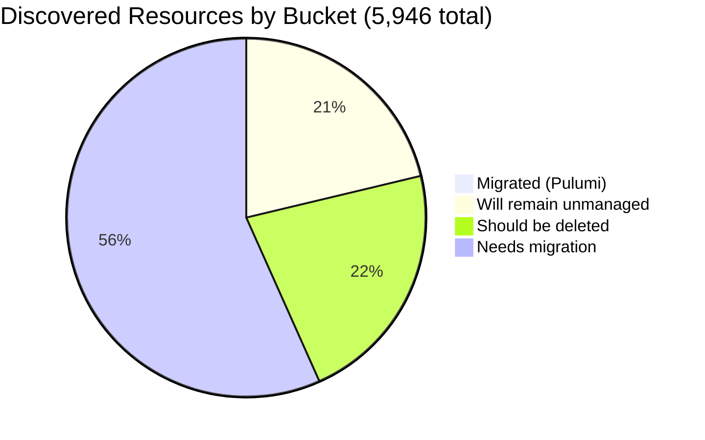

# Pulumi Insights Migration Report
**Organization:** `pequod` · **Generated:** 2026-06-29 · **Data freshness:** Jun 28–29, 2026 (except workshops, see §4)

---

## 1. Executive Summary

**Org-wide migration rate:**
░░░░░░░░░░░░░░░░░░░░ 1%

**5,946** total resources discovered across 5 Insights-enrolled accounts. **53** confirmed under Pulumi management. The `pequod` org is the Pulumi CE (Customer Engineering) team's shared demo and workshop estate — prolific IaC activity (543 stacks, 3,987 managed resources across all projects) but a large unmanaged tail in the enrolled cloud accounts. **The single biggest action item is deleting 1,064 orphaned `serverless-comp-*` IAM policies** that alone represent 18% of all discovered resources.

| Bucket | Count | % All Discovered | % Migratable |
|--------|------:|-----------------:|-------------:|
| ✅ Migrated (Pulumi-managed) | 53 | 0.9% | 1.1% |
| 🔒 Will remain unmanaged | ~1,253 | 21.1% | — |
| 🗑️ Should be deleted | ~1,300 | 21.9% | — |
| 🚧 Needs migration | ~3,340 | 56.2% | ~97.0% |
| **Total discovered** | **5,946** | | |

_Migratable base = 5,946 − 1,253 (will-remain) = 4,693._

> **Data-quality caveat:** 13 AWS regions in `aws-pulumi-ce-052848974346` had failed scans (af-south-1, ap-east-1, ap-south-2, ap-southeast-3, ap-southeast-5, ca-west-1, cn-north-1, cn-northwest-1, eu-central-2, eu-south-1, eu-south-2, me-central-1, me-south-1 — expected near-zero impact). `aws-pulumi-ce-workshops-420942475186` last scanned May 2025 — data is 13 months stale. Numbers for `aws-pulumi-ce-052848974346` are partly extrapolated from a 500-resource sample; `serverless-comp` and snapshot counts are exact from targeted queries. No resource tags were available for ownership attribution; naming convention mapping is used as proxy.

---

## 2. Migration Progress

### Org-wide four-bucket split

```
✅ Migrated          ░░░░░░░░░░░░░░░░░░░░  1%   (53 resources)
🔒 Will remain       ████░░░░░░░░░░░░░░░░ 21%   (~1,253 resources)
🗑️ Should delete     ████░░░░░░░░░░░░░░░░ 22%   (~1,300 resources)
🚧 Needs migration   ███████████░░░░░░░░░ 56%   (~3,340 resources)
```



### % Migrated by account

Migration % is uniformly low — this is a demo estate where cloud resources are created rapidly and rarely formalized into IaC.

```
aws-neo-eu-west-2-420942475186       ░░░░░░░░░░░░░░░░░░░░  0%  (0/133)
aws-pulumi-ce-052848974346           ░░░░░░░░░░░░░░░░░░░░  1%  (43/4,651)
aws-pulumi-ce-workshops-420942475186 ░░░░░░░░░░░░░░░░░░░░  1%  (2/230) ⚠️ stale
azure-team-ce-subscription           ░░░░░░░░░░░░░░░░░░░░  2%  (5/328)
google-pulum-ce-team-438338752289    ░░░░░░░░░░░░░░░░░░░░  1%  (3/604)
```

### % Migrated by responsible owner

_Ownership signal used: account owner (primary), resource-name prefix mapped to CE team member (secondary). Team mapping detailed in §6._

```
Mitch Gerdisch (MitchGerdisch)       ░░░░░░░░░░░░░░░░░░░░  1%  (~48/~5,100 attributable)
Robert Smith (rsmith-pulumi-corp)    ░░░░░░░░░░░░░░░░░░░░  0%  (0/133)
CE individuals (menfin, wladi, pk…)  ░░░░░░░░░░░░░░░░░░░░ ~1%  (~5/~550 attributable)
```

---

## 3. Momentum

| Metric | Value |
|--------|-------|
| Active stacks | 543 |
| Unique projects | 462 |
| Total resources under Pulumi IaC | 3,987 |
| Stacks with activity in last 30 days | 36 |

**Stacks last updated, by month** _(last-deploy timestamp; stack creation timestamps not available from API)_

```
Jun 2026 ████████████████████ 36  ← partial month; tracking to be busiest on record
May 2026 █████████████████░░░ 30
Apr 2026 ██████████████░░░░░░ 25
Mar 2026 ████████████████░░░░ 28
Feb 2026 █████████░░░░░░░░░░░ 16
Jan 2026 ████████░░░░░░░░░░░░ 15
Dec 2025 ███░░░░░░░░░░░░░░░░░  5  ← holiday dip
Nov 2025 ████████████████░░░░ 28
Oct 2025 █████████████░░░░░░░ 24
Sep 2025 █████░░░░░░░░░░░░░░░  9
Aug 2025 ████████████░░░░░░░░ 22
Jul 2025 ██████████░░░░░░░░░░ 18
Jun 2025 ███████░░░░░░░░░░░░░ 13
May 2025 ███████████░░░░░░░░░ 19
```
_(Bars scaled to 36, Jun 2026 max)_

**Takeaways:**
- Healthy pulse: H2 2025 and H1 2026 average ~24 stacks touched per month (excluding Dec dip).
- The org is in a **demo-creation pattern**, not a migration pattern. The 3,987 IaC-managed resources (top projects: `dmvhm-infrastructure` 1,282; `testEksLgAds` 453; `shared-dev-eks` 88) represent new infrastructure built with Pulumi — not yet reconciled against the 5,946 Insights-discovered resources.
- `aws-pulumi-ce-workshops-420942475186` has no scheduled scanning and no Pulumi activity in 13+ months; a fresh scan is overdue.

---

## 4. Coverage by Enrolled Account

> **Important:** Insights enrollment covers only these 5 accounts. Additional cloud accounts outside this list are invisible to this report; the true unmanaged footprint may be larger.

| Account | Cloud | Managed | Total Discovered | Coverage % | Last Scan | Notes |
|---------|-------|--------:|-----------------:|:----------:|-----------|-------|
| aws-neo-eu-west-2-420942475186 | AWS | 0 | 133 | ░░░░░░░░░░░░░░░░░░░░ 0% | 2026-06-29 | Workshop sandbox; owned by R. Smith |
| aws-pulumi-ce-052848974346 | AWS | 43 | 4,651 | ░░░░░░░░░░░░░░░░░░░░ 1% | 2026-06-28 | ⚠️ 13 regions failed scan |
| aws-pulumi-ce-workshops-420942475186 | AWS | 2 | 230 | ░░░░░░░░░░░░░░░░░░░░ 1% | **2025-05-28** | ⚠️ 13 months stale; scheduled scan disabled |
| azure-team-ce-subscription | Azure | 5 | 328 | ░░░░░░░░░░░░░░░░░░░░ 2% | 2026-06-29 | |
| google-pulum-ce-team-438338752289 | GCP | 3 | 604 | ░░░░░░░░░░░░░░░░░░░░ 1% | 2026-06-29 | Note: account name has typo (`pulum`) |

**Enrollment gaps:** Any additional AWS accounts used by CE members for customer demos, personal GCP projects, or other Azure subscriptions would add unmanaged resources not visible here. Re-enabling scheduled scanning for `aws-pulumi-ce-workshops-420942475186` is the highest-value immediate action for data completeness.

---

## 5. Data Analysis

> `aws-pulumi-ce-052848974346` will-remain and needs-migration are extrapolated from a 500-resource sample; should-delete counts (`serverless-comp`: 1,064 exact; snapshots: 176 exact; CFN stacks: 36 exact) are from targeted queries. All other accounts fully scanned.

| Account | Cloud | Total | ✅ Migrated | 🔒 Will Remain | 🗑️ Delete | 🚧 Needs Migration | % Migrated |
|---------|-------|------:|----------:|---------------:|----------:|-------------------:|----------:|
| aws-neo-eu-west-2-420942475186 | AWS | 133 | 0 | 99 | 5 | 29 | 0% |
| aws-pulumi-ce-052848974346 | AWS | 4,651 | 43 | ~800 | ~1,280 | ~2,528 | 1% |
| aws-pulumi-ce-workshops-420942475186 | AWS | 230 | 2 | 150 | 9 | 69 | 1% |
| azure-team-ce-subscription | Azure | 328 | 5 | 26 | 5 | 292 | 2% |
| google-pulum-ce-team-438338752289 | GCP | 604 | 3 | 178 | 1 | 422 | 1% |
| **TOTAL** | | **5,946** | **53** | **~1,253** | **~1,300** | **~3,340** | **1%** |

**Three noteworthy specifics:**
- **1,064 orphaned `serverless-comp-NNN-consumer-*` IAM policies** in `aws-pulumi-ce-052848974346/global` are the dominant noise source — sequential numbered artifacts from an old serverless component demo series, never cleaned up. Deleting these alone cuts the "needs attention" count by 22%.
- **`aws-pulumi-ce-052848974346/global` holds 1,689 resources** — the single heaviest sub-account — but most are AWS platform scaffolding (service-linked roles, CloudFront managed policies) or the serverless-comp orphans; the true active-workload migration queue is materially smaller than the raw numbers suggest.
- **GCP offers the richest single-account migration opportunity** outside the primary AWS account: 422 needs-migration resources including 90 custom subnetworks, 33 GCS buckets, 13 Workload Identity Pools, 11 backend services, and 11 DNS record sets — all active demo infrastructure.

---

## 6. Actions Needed

### Migration Queue by Team

**Ownership mapping assumptions** (resource-name prefix → CE team member, validated against account owners from `ListAccounts` API):

| Prefix pattern | Mapped to |
|---------------|-----------|
| `menfin-*`, `pulumi-*menfin*` | menfin |
| `vnet-dbw-*`, `rg-dbw-*`, `nsg-dbw-*` | wladi (Databricks specialist) |
| `pk-*`, `piers-*` | pk / Piers |
| `pulumi-esc-ediri*` | ediri |
| `zbuchheit*` | zbuchheit |
| `mtan*`, `pulumi-oidc-mtan*` | mtan |
| `shared-*`, `workshop*`, account-level resources | Mitch Gerdisch (account owner) |
| Everything else | Mitch Gerdisch (fallback: account owner) |

---

#### Mitch Gerdisch (`MitchGerdisch`) — ~2,900 resources to migrate

Owns `aws-pulumi-ce-052848974346` (bulk), `aws-pulumi-ce-workshops-420942475186`, and `google-pulum-ce-team-438338752289`.

| Resource | Account/Region | Why it matters |
|----------|---------------|----------------|
| EKS cluster + VPC networking, us-west-2 | aws-pulumi-ce | 43 resources already managed — expand `shared-dev-eks` project to cover remaining ec2/network infra in the same VPC |
| S3 buckets + access blocks (~26 us-east-1, ~33 us-west-2) | aws-pulumi-ce | Active demo buckets with high reuse across demos |
| `workshops.pulumi-ce.team` Route53 zone + records | aws-neo-eu-west-2 | Shared workshop DNS — critical, high blast radius if misconfigured |
| Lambda `lambda-for-account-cleanup` + IAM | aws-neo-eu-west-2 | Operational automation script; belongs in IaC |
| 36 CloudFormation stacks | aws-pulumi-ce (multi-region) | `example-cluster-*`, `argo-example-*`, `demo-ecs-lt-*`, `megan-cluster`, `pulumi-selfhosted-01-*`, etc. — migrate or destroy |
| GCP: 90 custom subnetworks, 33 buckets, 11 backend services | gcp account | Main GCP migration opportunity; group by project (`mitchselfhosted`, `my-demo-network`, `zendesk-domestic`) |

---

#### Robert Smith (`rsmith-pulumi-corp`) — 29 resources to migrate (`aws-neo-eu-west-2`)

| Resource | Type | Recommended action |
|----------|------|--------------------|
| `workshops.pulumi-ce.team` zone + NS + SOA records | Route53 | High priority — import into workshop-infra Pulumi project |
| `workshop-instructor-role` + `AdminWorkshop` role | IAM Roles | Import into workshop-infra project |
| `ContinuousDeliveryAdminRole` | IAM Role | Import or confirm still needed |
| `pulumi-esc-oidc-paul-umi-AdministratorAccess-role` | IAM Role | Import into ESC access project |
| KMS key `be144c85` + 2 budgets | KMS / Budgets | Import into account-baseline project |
| Bedrock harness role (`AmazonBedrockAgentCoreHarnessDefaultServiceRole`) + policy | IAM | Import if actively used; delete if one-off test |

---

#### CE individuals — ~60 resources (spread across GCP and Azure accounts)

| Owner | Key resources | Count | Action |
|-------|--------------|------:|--------|
| **menfin** | `menfin-demo-*` subnetworks, OIDC pools, GCS buckets, secrets | ~25 | Import into personal or shared Pulumi project |
| **wladi** | `vnet-dbw-*`, `rg-dbw-*`, `nsg-dbw-*` Azure Databricks VNets/NSGs/RGs | ~20 | Import into a `dbw-infra` Pulumi project |
| **pk / Piers** | `pk-demo-kv` Azure Key Vault, `pk-gitlab-pool-*` GCP WI provider | ~8 | Import into ESC/demo Pulumi project |
| **mtan** | `pulumi-oidc-mtan` GCP WI pool + SA | ~5 | Import into personal ESC project |
| **ediri** | `pulumi-esc-ediri` AWS IAM role + 3 policy attachments | 4 | Import into ESC access project |

---

### Deletion Candidates

> Recommend human review before deleting. Grouped by pattern; framed as suggestions only.

| Pattern | Exact Count | Account(s) | Reason |
|---------|------------:|----------|--------|
| `serverless-comp-NNN-consumer-*` IAM policies | **1,064** | aws-pulumi-ce/global | Orphaned workshop demo artifacts — sequential numbered (up to 742+); no attached principals expected |
| RDS cluster snapshots | **176** | aws-pulumi-ce (multi-region) | Accumulated automated snapshots from abandoned demo RDS clusters; oldest from 2021. Review retention and configure lifecycle. |
| CloudFormation stacks (stale) | ~20 of 36 | aws-pulumi-ce (multi-region) | `example-cluster-*`, `argo-example-*`, `demo-ecs-lt-autoscaleg-*`, `pulumi-selfhosted-01-*`, `MyWidgetServiceStack`, `megan-cluster` — demo-era stacks from 2021–2023; migrate or destroy. `CDKToolkit` stacks may be needed for CDK comparison demos. |
| `mitch-assumerole-test*` (S3 bucket + IAM policy + role + attachments) | 5 | workshops, neo | Explicit test name pattern, unused |
| `zbuchheit-oidc` role + attachment + `zbuchheit-bucket-*` | 5 | workshops | Personal stale resources; owner absent from recent activity |
| `this-is-a-test-foobar-4e80c` S3 bucket + 2 siblings | 3 | aws-pulumi-ce/eu-west-1 | Explicit test name |
| `piers-resourcegroup-12345` Azure RG | 1 | azure | Sequentially numbered test resource |
| `rs-test`, `jamesneotest433` (x2), `elisabeth-test` Azure RGs + resources | 4 | azure | Explicit test names |
| `piers-test-bucket` GCP | 1 | gcp | Test name |

**Total deletion candidates: ~1,279** (dominated by 1,064 serverless-comp policies)

---

### Unattributed Resources (assign an owner before migrating)

| Resource | Account | Issue |
|----------|---------|-------|
| `beacon-platform-v1c098aee5` Azure RG + related | azure | `beacon-platform` pattern doesn't match any known CE naming convention — assign an owner |
| `initech-identity-pool` GCP WI pool | gcp | "Initech" is a shared CE demo persona; multiple members may have created this — resolve to one owner |
| `synapse` Azure RG | azure | No context; unknown owner — check Azure RBAC for creator |
| `vnet-hub-dev` + `workers-*` Azure VNet/NSG | azure | Platform-style names with no owner tag |
| `pulumi-aca-webapp-*` Azure RG | azure | ACA demo, no individual prefix |
| ~280 unnamed IAM policies in `aws-pulumi-ce/global` | aws | Auto-generated names beyond the serverless-comp series — require AWS tag inspection to attribute |

> **Tag coverage note:** Resource tags were not available through the Insights search API. Running `aws resourcegroupstaggingapi get-resources`, `az resource list --output table`, and `gcloud asset search-all-resources` would resolve most of the ~280 unattributed AWS global resources and confirm the `beacon-platform` and `synapse` Azure owners.

---

_Report generated by Pulumi Neo. Classification based on resource names, types, and account ownership signals. All counts exact except where marked ~. Percentages may not sum exactly due to rounding. "~" indicates extrapolated values; exact counts are from targeted API queries._
