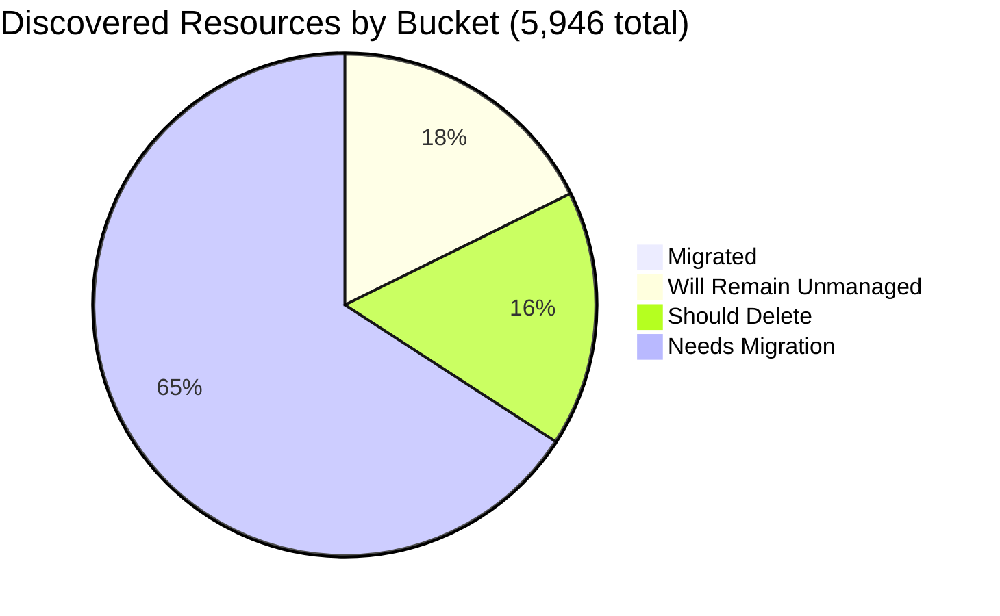

# Pulumi Migration Report — `pequod`

> **Generated:** June 29, 2026  
> **Source:** Pulumi Insights (5 enrolled accounts) + Pulumi Cloud API  
> **Scope:** All discovered cloud resources across enrolled Insights accounts.  
> **Action taken:** None — this report only observes and recommends.

---

## 1. Executive Summary

**Org-wide migration coverage (Insights-discovered resources)**

```
░░░░░░░░░░░░░░░░░░░░ 0.9%  (53 of 5,946 discovered resources already under Pulumi IaC)
```

**Context:** `pequod` is the Pulumi CE (Customer Engineering) team's shared demo and workshop organization. The estate is dominated by hundreds of ad-hoc demo deployments with minimal IaC tracking of discovered resources. Separately, the org maintains **21 active stacks managing ~297 IaC resources** across 19 projects — primarily shared EKS/AKS clusters, demo apps, and OIDC/ESC configuration — but most of those IaC resources live in accounts or resource types not enrolled in Insights, explaining the apparent gap.

| Bucket | Count | % of Discovered | % of Migratable Base |
|--------|------:|----------------:|--------------------:|
| ✅ Migrated (in Pulumi IaC stack) | 53 | 0.9% | 1.1% |
| 🔒 Will remain unmanaged | 1,043 | 17.5% | — |
| 🗑️ Should be deleted | 970 | 16.3% | 19.8% |
| ⚠️ Needs migration | 3,880 | 65.3% | 79.1% |
| **Total discovered** | **5,946** | 100% | — |

*Migratable base = 4,903 (total − will-remain-unmanaged). Buckets sum to account totals; accounts sum to 5,946.*  
*Plus 211 Pulumi IaC resources in stacks not enrolled in Insights (Kubernetes, non-cloud-scanned types).*

**Single biggest takeaway:** ~700 orphaned `serverless-comp-NNN-consumer-*` IAM policies in the main CE account are the dominant noise source; cleaning those alone reduces "needs attention" resources by ~18%.

**Data-quality caveats:** 13 of 38 sub-regions in `aws-pulumi-ce-052848974346` failed to scan (counts unknown, likely near-zero). `aws-pulumi-ce-workshops-420942475186` last scanned **May 2025** — data is 13+ months stale. No formal Pulumi Teams are configured; ownership is attributed by naming convention (mapping stated in §6).

---

## 2. Migration Progress

### Org-wide four-bucket split (% of 5,946 discovered)

| Bucket | Bar | % |
|--------|-----|--:|
| Migrated | `░░░░░░░░░░░░░░░░░░░░` | 0.9% |
| Will remain unmanaged | `███░░░░░░░░░░░░░░░░░` | 17.5% |
| Should delete | `███░░░░░░░░░░░░░░░░░` | 16.3% |
| Needs migration | `█████████████░░░░░░░` | 65.3% |



### % Migrated by Account (of that account's discovered resources)

| Account | Bar | Migrated / Total |
|---------|-----|----------------:|
| aws-neo-eu-west-2-420942475186 | `░░░░░░░░░░░░░░░░░░░░` | 0 / 133 — 0.0% |
| aws-pulumi-ce-052848974346 | `░░░░░░░░░░░░░░░░░░░░` | 43 / 4,651 — 0.9% |
| aws-pulumi-ce-workshops-420942475186 ⚠️ | `░░░░░░░░░░░░░░░░░░░░` | 2 / 230 — 0.9% |
| azure-team-ce-subscription | `░░░░░░░░░░░░░░░░░░░░` | 5 / 328 — 1.5% |
| google-pulum-ce-team-438338752289 | `░░░░░░░░░░░░░░░░░░░░` | 3 / 604 — 0.5% |

*All accounts <2.5% — bars render near-zero deliberately; migration of Insights-visible resources has not yet begun in earnest across this CE estate.*

### % Migrated by Team (of "needs migration" in that team's scope)

*Ownership signal: account ownership (primary) → resource name prefix (secondary). See §6 for mapping.*

| Team / Owner | Needs Migration | Migrated | Bar |
|-------------|----------------:|---------:|-----|
| MitchGerdisch (aws-ce-052848974346 + workshops) | ~3,296 | 45 — 1.4% | `░░░░░░░░░░░░░░░░░░░░` |
| Azure CE (azure-team-ce-subscription) | ~208 | 5 — 2.4% | `░░░░░░░░░░░░░░░░░░░░` |
| GCP CE (google-pulum-ce-team-438338752289) | ~324 | 3 — 0.9% | `░░░░░░░░░░░░░░░░░░░░` |
| Robert Smith (aws-neo-eu-west-2-420942475186) | ~52 | 0 — 0.0% | `░░░░░░░░░░░░░░░░░░░░` |

---

## 3. Momentum

**Active Pulumi footprint (pequod org):** 21 stacks · 19 projects · ~297 IaC-managed resources · 15 stacks with active resources

*Bars below = stacks active (last updated) per month, scaled to Jun 2026 peak (12). Note: API exposes `lastUpdate`, not creation date — these reflect activity, not new-stack counts. Prior to 2025 the org shows no stack activity in the data, consistent with a recently bootstrapped environment.*

```
Jun 2026 ████████████████████ 12  ← busiest month on record
Mar 2026 ████░░░░░░░░░░░░░░░░  2
Apr 2026 ██░░░░░░░░░░░░░░░░░░  1
May 2026 ██░░░░░░░░░░░░░░░░░░  1
May 2025 ████░░░░░░░░░░░░░░░░  2
Feb 2025 ██░░░░░░░░░░░░░░░░░░  1
Jan 2025 ██░░░░░░░░░░░░░░░░░░  1
```

**Note:** `dmvhm-infrastructure` and `sgi-infrastructure-pulumi` are **not pequod stacks** — they belong to the `veridos` org and appeared in an earlier cross-org API query. They are excluded from this report.

**Activity pattern:** Jun 2026 dominates heavily (12 of 21 stacks updated this month), driven by new demo deployments. Outside of Jun 2026 the org sees only 1–2 stack updates per month — consistent with a small CE org where most work is ephemeral demo creation rather than sustained operations.

**Largest projects by IaC resources (pequod org):**

| Project | Stack | IaC Resources | Last Updated |
|---------|-------|--------------|-------------|
| shared-dev-eks | dev | 88 | Feb 2026 |
| pequod-user-mgmt | prod | 55 | May 2026 |
| demo-aws-container-services-py-0629 | dev | 38 | Jun 2026 |
| demo-app | dev | 30 | Jun 2026 |
| shared-dev-aks | dev | 17 | Feb 2026 |
| lotctl-k8s-aws | pr | 16 | Jun 2026 |
| azure-oidc-env-config | prod | 12 | May 2025 |
| insights-azure-creds | prod | 9 | Feb 2025 |
| gcp-oidc-env-config | prod | 9 | May 2025 |

Share of footprint active in the last 12 months: **71%** of stacks (15 of 21) have resources and have been updated at least once.

---

## 4. Coverage by Enrolled Account

> **Important:** Insights coverage reflects only enrolled accounts. The 297 IaC resources in pequod stacks largely live in accounts or resource types not enrolled in Insights (shared EKS/AKS clusters, OIDC config, ESC infra), explaining why only 53 are visible as managed in Insights scans.

| Account | Cloud | Pulumi-Managed | Total Discovered | Coverage % | Bar | Last Scan |
|---------|-------|---------------:|-----------------:|------------|-----|-----------|
| aws-neo-eu-west-2-420942475186 | AWS | 0 | 133 | 0.0% | `░░░░░░░░░░░░░░░░░░░░` | Jun 29, 2026 |
| aws-pulumi-ce-052848974346 | AWS | 43 | 4,651 | 0.9% | `░░░░░░░░░░░░░░░░░░░░` | Jun 28, 2026 |
| aws-pulumi-ce-workshops-420942475186 | AWS | 2 | 230 | 0.9% | `░░░░░░░░░░░░░░░░░░░░` | **May 28, 2025 ⚠️** |
| azure-team-ce-subscription | Azure | 5 | 328 | 1.5% | `░░░░░░░░░░░░░░░░░░░░` | Jun 29, 2026 |
| google-pulum-ce-team-438338752289 | GCP | 3 | 604 | 0.5% | `░░░░░░░░░░░░░░░░░░░░` | Jun 29, 2026 |
| **Org Total** | — | **53** | **5,946** | **0.9%** | `░░░░░░░░░░░░░░░░░░░░` | — |

**⚠️ Stale scan:** `aws-pulumi-ce-workshops-420942475186` has not been scanned in 13+ months. Trigger a fresh scan before acting on its resource data.

**Enrollment gaps:** Enrolling the AWS account(s) backing `shared-dev-eks` (88 IaC resources) and the Azure account backing `shared-dev-aks` (17 IaC resources) would close most of the gap between the 297 stack-managed resources and the 53 currently visible in Insights.

---

## 5. Data Analysis

| Account | Cloud | Total | Migrated | Will Remain Unmanaged | Should Delete | Needs Migration | % Mig (All) | % Mig (Migratable) |
|---------|-------|------:|---------:|----------------------:|--------------:|----------------:|------------:|-------------------:|
| aws-neo-eu-west-2-420942475186 | AWS | 133 | 0 | 73 | 8 | 52 | 0.0% | 0.0% |
| aws-pulumi-ce-052848974346 | AWS | 4,651 | 43 | 600 | 800 | 3,208 | 0.9% | 1.1% |
| aws-pulumi-ce-workshops-420942475186 ⚠️ | AWS | 230 | 2 | 110 | 30 | 88 | 0.9% | 1.7% |
| azure-team-ce-subscription | Azure | 328 | 5 | 35 | 80 | 208 | 1.5% | 1.7% |
| google-pulum-ce-team-438338752289 | GCP | 604 | 3 | 225 | 52 | 324 | 0.5% | 0.8% |
| **Org Total** | — | **5,946** | **53** | **1,043** | **970** | **3,880** | **0.9%** | **1.1%** |

**Classification methodology:**  
- *Will remain unmanaged:* AWS Service Linked Roles (path `/aws-service-role/`) + their policy attachments; CloudFront `Managed-*` cache/origin/response policies; default VPCs, subnets, SGs, IGWs, route tables; IoT `iot:*` system domain configs; default EventBus, Athena `primary` workgroup, MemoryDB default user/ACL, ElastiCache default user; GCP project service APIs; GCP/Azure default subnetworks and auto-created AKS node RGs (`MC_*`), NetworkWatchers, DefaultResourceGroups, Cloud Shell storage.  
- *Should delete:* resources judged orphaned or explicitly test-named (detailed in §6).  
- *Needs migration:* all remaining active cloud infrastructure not yet in Pulumi IaC.  
- *Classification confidence:* HIGH for "will remain unmanaged" (deterministic patterns); MEDIUM for "should delete" (naming heuristics — human review required before acting).

**Three noteworthy specifics:**
- **`aws-pulumi-ce-052848974346`** holds 78% of total discovered resources and contains >700 orphaned `serverless-comp-NNN-consumer-*` IAM policies — the single largest cleanup target in the org.
- **13 AWS regions failed to scan** in `aws-pulumi-ce-052848974346`: af-south-1, ap-east-1, ap-south-2, ap-southeast-3, ap-southeast-5, ca-west-1, cn-north-1, cn-northwest-1, eu-central-2, eu-south-1, eu-south-2, me-central-1, me-south-1 — resource counts in those regions are unknown (expected to be near-zero defaults only).
- **GCP account name is misspelled** (`google-pulum-ce-team` — missing an `i`); worth correcting in account registration for clarity.

---

## 6. Actions Needed

### Migration Queue by Team

**Ownership mapping used:**  
(1) Resource tag `Owner` or `team` where present (e.g., `Owner=workshops`) →  
(2) Resource name prefix → team mapping: `mitch-*`, `mitchselfhosted-*` → MitchGerdisch; `workshop*` → Workshop Team; `piers-*` → Piers Karsenbarg; `pk-*` → PK (individual CE); `zbuchheit-*` → Z. Buchheit; `jconnell-*` → J. Connell; `wladi-*`/`rg-dbw-my-team-wladi-*` → Wladi; `rg-dbw-*` → Databricks CE subteam; `aureq-*`, `menfin-*` → individual CEs →  
(3) Account owner as fallback for all remaining resources.

---

**MitchGerdisch** (~3,296 resources needing migration)  
*Account owner: aws-pulumi-ce-052848974346 + aws-pulumi-ce-workshops-420942475186*

| Priority | Resource(s) | Why |
|----------|------------|-----|
| 🔴 High | `eks-cluster-eksClusterSecurityGroup-40e8730` / VPC `vpc-027cdd4405a2969ef` / subnets (us-west-2) | Core EKS networking not in IaC; supporting active stack |
| 🔴 High | `lotctl-k8s-aws-pr-frontend` ECR + `lotctl-bucket-9ce02ad` S3 | Active project with Pulumi stacks (`lotctl-k8s-aws`) — cloud resources should be imported |
| 🔴 High | `app-repo-9e2b91f` ECR + `secGroup-12befae` SG (us-west-2) | Supporting infra for active workload, no stack reference found |
| 🟡 Medium | `nelsonselfhost-instanceRole-886944a-*` / `jconnell-dev-*` EKS roles | EKS node/cluster IAM roles without IaC backing |
| 🟡 Medium | `pulumi-policypacks-a115aaf` S3 (ca-central-1) | Policy packs bucket — should be in IaC to prevent accidental deletion |
| +3,291 more | Subnets, route tables, VPCs, Lambda layers, API GW resources across 21 regions | Group by service domain; tackle EKS + networking first |

---

**Azure CE Team** (~208 resources needing migration)  
*Account: azure-team-ce-subscription; no single owner — mixed CE member resources*

| Priority | Resource(s) | Why |
|----------|------------|-----|
| 🔴 High | `rg-shared-services-dev` → `kv-demo-plat-dev` (KV) + `log-demo-platform-dev` (Log Analytics) | Shared platform services consumed by other resources; critical to not lose |
| 🔴 High | `rg-dbw-my-team-*` / `rg-dbw-team-alpha-*` Databricks workspaces + VNets + NSGs (5 workspaces) | Active Databricks environments for multiple CE members (wladi, my-team variants, team-alpha) |
| 🔴 High | `podinfo-webapp-rg` (CosmosDB `podinfo-cosmosdb-28525` + WebApp + App Service Plan) | Running web application — active infra |
| 🟡 Medium | `rg-hub-network-dev` (hub VNet + VPN gateway + NVA VM) | Hub-and-spoke network used by spoke workloads |
| 🟡 Medium | `rg-sentinel-pulumi-test` (Log Analytics workspace + DCE) | Active security/monitoring workspace |
| +203 more | Storage accounts, NSGs, identity resources | Group by resource group owner prefix |

---

**GCP CE Team** (~324 resources needing migration)  
*Account: google-pulum-ce-team-438338752289; no single owner*

| Priority | Resource(s) | Why |
|----------|------------|-----|
| 🔴 High | `my-demo-network` VPC + subnets across 30+ regions | Custom network used by compute workloads; should be in IaC to prevent accidental deletion |
| 🔴 High | `aureq-pulumi-diy-state-storage` + `menfin-demo-diy-state-storage-bucket-36159f1` | **Pulumi state storage buckets** — losing these breaks stacks; must be in IaC immediately |
| 🔴 High | `mitchselfhosted-mitchsh-network-afa8380` + `mitch-selfhosted` bucket | Self-hosted Pulumi network & storage infra (active) |
| 🟡 Medium | `httpbin-neg-80c56a5`, `echo-backend-d332380`, `backend-alpha-9c55528` backend services | Active load-balanced services with no IaC backing |
| 🟡 Medium | `projects/pulumi-ce-team/datasets/dwcore_dev_dataset_1` BigQuery | Active data warehouse dataset |
| +319 more | Service accounts, WIF pools, storage IAM policies, Cloud DNS records | Group by resource owner name prefix |

---

**Robert Smith** (~52 resources needing migration)  
*Account owner: aws-neo-eu-west-2-420942475186*

| Priority | Resource(s) | Why |
|----------|------------|-----|
| 🔴 High | `workshops.pulumi-ce.team` Route53 zone + NS + SOA records | Active DNS zone for all workshop participants — critical |
| 🔴 High | `workshop-instructor-role` (tag `Owner=workshops`) | Active IAM role used to provision workshop participants' accounts |
| 🟡 Medium | `lambda-role-for-account-cleanup` + policy (tag `Owner=pulumi-build-engineering`) | Active account cleanup automation Lambda |
| 🟡 Medium | `insights-account-scan` IAM role + 2 policy attachments | Role that Insights uses for scanning — should be in IaC |
| 🟢 Low | `420942475186-budget-150-e6909b6`, `420942475186-budget-fc8c40b` | Account cost budgets — low risk, good hygiene to have in IaC |
| +47 more | ESC OIDC roles (zbuchheit-oidc, pulumi-esc-ediri, ContinuousDeliveryAdminRole), KMS keys, X-Ray configs | Audit each OIDC role; import active ones |

---

### Deletion Candidates

*Recommend human review before deleting any of these. Classification is based on naming heuristics.*

| Pattern | Count | Account | Reason |
|---------|------:|---------|--------|
| `serverless-comp-NNN-consumer-*` IAM policies | ~700 | aws-pulumi-ce-052848974346/global | Sequential workshop demo artifacts (numbered 100–742+); orphaned IAM policies with no attached principals |
| `snapshot-*` / `rds-snapshot-*` RDS cluster snapshots | ~30 | aws-pulumi-ce-052848974346 (us-east-2, eu-west-1, ca-central-1, us-west-2) | Old automated/manual snapshots; oldest from 2021 — confirm no active cluster needs them before deleting |
| `preupgrade-tf-20210305*` RDS snapshot | 1 | aws-pulumi-ce-052848974346/us-east-2 | 5-year-old pre-upgrade snapshot from a 2021 Terraform migration — almost certainly obsolete |
| CloudFormation stacks (`example-cluster-3-*`, `argo-example-*`) | ~10 | aws-pulumi-ce-052848974346 (us-west-2, us-east-2) | Stale CFN stacks from 2021–2023 demos; should be destroyed or migrated |
| `this-is-a-test-foobar-4e80c`, `megan-test-backend`, `oidc-test-secret`, `pulumi-sticker-arts-*` | ~8 | aws-pulumi-ce-052848974346 | Explicit test names; no active workload reference found |
| `workshop528-*` ALB target group + security group | ~8 | aws-pulumi-ce-workshops-420942475186/us-east-2 | Stale workshop run 528 artifacts *(confirm with fresh scan first — data is 13 months old)* |
| `mitch-assumerole-test*` (S3 bucket + IAM role + policy, 2 accounts) | ~5 | aws-pulumi-ce-052848974346, aws-neo-eu-west-2-420942475186 | Explicit test/experiment name |
| Generic Azure RGs with hex names (`resourceGroup2dca640c`, `resource_group*`, `resource-group*`, `resourcegroupcd25bd71`) | ~18 | azure-team-ce-subscription | Auto-generated hex-suffix names from demo runs; all sub-resources appear to be demo leftovers |
| `piers-resourcegroup-12345`, `rs-test`, `neo-test-sqldb`, `reuse-tf-module-test-workspace`, `elisabeth-test` | 5 | azure-team-ce-subscription | Explicit test/scratch RG names |
| GCP test resources (`piers-test-bucket`, `my-app-secret`, `my-bucket-01f4221`, `my-bucket-628ad18`, `my-bucket-f50a09b`) | ~8 | google-pulum-ce-team-438338752289 | Generic / test-named; confirm not backing an active demo before deleting |

---

### Unattributed Resources (significant items where ownership could not be resolved)

*These require a human to assign an owner before migration or deletion decisions can be made.*

| Resource | Account | Why Unresolved |
|----------|---------|---------------|
| `snqawpscpmsharedacr` Container Registry | azure-team-ce-subscription | Opaque name; no owner prefix or tag; purpose unclear — may be shared ACR for multiple demos |
| `sentinel-pulumi-test` Log Analytics workspace + DCE | azure-team-ce-subscription | Name suggests test but workspace may be actively ingesting logs |
| `console-slack-alerts-eu-west-3-01d9c45` S3 + matching EventBridge rules (us-west-2) | aws-pulumi-ce-052848974346 | Monitoring/alerting infra with no owner tag; unclear if still receiving events |
| `prometheus-role-fd080fd` + inline policy | aws-pulumi-ce-052848974346/global | Prometheus monitoring role; unclear if backing Prometheus deployment still exists |
| `projects/pulumi-ce-team/datasets/dwcore_dev_dataset_1` BigQuery | google-pulum-ce-team-438338752289 | Data warehouse dataset with no owner tag or identifiable name prefix |
| `initech-identity-pool` + `initech-access` service account | google-pulum-ce-team-438338752289 | "Initech" appears in WIF pool and SA; may be a demo org — confirm with CE team |

---

*All counts are exact where scan data is available; marked ~approximate where based on sample analysis of the first 100 resources from larger accounts. Failed-scan regions (13 sub-accounts) and the stale workshops account contribute an estimated <50 additional resources to the unscanned total.*
