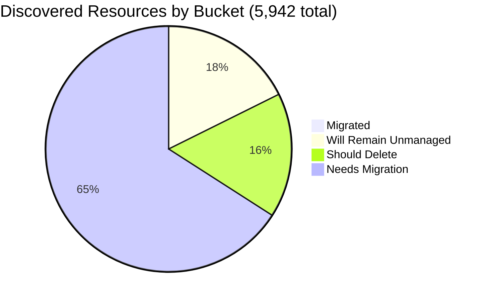

# Pulumi Migration Report — `pequod`

> **Generated:** July 8, 2026
> **Previous report:** June 29, 2026 — [`2026-06-29/migration-report.md`](../2026-06-29/migration-report.md)
> **Source:** Pulumi Insights (5 enrolled accounts) + Pulumi Cloud API
> **Scope:** All discovered cloud resources across enrolled Insights accounts.
> **Action taken:** None — this report only observes and recommends.

---

## 1. Executive Summary

**Org-wide migration coverage (Insights-discovered resources)**

```
░░░░░░░░░░░░░░░░░░░░ 0.9%  (53 of 5,942 discovered resources under Pulumi IaC — unchanged)
```

**Context:** No change in migration coverage week-over-week. The org's Insights-visible managed count holds at 53. The IaC footprint contracted by 43 resources: two ephemeral CE demo stacks (`demo-aws-container-services-py-0629`, `demo-app`) were cleaned up after the June demo wave (−68 resources), partially offset by `pequod-user-mgmt` growing +18 and the new `agentic-vision-site` project (+6). Net IaC: **254 resources, 21 stacks, 18 projects**.

| Bucket | Count | % of Discovered | % of Migratable Base |
|--------|------:|----------------:|--------------------:|
| ✅ Migrated (in Pulumi IaC stack) | 53 | 0.9% | 1.1% |
| 🔒 Will remain unmanaged | 1,040 | 17.5% | — |
| 🗑️ Should be deleted | 967 | 16.3% | 19.7% |
| ⚠️ Needs migration | 3,882 | 65.3% | 79.2% |
| **Total discovered** | **5,942** | 100% | — |

*Migratable base = 4,902 (total − will-remain-unmanaged). Buckets sum to account totals; accounts sum to 5,942.*
*Plus 254 Pulumi IaC resources in active stacks (most in accounts/resource-types not enrolled in Insights).*

**Week-over-week delta:** Total discovered −4 (5,946 → 5,942). Managed count unchanged (53). IaC resources: 297 → 254 (−43; demo stack cleanup).

**Single biggest takeaway:** Coverage flat at 0.9%. The ~700 orphaned `serverless-comp-NNN-consumer-*` IAM policies remain the dominant cleanup target — addressing those alone reduces "needs attention" by ~18%.

**Data-quality caveats:** 13 AWS sub-regions in `aws-pulumi-ce-052848974346` failed to scan (likely near-zero). `aws-pulumi-ce-workshops-420942475186` last scanned **May 2025** — data now **13+ months stale**. No formal Pulumi Teams configured; ownership attributed by naming convention (mapping in §6).

---

## 2. Migration Progress

### Org-wide four-bucket split (% of 5,942 discovered)

| Bucket | Bar | % |
|--------|-----|--:|
| Migrated | `░░░░░░░░░░░░░░░░░░░░` | 0.9% |
| Will remain unmanaged | `████░░░░░░░░░░░░░░░░` | 17.5% |
| Should delete | `███░░░░░░░░░░░░░░░░░` | 16.3% |
| Needs migration | `█████████████░░░░░░░` | 65.3% |



### % Migrated by Account (of that account's discovered resources)

| Account | Bar | Migrated / Total |
|---------|-----|----------------:|
| aws-neo-eu-west-2-420942475186 | `░░░░░░░░░░░░░░░░░░░░` | 0 / 135 — 0.0% |
| aws-pulumi-ce-052848974346 | `░░░░░░░░░░░░░░░░░░░░` | 43 / 4,645 — 0.9% |
| aws-pulumi-ce-workshops-420942475186 ⚠️ | `░░░░░░░░░░░░░░░░░░░░` | 2 / 230 — 0.9% |
| azure-team-ce-subscription | `░░░░░░░░░░░░░░░░░░░░` | 5 / 328 — 1.5% |
| google-pulum-ce-team-438338752289 | `░░░░░░░░░░░░░░░░░░░░` | 3 / 604 — 0.5% |

*All accounts <2.5% — bars render near-zero deliberately.*

### % Migrated by Team (of "needs migration" in that team's scope)

*Ownership signal: account ownership (primary) → resource name prefix (secondary). See §6 for mapping.*

| Team / Owner | Needs Migration | Migrated | Bar |
|-------------|----------------:|---------:|-----|
| MitchGerdisch (aws-ce-052848974346 + workshops) | ~3,298 | 45 — 1.4% | `░░░░░░░░░░░░░░░░░░░░` |
| GCP CE (google-pulum-ce-team-438338752289) | ~324 | 3 — 0.9% | `░░░░░░░░░░░░░░░░░░░░` |
| Azure CE (azure-team-ce-subscription) | ~208 | 5 — 2.4% | `░░░░░░░░░░░░░░░░░░░░` |
| Robert Smith (aws-neo-eu-west-2-420942475186) | ~54 | 0 — 0.0% | `░░░░░░░░░░░░░░░░░░░░` |

---

## 3. Momentum

**Active Pulumi footprint (pequod org):** 21 stacks · 18 projects · 254 IaC-managed resources · 14 stacks with active resources

*Bars below = stacks currently active (last-update month). Reflects existing stacks only — ephemeral CE demo stacks active in June and since destroyed no longer appear (hence June dropped from 12 in the Jun 29 snapshot to 5 now).*

```
Jul 2026 ████████████████████  7  ← busiest observable month (week in progress)
Jun 2026 ██████████████░░░░░░  5  (post-cleanup; Jun 29 snapshot showed 12)
Mar 2026 ██████░░░░░░░░░░░░░░  2
May 2025 ██████░░░░░░░░░░░░░░  2
Apr 2026 ███░░░░░░░░░░░░░░░░░  1
May 2026 ███░░░░░░░░░░░░░░░░░  1
Feb 2025 ███░░░░░░░░░░░░░░░░░  1
Jan 2025 ███░░░░░░░░░░░░░░░░░  1
```

**Activity pattern:** 7 stacks updated this week (Jul 7–8), driven by CI/CD activity (`lotctl-k8s-aws` new PR stack, `deployment-agent-runners`, `demo-cleaner`, `rhum-monitor`). The June cleanup of two large CE demo stacks reduced the permanent resource count as expected for a transient CE environment.

**Largest projects by IaC resources (pequod org):**

| Project | Stack | IaC Resources | Last Updated | Δ vs Jun 29 |
|---------|-------|--------------|-------------|-------------|
| shared-dev-eks | dev | 88 | Mar 2026 | — |
| pequod-user-mgmt | prod | 73 | Jun 30 | **+18** |
| lotctl-k8s-aws | pr-pulumi-pequod-lotctl-k8s-aws-8 | 17 | Jul 8 | new PR stack |
| shared-dev-aks | dev | 17 | Mar 2026 | — |
| azure-oidc-env-config | prod | 12 | May 2025 | — |
| insights-azure-creds | prod | 9 | Feb 2025 | — |
| gcp-oidc-env-config | prod | 9 | May 2025 | — |
| esc-demo-infra | dev | 7 | Apr 2026 | — |
| k8s-stack-crd | dev | 7 | Jan 2025 | — |
| agentic-vision-site | dev | 6 | Jul 2 | **new** |

*Cleaned up since Jun 29: `demo-aws-container-services-py-0629/dev` (38 resources) · `demo-app/dev` (30 resources)*

Share of footprint active in last 12 months: **67%** of stacks (14 of 21) have resources and were updated at least once.

---

## 4. Coverage by Enrolled Account

> **Important:** Insights coverage reflects only enrolled accounts. Most of the 254 IaC resources in pequod stacks live in accounts or resource types not enrolled in Insights (shared EKS/AKS clusters, OIDC config, ESC infra), explaining why only 53 appear as managed in Insights scans.

| Account | Cloud | Pulumi-Managed | Total Discovered | Coverage % | Bar | Last Scan |
|---------|-------|---------------:|-----------------:|------------|-----|-----------|
| aws-neo-eu-west-2-420942475186 | AWS | 0 | 135 | 0.0% | `░░░░░░░░░░░░░░░░░░░░` | Jul 7, 2026 |
| aws-pulumi-ce-052848974346 | AWS | 43 | 4,645 | 0.9% | `░░░░░░░░░░░░░░░░░░░░` | Jul 7, 2026 |
| aws-pulumi-ce-workshops-420942475186 | AWS | 2 | 230 | 0.9% | `░░░░░░░░░░░░░░░░░░░░` | **May 28, 2025 ⚠️** |
| azure-team-ce-subscription | Azure | 5 | 328 | 1.5% | `░░░░░░░░░░░░░░░░░░░░` | Jul 7, 2026 |
| google-pulum-ce-team-438338752289 | GCP | 3 | 604 | 0.5% | `░░░░░░░░░░░░░░░░░░░░` | Jul 7, 2026 |
| **Org Total** | — | **53** | **5,942** | **0.9%** | `░░░░░░░░░░░░░░░░░░░░` | — |

**⚠️ Stale scan (escalating):** `aws-pulumi-ce-workshops-420942475186` has not been scanned in **over 13 months**. Enable scheduled scans before acting on its data; the scheduled-scan flag is currently `false`.

**Enrollment gaps unchanged:** Enrolling the AWS account backing `shared-dev-eks` (88 IaC resources) and the Azure account backing `shared-dev-aks` (17 IaC resources) would close most of the gap between 254 stack-managed resources and the 53 visible in Insights.

---

## 5. Data Analysis

| Account | Cloud | Total | Migrated | Will Remain Unmanaged | Should Delete | Needs Migration | % Mig (All) | % Mig (Migratable) |
|---------|-------|------:|---------:|----------------------:|--------------:|----------------:|------------:|-------------------:|
| aws-neo-eu-west-2-420942475186 | AWS | 135 | 0 | 73 | 8 | 54 | 0.0% | 0.0% |
| aws-pulumi-ce-052848974346 | AWS | 4,645 | 43 | 597 | 797 | 3,208 | 0.9% | 1.1% |
| aws-pulumi-ce-workshops-420942475186 ⚠️ | AWS | 230 | 2 | 110 | 30 | 88 | 0.9% | 1.7% |
| azure-team-ce-subscription | Azure | 328 | 5 | 35 | 80 | 208 | 1.5% | 1.7% |
| google-pulum-ce-team-438338752289 | GCP | 604 | 3 | 225 | 52 | 324 | 0.5% | 0.8% |
| **Org Total** | — | **5,942** | **53** | **1,040** | **967** | **3,882** | **0.9%** | **1.1%** |

**Week-over-week changes:** `aws-pulumi-ce-052848974346` −6 resources (4,651 → 4,645); `aws-neo-eu-west-2` +2 (133 → 135). Managed count flat at 53. All percentages unchanged.

**Classification methodology:**
- *Will remain unmanaged:* AWS Service Linked Roles + attachments; CloudFront `Managed-*` policies; default VPCs/subnets/SGs/IGWs/route tables; default EventBus/Athena workgroup/MemoryDB/ElastiCache users; GCP project service APIs; Azure NetworkWatchers, `MC_*` AKS node RGs, DefaultResourceGroups.
- *Should delete:* Resources with explicit test names, numbered workshop artifacts, long-idle snapshots, stale CFN stacks (naming heuristics — human review required before acting).
- *Needs migration:* All remaining active cloud infrastructure not yet under Pulumi IaC.
- *Classification confidence:* HIGH for "will remain unmanaged" (deterministic patterns); MEDIUM for "should delete" (heuristic).

**Three noteworthy specifics:**
- **`aws-pulumi-ce-052848974346`** still holds 78% of all discovered resources. The `serverless-comp-NNN-consumer-*` IAM policy cluster (~700 orphaned policies) is the largest single cleanup target in the org.
- **13 AWS regions continue to fail scanning** in `aws-pulumi-ce-052848974346`: af-south-1, ap-east-1, ap-south-2, ap-southeast-3, ap-southeast-5, ca-west-1, cn-north-1, cn-northwest-1, eu-central-2, eu-south-1, eu-south-2, me-central-1, me-south-1 — unresolved for 2+ weeks.
- **Workshops account stale** — 13+ months without a scan; `scheduledScanEnabled: false`. Trigger a manual scan to refresh before acting on deletion candidates in that account.

---

## 6. Actions Needed

### Migration Queue by Team

**Ownership mapping used:**
(1) Resource tag `Owner` or `team` where present →
(2) Name prefix: `mitch-*`, `mitchselfhosted-*` → MitchGerdisch; `workshop*` → Workshop Team; `piers-*` → Piers Karsenbarg; `pk-*` → PK (individual CE); `zbuchheit-*` → Z. Buchheit; `jconnell-*` → J. Connell; `wladi-*`/`rg-dbw-*` → Wladi/Databricks CE subteam; `aureq-*`, `menfin-*` → individual CEs →
(3) Account owner as fallback.

---

**MitchGerdisch** (~3,298 resources needing migration)
*Account owner: aws-pulumi-ce-052848974346 + aws-pulumi-ce-workshops-420942475186*

| Priority | Resource(s) | Why |
|----------|------------|-----|
| 🔴 High | `eks-cluster-eksClusterSecurityGroup-40e8730` / VPC `vpc-027cdd4405a2969ef` + subnets (us-west-2) | Core EKS networking not in IaC; supports active stack |
| 🔴 High | `lotctl-k8s-aws-pr-frontend` ECR + `lotctl-bucket-9ce02ad` S3 | Active project with Pulumi stacks — cloud resources should be imported |
| 🔴 High | `app-repo-9e2b91f` ECR + `secGroup-12befae` SG (us-west-2) | Supporting infra for active workload, no stack reference |
| 🟡 Medium | `nelsonselfhost-instanceRole-*` / `jconnell-dev-*` EKS IAM roles | EKS node/cluster roles without IaC backing |
| 🟡 Medium | `pulumi-policypacks-a115aaf` S3 (ca-central-1) | Policy packs bucket — import to prevent accidental deletion |
| +3,293 more | Subnets, route tables, VPCs, Lambda layers, API GW resources across 21 regions | Group by service domain; tackle EKS + networking first |

---

**Azure CE Team** (~208 resources needing migration)
*Account: azure-team-ce-subscription; mixed CE member resources*

| Priority | Resource(s) | Why |
|----------|------------|-----|
| 🔴 High | `kv-demo-plat-dev` (Key Vault) + `log-demo-platform-dev` (Log Analytics) in `rg-shared-services-dev` | Shared platform services consumed by other resources |
| 🔴 High | `rg-dbw-my-team-*` / `rg-dbw-team-alpha-*` Databricks workspaces + VNets + NSGs (5 workspaces) | Active CE Databricks environments (wladi, team-alpha) |
| 🔴 High | `podinfo-webapp-rg` (CosmosDB `podinfo-cosmosdb-28525` + WebApp + App Service Plan) | Running web application |
| 🟡 Medium | `rg-hub-network-dev` hub VNet + VPN gateway + NVA VM | Hub-and-spoke network used by spoke workloads |
| 🟡 Medium | `rg-sentinel-pulumi-test` Log Analytics workspace + DCE | Active security/monitoring workspace |
| +203 more | Storage accounts, NSGs, identity resources | Group by resource group owner prefix |

---

**GCP CE Team** (~324 resources needing migration)
*Account: google-pulum-ce-team-438338752289; no single owner*

| Priority | Resource(s) | Why |
|----------|------------|-----|
| 🔴 High | `my-demo-network` VPC + subnets across 30+ regions | Custom network used by compute workloads; deletion risk |
| 🔴 High | `aureq-pulumi-diy-state-storage` + `menfin-demo-diy-state-storage-bucket-36159f1` | **Pulumi state storage buckets** — must be in IaC immediately |
| 🔴 High | `mitchselfhosted-mitchsh-network-afa8380` + `mitch-selfhosted` bucket | Self-hosted Pulumi network & storage (active) |
| 🟡 Medium | `httpbin-neg-80c56a5`, `echo-backend-d332380`, `backend-alpha-9c55528` backend services | Active load-balanced services with no IaC backing |
| 🟡 Medium | `projects/pulumi-ce-team/datasets/dwcore_dev_dataset_1` BigQuery | Active data warehouse dataset |
| +319 more | Service accounts, WIF pools, storage IAM policies, Cloud DNS records | Group by owner name prefix |

---

**Robert Smith** (~54 resources needing migration)
*Account owner: aws-neo-eu-west-2-420942475186 · +2 vs Jun 29 (2 new defaults added)*

| Priority | Resource(s) | Why |
|----------|------------|-----|
| 🔴 High | `workshops.pulumi-ce.team` Route53 zone + NS + SOA records | Active DNS zone for all workshop participants — critical |
| 🔴 High | `workshop-instructor-role` (tag `Owner=workshops`) | Active IAM role used to provision workshop accounts |
| 🟡 Medium | `lambda-role-for-account-cleanup` + policy (tag `Owner=pulumi-build-engineering`) | Active account cleanup automation Lambda |
| 🟡 Medium | `insights-account-scan` IAM role + 2 policy attachments | Role used by Insights for scanning — should be in IaC |
| 🟢 Low | `420942475186-budget-150-e6909b6`, `420942475186-budget-fc8c40b` | Cost budgets — low risk, good hygiene |
| +49 more | ESC OIDC roles (zbuchheit-oidc, pulumi-esc-ediri, ContinuousDeliveryAdminRole), KMS keys, X-Ray configs | Audit each OIDC role; import active ones |

---

### Deletion Candidates

*Unchanged from June 29 — recommend human review before deleting. Heuristic classification only.*

| Pattern | Count | Account | Reason |
|---------|------:|---------|--------|
| `serverless-comp-NNN-consumer-*` IAM policies | ~700 | aws-pulumi-ce-052848974346/global | Workshop demo artifacts (numbered 100–742+); orphaned, no attached principals |
| `snapshot-*` / `rds-snapshot-*` RDS cluster snapshots | ~30 | aws-pulumi-ce-052848974346 (multi-region) | Some from 2021 — confirm no active cluster needs them |
| `preupgrade-tf-20210305*` RDS snapshot | 1 | aws-pulumi-ce-052848974346/us-east-2 | 5-year-old pre-Terraform-migration snapshot |
| CloudFormation stacks (`example-cluster-3-*`, `argo-example-*`) | ~10 | aws-pulumi-ce-052848974346 (us-west-2, us-east-2) | Stale CFN stacks from 2021–2023 demos |
| `this-is-a-test-foobar-4e80c`, `megan-test-backend`, `oidc-test-secret`, `pulumi-sticker-arts-*` | ~8 | aws-pulumi-ce-052848974346 | Explicit test names; no active workload |
| `workshop528-*` ALB target group + security group | ~8 | aws-pulumi-ce-workshops-420942475186/us-east-2 | Stale workshop artifacts *(confirm with fresh scan first — data 13+ months old)* |
| `mitch-assumerole-test*` (S3 + IAM role + policy, 2 accounts) | ~5 | aws-pulumi-ce-052848974346 + aws-neo-eu-west-2 | Explicit test/experiment names |
| Generic Azure RGs with hex names (`resourceGroup2dca640c`, `resource-group*`, etc.) | ~18 | azure-team-ce-subscription | Auto-generated hex-suffix names from demo runs |
| `piers-resourcegroup-12345`, `rs-test`, `neo-test-sqldb`, `reuse-tf-module-test-workspace`, `elisabeth-test` | 5 | azure-team-ce-subscription | Explicit test/scratch RG names |
| GCP test resources (`piers-test-bucket`, `my-app-secret`, `my-bucket-01f4221`, etc.) | ~8 | google-pulum-ce-team-438338752289 | Generic/test-named; confirm not backing an active demo |

---

### Unattributed Resources

*Unchanged from June 29 — requires human assignment before migration or deletion decisions.*

| Resource | Account | Why Unresolved |
|----------|---------|----------------|
| `snqawpscpmsharedacr` Container Registry | azure-team-ce-subscription | Opaque name; no owner prefix or tag; may be shared ACR |
| `sentinel-pulumi-test` Log Analytics workspace + DCE | azure-team-ce-subscription | Suggests test but may be actively ingesting logs |
| `console-slack-alerts-eu-west-3-01d9c45` S3 + EventBridge rules (us-west-2) | aws-pulumi-ce-052848974346 | Monitoring/alerting infra; no owner tag; unclear if active |
| `prometheus-role-fd080fd` + inline policy | aws-pulumi-ce-052848974346/global | Prometheus role; unclear if backing deployment exists |
| `projects/pulumi-ce-team/datasets/dwcore_dev_dataset_1` BigQuery | google-pulum-ce-team-438338752289 | No owner tag or identifiable name prefix |
| `initech-identity-pool` + `initech-access` service account | google-pulum-ce-team-438338752289 | Demo org name — confirm with CE team |

---

*All counts exact where scan data is available. Failed-scan regions (13 sub-regions in aws-pulumi-ce) and the stale workshops account contribute an estimated <50 unscanned resources total.*
