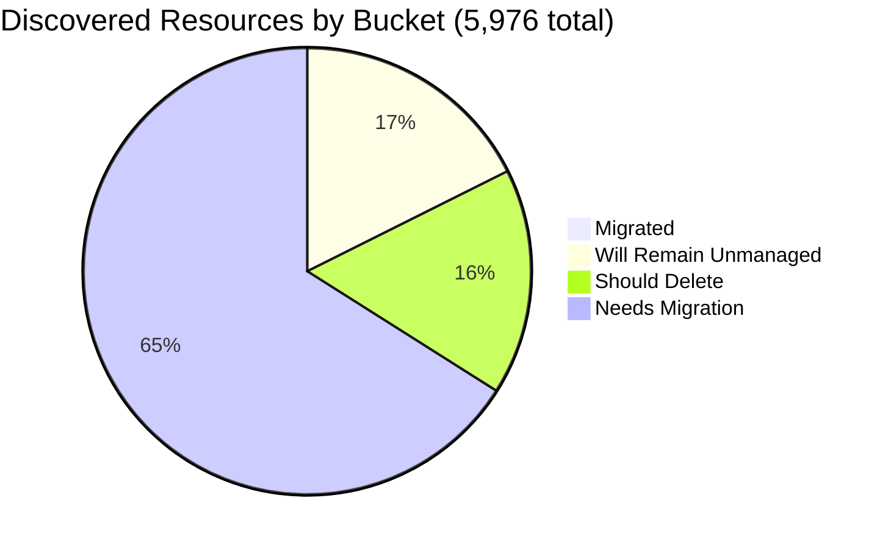

# Pulumi Migration Report — `pequod`

> **Generated:** July 10, 2026  
> **Prior report:** [June 29, 2026](../2026-06-29/migration-report.md)  
> **Source:** Pulumi Insights (5 enrolled accounts) + Pulumi Cloud API  
> **Scope:** All discovered cloud resources across enrolled Insights accounts.  
> **Action taken:** None — this report only observes and recommends.

---

## 1. Executive Summary

**Org-wide migration coverage (Insights-discovered resources)**

```
░░░░░░░░░░░░░░░░░░░░ 0.9%  (53 of 5,976 discovered resources already under Pulumi IaC)
```

**Context:** `pequod` is the Pulumi CE team's shared demo and workshop org. The estate is dominated by ad-hoc demo deployments; most IaC-managed resources live in accounts/resource types not enrolled in Insights. The org maintains **16 active stacks across 14 projects managing 228 IaC resources** (down from 21 stacks / 297 resources on Jun 29 — three demo stacks torn down, five new ones spun up this week).

| Bucket | Count | % of Discovered | % of Migratable Base |
|--------|------:|----------------:|--------------------:|
| ✅ Migrated (in Pulumi IaC stack) | 53 | 0.9% | 1.1% |
| 🔒 Will remain unmanaged | ~1,043 | 17.5% | — |
| 🗑️ Should be deleted | ~970 | 16.2% | 19.7% |
| ⚠️ Needs migration | ~3,910 | 65.4% | 79.3% |
| **Total discovered** | **5,976** | 100% | — |

*Migratable base = 4,933 (total − will-remain-unmanaged). Buckets sum to account totals; accounts sum to 5,976.*  
*Plus 175 IaC resources in non-Insights stacks (shared EKS/AKS clusters, OIDC/ESC config, Kubernetes objects).*

**Week-over-week delta (vs Jun 29):**  Discovered resources +30 (new demo artifacts in aws-ce-052); managed in Insights unchanged at 53; IaC stack resources −46 (three demo teardowns offset by five new stacks and organic growth in `pequod-user-mgmt`).

**Single biggest takeaway:** Migration coverage is flat at 0.9% — no net new Insights-visible resources were brought under IaC this week. The clearest quick win remains cleaning ~700 orphaned `serverless-comp-NNN-consumer-*` IAM policies in aws-ce-052 (reduces "needs attention" noise by ~18%).

**Data-quality caveats:** 13 AWS sub-regions in `aws-pulumi-ce-052848974346` failed to scan (counts unknown, expected near-zero). `aws-pulumi-ce-workshops-420942475186` last scanned **May 2025** — data is now 14 months stale; treat its figures as approximate. No formal Pulumi Teams configured; ownership attributed by naming convention (mapping in §6).

---

## 2. Migration Progress

### Org-wide four-bucket split (% of 5,976 discovered)

| Bucket | Bar | % |
|--------|-----|--:|
| Migrated | `░░░░░░░░░░░░░░░░░░░░` | 0.9% |
| Will remain unmanaged | `████░░░░░░░░░░░░░░░░` | 17.5% |
| Should delete | `███░░░░░░░░░░░░░░░░░` | 16.2% |
| Needs migration | `█████████████░░░░░░░` | 65.4% |



### % Migrated by Account (of that account's discovered resources)

| Account | Bar | Migrated / Total |
|---------|-----|----------------:|
| aws-neo-eu-west-2-420942475186 | `░░░░░░░░░░░░░░░░░░░░` | 0 / 135 — 0.0% |
| aws-pulumi-ce-052848974346 | `░░░░░░░░░░░░░░░░░░░░` | 43 / 4,679 — 0.9% |
| aws-pulumi-ce-workshops-420942475186 ⚠️ | `░░░░░░░░░░░░░░░░░░░░` | 2 / 230 — 0.9% |
| azure-team-ce-subscription | `░░░░░░░░░░░░░░░░░░░░` | 5 / 328 — 1.5% |
| google-pulum-ce-team-438338752289 | `░░░░░░░░░░░░░░░░░░░░` | 3 / 604 — 0.5% |

*All accounts <2.5% — all bars render near-zero; active migration of Insights-discovered resources has not yet begun across this CE estate.*

### % Migrated by Team

*Ownership signal: account ownership (primary) → resource name prefix (secondary). See §6 for mapping.*

| Team / Owner | Needs Migration | Migrated | Bar |
|-------------|----------------:|---------:|-----|
| MitchGerdisch (aws-ce-052 + workshops) | ~3,324 | 45 — 1.3% | `░░░░░░░░░░░░░░░░░░░░` |
| GCP CE (google-pulum-ce-team) | ~324 | 3 — 0.9% | `░░░░░░░░░░░░░░░░░░░░` |
| Azure CE (azure-team-ce-subscription) | ~208 | 5 — 2.4% | `░░░░░░░░░░░░░░░░░░░░` |
| Robert Smith (aws-neo-eu-west-2) | ~54 | 0 — 0.0% | `░░░░░░░░░░░░░░░░░░░░` |

---

## 3. Momentum

**Active Pulumi footprint (pequod org):** 16 stacks · 14 projects · 228 IaC-managed resources · 11 stacks with active resources

*Note: historical bars undercount because torn-down demo stacks no longer appear in the API. June 2026's true count was 12+ (per Jun 29 report); only 2 of those stacks survive today.*

```
Jul 2026 ████████████████████ 8  ← this week (Jul 1–10 only; month not complete)
Jun 2026 ████░░░░░░░░░░░░░░░░ 2  (surviving stacks only; true count was 12)
Mar 2026 ████░░░░░░░░░░░░░░░░ 2
May 2026 ██░░░░░░░░░░░░░░░░░░ 1
May 2025 ████░░░░░░░░░░░░░░░░ 2
Feb 2025 ██░░░░░░░░░░░░░░░░░░ 1
```

**This week's stack activity (Jul 1–10):**

| Stack | Change | Resources | Last Updated |
|-------|--------|----------:|-------------|
| `deployment-agent-runners/prod` | 🆕 new | 0 | Jul 10 |
| `demo-cleaner/prod` | 🆕 new | 3 | Jul 10 |
| `rhum-monitor/prod` | 🆕 new | 1 | Jul 8 |
| `pequod-user-mgmt/prod` | 📈 +22 | 77 | Jul 8 |
| `aws-ec2-py-27max/dev` | 🆕 new | 3 | Jul 8 |
| `lotctl-k8s-aws/dev` | updated | 0 | Jul 8 |
| `githubactions-pulumi-oidcissuer/prod` | 🆕 new | 3 | Jul 4 |
| `agentic-vision-site/dev` | 🆕 new | 6 | Jul 2 |

**Torn down this week:** `demo-aws-container-services-py-0629/dev` (−38 resources), `demo-app/dev` (−30), `lotctl-k8s-aws/pr` (−16) — total −84 resources.

**Current projects by IaC resources (pequod org):**

| Project | Stack | IaC Resources | Last Updated |
|---------|-------|--------------|-------------|
| shared-dev-eks | dev | 88 | Mar 2026 |
| pequod-user-mgmt | prod | 77 | Jul 8, 2026 |
| shared-dev-aks | dev | 17 | Mar 2026 |
| azure-oidc-env-config | prod | 12 | May 2025 |
| gcp-oidc-env-config | prod | 9 | May 2025 |
| insights-azure-creds | prod | 9 | Feb 2025 |
| agentic-vision-site | dev | 6 | Jul 2, 2026 |
| githubactions-pulumi-oidcissuer | prod | 3 | Jul 4, 2026 |
| demo-cleaner | prod | 3 | Jul 10, 2026 |
| aws-ec2-py-27max | dev | 3 | Jul 8, 2026 |
| rhum-monitor | prod | 1 | Jul 8, 2026 |

**Acceleration / stall flags:**  
- `pequod-user-mgmt` is accelerating — 22 new resources this week, likely reflecting active platform build-out.  
- `shared-dev-eks` and `shared-dev-aks` stalled since March 2026 (no update in 112+ days).  
- `azure-oidc-env-config`, `gcp-oidc-env-config`, `insights-azure-creds` have not been updated in 2–17 months.

---

## 4. Coverage by Enrolled Account

> **Important:** Insights coverage reflects only enrolled accounts. The 228 IaC resources in pequod stacks largely live in accounts/resource types not enrolled in Insights (EKS/AKS clusters, OIDC config), explaining why only 53 are visible as managed in Insights.

| Account | Cloud | Pulumi-Managed | Total Discovered | Coverage % | Bar | Last Scan |
|---------|-------|---------------:|-----------------:|------------|-----|-----------|
| aws-neo-eu-west-2-420942475186 | AWS | 0 | 135 | 0.0% | `░░░░░░░░░░░░░░░░░░░░` | Jun 29, 2026 |
| aws-pulumi-ce-052848974346 | AWS | 43 | 4,679 | 0.9% | `░░░░░░░░░░░░░░░░░░░░` | Jul 9, 2026 |
| aws-pulumi-ce-workshops-420942475186 | AWS | 2 | 230 | 0.9% | `░░░░░░░░░░░░░░░░░░░░` | **May 28, 2025 ⚠️** |
| azure-team-ce-subscription | Azure | 5 | 328 | 1.5% | `░░░░░░░░░░░░░░░░░░░░` | Jul 9, 2026 |
| google-pulum-ce-team-438338752289 | GCP | 3 | 604 | 0.5% | `░░░░░░░░░░░░░░░░░░░░` | Jul 9, 2026 |
| **Org Total** | — | **53** | **5,976** | **0.9%** | `░░░░░░░░░░░░░░░░░░░░` | — |

**⚠️ Critical stale scan:** `aws-pulumi-ce-workshops-420942475186` has not been scanned in **14 months** — trigger a fresh scan before acting on any of its resource data. This is now the most urgent Insights hygiene issue.

**Enrollment gaps:** Enrolling the AWS account(s) backing `shared-dev-eks` (88 IaC resources) and the Azure subscription backing `shared-dev-aks` (17 IaC resources) would close the largest single visibility gap.

---

## 5. Data Analysis

| Account | Cloud | Total | Migrated | Will Remain Unmanaged | Should Delete | Needs Migration | % Mig (All) | % Mig (Migratable) |
|---------|-------|------:|---------:|----------------------:|--------------:|----------------:|------------:|-------------------:|
| aws-neo-eu-west-2-420942475186 | AWS | 135 | 0 | ~73 | ~8 | ~54 | 0.0% | 0.0% |
| aws-pulumi-ce-052848974346 | AWS | 4,679 | 43 | ~600 | ~800 | ~3,236 | 0.9% | 1.1% |
| aws-pulumi-ce-workshops-420942475186 ⚠️ | AWS | 230 | 2 | ~110 | ~30 | ~88 | 0.9% | 1.7% |
| azure-team-ce-subscription | Azure | 328 | 5 | ~35 | ~80 | ~208 | 1.5% | 1.7% |
| google-pulum-ce-team-438338752289 | GCP | 604 | 3 | ~225 | ~52 | ~324 | 0.5% | 0.8% |
| **Org Total** | — | **5,976** | **53** | **~1,043** | **~970** | **~3,910** | **0.9%** | **1.1%** |

*aws-ce-052 discovery count grew by 28 this week (4,651→4,679); new resources classified as needs-migration pending owner tagging.*

**Classification methodology:** Same as Jun 29 report (deterministic patterns for "will remain unmanaged": SLRs, default VPCs/SGs/subnets, CloudFront managed policies, GCP service APIs, Azure NetworkWatchers/MC_* RGs; naming heuristics for "should delete"). Classification confidence: HIGH for unmanaged, MEDIUM for deletions.

**Three noteworthy specifics:**
- **`aws-pulumi-ce-052848974346`** continues to hold 78% of total discovered resources. The ~700 `serverless-comp-NNN-consumer-*` IAM policies remain the dominant cleanup target.
- **13 AWS sub-regions failed to scan** in aws-ce-052 (same set as Jun 29: af-south-1, ap-east-1, ap-south-2, ap-southeast-3, ap-southeast-5, ca-west-1, cn-north-1, cn-northwest-1, eu-central-2, eu-south-1, eu-south-2, me-central-1, me-south-1) — counts unknown.
- **GCP account name still misspelled** (`google-pulum-ce-team` — missing `i`); correct in account registration for clarity.

---

## 6. Actions Needed

### Migration Queue by Team

**Ownership mapping:** (1) Resource tag `Owner`/`team` → (2) Name prefix: `mitch-*`/`mitchselfhosted-*` → MitchGerdisch; `workshop*` → Workshop Team; `piers-*`/`pk-*` → Piers K.; `zbuchheit-*` → Z. Buchheit; `jconnell-*` → J. Connell; `wladi-*`/`rg-dbw-my-team-wladi-*` → Wladi; `rg-dbw-*` → Databricks CE subteam; `aureq-*`/`menfin-*` → individual CEs → (3) Account owner fallback.

---

**MitchGerdisch** (~3,324 resources needing migration — +28 vs last week)  
*aws-pulumi-ce-052848974346 + aws-pulumi-ce-workshops-420942475186*

| Priority | Resource(s) | Why |
|----------|------------|-----|
| 🔴 High | `eks-cluster-eksClusterSecurityGroup-40e8730` / VPC `vpc-027cdd4405a2969ef` + subnets (us-west-2) | Core EKS networking not in IaC; supporting active stack |
| 🔴 High | `lotctl-bucket-9ce02ad` S3 + ECR repos | Active lotctl project has IaC stacks — cloud resources should be imported |
| 🔴 High | `app-repo-9e2b91f` ECR + `secGroup-12befae` SG (us-west-2) | Supporting infra for active workload, no stack reference |
| 🟡 Medium | `nelsonselfhost-instanceRole-886944a-*` / `jconnell-dev-*` EKS roles | EKS node/cluster IAM roles without IaC backing |
| 🟡 Medium | `pulumi-policypacks-a115aaf` S3 (ca-central-1) | Policy packs bucket — should be in IaC to prevent accidental deletion |
| +3,319 more | Subnets, route tables, VPCs, Lambda layers, API GW across 21 regions | Tackle EKS + networking first; then service domain by service domain |

---

**Azure CE Team** (~208 resources needing migration — unchanged)  
*azure-team-ce-subscription; mixed CE member resources*

| Priority | Resource(s) | Why |
|----------|------------|-----|
| 🔴 High | `rg-shared-services-dev` → `kv-demo-plat-dev` (KV) + `log-demo-platform-dev` | Shared platform services consumed by multiple demos; critical |
| 🔴 High | `rg-dbw-my-team-*` / `rg-dbw-team-alpha-*` Databricks workspaces + VNets + NSGs (5 workspaces) | Active Databricks environments for wladi, team-alpha |
| 🔴 High | `podinfo-webapp-rg` (CosmosDB + WebApp + App Service Plan) | Running web application |
| 🟡 Medium | `rg-hub-network-dev` (hub VNet + VPN gateway + NVA VM) | Hub-and-spoke network; used by spoke workloads |
| 🟡 Medium | `rg-sentinel-pulumi-test` (Log Analytics + DCE) | Active security/monitoring workspace |
| +203 more | Storage accounts, NSGs, identity resources | Group by resource group owner prefix |

---

**GCP CE Team** (~324 resources needing migration — unchanged)  
*google-pulum-ce-team-438338752289; no single owner*

| Priority | Resource(s) | Why |
|----------|------------|-----|
| 🔴 High | `aureq-pulumi-diy-state-storage` + `menfin-demo-diy-state-storage-bucket-36159f1` | **Pulumi state storage buckets** — losing these breaks stacks; import immediately |
| 🔴 High | `my-demo-network` VPC + subnets across 30+ regions | Custom network used by compute workloads |
| 🔴 High | `mitchselfhosted-mitchsh-network-afa8380` + `mitch-selfhosted` bucket | Self-hosted Pulumi network & storage (active) |
| 🟡 Medium | `httpbin-neg-80c56a5`, `echo-backend-d332380`, `backend-alpha-9c55528` backend services | Active load-balanced services with no IaC backing |
| 🟡 Medium | `projects/pulumi-ce-team/datasets/dwcore_dev_dataset_1` BigQuery | Active data warehouse dataset |
| +319 more | Service accounts, WIF pools, storage IAM policies, Cloud DNS | Group by resource owner name prefix |

---

**Robert Smith** (~54 resources needing migration — +2 vs last week)  
*aws-neo-eu-west-2-420942475186*

| Priority | Resource(s) | Why |
|----------|------------|-----|
| 🔴 High | `workshops.pulumi-ce.team` Route53 zone + NS + SOA | Active DNS zone for all workshop participants — critical |
| 🔴 High | `workshop-instructor-role` (tag `Owner=workshops`) | Active IAM role used to provision participant accounts |
| 🟡 Medium | `lambda-role-for-account-cleanup` + policy (tag `Owner=pulumi-build-engineering`) | Active account cleanup Lambda |
| 🟡 Medium | `insights-account-scan` IAM role + 2 policy attachments | Role Insights uses for scanning |
| 🟢 Low | `420942475186-budget-150-e6909b6`, `420942475186-budget-fc8c40b` | Cost budgets — low risk, good hygiene |
| +49 more | ESC OIDC roles (zbuchheit-oidc, pulumi-esc-ediri, ContinuousDeliveryAdminRole), KMS keys, X-Ray configs | Audit each OIDC role; import active ones |

---

### Deletion Candidates

*Recommend human review before deleting any of these. Classification based on naming heuristics.*

| Pattern | Count | Account | Reason |
|---------|------:|---------|--------|
| `serverless-comp-NNN-consumer-*` IAM policies | ~700 | aws-pulumi-ce-052848974346/global | Sequential workshop demo artifacts (numbered 100–742+); no attached principals |
| `snapshot-*` / `rds-snapshot-*` RDS cluster snapshots | ~30 | aws-pulumi-ce-052848974346 (us-east-2, eu-west-1, ca-central-1, us-west-2) | Old automated/manual snapshots; oldest from 2021 |
| `preupgrade-tf-20210305*` RDS snapshot | 1 | aws-pulumi-ce-052848974346/us-east-2 | 5-year-old pre-Terraform-migration snapshot — almost certainly obsolete |
| CloudFormation stacks (`example-cluster-3-*`, `argo-example-*`) | ~10 | aws-pulumi-ce-052848974346 (us-west-2, us-east-2) | Stale CFN stacks from 2021–2023 demos |
| `this-is-a-test-foobar-4e80c`, `megan-test-backend`, `oidc-test-secret`, `pulumi-sticker-arts-*` | ~8 | aws-pulumi-ce-052848974346 | Explicit test names; no active workload reference |
| `workshop528-*` ALB target group + SG | ~8 | aws-pulumi-ce-workshops-420942475186/us-east-2 | Stale workshop run 528 artifacts *(verify with fresh scan first — data is 14 months old)* |
| `mitch-assumerole-test*` (S3 + IAM role + policy, 2 accounts) | ~5 | aws-ce-052 + aws-neo | Explicit test/experiment name |
| Azure RGs with hex names (`resourceGroup2dca640c`, `resource_group*`, etc.) | ~18 | azure-team-ce-subscription | Auto-generated hex-suffix names from demo runs |
| `piers-resourcegroup-12345`, `rs-test`, `neo-test-sqldb`, `reuse-tf-module-test-workspace`, `elisabeth-test` | 5 | azure-team-ce-subscription | Explicit test/scratch RG names |
| GCP test resources (`piers-test-bucket`, `my-app-secret`, `my-bucket-01f4221`, `my-bucket-628ad18`, `my-bucket-f50a09b`) | ~8 | google-pulum-ce-team-438338752289 | Generic/test-named; confirm not backing active demo |

---

### Unattributed Resources

*Significant resources where ownership could not be resolved; require human assignment before migration/deletion decisions.*

| Resource | Account | Why Unresolved |
|----------|---------|---------------|
| `snqawpscpmsharedacr` Container Registry | azure-team-ce-subscription | Opaque name; no owner prefix or tag; purpose unclear |
| `sentinel-pulumi-test` Log Analytics workspace + DCE | azure-team-ce-subscription | Name suggests test but may be actively ingesting logs |
| `console-slack-alerts-eu-west-3-01d9c45` S3 + EventBridge rules | aws-pulumi-ce-052848974346 | Monitoring/alerting infra with no owner tag |
| `prometheus-role-fd080fd` + inline policy | aws-pulumi-ce-052848974346/global | Prometheus monitoring role; unclear if active |
| `projects/pulumi-ce-team/datasets/dwcore_dev_dataset_1` BigQuery | google-pulum-ce-team-438338752289 | No owner tag or identifiable name prefix |
| `initech-identity-pool` + `initech-access` SA | google-pulum-ce-team-438338752289 | "Initech" WIF pool; may be demo org — confirm with CE team |

---

*Counts are exact where scan data is available. "~" values reflect classification estimates based on prior-week patterns; 13 failed-scan AWS sub-regions and the stale workshops account (14 months) contribute an estimated <50 unscanned resources.*
