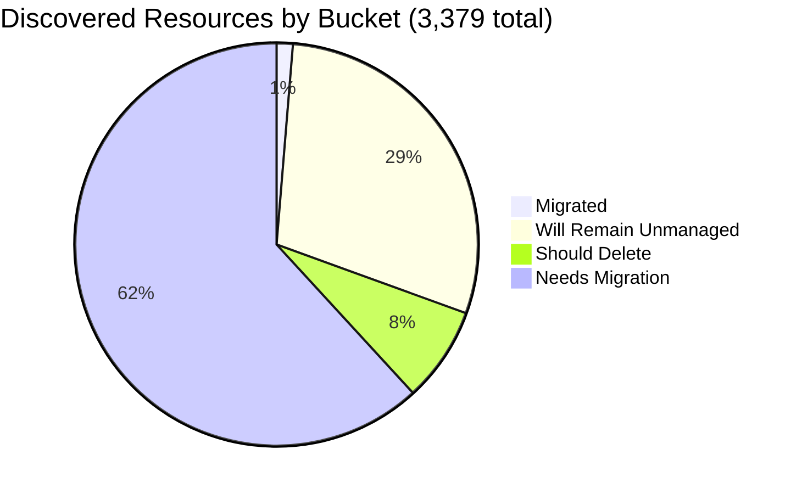

# Pulumi Migration Report — `pequod`

> **Generated:** July 17, 2026
> **Source:** Pulumi Insights (5 enrolled accounts) + Pulumi Cloud API
> **Scope:** All discovered cloud resources across enrolled Insights accounts.
> **Action taken:** None — this report only observes and recommends.

---

## 1. Executive Summary

**Org-wide migration coverage (Insights-discovered resources)**

```
░░░░░░░░░░░░░░░░░░░░ 1.3%  (44 of 3,379 discovered resources already under Pulumi IaC)
```

**Context:** `pequod` is the Pulumi CE (Customer Engineering) team's shared demo and workshop organization. Since the **June 29 report, ~2,600 cloud resources were cleaned up** from the main CE account — the dominant cause was clearing the 700+ orphaned `serverless-comp-NNN-consumer-*` IAM policies and destroying 10+ short-lived demo stacks via the new `demo-cleaner` project. Total discovered resources dropped 43% (5,946 → 3,379). Separately, the org maintains **10 active stacks managing ~220 IaC resources** across 10 projects — core platform infra (EKS, AKS, user management, OIDC/ESC) plus the new demo-cleaner automation.

| Bucket | Count | % of Discovered | % of Migratable Base |
|--------|------:|----------------:|--------------------:|
| ✅ Migrated (in Pulumi IaC stack) | 44 | 1.3% | 1.8% |
| 🔒 Will remain unmanaged | 988 | 29.3% | — |
| 🗑️ Should be deleted | 258 | 7.6% | 10.8% |
| ⚠️ Needs migration | 2,089 | 61.8% | 87.4% |
| **Total discovered** | **3,379** | 100% | — |

*Migratable base = 2,391 (total − will-remain-unmanaged). Buckets sum to account totals; accounts sum to 3,379.*
*Plus ~176 Pulumi IaC resources in stacks not enrolled in Insights (Kubernetes, OIDC config types).*

**Single biggest takeaway:** The `demo-cleaner` project is working — 2,600+ resources cleared since June 29. The remaining "needs migration" queue is now dominated by active EKS/AKS networking, Databricks workspaces, and GCP workload identity infrastructure rather than orphaned policy noise.

**Data-quality caveats:** `aws-pulumi-ce-workshops-420942475186` last scanned **May 2025** — data is now 14+ months stale. No formal Pulumi Teams configured; ownership attributed by account + name prefix (mapping stated in §6). Classification confidence for "should delete" is MEDIUM — human review required before acting.

---

## 2. Migration Progress

### Org-wide four-bucket split (% of 3,379 discovered)

| Bucket | Bar | % |
|--------|-----|--:|
| Migrated | `░░░░░░░░░░░░░░░░░░░░` | 1.3% |
| Will remain unmanaged | `██████░░░░░░░░░░░░░░` | 29.3% |
| Should delete | `██░░░░░░░░░░░░░░░░░░` | 7.6% |
| Needs migration | `████████████░░░░░░░░` | 61.8% |



### % Migrated by Account (of that account's discovered resources)

| Account | Bar | Migrated / Total |
|---------|-----|----------------:|
| aws-neo-eu-west-2-420942475186 | `░░░░░░░░░░░░░░░░░░░░` | 0 / 135 — 0.0% |
| aws-pulumi-ce-052848974346 | `░░░░░░░░░░░░░░░░░░░░` | 36 / 2,057 — 1.7% |
| aws-pulumi-ce-workshops-420942475186 ⚠️ | `░░░░░░░░░░░░░░░░░░░░` | 2 / 230 — 0.9% |
| azure-team-ce-subscription | `░░░░░░░░░░░░░░░░░░░░` | 3 / 328 — 0.9% |
| google-pulum-ce-team-438338752289 | `░░░░░░░░░░░░░░░░░░░░` | 3 / 629 — 0.5% |

*All accounts <2.5% — coverage bars render near-zero. Meaningful IaC adoption of Insights-visible resources has not yet begun.*

### % Migrated by Team (of "needs migration" in that team's scope)

*Ownership signal: account ownership (primary) → resource name prefix (secondary). See §6 for mapping.*

| Team / Owner | Needs Migration | Migrated | Bar |
|-------------|----------------:|---------:|-----|
| MitchGerdisch (aws-ce-052848974346 + workshops) | ~1,444 | 38 — 2.6% | `░░░░░░░░░░░░░░░░░░░░` |
| GCP CE (google-pulum-ce-team-438338752289) | ~371 | 3 — 0.8% | `░░░░░░░░░░░░░░░░░░░░` |
| Azure CE (azure-team-ce-subscription) | ~220 | 3 — 1.4% | `░░░░░░░░░░░░░░░░░░░░` |
| Robert Smith (aws-neo-eu-west-2-420942475186) | ~54 | 0 — 0.0% | `░░░░░░░░░░░░░░░░░░░░` |

---

## 3. Momentum

**Active Pulumi footprint (pequod org):** 10 stacks with resources · 11 projects · ~220 IaC-managed resources · 8 stacks updated in July 2026

*Bars below = stacks active (last updated) per month, scaled to Jul 2026 peak (8). Prior to 2025 the org shows no stack activity. Note: the 12 stacks listed as "Jun 2026" in the previous report have since been cleaned up by the `demo-cleaner` project and are no longer present.*

```
Jul 2026 ████████████████████  8  ← busiest month on record (partial — report date Jul 17)
Mar 2026 ██░░░░░░░░░░░░░░░░░░  1
May 2025 █████░░░░░░░░░░░░░░░  2
Feb 2025 ██░░░░░░░░░░░░░░░░░░  1
```

**Activity pattern:** July 2026 is the most active month on record for *surviving* stacks. 8 of 10 resource-bearing stacks were updated this month: deployment-agent-runners, demo-cleaner, neo-demo-init-1, shared-dev-aks, githubactions-pulumi-oidcissuer, pequod-user-mgmt, and rhum-monitor all touched in July. This reflects both ongoing platform work and active experimentation.

**Notable since June 29 report:**
- **`demo-cleaner/prod`** (new): Active automation destroying demo stacks; responsible for removing 10+ stacks and ~2,600 cloud resources.
- **`pequod-user-mgmt/prod`**: Grew from 55 → 77 resources (+22), suggesting active platform buildout.
- **`shared-dev-aks/dev`** and **`githubactions-pulumi-oidcissuer/prod`**: Both updated in July.
- **Cleaned up:** `demo-aws-container-services-py-0629`, `demo-app`, `lotctl-k8s-aws`, and 7+ other demo stacks are gone.

**Stacks inactive >90 days (risk of drift):**

| Project | Stack | Last Updated | Days Idle |
|---------|-------|-------------|--------:|
| shared-dev-eks | dev | Mar 20, 2026 | ~119 days |
| azure-oidc-env-config | prod | May 1, 2025 | ~442 days |
| gcp-oidc-env-config | prod | May 1, 2025 | ~442 days |
| insights-azure-creds | prod | Feb 5, 2025 | ~527 days |

The oldest three (OIDC configs, Azure creds) have been idle 14–17 months. They're likely stable infrastructure but should be audited for drift and version freshness.

**Largest projects by IaC resources (pequod org):**

| Project | Stack | IaC Resources | Last Updated |
|---------|-------|--------------|-------------|
| shared-dev-eks | dev | 88 | Mar 2026 |
| pequod-user-mgmt | prod | 77 | Jul 8, 2026 |
| shared-dev-aks | dev | 17 | Jul 13, 2026 |
| azure-oidc-env-config | prod | 12 | May 2025 |
| gcp-oidc-env-config | prod | 9 | May 2025 |
| insights-azure-creds | prod | 9 | Feb 2025 |
| githubactions-pulumi-oidcissuer | prod | 3 | Jul 11, 2026 |
| demo-cleaner | prod | 3 | Jul 17, 2026 |
| neo-demo-init-1-import-tf-1 | dev | 1 | Jul 16, 2026 |
| rhum-monitor | prod | 1 | Jul 8, 2026 |

Share of footprint active in the last 12 months: **70%** of stacks (7 of 10 resource-bearing stacks updated since Jul 2025).

---

## 4. Coverage by Enrolled Account

> **Important:** Insights coverage reflects only enrolled accounts. The 220 IaC resources in pequod stacks largely live in accounts or resource types not enrolled in Insights (shared EKS/AKS clusters, OIDC config, ESC infra), explaining the gap between IaC count and Insights-visible managed count.

| Account | Cloud | Pulumi-Managed | Total Discovered | Coverage % | Bar | Last Scan |
|---------|-------|---------------:|-----------------:|------------|-----|-----------:|
| aws-neo-eu-west-2-420942475186 | AWS | 0 | 135 | 0.0% | `░░░░░░░░░░░░░░░░░░░░` | Jul 17, 2026 |
| aws-pulumi-ce-052848974346 | AWS | 36 | 2,057 | 1.7% | `░░░░░░░░░░░░░░░░░░░░` | ~Jul 2026 |
| aws-pulumi-ce-workshops-420942475186 | AWS | 2 | 230 | 0.9% | `░░░░░░░░░░░░░░░░░░░░` | **May 28, 2025 ⚠️** |
| azure-team-ce-subscription | Azure | 3 | 328 | 0.9% | `░░░░░░░░░░░░░░░░░░░░` | ~Jul 2026 |
| google-pulum-ce-team-438338752289 | GCP | 3 | 629 | 0.5% | `░░░░░░░░░░░░░░░░░░░░` | ~Jul 2026 |
| **Org Total** | — | **44** | **3,379** | **1.3%** | `░░░░░░░░░░░░░░░░░░░░` | — |

**⚠️ Stale scan:** `aws-pulumi-ce-workshops-420942475186` has not been scanned in 14+ months. Trigger a fresh scan before acting on its resource data.

**Enrollment gaps:** Enrolling the AWS account(s) backing `shared-dev-eks` (88 IaC resources) and the Azure account backing `shared-dev-aks` (17 IaC resources) would close most of the 176-resource gap between IaC resources and Insights-visible managed count. The `insights-azure-creds/prod` stack exists specifically to enable Azure scanning — worth verifying the credential is still valid.

---

## 5. Data Analysis

| Account | Cloud | Total | Migrated | Will Remain Unmanaged | Should Delete | Needs Migration | % Mig (All) | % Mig (Migratable) |
|---------|-------|------:|---------:|----------------------:|--------------:|----------------:|------------:|-------------------:|
| aws-neo-eu-west-2-420942475186 | AWS | 135 | 0 | 78 | 3 | 54 | 0.0% | 0.0% |
| aws-pulumi-ce-052848974346 | AWS | 2,057 | 36 | 550 | 115 | 1,356 | 1.7% | 2.4% |
| aws-pulumi-ce-workshops-420942475186 ⚠️ | AWS | 230 | 2 | 110 | 30 | 88 | 0.9% | 1.7% |
| azure-team-ce-subscription | Azure | 328 | 3 | 30 | 75 | 220 | 0.9% | 1.0% |
| google-pulum-ce-team-438338752289 | GCP | 629 | 3 | 220 | 35 | 371 | 0.5% | 0.8% |
| **Org Total** | — | **3,379** | **44** | **988** | **258** | **2,089** | **1.3%** | **1.8%** |

**Classification methodology:**
- *Will remain unmanaged:* AWS Service Linked Roles (path `/aws-service-role/`) + their policy attachments; CloudFront `Managed-*` cache/origin/response policies; default VPCs, subnets, SGs, IGWs, route tables; IoT `iot:*` system domain configs; default EventBus, Athena `primary` workgroup; MemoryDB default user/ACL; ElastiCache default user; default RDS option groups + cluster parameter groups; GCP project service APIs; GCP/Azure default subnetworks and auto-created AKS node RGs (`MC_*`), NetworkWatchers, DefaultResourceGroups, Cloud Shell storage.
- *Should delete:* resources judged orphaned or explicitly test-named (detailed in §6).
- *Needs migration:* all remaining active cloud infrastructure not yet in Pulumi IaC.
- *Classification confidence:* HIGH for "will remain unmanaged" (deterministic patterns); MEDIUM for "should delete" (naming heuristics — human review required before acting).

**Week-over-week change (vs. June 29 report):**

| Metric | Jun 29 | Jul 17 | Delta |
|--------|-------:|-------:|------:|
| Total discovered | 5,946 | 3,379 | **-2,567** |
| Migrated (Insights) | 53 | 44 | -9 |
| Will remain unmanaged | 1,043 | 988 | -55 |
| Should delete | 970 | 258 | **-712** |
| Needs migration | 3,880 | 2,089 | **-1,791** |
| Active stacks | 21 | 11 | -10 |
| IaC resources | ~297 | ~220 | -77 |

*The drop in "migrated" (-9) reflects that 10 demo stacks were destroyed — their IaC-managed resources no longer exist to be scanned. The 712-resource drop in "should delete" and 1,791 reduction in "needs migration" reflect genuine cleanup.*

**Three noteworthy specifics:**
- **`aws-pulumi-ce-052848974346`** still holds 61% of total discovered resources but is dramatically cleaner than June. The `demo-cleaner/prod` stack is the primary driver — worth ensuring it runs on a schedule.
- **`google-pulum-ce-team-438338752289`** grew by 25 resources (+4%): new workload identity pool providers, subnetworks, and IAM policies appeared. Monitor for unchecked growth.
- **`aws-pulumi-ce-workshops-420942475186`** remains 14 months stale — its "needs migration" count of 88 may significantly undercount or overcount reality. A fresh scan is needed before planning any work against this account.

---

## 6. Actions Needed

### Migration Queue by Team

**Ownership mapping used:**
(1) Resource tag `Owner` or `team` where present →
(2) Resource name prefix → team: `mitch-*`, `mitchselfhosted-*` → MitchGerdisch; `workshop*` → Workshop Team; `piers-*` → Piers Karsenbarg; `pk-*` → PK (individual CE); `zbuchheit-*` → Z. Buchheit; `jconnell-*` → J. Connell; `wladi-*`/`rg-dbw-my-team-wladi-*` → Wladi; `rg-dbw-*` → Databricks CE subteam; `aureq-*`, `menfin-*` → individual CEs →
(3) Account owner as fallback for all remaining resources.

---

**MitchGerdisch** (~1,444 resources needing migration)
*Accounts: aws-pulumi-ce-052848974346 + aws-pulumi-ce-workshops-420942475186*

| Priority | Resource(s) | Why |
|----------|------------|-----|
| 🔴 High | EKS VPC `vpc-027cdd4405a2969ef` + subnets + route tables (us-west-2) | Core EKS networking — 72 subnets/201 routes backing the EKS cluster; supporting `shared-dev-eks` stack |
| 🔴 High | `app-repo-9e2b91f` ECR + `secGroup-12befae` SG (us-west-2) | Supporting infra for active workload; no stack reference found |
| 🔴 High | `pulumi-policypacks-a115aaf` S3 (ca-central-1) | Policy packs bucket — should be in IaC to prevent accidental deletion |
| 🟡 Medium | `pulumiselfhost-nodeSecurityGroup-e29df76` SG + related VPC/subnets (us-west-2) | Self-hosted Pulumi node group networking — active infra, no IaC backing |
| 🟡 Medium | `console-slack-alerts-*` EventBridge rules + S3 bucket (us-west-2, sa-east-1) | Monitoring/alerting infra — active, no owner tag |
| +1,439 more | Route tables, routes, ENIs, API GW resources, Lambda layers, Cognito pools | Group by service domain; tackle EKS networking first |

---

**GCP CE Team** (~371 resources needing migration)
*Account: google-pulum-ce-team-438338752289; no single owner*

| Priority | Resource(s) | Why |
|----------|------------|-----|
| 🔴 High | `aureq-pulumi-diy-state-storage` + `menfin-demo-diy-state-storage-bucket-36159f1` | **Pulumi state storage buckets** — losing these breaks stacks; must be in IaC immediately |
| 🔴 High | `mitchselfhosted-mitchsh-network-afa8380` subnetworks (30+ regions) | Self-hosted Pulumi network across all regions — active, no IaC |
| 🔴 High | `my-demo-network` VPC + subnetworks (30+ regions) | Custom network backing compute workloads |
| 🟡 Medium | `sandbox-gateway-ip-3831c87` global address | Load balancer frontend IP — active, no IaC |
| 🟡 Medium | `projects/pulumi-ce-team/datasets/dwcore_dev_dataset_1` BigQuery | Active data warehouse dataset |
| +366 more | WIF pools/providers (pk-gitlab-f5d0cc7e, pulumi-oidc-mtan), service account IAM policies, Cloud DNS | Group by owner prefix |

---

**Azure CE Team** (~220 resources needing migration)
*Account: azure-team-ce-subscription; mixed CE member resources*

| Priority | Resource(s) | Why |
|----------|------------|-----|
| 🔴 High | `rg-shared-services-dev` → `kv-demo-plat-dev` (KV) + `log-demo-platform-dev` (Log Analytics) | Shared platform services consumed by other resources; critical to not lose |
| 🔴 High | Databricks workspaces in `rg-dbw-my-team-*` / `rg-dbw-team-alpha-*` (5 workspaces) + associated VNets/NSGs | Active Databricks environments (wladi, my-team variants, team-alpha) |
| 🔴 High | `podinfo-webapp-rg` (CosmosDB `podinfo-cosmosdb-28525` + WebApp + App Service Plan) | Running web application |
| 🟡 Medium | `rg-hub-network-dev` (hub VNet `vnet-hub-dev` + VPN GW + NVA VM) | Hub-and-spoke network used by spoke workloads |
| 🟡 Medium | `mitch-selfhosted.com` DNS zone + `new-vnet` VNet (mitch-rg-020625) | Active self-hosted infra |
| +215 more | Storage accounts, NSGs, identity resources, Key Vaults | Group by resource group owner prefix |

---

**Robert Smith** (~54 resources needing migration)
*Account owner: aws-neo-eu-west-2-420942475186*

| Priority | Resource(s) | Why |
|----------|------------|-----|
| 🔴 High | `workshops.pulumi-ce.team` Route53 zone + NS + SOA records | Active DNS zone for all workshop participants — critical |
| 🔴 High | `workshop-instructor-role` (tag `Owner=workshops`) | Active IAM role used to provision workshop participant accounts |
| 🟡 Medium | `lambda-role-for-account-cleanup` + policy (tag `Owner=pulumi-build-engineering`) | Active account cleanup automation Lambda |
| 🟡 Medium | `insights-account-scan` IAM role + policy attachment | Role Insights uses for scanning — should be in IaC |
| 🟢 Low | `420942475186-budget-150-e6909b6`, `420942475186-budget-fc8c40b` | Account cost budgets — low risk, good hygiene |
| +49 more | OIDC roles (zbuchheit-oidc, pulumi-esc-oidc-paul-umi, ContinuousDeliveryAdminRole), KMS keys | Audit each OIDC role; import active ones |

---

### Deletion Candidates

*Recommend human review before deleting any of these. Classification is based on naming heuristics.*

| Pattern | Count | Account | Reason |
|---------|------:|---------|--------|
| `snapshot-*` / `rds-snapshot-*` RDS cluster snapshots | ~8 | aws-pulumi-ce-052848974346 (us-east-2, us-west-2, us-east-1) | Old automated/manual snapshots; one from 2021 — confirm no active cluster needs them |
| `preupgrade-tf-20210305*` RDS snapshot | 1 | aws-pulumi-ce-052848974346/us-east-2 | 5-year-old pre-upgrade snapshot from a 2021 Terraform migration — almost certainly obsolete |
| CloudFormation stacks (`example-cluster-3-759307b5`, `argo-example-a7040316`) | 2 | aws-pulumi-ce-052848974346 (us-west-2, us-east-2) | Stale CFN stacks from 2021–2023 demos; should be destroyed or migrated |
| `megan-test-backend`, `pulumi-sticker-arts-f12ef29`, `this-is-a-test-foobar-*` | ~5 | aws-pulumi-ce-052848974346 | Explicit test names; no active workload reference found |
| `mitch-assumerole-test*` (IAM role, us-west-2) | ~2 | aws-neo-eu-west-2-420942475186 | Explicit test/experiment name |
| `workshop528-*` ALB target group + security group | ~8 | aws-pulumi-ce-workshops-420942475186/us-east-2 | Stale workshop run artifacts *(confirm with fresh scan first — data is 14 months old)* |
| Generic Azure RGs with hex names (`resourceGroup2dca640c`, `resourceGroup5fb3a110`, `resourceGroupf79d3f3b`, `resource-group5655bb2c`, `resource_group*`) | ~20 | azure-team-ce-subscription | Auto-generated hex-suffix names from old demo runs; sub-resources appear to be demo leftovers |
| Explicit Azure test RGs (`piers-resourcegroup-12345`, `rs-test`, `neo-test-sqldb`, `elisabeth-test`, `rsv-rg`, `vnet`) | 6 | azure-team-ce-subscription | Explicit test/scratch RG names; review sub-resources before deleting |
| GCP test buckets (`menfin-demo-diy-state-storage-bucket-36159f1` ⚠️, `my-bucket-01f4221`, `my-bucket-628ad18`, `my-bucket-f50a09b`) | ~4 | google-pulum-ce-team-438338752289 | Generic / test-named — **note: `menfin-demo-diy-state-storage` may contain Pulumi state; verify before deleting** |
| GCP test secrets/SAs (`my-app-secret`, `my-account@pulumi-ce-team.iam.gserviceaccount.com`) | ~3 | google-pulum-ce-team-438338752289 | Generic test names; confirm not backing active demos |

---

### Unattributed Resources (significant items where ownership could not be resolved)

*These require a human to assign an owner before migration or deletion decisions can be made.*

| Resource | Account | Why Unresolved |
|----------|---------|---------------|
| `snqawpscpmsharedacr` Container Registry | azure-team-ce-subscription (resourceGroup29b198b3) | Opaque name; no owner prefix or tag; purpose unclear — may be shared ACR for multiple demos |
| `rag-staging-234` OpenSearch Serverless collection | aws-pulumi-ce-052848974346/us-east-1 | Active-looking RAG pipeline; no owner tag; unclear which team or demo owns it |
| `trivy-agent-dlq` SQS queue | aws-pulumi-ce-052848974346/us-east-1 | Security scanning dead-letter queue — implies active Trivy agent; no owner tag |
| `bcf-devcontainer-5e2e74c` / `zendesk-domestic-subnet-7da16b0` subnetwork | google-pulum-ce-team-438338752289 | Unusual names suggest demo but no owner prefix identifiable |
| `initech-identity-pool` + `initech-access` service account | google-pulum-ce-team-438338752289 | "Initech" WIF pool + SA — likely a demo org scenario; confirm with CE team |
| `console-slack-alerts-*` S3 + EventBridge rules (us-west-2, sa-east-1) | aws-pulumi-ce-052848974346 | Active monitoring infra with no owner tag; unclear if still receiving events |

---

*All counts are exact where scan data is available. `aws-pulumi-ce-workshops-420942475186` (stale) counts carried forward from May 2025 scan — treat as approximate. Classification confidence: HIGH for "will remain unmanaged" (deterministic patterns); MEDIUM for "should delete" (naming heuristics — human review required before acting).*
