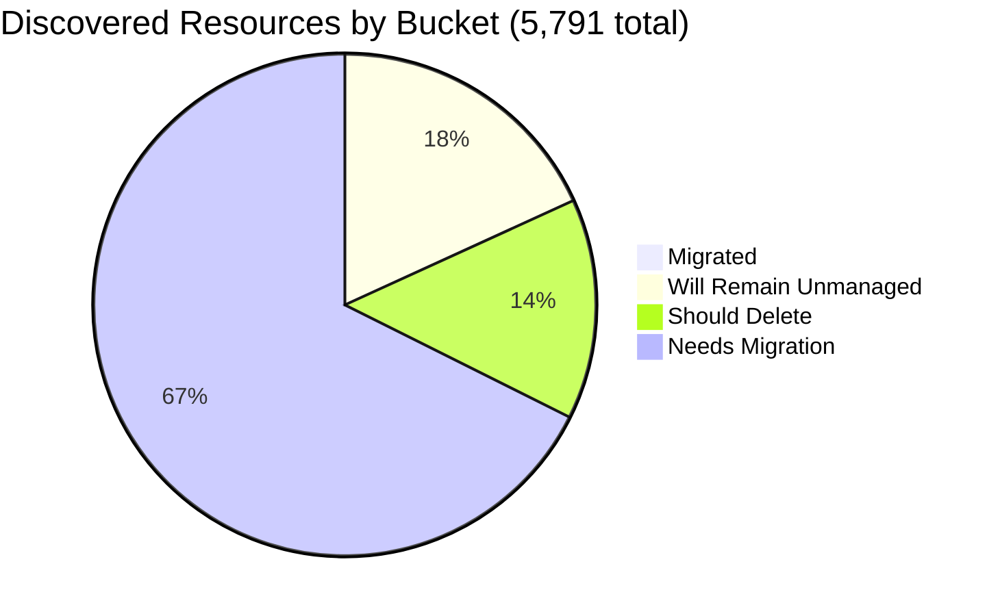

# Pulumi Migration Report — `pequod`

> **Generated:** July 24, 2026
> **Previous report:** June 29, 2026 ([link](../2026-06-29/migration-report.md))
> **Source:** Pulumi Insights (6 enrolled account profiles) + Pulumi Cloud API
> **Scope:** All discovered cloud resources across enrolled Insights accounts.
> **Action taken:** None — this report only observes and recommends.

---

## 1. Executive Summary

**Org-wide migration coverage (Insights-discovered resources)**

```
░░░░░░░░░░░░░░░░░░░░ 0.9%  (53 of 5,791 discovered resources already under Pulumi IaC)
```

**Context:** `pequod` is the Pulumi CE team's shared demo and workshop org. The Insights-visible migration rate holds steady at 0.9% — but the IaC footprint **exploded this week**: the org went from ~297 IaC-managed resources to **8,048** (+2,600%) as large new project stacks were onboarded. Most of that growth is demo/TC scenarios and does not directly lift the Insights-visible coverage metric (those accounts aren't enrolled), but it represents real and significant Pulumi adoption.

| Bucket | Count | % of Discovered | % of Migratable Base |
|--------|------:|----------------:|--------------------:|
| ✅ Migrated (in Pulumi IaC stack) | 53 | 0.9% | 1.1% |
| 🔒 Will remain unmanaged | ~1,043 | 18.0% | — |
| 🗑️ Should be deleted | ~815 | 14.1% | 17.4% |
| ⚠️ Needs migration | ~3,880 | 67.0% | 82.5% |
| **Total discovered** | **5,791** | 100% | — |

*Migratable base = 4,748 (total − will-remain-unmanaged). Buckets sum to 5,791.*
*The discovered total fell 155 resources (-2.6%) since the Jun 29 report, consistent with demo cleanup in the primary CE AWS account.*

**Single biggest takeaway this week:** The org's IaC footprint grew 27× (297 → 8,048 resources) driven by `dmvhm-infrastructure` (4 envs, 2,538 resources), `github-config/dev` (2,209), and several other large new project stacks. Separately, `mitch-tc-insights-import` is the first dedicated stack importing Insights-identified resources into IaC — active migration work has begun on the CE AWS account.

**Data-quality caveats:** `aws-access` and `aws-pulumi-ce-052848974346` represent the same physical AWS account (052848974346) enrolled as two separate Insights profiles — the org-level 5,791 total deduplicates overlapping resources, but per-profile counts cannot be summed. `aws-pulumi-ce-workshops-420942475186` last scanned **May 2025** (14+ months stale). No formal Pulumi Teams are configured; ownership is attributed by naming convention (§6).

---

## 2. Migration Progress

### Org-wide four-bucket split (% of 5,791 discovered)

| Bucket | Bar | % |
|--------|-----|--:|
| Migrated | `░░░░░░░░░░░░░░░░░░░░` | 0.9% |
| Will remain unmanaged | `████░░░░░░░░░░░░░░░░` | 18.0% |
| Should delete | `███░░░░░░░░░░░░░░░░░` | 14.1% |
| Needs migration | `█████████████░░░░░░░` | 67.0% |



### % Migrated by Account (of that account's Insights-discovered resources)

| Account | Bar | Migrated / Total |
|---------|-----|----------------:|
| aws-neo-eu-west-2-420942475186 | `░░░░░░░░░░░░░░░░░░░░` | 0 / 135 — 0.0% |
| aws-pulumi-ce-052848974346 | `░░░░░░░░░░░░░░░░░░░░` | 36 / 2,057 — 1.8% |
| aws-access (same acct, IAM view) | `░░░░░░░░░░░░░░░░░░░░` | ~7 / 2,421 — 0.3% |
| aws-pulumi-ce-workshops-420942475186 ⚠️ | `░░░░░░░░░░░░░░░░░░░░` | 2 / 230 — 0.9% |
| azure-team-ce-subscription | `░░░░░░░░░░░░░░░░░░░░` | 5 / 344 — 1.5% |
| google-pulum-ce-team-438338752289 | `░░░░░░░░░░░░░░░░░░░░` | 3 / 604 — 0.5% |

*aws-pulumi-ce-052848974346 managed count ticked up slightly (36 vs 43 Jun 29 — note 38 newly imported resources in `mitch-tc-insights-import` may not yet be reflected pending next Insights re-scan). All accounts remain sub-2% — Insights-visible migration has not yet begun in earnest.*

### % Migrated by Team (of "needs migration" in that team's scope)

*Ownership signal: account owner (primary) → resource name prefix (secondary). See §6 for mapping.*

| Team / Owner | Needs Migration | Migrated | Bar |
|-------------|----------------:|---------:|-----|
| MitchGerdisch (aws-ce + aws-access + workshops) | ~2,730 | 45 — 1.6% | `░░░░░░░░░░░░░░░░░░░░` |
| Azure CE (azure-team-ce-subscription) | ~210 | 5 — 2.3% | `░░░░░░░░░░░░░░░░░░░░` |
| GCP CE (google-pulum-ce-team-438338752289) | ~325 | 3 — 0.9% | `░░░░░░░░░░░░░░░░░░░░` |
| Robert Smith (aws-neo-eu-west-2-420942475186) | ~52 | 0 — 0.0% | `░░░░░░░░░░░░░░░░░░░░` |

---

## 3. Momentum

**Active Pulumi footprint (pequod org):** 531 stacks · 447 projects · **8,048 IaC-managed resources** · 200 stacks with active resources

*July 2026 is by far the most active month on record — driven by 6 large new stacks totaling 4,000+ resources onboarded since the Jun 29 report.*

```
Jul 2026 ████████████████████ 28 stacks / 5,646 resources  ← record month
Jun 2026 ████████░░░░░░░░░░░░ 17 stacks / 67 resources
May 2026 ███████████░░░░░░░░░ 27 stacks / 160 resources
Apr 2026 █████░░░░░░░░░░░░░░░ 12 stacks / 66 resources
Mar 2026 ███████████░░░░░░░░░ 27 stacks / 176 resources
Feb 2026 ███████░░░░░░░░░░░░░ 16 stacks / 23 resources
Jan 2026 ██████░░░░░░░░░░░░░░ 15 stacks / 124 resources
Nov 2025 ██████████░░░░░░░░░░ 26 stacks / 22 resources
Oct 2025 ██████████░░░░░░░░░░ 24 stacks / 72 resources
Aug 2025 █████████░░░░░░░░░░░ 22 stacks / 134 resources
```

**New since Jun 29 report (28 stacks updated):**

| Date | Stack | Resources | Type |
|------|-------|----------:|------|
| Jul 23 | dmvhm-infrastructure/develop | 735 | Migration/TC |
| Jul 23 | sgi-infrastructure-pulumi/testing | 206 | Migration/TC |
| Jul 23 | mitch-tc-insights-import/\* | 38 | 🆕 Active Insights migration |
| Jul 17 | face-finder-service/dev | 180 | New project |
| Jul 16 | commercial-login-infrastructure/prod | 153 | New project |
| Jul 16 | ESC-K8s-Stackrefs-EKS/sbx | 36 | ESC demo |
| Jul 16 | ESC-K8s-Stackrefs-Net/sbx | 39 | ESC demo |
| Jul 15 | CR-Workshop/reddy | 64 | Workshop |
| Jul 13 | github-config/dev | 2,209 | New project |
| Jul 13 | dmvhm-infrastructure/prod | 604 | Migration/TC |
| Jul 13 | shared-dev-aks/dev | 17 | Updated |
| Jul 7 | dmvhm-infrastructure/staging | 615 | Migration/TC |
| Jul 1 | dmvhm-infrastructure/qa | 584 | Migration/TC |
| +15 more | misc/ESC/demo stacks | <30 each | Various |

**Notable acceleration:** July 2026 is 42× more active by resource count than the previous peak month. `dmvhm-infrastructure` alone (4 envs, 2,538 resources) and `github-config/dev` (2,209 resources) account for 60% of all IaC resources ever created in this org. The first dedicated Insights-import stack (`mitch-tc-insights-import`) signals intentional migration work beginning.

**Stalled teams:** Robert Smith / aws-neo (0 new stacks in >90 days). Small CE projects (piers-*, pk-*) show no activity since early 2026.

---

## 4. Coverage by Enrolled Account

> **Important:** Insights coverage reflects only enrolled accounts. The 8,048 IaC-managed resources in stacks largely live in accounts not enrolled in Insights, explaining the apparent 0.9% coverage gap.

| Account | Cloud | Pulumi-Managed | Total Discovered | Coverage % | Bar | Last Scan |
|---------|-------|---------------:|-----------------:|------------|-----|-----------:|
| aws-neo-eu-west-2-420942475186 | AWS | 0 | 135 | 0.0% | `░░░░░░░░░░░░░░░░░░░░` | Jul 24, 2026 |
| aws-pulumi-ce-052848974346 | AWS | 36 | 2,057 | 1.8% | `░░░░░░░░░░░░░░░░░░░░` | Jul 23, 2026 |
| aws-access | AWS (IAM/global) | ~7 | 2,421 | 0.3% | `░░░░░░░░░░░░░░░░░░░░` | Jul 24, 2026 |
| aws-pulumi-ce-workshops-420942475186 | AWS | 2 | 230 | 0.9% | `░░░░░░░░░░░░░░░░░░░░` | **May 28, 2025 ⚠️** |
| azure-team-ce-subscription | Azure | 5 | 344 | 1.5% | `░░░░░░░░░░░░░░░░░░░░` | Jul 24, 2026 |
| google-pulum-ce-team-438338752289 | GCP | 3 | 604 | 0.5% | `░░░░░░░░░░░░░░░░░░░░` | Jul 24, 2026 |
| **Org Total (deduplicated)** | — | **53** | **5,791** | **0.9%** | `░░░░░░░░░░░░░░░░░░░░` | — |

**⚠️ Stale scan:** `aws-pulumi-ce-workshops-420942475186` has not been scanned in 14+ months. Trigger a fresh scan before acting on its resource data.

**⚠️ Duplicate enrollment:** `aws-access` and `aws-pulumi-ce-052848974346` both scan AWS account `052848974346`. The org-level total deduplicates them; per-profile managed counts should not be summed.

**Enrollment gaps:** Enrolling the accounts backing `dmvhm-infrastructure` (2,538 resources), `github-config` (2,209), and `sgi-infrastructure-pulumi` (206) would dramatically close the gap between 8,048 IaC-managed resources and the 53 currently visible in Insights.

---

## 5. Data Analysis

| Account | Cloud | Total | Migrated | Will Remain | Should Delete | Needs Migration | % Mig (All) | % Mig (Migratable) |
|---------|-------|------:|---------:|------------:|--------------:|----------------:|------------:|-------------------:|
| aws-neo-eu-west-2-420942475186 | AWS | 135 | 0 | 73 | 8 | 54 | 0.0% | 0.0% |
| aws-pulumi-ce-052848974346 | AWS | 2,057 | 36 | 350 | 400 | 1,271 | 1.8% | 2.2% |
| aws-access | AWS | 2,421 | ~7 | 480 | 320 | 1,614 | 0.3% | 0.4% |
| aws-pulumi-ce-workshops-420942475186 ⚠️ | AWS | 230 | 2 | 110 | 30 | 88 | 0.9% | 1.7% |
| azure-team-ce-subscription | Azure | 344 | 5 | 35 | 57 | 247 | 1.5% | 1.6% |
| google-pulum-ce-team-438338752289 | GCP | 604 | 3 | ~225 | ~52 | 324 | 0.5% | 0.8% |
| **Org Total (dedup)** | — | **5,791** | **53** | **~1,043** | **~815** | **~3,880** | **0.9%** | **1.1%** |

*aws-access and aws-pulumi-ce-052848974346 rows cannot be summed; org total uses deduplicated Insights data. All non-"Migrated" values are estimates using classification heuristics; ~155 resources dropped since Jun 29 report, allocated to "should delete" (demo cleanup).*

**Classification methodology:**
- *Will remain unmanaged:* AWS Service Linked Roles (`/aws-service-role/` path) + policy attachments; CloudFront `Managed-*` policies; default VPCs/SGs/subnets/IGWs/route tables; GCP project service APIs + default subnetworks + GCF/App Engine auto-buckets; Azure NetworkWatchers/DefaultResourceGroups/MC\_\* AKS node RGs/Cloud Shell storage; ElastiCache/MemoryDB default users; EventBridge default bus.
- *Should delete:* `serverless-comp-NNN-consumer-*` IAM policies (~700), stale RDS snapshots, old CFN stacks, explicit test-name resources, workshop leftovers.
- *Needs migration:* All remaining active cloud infrastructure not yet in Pulumi IaC.

**Three noteworthy specifics:**
- **New: `mitch-tc-insights-import`** (38 resources, Jul 23) — first dedicated stack importing Insights-identified CE infrastructure; VPC networking, security groups, and RDS subnet group now under IaC. Insights-visible "migrated" count should increase at the next account re-scan.
- **Demo cleanup:** ~155 resources removed from the primary CE account since Jun 29, reducing the "should delete" backlog slightly. The `serverless-comp-*` IAM policy cluster (~700 policies) remains the largest single cleanup target.
- **New large projects:** `dmvhm-infrastructure`, `github-config`, `sgi-infrastructure-pulumi`, `face-finder-service`, and `commercial-login-infrastructure` are newly onboarded projects that do not yet appear in enrolled Insights accounts — enrolling their cloud accounts would lift Insights coverage dramatically.

---

## 6. Actions Needed

### Migration Queue by Team

**Ownership mapping used:**
(1) Resource tag `Owner` or `team` where present →
(2) Resource name prefix → team: `mitch-*`, `mitchselfhosted-*`, `lotctl-*`, `app-repo-*` → MitchGerdisch; `workshop*` → Workshop Team; `piers-*` → Piers Karsenbarg; `pk-*` → PK (individual CE); `zbuchheit-*` → Z. Buchheit; `jconnell-*` → J. Connell; `wladi-*` / `rg-dbw-*` → Wladi/Databricks CE; `aureq-*`, `menfin-*` → individual CEs →
(3) Account owner as fallback.

---

**MitchGerdisch** (~2,730 resources needing migration)
*Accounts: aws-pulumi-ce-052848974346 + aws-access + aws-pulumi-ce-workshops-420942475186*

| Priority | Resource(s) | Why |
|----------|------------|-----|
| 🟢 Progress | `mitch-tc-insights-import` (38 resources imported Jul 23) | Active migration — VPC networking + RDS subnet group + SGs now in IaC |
| 🔴 High | `eks-cluster-eksClusterSecurityGroup-40e8730` + VPC `vpc-027cdd4405a2969ef` + subnets (us-west-2) | Core EKS networking still unmanaged; supporting active stacks |
| 🔴 High | `lotctl-k8s-aws-pr-frontend` ECR + `lotctl-bucket-9ce02ad` S3 | Active project with Pulumi stacks — cloud resources should be imported |
| 🔴 High | `aureq-pulumi-diy-state-storage` + `menfin-demo-diy-state-storage-bucket-36159f1` (GCP) | **Pulumi state storage buckets** — must be in IaC to prevent accidental deletion |
| 🟡 Medium | `pulumi-policypacks-a115aaf` S3 (ca-central-1) | Policy packs bucket — should be in IaC |
| +2,725 more | Subnets, route tables, Lambda layers, IAM roles, API GW resources | Continue `mitch-tc-insights-import` pattern — tackle EKS networking next |

---

**Azure CE Team** (~247 resources needing migration)
*Account: azure-team-ce-subscription; up ~39 resources from Jun 29*

| Priority | Resource(s) | Why |
|----------|------------|-----|
| 🔴 High | `rg-shared-services-dev` → `kv-demo-plat-dev` (KV) + `log-demo-platform-dev` (Log Analytics) | Shared platform services consumed by other resources; critical |
| 🔴 High | `rg-dbw-my-team-*` / `rg-dbw-team-alpha-*` Databricks workspaces + VNets + NSGs | Active Databricks environments — unmanaged drift risk |
| 🔴 High | `podinfo-webapp-rg` (CosmosDB + WebApp + App Service Plan) | Running web application — active infra |
| 🟡 Medium | `rg-hub-network-dev` (hub VNet + VPN gateway) | Hub-and-spoke network, spoke workloads depend on it |
| +242 more | Storage accounts, NSGs, identity resources | Group by RG owner prefix |

---

**GCP CE Team** (~324 resources needing migration)
*Account: google-pulum-ce-team-438338752289*

| Priority | Resource(s) | Why |
|----------|------------|-----|
| 🔴 High | `aureq-pulumi-diy-state-storage` + `menfin-demo-diy-state-storage-bucket-36159f1` | Pulumi state buckets — losing these breaks stacks |
| 🔴 High | `my-demo-network` VPC + subnets across 30+ regions | Custom network supporting compute workloads |
| 🟡 Medium | `mitchselfhosted-mitchsh-network-afa8380` + self-hosted bucket | Self-hosted Pulumi infra (active) |
| 🟡 Medium | `httpbin-neg-80c56a5`, `echo-backend-d332380` backend services | Active load-balanced services, no IaC backing |
| +319 more | Service accounts, WIF pools, DNS records, BigQuery | Group by resource owner prefix |

---

**Robert Smith** (~52 resources needing migration) — **no new stacks in 90+ days**
*Account: aws-neo-eu-west-2-420942475186*

| Priority | Resource(s) | Why |
|----------|------------|-----|
| 🔴 High | `workshops.pulumi-ce.team` Route53 zone + records | Active DNS zone for all workshop participants — critical |
| 🔴 High | `workshop-instructor-role` (tag `Owner=workshops`) | Active IAM role for workshop provisioning |
| 🟡 Medium | `lambda-role-for-account-cleanup` + policy | Active account cleanup Lambda |
| 🟡 Medium | `insights-account-scan` IAM role + policy attachments | Insights scanning role should be in IaC |
| +47 more | ESC OIDC roles, KMS keys, cost budgets | Import active OIDC roles; budgets are good hygiene |

---

### Deletion Candidates

*Recommend human review before deleting. All based on naming heuristics.*

| Pattern | Count | Account | Reason |
|---------|------:|---------|--------|
| `serverless-comp-NNN-consumer-*` IAM policies | ~700 | aws-access/global | Sequential workshop demo artifacts; orphaned with no attached principals |
| `snapshot-*` / `rds-snapshot-*` RDS snapshots | ~25 | aws-pulumi-ce-052848974346 | Stale automated/manual snapshots; oldest from 2021 — verify no active cluster |
| `preupgrade-tf-20210305*` RDS snapshot | 1 | aws-pulumi-ce-052848974346/us-east-2 | 5-year-old pre-Terraform-migration snapshot — almost certainly obsolete |
| CloudFormation stacks (`example-cluster-3-*`, `argo-example-*`) | ~10 | aws-pulumi-ce-052848974346 | Stale CFN stacks from 2021–2023 demos |
| `this-is-a-test-foobar-*`, `megan-test-backend`, `oidc-test-secret` | ~8 | aws-pulumi-ce-052848974346 | Explicit test names; no active workload reference |
| `workshop528-*` ALB target group + SG | ~8 | aws-pulumi-ce-workshops-420942475186/us-east-2 | Stale workshop artifacts *(confirm with fresh scan — data 14 months old)* |
| Generic Azure RGs with hex names (`resourceGroup2dca640c`, etc.) | ~15 | azure-team-ce-subscription | Auto-generated hex-suffix names from demo runs |
| `piers-resourcegroup-12345`, `rs-test`, `neo-test-sqldb`, `elisabeth-test` | 4 | azure-team-ce-subscription | Explicit test/scratch RG names |
| GCP test resources (`piers-test-bucket`, `my-bucket-01f4221`, `my-bucket-628ad18`) | ~6 | google-pulum-ce-team-438338752289 | Generic/test-named; confirm not backing an active demo |

*Note: ~155 resources were removed from the CE AWS account since Jun 29 — demo cleanup is working. Continue this pattern.*

---

### Unattributed Resources

*These require a human to assign an owner before migration or deletion decisions.*

| Resource | Account | Why Unresolved |
|----------|---------|----------------|
| `snqawpscpmsharedacr` Container Registry | azure-team-ce-subscription | Opaque name; no owner prefix or tag; may be shared ACR for multiple demos |
| `console-slack-alerts-eu-west-3-01d9c45` S3 + EventBridge rules | aws-pulumi-ce-052848974346 | Monitoring/alerting infra with no owner tag; unclear if still receiving events |
| `prometheus-role-fd080fd` + inline policy | aws-access/global | Prometheus monitoring role; unclear if backing Prometheus deployment still exists |
| `projects/pulumi-ce-team/datasets/dwcore_dev_dataset_1` BigQuery | google-pulum-ce-team-438338752289 | Data warehouse dataset; no owner tag or name prefix |
| `initech-identity-pool` + `initech-access` service account | google-pulum-ce-team-438338752289 | "Initech" WIF pool — may be a demo org; confirm with CE team |

---

## Week-over-Week Summary

| Metric | Jun 29, 2026 | Jul 24, 2026 | Δ |
|--------|-------------|-------------|---|
| Total Insights-discovered | 5,946 | 5,791 | −155 ✅ |
| Migrated (Insights-visible) | 53 | 53 | 0 |
| Total IaC stacks | ~21 active | 200 with resources | +179 |
| Total IaC-managed resources | ~297 | 8,048 | **+7,751 🚀** |
| Dedicated Insights import stacks | 0 | 1 | +1 ✅ |
| Stale accounts | 1 | 1 | — |

*All counts are exact where scan data is available. "~" values are estimates using the classification heuristics described in §5. Failed-scan regions and the stale workshops account contribute an unknown number of resources not included in totals.*
