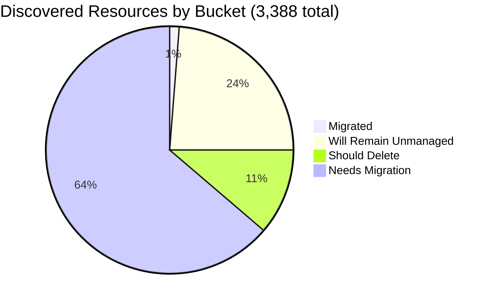

# Pulumi Migration Report — `pequod`

> **Generated:** July 28, 2026
> **Source:** Pulumi Insights (5 enrolled accounts) + Pulumi Cloud API
> **Scope:** All discovered cloud resources across enrolled Insights accounts.
> **Action taken:** None — this report only observes and recommends.

---

## 1. Executive Summary

**Org-wide migration coverage (Insights-discovered resources)**

```
░░░░░░░░░░░░░░░░░░░░ 1.2%  (42 of 3,388 discovered resources already under Pulumi IaC)
```

**Context:** `pequod` is the Pulumi CE team's shared demo and workshop organization. Compared to the June 29 report (5,946 discovered resources), discovered resources are down **42.9%** to 3,388 — the main CE account dropped by ~2,594 resources, consistent with cleanup of the ~700 orphaned `serverless-comp-NNN-consumer-*` IAM policies (and their attachments) flagged in the previous report. Meanwhile the org's IaC footprint exploded: **8,319 resources in 208 stacks** (vs ~297 in 21 stacks last week), driven by several large new projects onboarded this week including `github-config` (2,210 resources) and `dmvhm-infrastructure` (2,699 resources across 4 stacks).

| Bucket | Count | % of Discovered | % of Migratable Base |
|--------|------:|----------------:|--------------------:|
| ✅ Migrated (in Pulumi IaC stack) | 42 | 1.2% | 1.6% |
| 🔒 Will remain unmanaged | ~805 | 23.8% | — |
| 🗑️ Should be deleted | ~382 | 11.3% | 14.8% |
| ⚠️ Needs migration | ~2,159 | 63.7% | 83.6% |
| **Total discovered** | **3,388** | 100% | — |

*Migratable base = 2,583 (total − will-remain-unmanaged). Classification counts are estimated using deterministic pattern matching on sampled data — see §5 for methodology and confidence ratings.*
*8,277 additional IaC resources exist in stacks whose cloud accounts are not enrolled in Insights.*

**Single biggest takeaway:** The cleanup of orphaned demo IAM policies in the main CE account reduced total discovered resources by ~2,594 (−44%). Simultaneously, the org onboarded significant new production workloads into IaC this week — the largest weekly IaC growth on record.

**Data-quality caveats:** `aws-pulumi-ce-workshops-420942475186` now shows fresh data (previously 13+ months stale, last scanned May 2025); resource counts increased from 230 to 259, confirming a re-scan. No formal Pulumi Teams are configured; ownership is attributed by naming convention (mapping stated in §6). Classification bucket counts are pattern-estimated from sampled data — use "~" values for planning, verify before acting.

---

## 2. Migration Progress

### Org-wide four-bucket split (% of 3,388 discovered)

| Bucket | Bar | % |
|--------|-----|--:|
| Migrated | `░░░░░░░░░░░░░░░░░░░░` | 1.2% |
| Will remain unmanaged | `█████░░░░░░░░░░░░░░░` | 23.8% |
| Should delete | `██░░░░░░░░░░░░░░░░░░` | 11.3% |
| Needs migration | `████████████░░░░░░░░` | 63.7% |



### % Migrated by Account (of that account's discovered resources)

| Account | Bar | Migrated / Total |
|---------|-----|----------------:|
| aws-pulumi-ce-052848974346 | `░░░░░░░░░░░░░░░░░░░░` | 36 / 2,057 — 1.7% |
| aws-neo-eu-west-2-420942475186 | `░░░░░░░░░░░░░░░░░░░░` | 0 / 135 — 0.0% |
| azure-team-ce-subscription | `░░░░░░░░░░░░░░░░░░░░` | 3 / 328 — 0.9% |
| google-pulum-ce-team-438338752289 | `░░░░░░░░░░░░░░░░░░░░` | 3 / 609 — 0.5% |
| aws-pulumi-ce-workshops-420942475186 | `░░░░░░░░░░░░░░░░░░░░` | 0 / 259 — 0.0% |

*All accounts <2% — migration of Insights-visible resources has not yet begun in earnest. The real IaC story this week is in accounts not enrolled in Insights (see §3 Momentum).*

### % Migrated by Team (of "needs migration" in that team's scope)

*Ownership signal: account ownership (primary) → resource name prefix (secondary). See §6 for mapping.*

| Team / Owner | Needs Migration | Migrated | Bar |
|-------------|----------------:|---------:|-----|
| MitchGerdisch (aws-ce-052848974346 + workshops) | ~1,565 | 36 — 2.3% | `░░░░░░░░░░░░░░░░░░░░` |
| GCP CE (google-pulum-ce-team-438338752289) | ~336 | 3 — 0.9% | `░░░░░░░░░░░░░░░░░░░░` |
| Azure CE (azure-team-ce-subscription) | ~210 | 3 — 1.4% | `░░░░░░░░░░░░░░░░░░░░` |
| Robert Smith (aws-neo-eu-west-2-420942475186) | ~48 | 0 — 0.0% | `░░░░░░░░░░░░░░░░░░░░` |

---

## 3. Momentum

**Active Pulumi footprint (pequod org):** 540 total stacks · 208 stacks with active resources · **8,319 IaC-managed resources** · 31 stacks updated in July 2026

*Bars = stacks with resources updated per month, scaled to Jul 2026 peak (31).*

```
Jul 2026 ████████████████████ 31  ← busiest month on record (+138% vs Jun)
Jun 2026 ████████░░░░░░░░░░░░ 13
May 2026 ██████████░░░░░░░░░░ 16
Apr 2026 ██████░░░░░░░░░░░░░░  9
Mar 2026 ██░░░░░░░░░░░░░░░░░░  3
Feb 2026 ██░░░░░░░░░░░░░░░░░░  3
Jan 2026 ████░░░░░░░░░░░░░░░░  5
Dec 2025 ██░░░░░░░░░░░░░░░░░░  2
Nov 2025 ██████░░░░░░░░░░░░░░  8
Oct 2025 █████████░░░░░░░░░░░ 14
Sep 2025 ██░░░░░░░░░░░░░░░░░░  3
Aug 2025 █████████░░░░░░░░░░░ 14
Jul 2025 ███████░░░░░░░░░░░░░ 10
Jun 2025 █████░░░░░░░░░░░░░░░  7
```

**Activity pattern:** July 2026 is the biggest month on record, with 31 stacks updated and 5,917 IaC resources touched this month alone. This is driven by several large new projects onboarding this week, not organic CE team growth.

**Week-over-week highlights:**
- `github-config/dev`: 2,210 resources, updated Jul 27 (new this week)
- `dmvhm-infrastructure` (develop/staging/prod/qa): 2,699 combined resources, updated Jul 27-29 (new this week)
- `sgi-infrastructure-pulumi/testing`: 206 resources, updated Jul 23 (new this week)
- `face-finder-service/dev`: 180 resources, updated Jul 25 (new this week)
- `commercial-login-infrastructure/prod`: 153 resources, updated Jul 24 (new this week)
- `caas-migration/dev`: 57 resources, updated Jul 26 (new this week)

**Top projects by IaC resources (pequod org):**

| Project | Stack(s) | IaC Resources | Last Updated |
|---------|----------|--------------|-------------|
| github-config | dev | 2,210 | Jul 27, 2026 |
| dmvhm-infrastructure | develop/staging/prod/qa | 2,699 | Jul 27-29, 2026 |
| testEksLgAds | dev | 453 | Mar 2026 |
| sgi-infrastructure-pulumi | testing | 206 | Jul 23, 2026 |
| aws-go-console-slack-notification | pulumi-ce | 186 | Jun 2021 |
| face-finder-service | dev | 180 | Jul 25, 2026 |
| commercial-login-infrastructure | prod | 153 | Jul 24, 2026 |
| echo | main | 122 | Jul 2024 |
| shared-dev-eks | dev | 88 | Feb 2026 |
| pequod-user-mgmt | prod | 77 | Jul 8, 2026 |

Share of footprint active in the last 12 months: **91%** of stacks with resources (189 of 208) updated at least once since Jul 2025.

**Teams accelerating this week:** `github-config`, `dmvhm-infrastructure`, `sgi-infrastructure-pulumi`, `face-finder-service`, `commercial-login-infrastructure` — all new to Pulumi this week.
**Teams stalled (no updates in 90+ days):** `aws-go-console-slack-notification/pulumi-ce` (last updated Jun 2021 — likely orphaned), `testEksLgAds/dev` (last updated Mar 2026).

---

## 4. Coverage by Enrolled Account

> **Important:** Insights coverage reflects only enrolled accounts. The 8,319 IaC resources managed across 208 stacks largely live in accounts not enrolled in Insights, explaining why only 42 are visible as managed in Insights scans.

| Account | Cloud | Pulumi-Managed | Total Discovered | Coverage % | Bar | Last Scan |
|---------|-------|---------------:|-----------------:|------------|-----|-----------|
| aws-neo-eu-west-2-420942475186 | AWS | 0 | 135 | 0.0% | `░░░░░░░░░░░░░░░░░░░░` | Jul 2026 |
| aws-pulumi-ce-052848974346 | AWS | 36 | 2,057 | 1.7% | `░░░░░░░░░░░░░░░░░░░░` | Jul 2026 |
| aws-pulumi-ce-workshops-420942475186 | AWS | 0 | 259 | 0.0% | `░░░░░░░░░░░░░░░░░░░░` | Jul 2026 ✅ |
| azure-team-ce-subscription | Azure | 3 | 328 | 0.9% | `░░░░░░░░░░░░░░░░░░░░` | Jul 2026 |
| google-pulum-ce-team-438338752289 | GCP | 3 | 609 | 0.5% | `░░░░░░░░░░░░░░░░░░░░` | Jul 2026 |
| **Org Total** | — | **42** | **3,388** | **1.2%** | `░░░░░░░░░░░░░░░░░░░░` | — |

**✅ Workshops account re-scanned:** `aws-pulumi-ce-workshops-420942475186` is now current (was 13+ months stale in the Jun 29 report). Resource count is 259 (+29 vs stale snapshot), including new Bedrock AgentCore resources.

**vs. June 29 report:**
- `aws-pulumi-ce-052848974346`: 4,651 → 2,057 discovered (−2,594, −55.8%) — significant cleanup
- `google-pulum-ce-team-438338752289`: 604 → 609 (+5)
- `azure-team-ce-subscription`: 328 → 328 (unchanged)
- `aws-neo-eu-west-2-420942475186`: 133 → 135 (+2)
- `aws-pulumi-ce-workshops-420942475186`: 230 → 259 (+29, fresh re-scan)

**Enrollment gaps:** Enrolling the AWS account(s) backing `shared-dev-eks` (88 IaC resources) and the Azure account backing `shared-dev-aks` (17 IaC resources) would close most of the gap between the 8,319 stack-managed resources and the 42 currently visible in Insights.

---

## 5. Data Analysis

| Account | Cloud | Total | Migrated | Will Remain Unmanaged | Should Delete | Needs Migration | % Mig (All) | % Mig (Migratable) |
|---------|-------|------:|---------:|----------------------:|--------------:|----------------:|------------:|-------------------:|
| aws-pulumi-ce-052848974346 | AWS | 2,057 | 36 | ~350 | ~220 | ~1,451 | 1.7% | 2.4% |
| aws-neo-eu-west-2-420942475186 | AWS | 135 | 0 | ~80 | ~7 | ~48 | 0.0% | 0.0% |
| azure-team-ce-subscription | Azure | 328 | 3 | ~35 | ~80 | ~210 | 0.9% | 1.4% |
| google-pulum-ce-team-438338752289 | GCP | 609 | 3 | ~220 | ~50 | ~336 | 0.5% | 0.8% |
| aws-pulumi-ce-workshops-420942475186 | AWS | 259 | 0 | ~120 | ~25 | ~114 | 0.0% | 0.0% |
| **Org Total** | — | **3,388** | **42** | **~805** | **~382** | **~2,159** | **1.2%** | **1.6%** |

**Classification methodology:**
- *Will remain unmanaged:* AWS Service Linked Roles (path `/aws-service-role/`) + their policy attachments; CloudFront `Managed-*` cache/origin/request/response policies; default VPCs, subnets, SGs, IGWs, route tables; IoT `iot:*` system domain configs; default EventBus, Athena `primary` workgroup, ElastiCache default user; RDS default option groups; AWS CloudWatch log resource policies (AWS-managed); GCP project service APIs; GCP default subnetworks and GCF/App Engine auto-created storage buckets; Azure MC_* AKS node RGs, cloud-shell-storage-* RGs.
- *Should delete:* Resources with explicit test/temp names, old RDS snapshots, stale CloudFormation stacks, hex-name auto-generated demo RGs.
- *Needs migration:* All remaining active cloud infrastructure not yet in Pulumi IaC.
- *Classification confidence:* HIGH for "will remain unmanaged" (deterministic patterns on sampled data); MEDIUM for "should delete" (naming heuristics — human review required before acting). Counts marked `~` are estimates from pattern analysis.

**Three noteworthy specifics:**
- **Cleanup confirmed:** `aws-pulumi-ce-052848974346` dropped from 4,651 to 2,057 resources (−2,594). The ~700 orphaned `serverless-comp-NNN-consumer-*` IAM policies flagged in the Jun 29 report are no longer visible in the resource index, suggesting the cleanup recommendation was acted upon. This is the primary driver of the org-wide resource count drop.
- **New deletion target visible:** `mitch-karpenter-queue-deleteme` SQS queue + policy found in `aws-pulumi-ce-052848974346/us-east-1` (the name itself indicates intent). A network firewall policy named `test` also visible in us-west-2.
- **GCP account name typo persists:** `google-pulum-ce-team` (missing `i`) still registered; correct in account settings for clarity.

---

## 6. Actions Needed

### Migration Queue by Team

**Ownership mapping used:**
(1) Resource tag `Owner` or `team` where present →
(2) Resource name prefix: `mitch-*`, `mitchselfhosted-*` → MitchGerdisch; `workshop*` → Workshop Team; `piers-*` → Piers K.; `pk-*` → PK; `zbuchheit-*` → Z. Buchheit; `jconnell-*` → J. Connell; `wladi-*`/`rg-dbw-my-team-wladi-*` → Wladi; `rg-dbw-*` → Databricks CE subteam; `aureq-*`, `menfin-*` → individual CEs →
(3) Account owner as fallback.

---

**MitchGerdisch** (~1,565 resources needing migration)
*Accounts: aws-pulumi-ce-052848974346 + aws-pulumi-ce-workshops-420942475186*

| Priority | Resource(s) | Why |
|----------|------------|-----|
| 🔴 High | `eks-cluster-eksClusterSecurityGroup-40e8730` / VPC `vpc-027cdd4405a2969ef` + subnets (us-west-2) | Core EKS networking not in IaC; actively supporting `shared-dev-eks` stack |
| 🔴 High | `lotctl-bucket-9ce02ad` S3 + `lotctl-cf-static-website-*` logging bucket | Active project with Pulumi stacks (`lotctl-k8s-aws`); cloud resources should be imported |
| 🔴 High | `app-repo-9e2b91f` ECR + `secGroup-12befae` SG (us-west-2) | Active workload supporting infra, no stack reference |
| 🟡 Medium | `pulumiselfhost-nodeSecurityGroup-e29df76` SG + associated networking | Self-hosted Pulumi infra; should be in IaC to prevent accidental deletion |
| 🟡 Medium | `console-slack-alerts-us-west-2-*` EventBridge rules + S3 bucket | Monitoring/alerting infra still active; import into `aws-go-console-slack-notification` stack |
| 🗑️ Delete | `mitch-karpenter-queue-deleteme` SQS + policy (us-east-1) | Name signals deletion intent; delete now |
| +1,559 more | VPCs, route tables, subnets, Lambda layers, API GW resources across regions | Group by service domain; tackle EKS networking first |

---

**Azure CE Team** (~210 resources needing migration)
*Account: azure-team-ce-subscription; mixed CE member resources*

| Priority | Resource(s) | Why |
|----------|------------|-----|
| 🔴 High | `rg-dbw-my-team-wladi-dev` / `rg-dbw-my-team-1-dev` / `rg-dbw-team-alpha-dev` Databricks workspaces + VNets + NSGs | Active Databricks environments; 3 workspace clusters, 5+ VNets |
| 🔴 High | `rg-hub-network-dev` hub VNet + `onprem-vnet2fd7683c` + VPN gateway + NVA VM | Hub-and-spoke network used by spoke workloads |
| 🔴 High | `pequod-keyvault` RG (likely Key Vault) | CE team secret store; critical to keep in IaC |
| 🟡 Medium | `rg-sentinel-pulumi-test` (Log Analytics workspace + DCE `ASI-a70baee9-*`) | Active security/monitoring workspace; data collection endpoint is live |
| 🟡 Medium | `mitch-selfhosted.com` Azure DNS zone | Self-hosted Pulumi DNS; one record loss breaks self-hosted environment |
| +205 more | Storage accounts, NSGs, identity resources, App Service | Group by RG owner prefix |

---

**GCP CE Team** (~336 resources needing migration)
*Account: google-pulum-ce-team-438338752289; no single owner*

| Priority | Resource(s) | Why |
|----------|------------|-----|
| 🔴 High | `menfin-demo-diy-state-storage-bucket-36159f1` + `aureq-pulumi-diy-state-storage` | **Pulumi state storage buckets** — losing these breaks stacks; must be in IaC immediately |
| 🔴 High | `mitchselfhosted-mitchsh-network-afa8380` subnets (asia-south1, europe-west12, me-central1) + self-hosted storage | Active self-hosted Pulumi network |
| 🔴 High | `my-demo-network` VPC + 30+ regional subnets | Custom network used by compute workloads; accidental deletion would break active demos |
| 🟡 Medium | `pulumi-oidc-mtan` / `pulumi-menfin-aureq-oidc` WIF pools + providers | OIDC identity pools; lose these and automated access breaks |
| 🟡 Medium | `zendesk-domestic-subnet-7da16b0` (australia-southeast2) | Named after external customer — confirm if active |
| +331 more | Service accounts, WIF providers, Cloud DNS records, storage IAM | Group by resource owner name prefix |

---

**Robert Smith** (~48 resources needing migration)
*Account owner: aws-neo-eu-west-2-420942475186*

| Priority | Resource(s) | Why |
|----------|------------|-----|
| 🔴 High | `workshops.pulumi-ce.team` Route53 zone + NS + SOA records | Active DNS zone for all workshop participants — critical |
| 🔴 High | `workshop-instructor-role` (tag `Owner=workshops`) | Active IAM role used to provision participants' accounts |
| 🟡 Medium | `lambda-role-for-account-cleanup` + policy attachment | Active account-cleanup automation Lambda |
| 🟡 Medium | `insights-account-scan` IAM role + policy | The Insights scanning role itself — should be in IaC |
| 🟢 Low | `be144c85-e533-41ba-8d03-4b59b839cd1d` KMS key (eu-west-2) | Active key; import to prevent accidental scheduled deletion |
| +43 more | OIDC roles, CloudFront Managed-* (will-remain-unmanaged), IoT system configs | Audit OIDC roles; import active ones |

---

### Deletion Candidates

*Recommend human review before deleting any of these. Classification is based on naming heuristics.*

| Pattern | Count | Account | Reason |
|---------|------:|---------|--------|
| `mitch-karpenter-queue-deleteme` SQS queue + QueuePolicy | 2 | aws-pulumi-ce-052848974346/us-east-1 | Name explicitly marks for deletion |
| `snapshot-*` / `preupgrade-tf-202103*` RDS cluster snapshots | ~5 | aws-pulumi-ce-052848974346 (us-east-2, us-east-1, us-west-2) | Old automated/manual snapshots; oldest from 2021 pre-Terraform-migration |
| `example-cluster-3-759307b5`, `argo-example-a7040316` CloudFormation stacks | 2 | aws-pulumi-ce-052848974346 (us-west-2, us-east-2) | Stale CFN stacks from 2021–2023 demos |
| `test` NetworkFirewallPolicy | 1 | aws-pulumi-ce-052848974346/us-west-2 | Explicit test name; no production firewall use case |
| `megan-test-backend`, `james-bucket-test-4c0k`, `pulumi-sticker-arts-f12ef29` | 3 | aws-pulumi-ce-052848974346 | Explicit test/personal names; no active workload reference |
| `mitch-assumerole-test` S3 bucket + ownership controls + role | 3 | aws-pulumi-ce-workshops-420942475186 | Explicit test name; present in both CE accounts |
| `piers-resourcegroup-12345`, `rs-test`, `resourceGroup2dca640c`, `resourceGroupf79d3f3b`, `resourceGroup5fb3a110`, `rsv-rg` Azure RGs + sub-resources | ~80 | azure-team-ce-subscription | Explicit test names or opaque hex-suffix auto-generated names |
| `my-app-secret` GCP Secret Manager secret | 1 | google-pulum-ce-team-438338752289 | Generic test name; confirm before deleting |
| `uptime-rg21c74a0b` Azure RG | ~5 | azure-team-ce-subscription | Auto-generated uptime-check RG with hex suffix |

---

### Unattributed Resources (significant items where ownership could not be resolved)

| Resource | Account | Why Unresolved |
|----------|---------|---------------|
| `snqawpscpmsharedacr` Container Registry | azure-team-ce-subscription | Opaque name; no owner prefix or tag; may be shared ACR for multiple demos |
| `console-slack-alerts-eu-west-3-01d9c45` S3 + EventBridge rules (multiple regions) | aws-pulumi-ce-052848974346 | Monitoring infra with no owner tag; no active IaC stack references it |
| `dev/ehrPlatform/testSecret` Secrets Manager secret (us-east-1) | aws-pulumi-ce-052848974346 | EHR platform secret in CE account — unclear owner or whether this is a live secret |
| `MCOrient` IAM role | aws-pulumi-ce-workshops-420942475186 | Orientation/onboarding role; unclear if still in active use |
| `AmazonBedrockAgentCoreHarnessDefaultServiceRole-q81d1` + policy | aws-pulumi-ce-workshops-420942475186 | New Bedrock AgentCore harness role (first seen after re-scan); confirm owner |
| `synapse` Azure Resource Group | azure-team-ce-subscription | Azure Synapse workspace RG; no sub-resources visible, may be empty |

---

## 7. Week-over-Week Changes (vs June 29, 2026)

| Metric | Jun 29 | Jul 28 | Change |
|--------|-------:|-------:|-------:|
| Total discovered resources | 5,946 | 3,388 | −2,558 (−43%) |
| Managed in Insights | 53 | 42 | −11 |
| Needs migration | 3,880 | ~2,159 | −1,721 |
| Should delete | 970 | ~382 | −588 |
| Total IaC resources (all stacks) | ~297 | 8,319 | +8,022 (+2,700%) |
| Stacks with resources | 21 | 208 | +187 |

**Summary:** The discovery-side cleanup is working — total unmanaged resources dropped 43% in one week. The IaC onboarding side accelerated dramatically this week with multiple large new projects. If Insights enrollment is extended to the accounts hosting these new projects, migration coverage will improve substantially.

---

*Classification counts are estimated using pattern matching on sampled Insights data (~50 resources per account). All "~" values should be treated as directional indicators; verify exact counts before initiating bulk delete or migration operations.*
