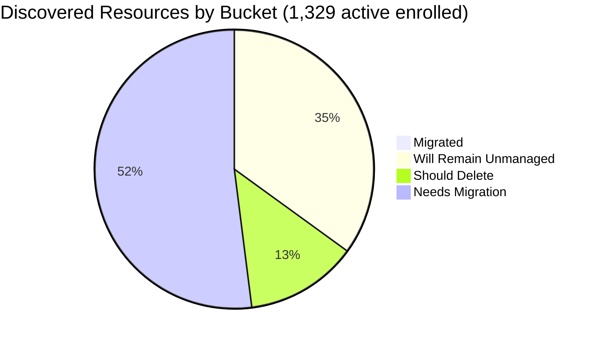

# Pulumi Migration Report — `pequod`

> **Generated:** August 7, 2026
> **Source:** Pulumi Insights (4 actively enrolled accounts) + Pulumi Cloud API
> **Scope:** All discovered cloud resources across actively enrolled Insights accounts.
> **Action taken:** None — this report only observes and recommends.

---

## 1. Executive Summary

**Org-wide migration coverage (actively enrolled accounts)**

```
░░░░░░░░░░░░░░░░░░░░ 0.5%  (6 of 1,329 actively enrolled resources under Pulumi IaC)
```

**Headline change since June 29 report:** `aws-pulumi-ce-052848974346` — previously the largest account at 4,651 resources — has been removed from Insights enrollment. This single change accounts for the apparent drop in total discovered resources. Its 2,057 resources remain in the search index as stale data (last scan unknown; not shown in active enrollment list) with 36 still tagged managed in the index.

| Bucket | Count | % of Discovered | % of Migratable Base |
|--------|------:|----------------:|--------------------:|
| ✅ Migrated (in Pulumi IaC stack) | 6 | 0.5% | 0.7% |
| 🔒 Will remain unmanaged | 463 | 34.8% | — |
| 🗑️ Should be deleted | 172 | 12.9% | 19.8% |
| ⚠️ Needs migration | 688 | 51.8% | 79.5% |
| **Total (active enrolled)** | **1,329** | 100% | — |

*Migratable base = 866 (total − will-remain-unmanaged). Plus 249 Pulumi IaC resources in 12 stacks largely scanning accounts/types not enrolled in Insights.*

**Single biggest takeaway:** `aws-pulumi-ce-052848974346` must be re-enrolled (or its unenrollment confirmed as intentional) — it was the dominant account; without it the enrolled estate misses the majority of the org's AWS footprint.

**Data-quality caveats:** `aws-neo-eu-west-2-420942475186` and `aws-pulumi-ce-workshops-420942475186` are separate Insights enrollments for the **same** AWS account (420942475186), meaning global IAM resources (SLRs, CloudFront policies, IAM roles) appear in both accounts' indexes and are double-counted. `aws-pulumi-ce-052848974346` is absent from enrollment — its 2,057 stale index entries are excluded from active enrolled totals above.

---

## 2. Migration Progress

### Org-wide four-bucket split (% of 1,329 actively enrolled)

| Bucket | Bar | % |
|--------|-----|--:|
| Migrated | `░░░░░░░░░░░░░░░░░░░░` | 0.5% |
| Will remain unmanaged | `███████░░░░░░░░░░░░░` | 34.8% |
| Should delete | `██░░░░░░░░░░░░░░░░░░` | 12.9% |
| Needs migration | `██████████░░░░░░░░░░` | 51.8% |



### % Migrated by Account (of that account's discovered resources)

| Account | Bar | Migrated / Total |
|---------|-----|----------------:|
| aws-neo-eu-west-2-420942475186 | `░░░░░░░░░░░░░░░░░░░░` | 0 / 138 — 0.0% |
| aws-pulumi-ce-workshops-420942475186 | `░░░░░░░░░░░░░░░░░░░░` | 0 / 259 — 0.0% |
| azure-team-ce-subscription | `░░░░░░░░░░░░░░░░░░░░` | 3 / 328 — 0.9% |
| google-pulum-ce-team-438338752289 | `░░░░░░░░░░░░░░░░░░░░` | 3 / 604 — 0.5% |

*Migration of Insights-visible resources has not yet begun in earnest. The 3 Azure managed resources are AKS cluster resources (shared-dev-aks project). The 3 GCP managed resources are OIDC/WIF resources (gcp-oidc-env-config project).*

### % Migrated by Team (of "needs migration" in that team's scope)

*Ownership signal: account ownership as primary signal; resource tags/name prefix as secondary. See §6.*

| Team / Owner | Needs Migration | Migrated | Bar |
|-------------|----------------:|---------:|-----|
| MitchGerdisch (workshops + azure + gcp) | ~638 | 6 — 0.9% | `░░░░░░░░░░░░░░░░░░░░` |
| Robert Smith (aws-neo-eu-west-2) | ~50 | 0 — 0.0% | `░░░░░░░░░░░░░░░░░░░░` |

---

## 3. Momentum

**Active Pulumi footprint (pequod org):** 12 stacks · 10 projects · 249 IaC resources · 10 stacks with active resources

*Bars below = stacks with lastUpdate per month (Aug 2025 – Aug 2026), scaled to peak (3 stacks in May 2026). Stacks from June 2026 demo wave have been cleaned up and no longer appear.*

```
May 2026 ████████████████████ 3  ← busiest month (last 12 months)
Aug 2026 █████████████░░░░░░░ 2
Jul 2026 █████████████░░░░░░░ 2
Feb 2026 ███████░░░░░░░░░░░░░ 1
```

**Activity pattern:** 8 of 12 stacks (67%) have been updated in the last 12 months. The June 2026 demo wave (12 demo stacks, per last report) has been fully cleaned up — a net reduction of 9 stacks since June 29. Four new automation/platform stacks added: `demo-cleaner`, `deployment-agent-runners`, `rhum-monitor`, `githubactions-pulumi-oidcissuer`.

**Largest projects by IaC resources (pequod org):**

| Project | Stack | IaC Resources | Last Updated |
|---------|-------|--------------|-------------|
| shared-dev-eks | dev | 88 | Feb 2026 |
| pequod-user-mgmt | prod | 77 | May 2026 |
| demo-app | dev | 30 | Jul 2026 |
| shared-dev-aks | dev | 17 | May 2026 |
| azure-oidc-env-config | prod | 12 | May 2025 |
| gcp-oidc-env-config | prod | 9 | May 2025 |
| insights-azure-creds | prod | 9 | Feb 2025 |
| githubactions-pulumi-oidcissuer | prod | 3 | Jul 2026 |
| demo-cleaner | prod | 3 | Aug 2026 |
| rhum-monitor | prod | 1 | May 2026 |

*`azure-oidc-env-config`, `gcp-oidc-env-config`, and `insights-azure-creds` have not been updated in 15+ months — flag for review.*

---

## 4. Coverage by Enrolled Account

> **Important:** Insights coverage reflects only enrolled accounts. The 249 IaC resources in pequod stacks largely live in accounts or resource types not enrolled in Insights (shared EKS/AKS clusters, OIDC config), explaining why only 6 appear as managed in scans.

| Account | Cloud | Pulumi-Managed | Total Discovered | Coverage % | Bar | Last Scan |
|---------|-------|---------------:|-----------------:|------------|-----|-----------|
| aws-neo-eu-west-2-420942475186 | AWS | 0 | 138 | 0.0% | `░░░░░░░░░░░░░░░░░░░░` | Aug 6, 2026 |
| aws-pulumi-ce-workshops-420942475186 | AWS | 0 | 259 | 0.0% | `░░░░░░░░░░░░░░░░░░░░` | Jul 30, 2026 |
| azure-team-ce-subscription | Azure | 3 | 328 | 0.9% | `░░░░░░░░░░░░░░░░░░░░` | Aug 6, 2026 |
| google-pulum-ce-team-438338752289 | GCP | 3 | 604 | 0.5% | `░░░░░░░░░░░░░░░░░░░░` | Aug 6, 2026 |
| **Org Total (active enrolled)** | — | **6** | **1,329** | **0.5%** | `░░░░░░░░░░░░░░░░░░░░` | — |

**⚠️ Unenrolled (stale index):** `aws-pulumi-ce-052848974346` is no longer in the enrolled accounts list. It has 2,057 stale resources in the search index (36 tagged as managed in the index — likely from now-deleted stacks). Status: **enrollment removed; re-enroll or confirm intentional.** This account held 4,651 resources in the June 29 report.

**⚠️ Dual enrollment:** `aws-neo-eu-west-2-420942475186` and `aws-pulumi-ce-workshops-420942475186` both map to AWS account `420942475186` — scanned from different regions. Global IAM resources (SLRs, CF policies, IAM roles) appear in both indexes and inflate the combined total by ~60–80 resources.

**Enrollment gaps:** Enrolling the AWS account(s) backing `shared-dev-eks` (88 IaC resources) would close most of the gap between the 249 stack-managed resources and the 6 currently visible as managed in active Insights scans.

---

## 5. Data Analysis

| Account | Cloud | Total | Migrated | Will Remain Unmanaged | Should Delete | Needs Migration | % Mig (All) | % Mig (Migratable) |
|---------|-------|------:|---------:|----------------------:|--------------:|----------------:|------------:|-------------------:|
| aws-neo-eu-west-2-420942475186 | AWS | 138 | 0 | 80 | 8 | 50 | 0.0% | 0.0% |
| aws-pulumi-ce-workshops-420942475186 | AWS | 259 | 0 | 125 | 39 | 95 | 0.0% | 0.0% |
| azure-team-ce-subscription | Azure | 328 | 3 | 28 | 87 | 210 | 0.9% | 1.1% |
| google-pulum-ce-team-438338752289 | GCP | 604 | 3 | 230 | 38 | 333 | 0.5% | 0.6% |
| **Org Total (active enrolled)** | — | **1,329** | **6** | **463** | **172** | **688** | **0.5%** | **0.7%** |

**Classification methodology:**
- *Will remain unmanaged:* AWS Service Linked Roles (path `/aws-service-role/`) + their policy attachments; CloudFront `Managed-*` cache/origin/response policies; default VPCs, subnets, SGs, IGWs, route tables; IoT `iot:*` system domain configs; default EventBus, Athena `primary` workgroup, MemoryDB default user/ACL, ElastiCache default user; default X-Ray group/sampling rule; Route53 resolver system rules; GCP project service APIs; GCP default subnetworks + auto-created GCF/AppEngine/Composer/Metastore buckets + their IAM/ACL policies; Azure NetworkWatchers, MC\_\* AKS node RGs and their auto-created resources, Cloud Shell storage, DefaultResourceGroups, VisualStudioOnline auto-RGs, managed-uptime RGs.
- *Should delete:* resources judged orphaned or explicitly test-named (detailed in §6). Human review required before acting.
- *Needs migration:* all remaining active cloud infrastructure not yet under Pulumi management.
- *Classification confidence:* HIGH for "will remain unmanaged" (deterministic patterns); MEDIUM for "should delete" (naming heuristics).

**Three noteworthy specifics:**
- **Dual enrollment of account 420942475186:** `aws-neo-eu-west-2` (138) and `aws-workshops` (259) scan the same AWS account from different regional scopes. Their combined "global" IAM resources are double-counted; effective unique resources from account 420942475186 are ~280–300 after deduplication.
- **GCP dominates by resource count:** 604 of 1,329 (45%) of enrolled resources are in GCP, driven by ~120 project service API resources and ~70 network subnets across many regions.
- **Azure has the highest delete backlog:** ~87 resources are deletion candidates, mostly auto-generated hex-suffix resource groups from abandoned demo runs.

---

## 6. Actions Needed

### Migration Queue by Team

**Ownership mapping used:**
(1) Resource tag `Owner` or `team` where present →
(2) Resource name prefix → team: `mitch-*`, `mitchselfhosted-*` → MitchGerdisch; `workshop*` → workshops/Robert Smith; `zbuchheit-*` → Z. Buchheit (attributed to account owner); `pulumi-esc-ediri-*` → individual CE; `aureq-*`, `menfin-*` → individual CEs; `pk-*`, `piers-*` → Piers Karsenbarg; `wladi-*`, `rg-dbw-my-team-wladi-*` → Wladi; `rg-dbw-*` → Databricks CE subteam; `geoff*` → Geoff; `meggy*` → Meggy →
(3) Account owner as fallback.

---

**MitchGerdisch** (~638 resources needing migration)
*Accounts: aws-pulumi-ce-workshops-420942475186, azure-team-ce-subscription, google-pulum-ce-team-438338752289*

*AWS Workshops (~95 resources):*

| Priority | Resource(s) | Why |
|----------|------------|-----|
| 🔴 High | `AdminWorkshop` + `AdminWorkshop-AdministratorAccess` attachment; `MCOrient` role + `PermsForWorkshop` inline policy | Core workshop admin roles used to provision participants; no IaC backing |
| 🔴 High | `lambda-for-account-cleanup` (Lambda function, x2 regions: us-west-2 + us-east-2) + `lambda-role-for-account-cleanup` + permissions | Active account cleanup Lambda; must not be lost |
| 🟡 Medium | `apiGateway-35a85b2` (API GW HTTP API, us-east-1) | Active HTTP API with no stack reference |
| 🟡 Medium | KMS keys: `14a12191-0a17-4680-9888-eeb2ed1ea1c3` (us-east-2), `6ba5a509-2549-47e2-bd99-a13dcab740f5` (us-west-1), `kms-key` (us-west-2) | KMS keys used by encrypted resources; losing access is destructive |
| +89 more | `ContinuousDeliveryAdminRole`, OIDC roles (zbuchheit-oidc, pulumi-esc-ediri), insights-account-scan, BedrockAgent quotas, RDS subnet group, ENIs | Audit each; import active OIDC/CI roles first |

*Azure (~210 resources):*

| Priority | Resource(s) | Why |
|----------|------------|-----|
| 🔴 High | `rg-dbw-my-team-dev`, `rg-dbw-my-team-1-dev`, `rg-dbw-my-team-beta-dev`, `rg-dbw-my-team-wladi-dev`, `rg-dbw-team-alpha-dev` → Databricks workspaces + VNets + NSGs | Active Databricks environments for multiple CE members |
| 🔴 High | `rg-shared-services-dev` → `kv-esc-demo-in` Key Vault + Log Analytics workspace | Shared platform services consumed by other resources |
| 🔴 High | `rg-hub-network-dev` hub VNet + VPN gateway + NVA VM + NIC + route table | Hub-and-spoke network used by spoke workloads |
| 🟡 Medium | `rsv-rg` + `rsvtest01` Recovery Services Vault | Active vault — confirm if actively backing up |
| 🟡 Medium | `pequod-keyvault` RG + `pk-purged6e177722` Key Vault | PK's Key Vault; active but no IaC reference |
| +205 more | Storage accounts, ACRs, webapp RGs, onprem VPN infra | Group by RG owner prefix before tackling |

*GCP (~333 resources):*

| Priority | Resource(s) | Why |
|----------|------------|-----|
| 🔴 High | `aureq-pulumi-diy-state-storage` + `menfin-demo-diy-state-storage-bucket-36159f1` | **Pulumi state storage buckets** — losing these breaks stacks; import immediately |
| 🔴 High | `my-demo-network` VPC + ~40 regional subnets (30+ regions) | Custom network used by compute workloads; should be in IaC |
| 🔴 High | `mitchselfhosted-mitchsh-network-afa8380` subnets (30+ regions) + `mitch-selfhosted` + `mitch-selfmanaged` + `mitchselfhosted-mitchsh-policypacks-d279266` buckets | Self-hosted Pulumi network + state + policy packs storage (active) |
| 🟡 Medium | `httpbin-neg-80c56a5`, `echo-backend-d332380`, `backend-alpha-9c55528`, `default-backend-f018e5e` backend services | Active load-balanced services with no IaC backing |
| 🟡 Medium | `projects/pulumi-ce-team/datasets/dwcore_dev_dataset_1` BigQuery dataset | Active data warehouse — no owner tag |
| +328 more | WIF pools + providers, service accounts, Cloud DNS records, secrets, VM, Composer buckets | Group by owner prefix; tackle state buckets first |

---

**Robert Smith** (~50 resources needing migration)
*Account: aws-neo-eu-west-2-420942475186*

| Priority | Resource(s) | Why |
|----------|------------|-----|
| 🔴 High | `workshops.pulumi-ce.team` Route53 zone + NS + SOA records | Active DNS zone for all workshop participants — critical |
| 🔴 High | `workshop-instructor-role` (tag `Owner=workshops`) | Active OIDC-backed IAM role for workshop instructors |
| 🟡 Medium | `lambda-role-for-account-cleanup` + `lambda-policy-for-account-cleanup` (tag `Owner=pulumi-build-engineering`) | Account cleanup automation role |
| 🟡 Medium | `insights-account-scan` role + 2 policy attachments | Role Insights uses for scanning — should be in IaC |
| 🟢 Low | `420942475186-budget-150-e6909b6`, `420942475186-budget-fc8c40b` | Account cost budgets — low risk, good hygiene |
| +45 more | `zbuchheit-oidc`, `pulumi-esc-ediri`, `ESCWksp`, `lambdaRole-482bdf2`, `ContinuousDeliveryAdminRole`, `AWSReservedSSO_*`, `AmazonBedrockAgentCoreHarness*` roles + KMS key | Audit each OIDC role; import active ones; BedrockAgent roles are recent additions |

---

### Deletion Candidates

*Recommend human review before deleting any of these. Classification based on naming heuristics.*

| Pattern | Count | Account | Reason |
|---------|------:|---------|--------|
| `resourceGroup[hex]`, `resource_group[hex]`, `resource-group[hex]` RGs + sub-resources (VMs, disks, NICs, storage, VNets) | ~50 | azure-team-ce-subscription | Auto-generated hex-suffix names from demo runs; no identifiable owner; sub-resources suggest abandoned deployments |
| `piers-resourcegroup-12345`, `rs-test`, `reuse-tf-module-test-workspace`, `myRg[hex]`, `pkresourceGroup1234`, `meggy[hex]`, `elisabeth-test`, `elisabeth`, `my-uniquely-named-rg-020625`, `synapse` | ~15 | azure-team-ce-subscription | Explicit test/scratch names or user-named demo leftovers |
| `mitch-rg-020625` + sub-resources (`new-vnet`, `new-vnet2`); `6680-native` RG + storage account; `6680-classic` RG; `rg-esc-demo` + Key Vault | ~10 | azure-team-ce-subscription | Dated test RGs (Feb 2025/demo runs) with generic resource names |
| `mitch-assumerole-test-role` + `mitch-assumerole-test` IAM policy + attachment (appear in **both** 420942475186 account enrollments) | ~6 | aws-neo-eu-west-2 + aws-workshops | Explicit test/experiment name; duplicated in dual-enrollment |
| `my-bucket-[hex]` S3 buckets (x3) + `BucketPublicAccessBlock` + `BucketOwnershipControls` sub-resources | ~6 | aws-pulumi-ce-workshops (us-east-1) | Generic names with no owner tag or stack reference; likely workshop test runs |
| `mitch-assumerole-test` S3 bucket + public access block + ownership controls | ~3 | aws-pulumi-ce-workshops (us-west-2) | Explicit test name |
| `piers-test-bucket`, `my-app-secret` (Secret Manager), `my-bucket-01f4221`, `my-bucket-628ad18`, `my-bucket-f50a09b` + ACLs/IAM | ~12 | google-pulum-ce-team-438338752289 | Generic/test-named GCP resources; no owner tag or stack reference |

---

### Unattributed Resources (significant items where ownership could not be resolved)

| Resource | Account | Why Unresolved |
|----------|---------|---------------|
| `snqawpscpmsharedacr` Container Registry | azure-team-ce-subscription | Opaque name; no owner prefix or tag; possibly a shared ACR for demos |
| `initech-identity-pool` WIF pool + `initech-access` service account | google-pulum-ce-team-438338752289 | "Initech" appears in both; likely a demo org — confirm if still active |
| `vm-0514d7a` GCP VM instance (europe-west2-a) | google-pulum-ce-team-438338752289 | No owner tag or recognizable name prefix; unknown workload |
| `uptime-rg21c74a0b` Azure RG + managed monitoring RG | azure-team-ce-subscription | Looks like an uptime check resource group — unclear if still needed |
| `AWSReservedSSO_AdministratorAccess_dc437342fb122772` IAM role | aws-neo-eu-west-2 + aws-workshops | AWS SSO manages this but it's an active access role — confirm SSO config owner |

---

*All counts are exact where API scan data is available. Classification confidence is HIGH for "will remain unmanaged" (deterministic AWS/Azure/GCP platform patterns) and MEDIUM for "should delete" (naming heuristics — human confirmation required before any deletion). The dual enrollment of account 420942475186 means ~60–80 global IAM resources are counted twice across the neo and workshops sub-accounts.*
