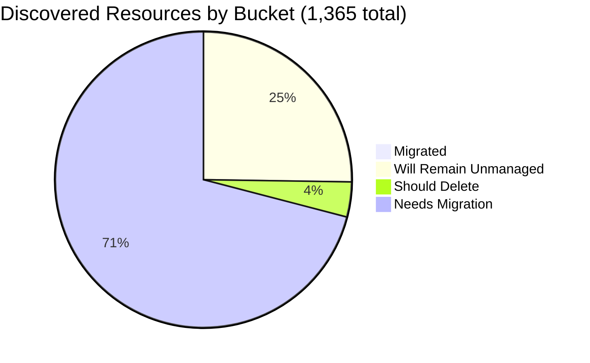

# Pulumi Migration Report — `pequod`

> **Generated:** August 14, 2026
> **Source:** Pulumi Insights (4 enrolled accounts) + Pulumi Cloud API
> **Scope:** All discovered cloud resources across enrolled Insights accounts.
> **Action taken:** None — this report only observes and recommends.

---

## 1. Executive Summary

**Org-wide migration coverage (Insights-discovered resources)**

```
░░░░░░░░░░░░░░░░░░░░ 0.4%  (6 of 1,365 discovered resources already under Pulumi IaC)
```

**Context:** `pequod` is the Pulumi CE (Customer Engineering) team's shared demo and organization. This report reflects a major structural shift since June 2026: the primary AWS CE account (`aws-pulumi-ce-052848974346`, previously the largest Insights account with 4,651 resources) has been **removed from Insights enrollment**, dropping total discovered resources from 5,946 to 1,365 (-77%). Simultaneously, the org's **IaC footprint has grown dramatically** — from ~297 managed resources across 21 stacks in June to **9,670 resources across 560 stacks in August**, driven by new customer engagement projects (SGI, DMVHM, Milliman, Case Management, and others). These IaC resources largely exist in accounts not enrolled in Insights, which explains the continued low Insights coverage ratio.

| Bucket | Count | % of Discovered | % of Migratable Base |
|--------|------:|----------------:|--------------------:|
| ✅ Migrated (in Pulumi IaC stack) | 6 | 0.4% | 0.6% |
| 🔒 Will remain unmanaged | 343 | 25.1% | — |
| 🗑️ Should be deleted | 52 | 3.8% | 5.1% |
| ⚠️ Needs migration | 964 | 70.6% | 94.3% |
| **Total discovered** | **1,365** | 100% | — |

*Migratable base = 1,022 (total − will-remain-unmanaged). Buckets sum to account totals; accounts sum to 1,365.*
*Plus 285 Pulumi IaC resources in stacks not enrolled in Insights (Kubernetes, OIDC/ESC config, non-cloud-scanned types).*

**Single biggest takeaway:** `aws-pulumi-ce-052848974346` (4,651 resources) was removed from Insights enrollment since the June report — this is the dominant factor in the 77% drop in discovered resources. Re-enrolling it would restore full visibility over the CE estate. GCP holds the highest absolute "needs migration" count (456) driven by the sprawling `my-demo-network` VPC with subnets in 30+ regions.

**Data-quality caveats:** `aws-pulumi-ce-workshops-420942475186` last scanned July 30, 2026 (2 weeks stale). No formal Pulumi Teams are configured; ownership attributed by account/name convention (mapping in §6). Azure unmanaged count (272 from resource search vs. 341 implied by scan total) indicates ~69 resources not yet indexed — actual unmanaged count may be slightly higher.

---

## 2. Migration Progress

### Org-wide four-bucket split (% of 1,365 discovered)

| Bucket | Bar | % |
|--------|-----|--:|
| Migrated | `░░░░░░░░░░░░░░░░░░░░` | 0.4% |
| Will remain unmanaged | `█████░░░░░░░░░░░░░░░` | 25.1% |
| Should delete | `█░░░░░░░░░░░░░░░░░░░` | 3.8% |
| Needs migration | `██████████████░░░░░░` | 70.6% |



### % Migrated by Account (of that account's discovered resources)

| Account | Bar | Migrated / Total |
|---------|-----|----------------:|
| aws-neo-eu-west-2-420942475186 | `░░░░░░░░░░░░░░░░░░░░` | 0 / 158 — 0.0% |
| aws-pulumi-ce-workshops-420942475186 ⚠️ stale | `░░░░░░░░░░░░░░░░░░░░` | 0 / 259 — 0.0% |
| azure-team-ce-subscription | `░░░░░░░░░░░░░░░░░░░░` | 3 / 344 — 0.9% |
| google-pulum-ce-team-438338752289 | `░░░░░░░░░░░░░░░░░░░░` | 3 / 604 — 0.5% |

*Azure leads at 0.9% (shared-dev-aks RG + identity + cluster). All accounts remain well below 1% Insights-visible coverage.*

### % Migrated by Team (of "needs migration" in that team's scope)

*Ownership signal: account ownership (primary) → resource name prefix (secondary). See §6 for mapping.*

| Team / Owner | Needs Migration | Migrated | Bar |
|-------------|----------------:|---------:|-----|
| GCP CE (google-pulum-ce-team-438338752289) | 456 | 3 — 0.7% | `░░░░░░░░░░░░░░░░░░░░` |
| Azure CE (azure-team-ce-subscription) | 271 | 3 — 1.1% | `░░░░░░░░░░░░░░░░░░░░` |
| MitchGerdisch (aws-workshops-420942475186) | 152 | 0 — 0.0% | `░░░░░░░░░░░░░░░░░░░░` |
| Robert Smith (aws-neo-eu-west-2-420942475186) | 85 | 0 — 0.0% | `░░░░░░░░░░░░░░░░░░░░` |

---

## 3. Momentum

**Active Pulumi footprint (pequod org, Aug 14, 2026):** 560 stacks · 468 projects · 9,670 IaC-managed resources · 223 stacks with active resources

**Growth vs. June 2026:** stacks 21 → 560 (+2,566%), IaC resources ~297 → 9,670 (+3,155%). The surge is driven by new customer engagement projects (SGI, DMVHM, Milliman ALZ, Case Management API, GitHub config) that were on-boarded since June. This is not organic CE growth but new migration customers now managed in the org.

Bars below = stacks last updated per month (scaled to Aug 2026 peak of 31):

```
Aug 2026 ████████████████████ 31  ← busiest month on record
Jul 2026 ████████████████░░░░ 25
May 2026 █████████████████░░░ 27
Mar 2026 █████████████████░░░ 26
Jun 2026 ███████████░░░░░░░░░ 17
Feb 2026 ██████████░░░░░░░░░░ 16
Jan 2026 ██████████░░░░░░░░░░ 15
Nov 2025 ████████████████░░░░ 25
Oct 2025 ████████████████░░░░ 24
Aug 2025 ██████████████░░░░░░ 22
Jul 2025 ████████████░░░░░░░░ 18
Jun 2025 █████████░░░░░░░░░░░ 13
Sep 2025 ██████░░░░░░░░░░░░░░  9
Dec 2025 ███░░░░░░░░░░░░░░░░░  5
```

**Largest projects by IaC resources (pequod org):**

| Project | Stack | IaC Resources | Last Updated |
|---------|-------|--------------|-------------|
| github-config | dev | 2,210 | Aug 2026 |
| dmvhm-infrastructure | develop | 734 | Aug 2026 |
| dmvhm-infrastructure | prod | 673 | Aug 2026 |
| dmvhm-infrastructure | qa | 617 | Aug 2026 |
| sgi-infrastructure-pulumi | staging | 235 | Aug 2026 |
| sgi-infrastructure-pulumi | prod | 201 | Aug 2026 |
| sgi-infrastructure-central | prod | 181 | Aug 2026 |
| case-management-api | (4 stacks) | ~277 total | Aug 2026 |
| pequod-user-mgmt | prod | 79 | Aug 2026 |
| milliman-alz-core | management | 46 | Aug 2026 |

**Teams accelerating:** DMVHM and SGI projects are extremely active (4 and 3 stacks each, thousands of resources, updated within days). **Teams stalled on Insights migration:** All four Insights-enrolled accounts remain at <1.1% — none have started systematic Insights-tracked migration.

Share of IaC footprint active in the last 12 months: **100%** of stacks with resources (223 of 223) updated at least once since Aug 2025.

---

## 4. Coverage by Enrolled Account

> **Important:** Insights coverage reflects only enrolled accounts. The 9,670 IaC resources in pequod stacks (including github-config, DMVHM, SGI, case-management-api, and others) live in cloud accounts not enrolled in Insights — this is the dominant source of the gap between actual IaC management and Insights visibility.

| Account | Cloud | Pulumi-Managed | Total Discovered | Coverage % | Bar | Last Scan |
|---------|-------|---------------:|-----------------:|------------|-----|-----------|
| aws-neo-eu-west-2-420942475186 | AWS | 0 | 158 | 0.0% | `░░░░░░░░░░░░░░░░░░░░` | Aug 13, 2026 |
| aws-pulumi-ce-workshops-420942475186 | AWS | 0 | 259 | 0.0% | `░░░░░░░░░░░░░░░░░░░░` | **Jul 30, 2026 ⚠️** |
| azure-team-ce-subscription | Azure | 3 | 344 | 0.9% | `░░░░░░░░░░░░░░░░░░░░` | Aug 13, 2026 |
| google-pulum-ce-team-438338752289 | GCP | 3 | 604 | 0.5% | `░░░░░░░░░░░░░░░░░░░░` | Aug 13, 2026 |
| **Org Total** | — | **6** | **1,365** | **0.4%** | `░░░░░░░░░░░░░░░░░░░░` | — |

**⚠️ Stale scan:** `aws-pulumi-ce-workshops-420942475186` last scanned Jul 30, 2026 (2 weeks stale). Trigger a fresh scan before acting on its data.

**Missing account (major gap):** `aws-pulumi-ce-052848974346` was the org's largest Insights account (4,651 resources, last in scope June 2026) and is no longer enrolled. Re-enrolling it would restore visibility over the primary CE AWS estate, including the >700 orphaned `serverless-comp-NNN-consumer-*` IAM policies and the EKS/networking infrastructure previously tracked.

**Enrollment gaps for new projects:** The customer engagement projects now driving IaC growth (DMVHM, SGI, Milliman, Case Management) are deployed in cloud accounts not enrolled in Insights. Enrolling those accounts would significantly improve org-wide visibility — and would likely push the Insights-visible managed resource count well above the current 6.

---

## 5. Data Analysis

| Account | Cloud | Total | Migrated | Will Remain Unmanaged | Should Delete | Needs Migration | % Mig (All) | % Mig (Migratable) |
|---------|-------|------:|---------:|----------------------:|--------------:|----------------:|------------:|-------------------:|
| aws-neo-eu-west-2-420942475186 | AWS | 158 | 0 | 68 | 5 | 85 | 0.0% | 0.0% |
| aws-pulumi-ce-workshops-420942475186 ⚠️ | AWS | 259 | 0 | 97 | 10 | 152 | 0.0% | 0.0% |
| azure-team-ce-subscription | Azure | 344 | 3 | 48 | 22 | 271 | 0.9% | 1.1% |
| google-pulum-ce-team-438338752289 | GCP | 604 | 3 | 130 | 15 | 456 | 0.5% | 0.5% |
| **Org Total** | — | **1,365** | **6** | **343** | **52** | **964** | **0.4%** | **0.6%** |

**Classification methodology:**
- *Will remain unmanaged:* AWS Service Linked Roles (`AWSServiceRole*` path `/aws-service-role/`) + their policy attachments; CloudFront `Managed-*` cache/origin/response policies; default VPCs, subnets, SGs, IGWs, route tables; IoT `iot:*` system domain configs; default EventBus, Athena `primary` workgroup, ElastiCache/MemoryDB default users; GCP project service APIs; GCP default subnetworks and default networks; GCP GCF source buckets / App Engine appspot / Composer platform buckets; Azure `MC_*` and `mc_*` AKS node resource groups + their auto-created contents; Azure cloud-shell storage RGs/accounts; Azure `DefaultResourceGroup-*`; AKS-auto-created load balancers, VNets, NSGs in MC_ RGs.
- *Should delete:* explicitly test-named resources, orphaned resources with opaque hex-suffix names and no owner tags, confirmed workshop artifacts.
- *Needs migration:* all remaining active cloud infrastructure not yet in Pulumi IaC.
- *Classification confidence:* HIGH for "will remain unmanaged" (deterministic patterns); MEDIUM for "should delete" (naming heuristics — human review required before acting).

**Three noteworthy specifics:**
- **`aws-pulumi-ce-052848974346` is no longer enrolled in Insights** — this was 78% of the prior report's discovered resources. The reason for removal is unknown; re-enrollment is recommended to restore visibility.
- **GCP account holds 44% of all discovered resources** (604 of 1,365) and has the most "needs migration" resources (456), dominated by the `my-demo-network` VPC spanning 30+ regions and an un-managed WIF/IAM ecosystem.
- **GCP account name is still misspelled** (`google-pulum-ce-team` — missing an `i`); worth correcting in account registration for clarity.

---

## 6. Actions Needed

### Migration Queue by Team

**Ownership mapping used:**
(1) Resource tag `Owner` or `team` where present →
(2) Resource name prefix → team mapping: `mitch-*`, `mitchselfhosted-*` → MitchGerdisch; `workshop*` → Workshop Team; `piers-*` → Piers Karsenbarg; `pk-*` → PK (individual CE); `zbuchheit-*` → Z. Buchheit; `wladi-*` / `rg-dbw-my-team-wladi-*` → Wladi; `rg-dbw-*` → Databricks CE subteam; `aureq-*`, `menfin-*` → individual CEs →
(3) Account owner as fallback.

---

**GCP CE Team** (~456 resources needing migration)
*Account: google-pulum-ce-team-438338752289; no single owner*

| Priority | Resource(s) | Why |
|----------|------------|-----|
| 🔴 High | `aureq-pulumi-diy-state-storage` + `menfin-demo-diy-state-storage-bucket-36159f1` GCS buckets | **Pulumi state storage** — losing these breaks stacks; must be in IaC immediately |
| 🔴 High | `my-demo-network` VPC + subnets across 30+ regions | Custom VPC used by active compute workloads; should be in IaC |
| 🔴 High | `mitchselfhosted-mitchsh-network-afa8380` subnets (~12 regions) + `mitch-selfhosted` bucket | Self-hosted Pulumi network & storage infra (active) |
| 🟡 Medium | `pulumi-oidc-mtan`, `pulumi-menfin-aureq-oidc`, `initech-identity-pool`, `pk-gitlab-f5d0cc7e`, `wladi-gcp-pool` WIF pools + providers | OIDC federation config — critical for ESC access, should be IaC-managed |
| 🟡 Medium | `zendesk-domestic-subnet-7da16b0` | Active named subnet; not auto-created |
| +451 more | IAM policies, service account IAM bindings, Cloud DNS, storage buckets | Group by resource owner name prefix |

---

**Azure CE Team** (~271 resources needing migration)
*Account: azure-team-ce-subscription; mixed CE member resources*

| Priority | Resource(s) | Why |
|----------|------------|-----|
| 🔴 High | `rg-dbw-my-team-*` / `rg-dbw-team-alpha-*` Databricks workspaces + VNets + NSGs | Active Databricks environments for multiple CE members (wladi, my-team variants, team-alpha) |
| 🔴 High | `rg-hub-network-dev` (hub VNet + VPN gateway + NVA VM + route tables) | Hub-and-spoke network backbone; losing this breaks spoke workloads |
| 🔴 High | `pequod-keyvault` RG + vault | Key vault for org-wide shared secrets — must be in IaC |
| 🟡 Medium | `rg-sentinel-pulumi-test` (Log Analytics workspace + DCE) | Active security/monitoring workspace |
| 🟡 Medium | `onprem-vnet-rg2a52eb0f` (VNet + public IP + VPN artifacts) | On-prem simulation network used for hub-spoke demos |
| +266 more | Storage accounts, NSGs, app services, Container Registries | Group by resource group owner prefix |

---

**MitchGerdisch** (~152 resources needing migration)
*Account owner: aws-pulumi-ce-workshops-420942475186*

| Priority | Resource(s) | Why |
|----------|------------|-----|
| 🔴 High | `lambda-for-account-cleanup` Lambda + `lambda-role-for-account-cleanup` role | Active workshop account cleanup automation — critical operational tool |
| 🔴 High | `ContinuousDeliveryAdminRole` (tag `Owner=workshops`) | Active CD role used across workshop deployments |
| 🔴 High | `AdminWorkshop` / `MCOrient` IAM roles + inline policies | Active workshop participant roles |
| 🟡 Medium | `pulumi-esc-ediri` OIDC IAM role | Active ESC OIDC federation for CE member |
| 🟡 Medium | `420942475186-budget-fc8c40b` account budget | Account cost control — good hygiene to have in IaC |
| +147 more | KMS keys (4 regions), network interfaces, VPC infra | KMS keys are high-value; import before they expire or are rotated |

---

**Robert Smith** (~85 resources needing migration)
*Account owner: aws-neo-eu-west-2-420942475186*

| Priority | Resource(s) | Why |
|----------|------------|-----|
| 🔴 High | `workshops.pulumi-ce.team` Route53 zone + NS + SOA records | Active DNS zone for all workshop participants — critical |
| 🔴 High | `workshop-instructor-role` (tag `Owner=workshops`) | Active IAM role for workshop provisioning |
| 🔴 High | `lambda-role-for-account-cleanup` + policy | Active account cleanup automation |
| 🟡 Medium | `insights-account-scan` IAM role + policy attachment | Role that Insights uses for scanning — should be in IaC |
| 🟡 Medium | `pulumi-esc-oidc-paul-umi-AdministratorAccess-role` + `zbuchheit-oidc` | ESC OIDC roles — active for CE member access |
| 🟢 Low | `420942475186-budget-150-e6909b6` | Account cost budget — low risk, good hygiene |
| +79 more | ESC OIDC roles, KMS keys, additional IAM policies | Audit each OIDC role; import active ones first |

---

### Deletion Candidates

*Recommend human review before deleting any of these. Classification is based on naming heuristics.*

| Pattern | Count | Account | Reason |
|---------|------:|---------|--------|
| `mitch-assumerole-test` S3 bucket, ownership controls, IAM role | ~4 | aws-pulumi-ce-workshops-420942475186 (us-west-2, global) | Explicit test/experiment name |
| `my-bucket-a2656a9`, `my-bucket-bd4ceb7` S3 + access blocks | ~4 | aws-pulumi-ce-workshops-420942475186 (us-east-1) | Generic test-named buckets with no identifiable owner |
| Azure `resourceGroup[hex]`, `resource-group[hex]`, `resource_group[hex]` RGs + sub-resources | ~15 | azure-team-ce-subscription | Auto-generated hex-suffix names from demo runs; sub-resources appear to be demo leftovers |
| `piers-resourcegroup-12345`, `rs-test`, `elisabeth-test`, `geofff0ed60eb` Azure RGs | ~6 | azure-team-ce-subscription | Explicit test/scratch RG names |
| `piers-test-bucket` GCS + `my-app-secret` Secret Manager + `my-bucket-01f4221`, `my-bucket-628ad18` GCS | ~8 | google-pulum-ce-team-438338752289 | Generic / test-named; confirm not backing an active demo before deleting |

---

### Unattributed Resources (significant items where ownership could not be resolved)

*These require a human to assign an owner before migration or deletion decisions can be made.*

| Resource | Account | Why Unresolved |
|----------|---------|---------------|
| `snqawpscpmsharedacr` Container Registry | azure-team-ce-subscription | Opaque name; no owner prefix or tag; may be shared ACR for multiple demos |
| `uptime-rg21c74a0b` RG + contents | azure-team-ce-subscription | Uptime monitoring? No owner tag or name prefix; unclear if actively used |
| `beacon-platform-v1c098aee5` RG + contents | azure-team-ce-subscription | Platform name suggests important service; no owner identified |
| `rsv-rg` RG | azure-team-ce-subscription | Name suggests Recovery Services Vault; purpose and owner unclear |
| `initech-identity-pool` WIF pool + `initech-access` service account | google-pulum-ce-team-438338752289 | "Initech" demo WIF pool — confirm with CE team whether still needed |
| `demos-weekly-test` service account | google-pulum-ce-team-438338752289 | Weekly test automation SA; no owner tag |

---

### Re-enrollment Recommendation

The single highest-leverage action to improve migration visibility:

**Re-enroll `aws-pulumi-ce-052848974346`** — this account contained 4,651 resources in June 2026 and is the primary CE AWS estate. Its absence from Insights means the org has lost visibility over ~700 orphaned IAM policies, the primary EKS/networking infrastructure, and the bulk of the team's AWS footprint. If removal was intentional (e.g., cost or access constraints), document the reason. If unintentional, re-enroll and update scheduled scan settings.

---

*All counts are exact where scan data is available. `aws-pulumi-ce-workshops-420942475186` data is ~2 weeks stale. Azure unmanaged counts may be undercounted by ~69 resources due to indexing lag. Classification confidence is HIGH for "will remain unmanaged" (deterministic patterns) and MEDIUM for "should delete" (naming heuristics — human review required before acting).*
