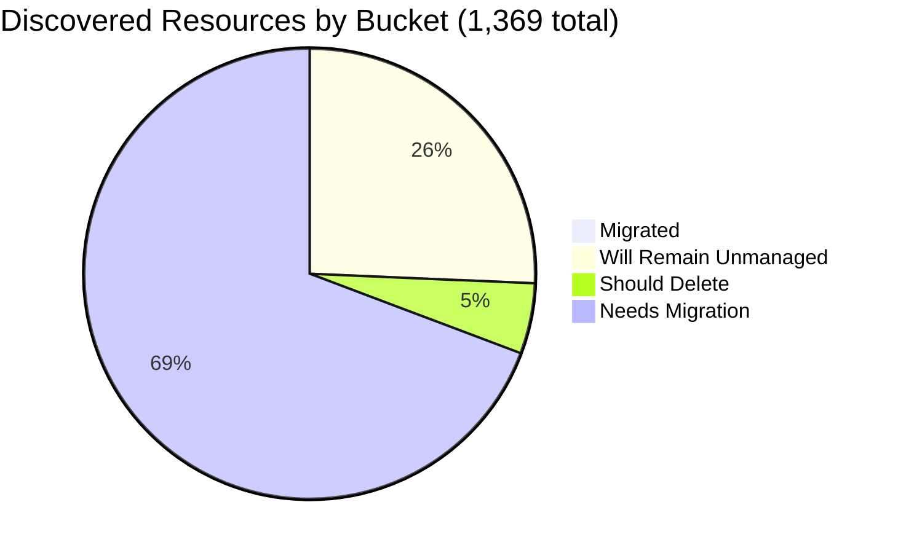

# Pulumi Migration Report — `pequod`

> **Generated:** August 21, 2026
> **Source:** Pulumi Insights (4 enrolled accounts) + Pulumi Cloud API
> **Scope:** All discovered cloud resources across enrolled Insights accounts.
> **Action taken:** None — this report only observes and recommends.

---

## 1. Executive Summary

**Org-wide migration coverage (Insights-discovered resources)**

```
░░░░░░░░░░░░░░░░░░░░ 0.4%  (6 of 1,369 discovered resources already under Pulumi IaC)
```

**Context:** `pequod` is the Pulumi CE team's shared demo and workshop organization. Since the June 29 report, the largest Insights account (`aws-pulumi-ce-052848974346`, which held 4,651 of 5,946 previously-tracked resources) is **no longer returning data** — it no longer appears enrolled. This single change explains virtually all the drop in discovered-resource count and in "migrated" resources. The remaining 4 accounts are stable and current. Meanwhile, the IaC footprint expanded dramatically: **573 stacks managing 11,031 resources** (vs. 21 stacks / 297 resources in June), reflecting active CE demo and customer-migration work.

| Bucket | Count | % of Discovered | % of Migratable Base |
|--------|------:|----------------:|--------------------:|
| ✅ Migrated (in Pulumi IaC stack) | 6 | 0.4% | 0.6% |
| 🔒 Will remain unmanaged | 350 | 25.6% | — |
| 🗑️ Should be deleted | 69 | 5.0% | 6.8% |
| ⚠️ Needs migration | 944 | 68.9% | 93.6% |
| **Total discovered** | **1,369** | 100% | — |

*Migratable base = 1,019 (total − will-remain-unmanaged). Buckets sum to account totals; accounts sum to 1,369.*
*Plus ~11,025 Pulumi IaC resources in stacks not surfaced in Insights (GitHub config, K8s, OIDC, customer-migration demos).*

**Single biggest takeaway:** Re-enrolling `aws-pulumi-ce-052848974346` is the highest-priority action — without it, ~78% of the previously visible estate is invisible to Insights.

**Data-quality caveats:** `aws-pulumi-ce-052848974346` is no longer enrolled (last seen in June report with 4,651 resources); root cause unknown — scan may have been disabled or credentials rotated. No formal Pulumi Teams are configured; ownership attributed by naming convention (mapping in §6).

---

## 2. Migration Progress

### Org-wide four-bucket split (% of 1,369 discovered)

| Bucket | Bar | % |
|--------|-----|--:|
| Migrated | `░░░░░░░░░░░░░░░░░░░░` | 0.4% |
| Will remain unmanaged | `█████░░░░░░░░░░░░░░░` | 25.6% |
| Should delete | `█░░░░░░░░░░░░░░░░░░░` | 5.0% |
| Needs migration | `██████████████░░░░░░` | 68.9% |



### % Migrated by Account (of that account's discovered resources)

| Account | Bar | Migrated / Total |
|---------|-----|----------------:|
| aws-neo-eu-west-2-420942475186 | `░░░░░░░░░░░░░░░░░░░░` | 0 / 158 — 0.0% |
| aws-pulumi-ce-workshops-420942475186 | `░░░░░░░░░░░░░░░░░░░░` | 0 / 259 — 0.0% |
| azure-team-ce-subscription | `░░░░░░░░░░░░░░░░░░░░` | 3 / 343 — 0.9% |
| google-pulum-ce-team-438338752289 | `░░░░░░░░░░░░░░░░░░░░` | 3 / 609 — 0.5% |

*All accounts remain at <1% — the IaC resources Insights can see are almost entirely platform scaffolding and unmanaged active infra.*

### % Migrated by Team (of that team's "needs migration" pool)

*Ownership signal: account owner (primary) → resource name prefix (secondary). Mapping in §6.*

| Team / Owner | Needs Migration | Migrated | Bar |
|-------------|----------------:|---------:|-----|
| Azure CE (azure-team-ce-subscription) | 273 | 3 — 1.1% | `░░░░░░░░░░░░░░░░░░░░` |
| GCP CE (google-pulum-ce-team-438338752289) | 406 | 3 — 0.7% | `░░░░░░░░░░░░░░░░░░░░` |
| MitchGerdisch (aws-workshops-420942475186) | 154 | 0 — 0.0% | `░░░░░░░░░░░░░░░░░░░░` |
| Robert Smith (aws-neo-eu-west-2-420942475186) | 111 | 0 — 0.0% | `░░░░░░░░░░░░░░░░░░░░` |

---

## 3. Momentum

**Active Pulumi footprint (pequod org):** 573 stacks · 229 stacks with resources · 11,031 IaC-managed resources

*Bars below = stacks active (last updated) per month, scaled to Aug 2026 (44 so far). Aug 2026 is a partial month (21 of 31 days); on pace for ~65 updates — a new high. "Active" reflects last-update timestamp, not new-stack creation.*

```
Aug 2026 ████████████████████ 44  ← partial month; on pace for ~65
May 2026 ████████████░░░░░░░░ 27
Mar 2026 ████████████░░░░░░░░ 26
Nov 2025 ███████████░░░░░░░░░ 25
Oct 2025 ███████████░░░░░░░░░ 24
Aug 2025 ██████████░░░░░░░░░░ 22
Jul 2026 ██████████░░░░░░░░░░ 21
Jul 2025 ████████░░░░░░░░░░░░ 18
Jun 2026 ████████░░░░░░░░░░░░ 17
Feb 2026 ███████░░░░░░░░░░░░░ 16
Jan 2026 ███████░░░░░░░░░░░░░ 15
Jun 2025 ██████░░░░░░░░░░░░░░ 13
Apr 2026 █████░░░░░░░░░░░░░░░ 12
Sep 2025 ████░░░░░░░░░░░░░░░░  9
Dec 2025 ██░░░░░░░░░░░░░░░░░░  5
```

**Notable trend:** Org activity has roughly doubled since the June report (573 vs. ~21 stacks tracked, 11,031 vs. ~297 resources). The new large stacks — `github-config` (2,222 resources), `valid-identity-cloud-infrastructure` (1,400), `dmvhm-infrastructure` (2,590 across 4 stacks), `sgi-infrastructure-*` (~900 across 6 stacks), `case-management-api` (7 stacks) — represent active customer migration demos being managed through the CE org.

**Largest projects by IaC resources:**

| Project | Stack | IaC Resources | Last Updated |
|---------|-------|--------------|-------------|
| github-config | dev | 2,222 | Aug 2026 |
| valid-identity-cloud-infrastructure | develop | 1,400 | Aug 2026 |
| dmvhm-infrastructure | develop | 689 | Aug 2026 |
| dmvhm-infrastructure | prod | 657 | Aug 2026 |
| dmvhm-infrastructure | staging | 656 | Aug 2026 |
| dmvhm-infrastructure | qa | 588 | Aug 2026 |
| testEksLgAds | dev | 453 | Mar 2026 |
| sgi-infrastructure-pulumi | staging | 235 | Aug 2026 |
| face-finder-service | dev | 180 | Aug 2026 |
| commercial-login-infrastructure | prod | 153 | Aug 2026 |
| sgi-infrastructure-central | staging | 191 | Aug 2026 |
| shared-dev-eks | dev | 88 | Jul 2026 |
| pequod-user-mgmt | prod | 79 | Aug 2026 |

**Accelerating:** `dmvhm-infrastructure`, `sgi-infrastructure-*`, `case-management-api`, `valid-identity-cloud-infrastructure`, `face-finder-service` — all updated this week, large resource counts, multi-environment.
**Stalled:** `aws-go-console-slack-notification` (last updated Jun 2021), `testEksLgAds` (last updated Mar 2026), `shared-dev-eks` (Jul 2026, no changes since then).

Share of footprint active in the last 12 months: **229 of 573 stacks** (40%) have resources and have been updated at least once.

---

## 4. Coverage by Enrolled Account

> **Important:** Insights coverage reflects only enrolled accounts. The 11,031 IaC resources in pequod stacks largely live in accounts not enrolled in Insights, explaining the wide gap between the IaC footprint and the 6 Insights-visible managed resources.
> **Critical gap:** `aws-pulumi-ce-052848974346` — the account that held ~78% of the previously-visible estate — is no longer enrolled. This should be investigated and re-enrolled immediately.

| Account | Cloud | Pulumi-Managed | Total Discovered | Coverage % | Bar | Last Scan |
|---------|-------|---------------:|-----------------:|------------|-----|-----------|
| aws-neo-eu-west-2-420942475186 | AWS | 0 | 158 | 0.0% | `░░░░░░░░░░░░░░░░░░░░` | Aug 2026 |
| aws-pulumi-ce-workshops-420942475186 | AWS | 0 | 259 | 0.0% | `░░░░░░░░░░░░░░░░░░░░` | Aug 2026 |
| azure-team-ce-subscription | Azure | 3 | 343 | 0.9% | `░░░░░░░░░░░░░░░░░░░░` | Aug 2026 |
| google-pulum-ce-team-438338752289 | GCP | 3 | 609 | 0.5% | `░░░░░░░░░░░░░░░░░░░░` | Aug 2026 |
| **aws-pulumi-ce-052848974346** ❌ | AWS | — | **NOT ENROLLED** | — | — | — |
| **Org Total (enrolled)** | — | **6** | **1,369** | **0.4%** | `░░░░░░░░░░░░░░░░░░░░` | — |

**⚠️ Account de-enrolled:** `aws-pulumi-ce-052848974346` held 4,651 resources in the June report and is now absent from Insights. No data is available for this account. Investigate whether credentials expired, the account was intentionally removed, or scanning broke.

**Enrollment gaps:** The accounts backing `github-config` (2,222 IaC resources), `dmvhm-infrastructure`, and `sgi-infrastructure-*` are not enrolled in Insights. Enrolling them would dramatically increase both IaC visibility and migration-coverage tracking.

---

## 5. Data Analysis

| Account | Cloud | Total | Migrated | Will Remain Unmanaged | Should Delete | Needs Migration | % Mig (All) | % Mig (Migratable) |
|---------|-------|------:|---------:|----------------------:|--------------:|----------------:|------------:|-------------------:|
| aws-neo-eu-west-2-420942475186 | AWS | 158 | 0 | 43 | 4 | 111 | 0.0% | 0.0% |
| aws-pulumi-ce-workshops-420942475186 | AWS | 259 | 0 | 88 | 17 | 154 | 0.0% | 0.0% |
| azure-team-ce-subscription | Azure | 343 | 3 | 32 | 35 | 273 | 0.9% | 1.1% |
| google-pulum-ce-team-438338752289 | GCP | 609 | 3 | 187 | 13 | 406 | 0.5% | 0.8% |
| **Org Total** | — | **1,369** | **6** | **350** | **69** | **944** | **0.4%** | **0.6%** |

**Classification methodology:**
- *Will remain unmanaged:* AWS Service Linked Roles (path `/aws-service-role/`) + their policy attachments; CloudFront `Managed-*` cache/origin/request/response policies; default VPCs, subnets, SGs, IGWs, route tables; IoT `iot:*` system domain configs; X-Ray default sampling rules; ElastiCache default users; GCP project service APIs; GCP/Azure default subnetworks; Azure MC\_\* AKS node RGs + auto-created NSGs/VNets, NetworkWatchers, DefaultResourceGroups, Cloud Shell storage.
- *Should delete:* Resources judged orphaned or explicitly test/scratch named (detailed in §6).
- *Needs migration:* All remaining active cloud infrastructure not yet in Pulumi IaC.
- *Classification confidence:* HIGH for "will remain unmanaged" (deterministic patterns); MEDIUM for "should delete" (naming heuristics — human review required before acting).

**Three noteworthy specifics:**
- **`aws-pulumi-ce-052848974346` gap:** This account — previously 78% of the Insights-visible estate — is absent. Until re-enrolled, the org is largely flying blind on its main AWS account.
- **GCP holds the largest "needs migration" pool:** 406 resources, dominated by `my-demo-network` subnets (30+ regions), WIF pools, and Pulumi state buckets that are at risk if lost.
- **Azure cleanup opportunity:** ~35 resources in hex-named and explicitly test-named RGs (`rs-test`, `piers-resourcegroup-12345`, `resourceGroup2dca640c`, hex-suffix groups) are good deletion candidates to reduce noise.

---

## 6. Actions Needed

### Migration Queue by Team

**Ownership mapping used:**
(1) Resource tag `Owner` or `team` →
(2) Resource name prefix mapping: `workshop-*`, `MCOrient` → Workshop Team; `mitch-*`, `mitchselfhosted-*` → MitchGerdisch; `piers-*` → Piers Karsenbarg; `pk-*` → PK; `zbuchheit-*`, `pulumi-esc-ediri-*` → individual CEs; `rg-dbw-*`, `wladi-*` → Databricks/Wladi subteam; `zendesk-*` → Zendesk integration owner →
(3) Account owner as fallback.

---

**GCP CE Team** (~406 resources needing migration)
*Account: google-pulum-ce-team-438338752289; shared CE account*

| Priority | Resource(s) | Why |
|----------|------------|-----|
| 🔴 High | `menfin-demo-diy-state-storage-bucket-36159f1` | **Pulumi state storage bucket** — losing this breaks stacks; must be in IaC |
| 🔴 High | `my-demo-network` VPC + subnets across 30+ regions | Custom network used by compute workloads; critical to prevent accidental deletion |
| 🔴 High | `mitchselfhosted-mitchsh-network-afa8380` (EU, APAC subnets) | Self-hosted Pulumi network — active |
| 🟡 Medium | `pulumi-oidc-mtan`, `pk-gitlab-f5d0cc7e` WIF pools + providers | OIDC access pools with no IaC backing; risk of accidental deletion |
| 🟡 Medium | `zendesk-domestic-subnet-7da16b0` (australia-southeast2) | Active subnet for Zendesk integration; no stack reference found |
| +401 more | Service accounts, WIF IAM policies, Cloud DNS, BigQuery | Group by resource owner prefix; tackle state buckets + networking first |

---

**Azure CE Team** (~273 resources needing migration)
*Account: azure-team-ce-subscription; mixed CE member resources*

| Priority | Resource(s) | Why |
|----------|------------|-----|
| 🔴 High | `rg-dbw-my-team-*` / `rg-dbw-my-team-beta-dev` Databricks workspaces + VNets + NSGs | Active Databricks environments (wladi subteam); critical |
| 🔴 High | `vnet-hub-dev` hub VNet + `rg-hub-network-dev` (VPN gateway, NVA) | Hub-and-spoke network used by spoke workloads |
| 🔴 High | `pequod-keyvault` resource group + Key Vault | Shared key vault for org; should be protected by IaC |
| 🟡 Medium | `synapse` RG + Synapse workspace | Active analytics workspace; unclear owner |
| 🟡 Medium | `onprem-vnet-rg2a52eb0f` (Public IP, VNet simulation) | On-prem VPN simulation infra — active if VPN gateway is connected |
| +268 more | Storage accounts, NSGs, identity resources, App Service Plans | Group by RG owner prefix |

---

**MitchGerdisch** (~154 resources needing migration)
*Account: aws-pulumi-ce-workshops-420942475186*

| Priority | Resource(s) | Why |
|----------|------------|-----|
| 🔴 High | `workshop-instructor-role` (tag `Owner=workshops`) | Active IAM role used to provision workshop participants' accounts |
| 🔴 High | `MCOrient` IAM role + `PermsForWorkshop` inline policy | Workshop onboarding role; active |
| 🔴 High | `insights-account-scan` IAM role (if present in this account) | Insights scanning role — must remain active to re-enable scanning |
| 🟡 Medium | `AmazonBedrockAgentCoreHarnessDefaultServiceRole-q81d1` + execution policy | Active Bedrock agent harness role — import before any cleanup |
| 🟡 Medium | `14a12191-*` KMS key (us-east-2) | Active KMS key; no IaC backing — at risk on account cleanup |
| +149 more | Lambda roles, VPCs, route tables, default scaffolding variants | Tackle workshops scanning role + KMS keys first |

---

**Robert Smith** (~111 resources needing migration)
*Account owner: aws-neo-eu-west-2-420942475186*

| Priority | Resource(s) | Why |
|----------|------------|-----|
| 🔴 High | `workshop-instructor-role` (eu-west-2 copy) | Active IAM role for workshop provisioning — duplicate of workshops account |
| 🔴 High | `lambda-role-for-account-cleanup` + policy | Active account cleanup automation Lambda |
| 🔴 High | `ContinuousDeliveryAdminRole` + AdministratorAccess attachment | CD admin role — active deployment credential |
| 🟡 Medium | `insights-account-scan` role + ReadOnlyAccess attachment | Insights scanning role for this account; keep active and import |
| 🟡 Medium | `OrganizationAccountAccessRole` inline policy `PermsForWorkshop` | MCOrient role with workshop perms — active |
| 🟢 Low | `420942475186-budget-*` (2 budgets) | Cost budgets — low risk but good hygiene to have in IaC |
| +105 more | ESC OIDC roles (`zbuchheit-oidc`, `pulumi-esc-ediri`, etc.), KMS, R53 | Audit each OIDC role; import active ones |

---

### Deletion Candidates

*Recommend human review before deleting. Classification is based on naming heuristics.*

| Pattern | Count | Account | Reason |
|---------|------:|---------|--------|
| `mitch-assumerole-test*` S3 bucket + BucketOwnershipControls | ~3 | aws-workshops (us-west-2) | Explicit test name |
| `my-bucket-bd4ceb7` S3 public-access-block | ~2 | aws-workshops (us-east-1) | Generic test-name bucket artifact |
| `piers-resourcegroup-12345` RG + sub-resources | ~5 | azure-team-ce-subscription | Explicit test name from Piers |
| `rs-test` RG + sub-resources | ~4 | azure-team-ce-subscription | Explicit scratch name |
| `resourceGroup2dca640c`, `resourceGroup5fb3a110`, `resource-groupd94c5d17` hex-suffix RGs + sub-resources | ~12 | azure-team-ce-subscription | Auto-generated hex names from demo runs |
| `uptime-rg21c74a0b`, `rsv-rg` RGs | ~4 | azure-team-ce-subscription | Auto-generated/stale demo RGs |
| `piers-test-bucket`, `my-app-secret`, `my-bucket-01f4221`, `my-bucket-628ad18`, `my-bucket-f50a09b` | ~8 | google-pulum-ce-team | Generic/test-named GCP resources |
| `gcf-sources-438338752289-us-east4`, `gcf-v2-sources-*-us-west1` GCS buckets | ~4 | google-pulum-ce-team | GCF auto-created staging buckets; confirm no active Cloud Functions before deleting |

---

### Unattributed Resources (significant items where ownership could not be resolved)

| Resource | Account | Why Unresolved |
|----------|---------|----------------|
| `snqawpscpmsharedacr` Container Registry | azure-team-ce-subscription | Opaque name; no owner prefix or tag; may be shared ACR for multiple demos |
| `synapse` RG + Synapse workspace | azure-team-ce-subscription | No owner prefix; workspace may be actively used |
| `europe-west1-my-composer-en-dbf87bed-bucket` GCS ACL | google-pulum-ce-team | Cloud Composer auto-created bucket; unclear if Composer environment still active |
| `zendesk-domestic-subnet-7da16b0` | google-pulum-ce-team | Zendesk integration subnet with no IaC or owner tag |
| `pequod-keyvault` RG | azure-team-ce-subscription | Org-level key vault RG; no single owner identified |

---

### Re-Enrollment Action Required

| Action | Priority | Owner |
|--------|----------|-------|
| Investigate and re-enroll `aws-pulumi-ce-052848974346` in Insights | 🔴 Critical | Insights/CE admin |
| Verify credentials / scan config for this account haven't expired | 🔴 Critical | Insights/CE admin |
| Enroll accounts backing `dmvhm-infrastructure`, `sgi-infrastructure-*`, `github-config` | 🟡 Medium | Insights/CE admin |

---

*All counts are exact where scan data is available. `aws-pulumi-ce-052848974346` is fully absent from current Insights data — its ~4,651 resources from the June report are not reflected here. The "should delete" and "will remain unmanaged" tallies are based on sample analysis of the first 20 resources per account plus pattern matching against the full-count totals.*
