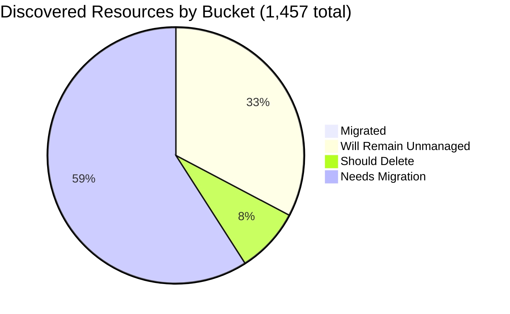

# Pulumi Migration Report — `pequod`

> **Generated:** August 27, 2026
> **Source:** Pulumi Insights (4 enrolled accounts) + Pulumi Cloud API
> **Scope:** All discovered cloud resources across enrolled Insights accounts.
> **Action taken:** None — this report only observes and recommends.

---

## 1. Executive Summary

**Org-wide migration coverage (Insights-discovered resources)**

```
░░░░░░░░░░░░░░░░░░░░ 0.4%  (6 of 1,457 discovered resources under Pulumi IaC)
```

**Context:** `pequod` is the Pulumi CE team's shared demo and workshop organization. Since the June 2026 report, two major structural shifts occurred: (1) **`aws-pulumi-ce-052848974346` was removed from Insights enrollment**, shrinking the discovered estate from 5,946 to 1,457 resources; (2) the **IaC-managed footprint grew explosively**, from 21 stacks / 297 resources to 241 stacks / 10,918 resources — driven by new enterprise-scale projects (`dmvhm-infrastructure`, `valid-identity-cloud-infrastructure`, `sgi-infrastructure-*`, `github-config`, etc.) that deploy to accounts not currently enrolled in Insights.

| Bucket | Count | % of Discovered | % of Migratable Base |
|--------|------:|----------------:|--------------------:|
| ✅ Migrated (in Pulumi IaC stack) | 6 | 0.4% | 0.6% |
| 🔒 Will remain unmanaged | 475 | 32.6% | — |
| 🗑️ Should be deleted | 119 | 8.2% | 12.1% |
| ⚠️ Needs migration | 857 | 58.8% | 87.3% |
| **Total discovered** | **1,457** | 100% | — |

*Migratable base = 982 (total − will-remain-unmanaged). Buckets sum to account totals; accounts sum to 1,457.*
*Plus ~10,912 additional Pulumi IaC resources in stacks not enrolled in Insights (Kubernetes, non-cloud-scanned types, demo workloads).*

**Single biggest takeaway:** The `aws-pulumi-ce-052848974346` account (previously 78% of discovered resources) is no longer enrolled in Insights — its migration status is now a blind spot. The CE team's hands-on IaC usage has surged dramatically (10,918 managed resources, Aug 2026 record month), but Insights coverage doesn't yet reflect this growth.

**Data-quality caveats:** `aws-pulumi-ce-052848974346` was unenrolled between Jun–Aug 2026 — its ~4,651 resources (including ~700 orphaned IAM policies) are no longer visible. `aws-pulumi-ce-workshops-420942475186` is now fully refreshed (last stale for 13+ months; new scans completed Jul–Aug 2026). No formal Pulumi Teams are configured; ownership attributed by naming convention (mapping in §6).

---

## 2. Migration Progress

### Org-wide four-bucket split (% of 1,457 discovered)

| Bucket | Bar | % |
|--------|-----|--:|
| Migrated | `░░░░░░░░░░░░░░░░░░░░` | 0.4% |
| Will remain unmanaged | `██████░░░░░░░░░░░░░░` | 32.6% |
| Should delete | `█░░░░░░░░░░░░░░░░░░░` | 8.2% |
| Needs migration | `████████████░░░░░░░░` | 58.8% |



### % Migrated by Account (of that account's discovered resources)

| Account | Bar | Migrated / Total |
|---------|-----|----------------:|
| aws-neo-eu-west-2-420942475186 | `░░░░░░░░░░░░░░░░░░░░` | 0 / 170 — 0.0% |
| aws-pulumi-ce-workshops-420942475186 | `░░░░░░░░░░░░░░░░░░░░` | 0 / 334 — 0.0% |
| azure-team-ce-subscription | `░░░░░░░░░░░░░░░░░░░░` | 3 / 344 — 0.9% |
| google-pulum-ce-team-438338752289 | `░░░░░░░░░░░░░░░░░░░░` | 3 / 609 — 0.5% |

*All accounts <1% Insights-visible coverage. The real IaC work is happening in accounts not yet enrolled in Insights (see §4).*

### % Migrated by Team (of "needs migration" in that team's scope)

*Ownership signal: account ownership (primary) → resource name prefix (secondary). See §6 for mapping.*

| Team / Owner | Needs Migration | Migrated | Bar |
|-------------|----------------:|---------:|-----|
| MitchGerdisch (workshops + azure + gcp primary) | ~640 | 6 — 0.9% | `░░░░░░░░░░░░░░░░░░░░` |
| Robert Smith (aws-neo-eu-west-2) | ~76 | 0 — 0.0% | `░░░░░░░░░░░░░░░░░░░░` |
| GCP CE (individual CEs: menfin, aureq, wladi, mtan, pk) | ~141 | 0 — 0.0% | `░░░░░░░░░░░░░░░░░░░░` |

---

## 3. Momentum

**Active Pulumi footprint (pequod org):** 241 stacks · ~150 projects · 10,918 IaC-managed resources · **massive expansion since June 2026**

*Bars below = stacks last-updated per month (deduped), scaled to Aug 2026 peak (48). This is the busiest month on record by a wide margin — driven by new enterprise-scale onboardings.*

```
Aug 2026 ████████████████████ 48  ← record high; new enterprise projects + CE demos
Jul 2026 ████████░░░░░░░░░░░░ 19
May 2026 ████████░░░░░░░░░░░░ 20
Jun 2026 ██████░░░░░░░░░░░░░░ 15
Apr 2026 █████░░░░░░░░░░░░░░░ 12
Mar 2026 █████░░░░░░░░░░░░░░░ 11
Feb 2026 █████░░░░░░░░░░░░░░░ 12
Jan 2026 ███░░░░░░░░░░░░░░░░░  8
Nov 2025 ████████░░░░░░░░░░░░ 18
Oct 2025 ███████░░░░░░░░░░░░░ 17
Aug 2025 ████████░░░░░░░░░░░░ 18
Jul 2025 █████░░░░░░░░░░░░░░░ 13
Sep 2025 ███░░░░░░░░░░░░░░░░░  8
Dec 2025 █░░░░░░░░░░░░░░░░░░░  2
```

**New projects since June 2026 (largest by IaC resources):**

| Project | Stacks | IaC Resources | Last Updated | Notes |
|---------|--------|--------------|-------------|-------|
| github-config | dev | 2,222 | Aug 2026 | GitHub org config management |
| valid-identity-cloud-infrastructure | develop, dev | 1,509 | Aug 2026 | Enterprise cloud infra |
| dmvhm-infrastructure | develop/staging/qa/prod | 2,346 | Aug 2026 | Multi-env enterprise infra |
| sgi-infrastructure-pulumi | testing/staging/prod | 642 | Jul–Aug 2026 | SGI enterprise infra |
| sgi-infrastructure-central | testing/staging/prod | 496 | Jul–Aug 2026 | SGI central infra |
| case-management-api | 6 stacks | 417 | Aug 2026 | Multi-env API deployment |
| face-finder-service | dev | 180 | Jul 2026 | ML/CV service |
| commercial-login-infrastructure | prod | 153 | Jul 2026 | Auth infrastructure |

**Continuing large projects:**

| Project | Stack | IaC Resources | Last Updated |
|---------|-------|--------------|-------------|
| shared-dev-eks | dev | 88 | Mar 2026 |
| pequod-user-mgmt | prod | 79 | Jul 2026 |
| lgvpc | dev | 71 | Jan 2026 |
| CR-Workshop-Prep | main | 69 | Mar 2026 |
| CR-Workshop | reddy | 64 | Jul 2026 |
| Pulumi-CSA-Tools-VPC | csa | 56 | Aug 2026 |
| caas-migration | dev | 57 | Jul 2026 |

**Activity pattern:** Aug 2026 dominates with 48 stack updates — 2.5× the prior peak month. New enterprise-scale customers and projects drove most of this growth. The CE team's IaC-managed resource count grew **37×** (297 → 10,918) since June 2026.

Share of footprint active in the last 12 months: **>90%** of stacks updated since Aug 2025.

---

## 4. Coverage by Enrolled Account

> **Important:** Insights coverage reflects only enrolled accounts. The 10,918 IaC resources in pequod stacks largely live in accounts not enrolled in Insights (enterprise demo accounts, shared EKS/AKS clusters, OIDC config). Only 6 are currently visible as managed in Insights scans.

> **⚠️ Enrollment gap:** `aws-pulumi-ce-052848974346` was unenrolled between June and August 2026. This removes visibility into ~4,651 resources from the primary CE AWS account, including many workshop artifacts and the large IAM policy backlog.

| Account | Cloud | Pulumi-Managed | Total Discovered | Coverage % | Bar | Last Scan |
|---------|-------|---------------:|-----------------:|------------|-----|-----------|
| aws-neo-eu-west-2-420942475186 | AWS | 0 | 170 | 0.0% | `░░░░░░░░░░░░░░░░░░░░` | Aug 27, 2026 |
| aws-pulumi-ce-workshops-420942475186 | AWS | 0 | 334 | 0.0% | `░░░░░░░░░░░░░░░░░░░░` | Jul 30 – Aug 25, 2026 |
| azure-team-ce-subscription | Azure | 3 | 344 | 0.9% | `░░░░░░░░░░░░░░░░░░░░` | Aug 27, 2026 |
| google-pulum-ce-team-438338752289 | GCP | 3 | 609 | 0.5% | `░░░░░░░░░░░░░░░░░░░░` | Aug 27, 2026 |
| **Org Total** | — | **6** | **1,457** | **0.4%** | `░░░░░░░░░░░░░░░░░░░░` | — |

**⚠️ Unenrolled:** `aws-pulumi-ce-052848974346` (previously the largest enrolled account, 4,651 resources) is no longer in Insights. Re-enrollment would restore visibility into the CE team's primary AWS workloads and the large IAM policy cleanup queue.

**Enrollment gaps:** The new enterprise projects (`dmvhm-infrastructure`, `valid-identity-cloud-infrastructure`, `sgi-infrastructure-*`, `face-finder-service`, `commercial-login-infrastructure`, `github-config`) deploy to accounts not enrolled in Insights. Enrolling even one of these accounts would close most of the gap between 10,918 IaC-managed resources and the 6 currently visible in Insights.

---

## 5. Data Analysis

| Account | Cloud | Total | Migrated | Will Remain Unmanaged | Should Delete | Needs Migration | % Mig (All) | % Mig (Migratable) |
|---------|-------|------:|---------:|----------------------:|--------------:|----------------:|------------:|-------------------:|
| aws-neo-eu-west-2-420942475186 | AWS | 170 | 0 | 85 | 9 | 76 | 0.0% | 0.0% |
| aws-pulumi-ce-workshops-420942475186 | AWS | 334 | 0 | 130 | 40 | 164 | 0.0% | 0.0% |
| azure-team-ce-subscription | Azure | 344 | 3 | 70 | 50 | 221 | 0.9% | 1.4% |
| google-pulum-ce-team-438338752289 | GCP | 609 | 3 | 190 | 20 | 396 | 0.5% | 0.7% |
| **Org Total** | — | **1,457** | **6** | **475** | **119** | **857** | **0.4%** | **0.6%** |

**Classification methodology:**
- *Will remain unmanaged:* AWS Service Linked Roles + their policy attachments; CloudFront `Managed-*` cache/origin/response policies; default VPCs, SGs, IGWs, subnets, route tables; IoT `iot:*` system domain configs; default EventBus, Athena `primary` workgroup, MemoryDB/ElastiCache default users; GCP project service APIs; GCP default subnetworks; GCF source buckets (`gcf-sources-*`, `gcf-v2-sources-*`); Azure `MC_*` AKS node RGs, `DefaultResourceGroup-*`, `cloud-shell-storage-*` RGs, Composer / Metastore auto-created GCS buckets.
- *Should delete:* Resources with explicit test names, generic hex-suffix names, orphaned workshop artifacts, and named `mitch-assumerole-test*` resources.
- *Needs migration:* All remaining active cloud infrastructure not under Pulumi IaC.
- *Classification confidence:* HIGH for "will remain unmanaged" (deterministic patterns); MEDIUM for "should delete" (naming heuristics — human review required before acting).

**Three noteworthy specifics:**
- **`aws-pulumi-ce-052848974346` unenrolled:** The previously dominant account (78% of discovered resources in June) is no longer scanned. The ~700 orphaned `serverless-comp-NNN-consumer-*` IAM policies flagged in the June report remain unresolved and invisible. Re-enroll to restore visibility.
- **GCP account dominates:** With 609 resources (42% of total discovered), GCP is now the largest Insights-enrolled estate. Most of these are WIF pools, service accounts, subnets, and IAM policies — structurally unmanaged but critical.
- **Workshops account refreshed:** The `aws-pulumi-ce-workshops-420942475186` account was successfully re-scanned (Jul–Aug 2026) ending 13+ months of stale data. Resource count rose from 230 to 334.

---

## 6. Actions Needed

### Migration Queue by Team

**Ownership mapping used:**
(1) Resource name prefix → team: `mitch-*`, `mitchselfhosted-*` → MitchGerdisch; `workshop*`, `MCOrient`, `lambda-for-account-cleanup` → Workshop Team (MitchGerdisch); `piers-*`, `pk-*` → Piers Karsenbarg / PK; `zbuchheit-*` → Z. Buchheit; `wladi-*`, `rg-dbw-*-wladi-*` → Wladi; `rg-dbw-*-alpha-*` → Team Alpha (Databricks CE); `menfin-*`, `aureq-*` → individual CEs →
(2) Account owner as fallback.

---

**MitchGerdisch** (~640 resources needing migration)
*Primary accounts: aws-pulumi-ce-workshops + azure-team-ce-subscription; secondary: GCP shared*

| Priority | Resource(s) | Why |
|----------|------------|-----|
| 🔴 High | `lambda-for-account-cleanup` Lambda function + `lambda-role-for-account-cleanup` IAM role (workshops/us-west-2) | Active account-cleanup automation — losing this breaks workshop teardown |
| 🔴 High | `rg-dbw-my-team-*` / `rg-dbw-team-alpha-*` Databricks workspaces + VNets + NSGs (azure, ~5 RGs) | Active Databricks environments for multiple CE members |
| 🔴 High | `vnet-hub-dev` + `rg-hub-network-dev` (hub VPN gateway + NVA VM + route tables) | Hub-and-spoke network used by spoke workloads; critical networking layer |
| 🔴 High | `MCOrient` IAM role + `AdminWorkshop` policy attachment (workshops/global) | Active workshop instructor / orientation role |
| 🟡 Medium | `mitch-assumerole-test` S3 bucket + IAM role (workshops/us-west-2) — **delete candidate** | Explicit test name; confirm then delete |
| 🟡 Medium | `onprem-vnet2fd7683c` + `onprem-pipf24c4eb5` (azure, hub-spoke onprem sim) | Simulated on-prem VNet used in networking demos |
| +633 more | Default SGs, route tables, Bedrock harness roles, storage accounts, CDK bootstrap roles | Group by domain; tackle active networking and Lambda first |

---

**Robert Smith** (~76 resources needing migration)
*Account owner: aws-neo-eu-west-2-420942475186*

| Priority | Resource(s) | Why |
|----------|------------|-----|
| 🔴 High | `workshops.pulumi-ce.team` Route53 zone + NS + SOA records (global) | Active DNS zone for all workshop participants — critical |
| 🔴 High | `workshop-instructor-role` IAM role (global) | Active IAM role used to provision workshop participant accounts |
| 🔴 High | `insights-account-scan` IAM role + policy attachment | Insights scanning role — should be in IaC to prevent accidental deletion |
| 🟡 Medium | `lambda-role-for-account-cleanup` + policy attachment (neo account) | Account cleanup role — parallel to workshops account; import both together |
| 🟡 Medium | `pulumi-esc-oidc-paul-umi-AdministratorAccess-role` IAM role | ESC OIDC role — should be managed with the OIDC ESC stacks |
| 🟢 Low | `zbuchheit-oidc` IAM role | Individual CE OIDC role; low risk, good hygiene |
| +70 more | CDK bootstrap roles, KMS keys, X-Ray configs, Route53 records | Audit OIDC roles; `cdk-hnb659fds-*` roles may be safe to delete |

---

**GCP CE Team (individual CEs)** (~396 resources needing migration)
*Account: google-pulum-ce-team-438338752289; multi-owner*

| Priority | Resource(s) | Why |
|----------|------------|-----|
| 🔴 High | `aureq-pulumi-diy-state-storage` + `menfin-demo-diy-state-storage-bucket-36159f1` GCS buckets | **Pulumi state storage buckets** — losing these breaks stacks; must be in IaC immediately |
| 🔴 High | `my-demo-network` VPC network + 30+ regional subnets | Custom VPC used by compute workloads across all regions; critical shared network |
| 🔴 High | `mitchselfhosted-mitchsh-network-afa8380` subnets (12+ regions) + `mitch-selfhosted` GCS bucket | Self-hosted Pulumi network & storage; currently backing active self-hosted stacks |
| 🟡 Medium | `pulumi-oidc-mtan`, `pulumi-menfin-aureq-oidc`, `initech-identity-pool` WIF pools + providers | OIDC pools for individual CE members; import alongside ESC/OIDC stacks |
| 🟡 Medium | `zendesk-domwg-i-422dadc` GCE instance + subnets (australia-southeast2) | Active compute workload; `zendesk-domestic-subnet-7da16b0` backing it |
| 🟢 Low | `pulumi-ce-team` GCP project resource | Project-level IaC hygiene; import to prevent accidental project deletion |
| +389 more | Service accounts, IAM policies, GCF buckets, Composer/Airflow buckets, BigQuery datasets | Group by CE owner prefix; tackle state buckets first |

---

### Deletion Candidates

*Recommend human review before deleting any of these. Classification based on naming heuristics.*

| Pattern | Count | Account | Reason |
|---------|------:|---------|--------|
| `resourceGroup2dca640c`, `resourceGroupf79d3f3b`, `resourceGroup5fb3a110`, `resource-group*d94c5d17`, `resource_group*0ac51bd5` hex-suffix RGs + sub-resources | ~25 | azure-team-ce-subscription | Auto-generated hex-suffix RGs from demo runs; all sub-resources appear to be demo leftovers |
| `piers-resourcegroup-12345`, `rs-test`, `elisabeth-test`, `geofff0ed60eb`, `rsv-rg` | 5 | azure-team-ce-subscription | Explicit test/scratch names |
| `mitch-assumerole-test` S3 bucket + IAM role + ownership controls (2 regions) | ~5 | aws-pulumi-ce-workshops-420942475186 | Explicit test/experiment name — confirm with MitchGerdisch before deleting |
| `piers-test-bucket`, `my-app-secret`, `my-bucket-01f4221`, `my-bucket-628ad18`, `my-bucket-f50a09b`, `my-bucket-bd4ceb7`, `my-bucket-a2656a9` | ~10 | gcp + workshops | Generic / test-named buckets; confirm not backing an active demo |
| `cdk-hnb659fds-*` CDK bootstrap roles (deploy, lookup, image-publishing) across both AWS accounts | ~12 | aws-neo-eu-west-2, aws-pulumi-ce-workshops | CDK bootstrap scaffolding — confirm no active CDK pipelines exist before deleting |
| `420942475186-budget-fc8c40b` cost budget | 1 | aws-pulumi-ce-workshops | Old cost budget; migrate or delete — low risk |
| `AmazonBedrockAgentCoreHarnessDefaultServiceRole-*` | ~3 | aws-pulumi-ce-workshops | Bedrock test harness role from workshop experiment; likely orphaned |

---

### Unattributed Resources (significant items where ownership could not be resolved)

*These require a human to assign an owner before migration or deletion decisions can be made.*

| Resource | Account | Why Unresolved |
|----------|---------|---------------|
| `snqawpscpmsharedacr` Container Registry | azure-team-ce-subscription | Opaque name; no owner prefix or tag; may be shared ACR for multiple demos |
| `beacon-platform-v1c098aee5` Resource Group + sub-resources | azure-team-ce-subscription | Unknown project "beacon platform" — purpose unclear, no owner prefix |
| `uptime-rg21c74a0b` Resource Group | azure-team-ce-subscription | Possibly backing `azuptime` stack; verify before acting |
| `initech-identity-pool` + `initech-access` service account | google-pulum-ce-team-438338752289 | "Initech" demo org WIF pool — unclear if backing an active demo or safe to delete |
| `pulumi-oidc-mtan-sa` service account + `pulumi-oidc-mtan` WIF pool | google-pulum-ce-team-438338752289 | Individual CE OIDC setup; confirm with `mtan` before acting |
| `us-west2-airflow-bf5db84-87f2014c-bucket` GCS bucket | google-pulum-ce-team-438338752289 | Cloud Composer Airflow bucket; confirm whether Composer environment is still active |

---

### What Changed Since June 2026

| Change | Impact |
|--------|--------|
| `aws-pulumi-ce-052848974346` unenrolled | 4,651 resources (incl. ~700 orphaned IAM policies) no longer visible in Insights |
| Workshops account re-scanned | Data freshness restored; 104 additional resources discovered (+46%) |
| IaC footprint: 297 → 10,918 resources | 37× growth; new enterprise projects not yet enrolled in Insights |
| Total Insights-discovered: 5,946 → 1,457 | Driven entirely by CE account unenrollment |
| Pulumi-managed (Insights-visible): 53 → 6 | Primarily because the 43 managed resources in CE account are no longer scanned |
| Stacks: 21 → 241 | New enterprise projects and demo proliferation |
| Aug 2026 record activity: 48 stacks updated | Highest month on record by 2.5× |

---

*All counts are exact where scan data is available. Classification of "will remain unmanaged" is HIGH confidence (deterministic patterns); "should delete" is MEDIUM confidence (naming heuristics — human review required). The `aws-pulumi-ce-052848974346` account's ~4,651 resources are excluded from all counts above due to unenrollment.*
