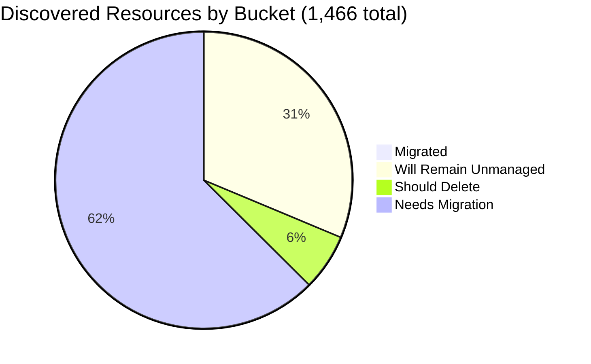

# Pulumi Migration Report — `pequod`

> **Generated:** September 4, 2026
> **Source:** Pulumi Insights (4 enrolled accounts) + Pulumi Cloud API
> **Scope:** All discovered cloud resources across enrolled Insights accounts.
> **Action taken:** None — this report only observes and recommends.

---

## 1. Executive Summary

**Org-wide migration coverage (Insights-discovered resources)**

```
░░░░░░░░░░░░░░░░░░░░ 0.4%  (6 of 1,466 discovered resources already under Pulumi IaC)
```

**Context:** `pequod` is the Pulumi CE (Customer Engineering) team's shared demo and workshop organization. As in prior reports, the estate is dominated by ad-hoc demo deployments with minimal IaC tracking of discovered resources.

| Bucket | Count | % of Discovered | % of Migratable Base |
|--------|------:|----------------:|--------------------:|
| ✅ Migrated (in Pulumi IaC stack) | 6 | 0.4% | 0.6% |
| 🔒 Will remain unmanaged | 457 | 31.2% | — |
| 🗑️ Should be deleted | 90 | 6.1% | 8.9% |
| ⚠️ Needs migration | 913 | 62.3% | 90.5% |
| **Total discovered** | **1,466** | 100% | — |

*Migratable base = 1,009 (total − will-remain-unmanaged). Buckets sum to account totals; accounts sum to 1,466.*
*Plus 215 Pulumi IaC resources (of 221 total IaC-managed resources across 11 active stacks) in stacks, regions, or resource types not enrolled in Insights.*

**Single biggest takeaway:** **`aws-pulumi-ce-052848974346`, the account that held 78% of the org's discovered estate (4,651 of 5,946 resources) in the June 29, 2026 report, is no longer enrolled in Insights.** It does not appear in the current account list or in any scan results. This is the dominant driver of every headline number changing versus last report — total discovered resources dropped from 5,946 to 1,466 (-75%) even though the underlying migration posture of the remaining accounts is essentially unchanged. **Recommend confirming with the account owner (MitchGerdisch) whether this was an intentional un-enrollment, a deleted/deactivated AWS account, or a broken scan credential — re-enrolling it (if still live) is the single highest-leverage action to restore visibility.**

**Data-quality caveats:**
- `aws-pulumi-ce-052848974346` missing from Insights entirely (see above) — its resources are excluded from every count in this report and cannot be assumed deleted.
- `aws-pulumi-ce-workshops-420942475186` scans are staggered across regions: `us-east-1` scanned Aug 25, 2026, but `global`/`us-east-2`/`us-west-1`/`us-west-2` last scanned Jul 30, 2026 (5+ weeks old at time of writing).
- No formal Pulumi Teams are configured; ownership is attributed by naming convention (mapping stated in §6), same methodology as the prior report.
- "Should be deleted" and "needs migration" splits are naming-heuristic judgment calls (MEDIUM confidence); "will remain unmanaged" uses deterministic type/name patterns (HIGH confidence).

---

## 2. Migration Progress

### Org-wide four-bucket split (% of 1,466 discovered)

| Bucket | Bar | % |
|--------|-----|--:|
| Migrated | `░░░░░░░░░░░░░░░░░░░░` | 0.4% |
| Will remain unmanaged | `██████░░░░░░░░░░░░░░` | 31.2% |
| Should delete | `█░░░░░░░░░░░░░░░░░░░` | 6.1% |
| Needs migration | `████████████░░░░░░░░` | 62.3% |



### % Migrated by Account (of that account's discovered resources)

| Account | Bar | Migrated / Total |
|---------|-----|----------------:|
| aws-neo-eu-west-2-420942475186 | `░░░░░░░░░░░░░░░░░░░░` | 0 / 175 — 0.0% |
| aws-pulumi-ce-workshops-420942475186 ⚠️ | `░░░░░░░░░░░░░░░░░░░░` | 0 / 331 — 0.0% |
| azure-team-ce-subscription | `░░░░░░░░░░░░░░░░░░░░` | 3 / 356 — 0.8% |
| google-pulum-ce-team-438338752289 | `░░░░░░░░░░░░░░░░░░░░` | 3 / 604 — 0.5% |

*All accounts remain under 1% migrated — no material change in migration posture since the last report; the drop in the org-wide bar is entirely attributable to the missing AWS account, not to new migration work.*

### % Migrated by Team (of "needs migration" scope in that team's accounts)

*Ownership signal: account ownership (primary) → resource name prefix (secondary). See §6 for mapping.*

| Team / Owner | Needs Migration | Migrated | Bar |
|-------------|----------------:|---------:|-----|
| Shared Platform (shared-dev-aks + gcp-oidc-env-config) | 1 | 6 — 85.7% | `█████████████████░░░` |
| Robert Smith (aws-neo-eu-west-2-420942475186) | 49 | 0 — 0.0% | `░░░░░░░░░░░░░░░░░░░░` |
| MitchGerdisch + workshops (aws-pulumi-ce-workshops) | 213 | 0 — 0.0% | `░░░░░░░░░░░░░░░░░░░░` |
| Individual CE members / unassigned (Azure + GCP) | 650 | 0 — 0.0% | `░░░░░░░░░░░░░░░░░░░░` |

*The "Shared Platform" bar is high only because the shared-dev-aks cluster/RG/identity (3 resources) and the pequod GCP OIDC access pool (3 resources) are the entire migrated set — the surrounding node-pool networking for shared-dev-aks (VNets, NSGs, VMSS) still shows up under "needs migration," so this is not representative of broader progress.*

---

## 3. Momentum

**Active Pulumi footprint (pequod org):** 11 stacks · 11 projects · 221 IaC-managed resources · 9 stacks with active resources

*Bars below = stacks by month of last update, scaled to the busiest month (3). Note: the API exposes `lastUpdate`, not creation date — these reflect activity, not new-stack counts.*

```
Sep 2026 ████████████████████  3  ← busiest month on record (partial month, as of Sep 4)
Aug 2026 █████████████░░░░░░░  2
Jul 2026 █████████████░░░░░░░  2
May 2025 █████████████░░░░░░░  2
Mar 2026 ███████░░░░░░░░░░░░░  1
Feb 2025 ███████░░░░░░░░░░░░░  1
```

**Activity pattern:** Only 11 stacks exist org-wide today (down from 21 in the June report), and every stack maps to a distinct project — the sprawl of one-off demo projects seen previously (e.g. `demo-aws-container-services-py-0629`) is gone. This is consistent with the org's TTL-based stack cleanup policy (new stacks are tagged `delete_stack=True` with a 24-hour auto-destroy schedule), which keeps the **Pulumi-managed** footprint lean. That same policy does **not** apply to the underlying cloud accounts, which is why cloud-native leftovers keep accumulating in Insights scans even as the IaC footprint stays small — the "needs migration" and "should delete" buckets above are a symptom of infrastructure created *outside* Pulumi's TTL discipline.

**Largest projects by IaC resources (pequod org):**

| Project | Stack | IaC Resources | Last Updated |
|---------|-------|--------------|-------------|
| shared-dev-eks | dev | 88 | Mar 2026 |
| pequod-user-mgmt | prod | 79 | Aug 2026 |
| shared-dev-aks | dev | 17 | Jul 2026 |
| azure-oidc-env-config | prod | 12 | May 2025 |
| gcp-oidc-env-config | prod | 9 | May 2025 |
| insights-azure-creds | prod | 9 | Feb 2025 |
| githubactions-pulumi-oidcissuer | prod | 3 | Aug 2026 |
| demo-cleaner | prod | 3 | Sep 2026 |
| +2 more | rhum-monitor (1), mrg-pulumi-hcl-skill-migration (0), deployment-agent-runners (0) | 1 | Jul–Sep 2026 |

Share of footprint active in the last 12 months: **73%** of stacks (8 of 11) have been updated since September 2025.

---

## 4. Coverage by Enrolled Account

> **Important:** Insights coverage reflects only enrolled accounts, not the full estate — and one previously-enrolled account (`aws-pulumi-ce-052848974346`) has dropped out entirely (see §1). The 221 IaC resources in pequod stacks mostly live in accounts or resource types not enrolled in Insights, explaining why only 6 are visible as managed in Insights scans.

| Account | Cloud | Pulumi-Managed | Total Discovered | Coverage % | Bar | Last Scan |
|---------|-------|---------------:|-----------------:|------------|-----|-----------|
| aws-neo-eu-west-2-420942475186 | AWS | 0 | 175 | 0.0% | `░░░░░░░░░░░░░░░░░░░░` | Sep 3, 2026 |
| aws-pulumi-ce-workshops-420942475186 ⚠️ | AWS | 0 | 331 | 0.0% | `░░░░░░░░░░░░░░░░░░░░` | **Jul 30 – Aug 25, 2026 (mixed)** |
| azure-team-ce-subscription | Azure | 3 | 356 | 0.8% | `░░░░░░░░░░░░░░░░░░░░` | Sep 3, 2026 |
| google-pulum-ce-team-438338752289 | GCP | 3 | 604 | 0.5% | `░░░░░░░░░░░░░░░░░░░░` | Sep 3, 2026 |
| **Org Total** | — | **6** | **1,466** | **0.4%** | `░░░░░░░░░░░░░░░░░░░░` | — |
| ⚠️ *aws-pulumi-ce-052848974346* | *AWS* | *unknown* | *not enrolled* | *n/a* | — | *not scanned* |

**⚠️ Missing account:** `aws-pulumi-ce-052848974346` is absent from the Insights account list. Its June 29, 2026 snapshot showed 4,651 discovered resources (43 migrated, 3,208 needing migration, 800 recommended for deletion). Until re-enrolled, none of that estate is visible or actionable from this report.

**Enrollment gaps:** Enrolling the AWS/Azure accounts backing `shared-dev-eks` (88 IaC resources, largest project in the org) would materially improve coverage — none of its 88 resources are currently visible in any Insights account.

---

## 5. Data Analysis

| Account | Cloud | Total | Migrated | Will Remain Unmanaged | Should Delete | Needs Migration | % Mig (All) | % Mig (Migratable) |
|---------|-------|------:|---------:|----------------------:|--------------:|----------------:|------------:|-------------------:|
| aws-neo-eu-west-2-420942475186 | AWS | 175 | 0 | 116 | 3 | 56 | 0.0% | 0.0% |
| aws-pulumi-ce-workshops-420942475186 ⚠️ | AWS | 331 | 0 | 112 | 15 | 204 | 0.0% | 0.0% |
| azure-team-ce-subscription | Azure | 356 | 3 | 26 | 57 | 270 | 0.8% | 0.9% |
| google-pulum-ce-team-438338752289 | GCP | 604 | 3 | 203 | 15 | 383 | 0.5% | 0.7% |
| **Org Total** | — | **1,466** | **6** | **457** | **90** | **913** | **0.4%** | **0.6%** |

**Classification methodology:**
- *Will remain unmanaged:* AWS Service Linked Roles + attachments; CloudFront `Managed-*` policies; AWS CDK bootstrap scaffolding (`cdk-hnb659fds-*`, `CDKToolkit`); AWS Organizations/SSO reserved roles; IoT default domain configs; default EventBus, Athena `primary` workgroup, MemoryDB/ElastiCache default users; GCP project service API enablements, default subnetworks, App Engine/Cloud Functions system buckets; Azure NetworkWatchers, `MC_*` AKS node resource groups, `DefaultResourceGroup-*`, Cloud Shell storage.
- *Should delete:* explicit test/scratch names, ad-hoc personal test resources, and auto-generated hex-suffix resource groups/buckets (detailed in §6).
- *Needs migration:* all remaining active cloud infrastructure not yet in Pulumi IaC.
- *Classification confidence:* HIGH for "will remain unmanaged" (deterministic patterns); MEDIUM for "should delete" (naming heuristics — human review required before acting).

**Three noteworthy specifics:**
- **`google-pulum-ce-team-438338752289`** holds 41% of total discovered resources; its "will remain unmanaged" bucket (203) is dominated by 133 default GCP subnetworks and 49 auto-enabled project service APIs — normal GCP project scaffolding, not a cleanup target.
- **`azure-team-ce-subscription`** has the highest "should delete" share (57 of 356, 16%) — driven almost entirely by 36 auto-generated hex-suffix resource groups (`resourceGroup2dca640c`-style demo leftovers).
- **The shared-dev-aks cluster's own node-pool networking (VNets, NSGs, VMSS) is not part of the 3 migrated resources** for that stack — only the resource group, managed identity, and cluster object are IaC-tracked; the AKS-provisioned networking underneath shows up as "needs migration," which is arguably a false positive (it is implicitly managed via the cluster) and worth excluding from the migration queue below.

---

## 6. Actions Needed

### Migration Queue by Team

**Ownership mapping used:**
(1) Resource name prefix → team/individual mapping, consistent with the June 29, 2026 report: `mitch-*`, `mitchselfhosted-*` → MitchGerdisch; `wladi*`/`dbw-*-wladi*` → Wladi; `dbw-*`/`rg-dbw-*` (excl. wladi) → Databricks CE Subteam; `piers-*`, `pk-*` → Piers Karsenbarg; `zbuchheit-*` → Z. Buchheit; `aureq-*` → Aureq; `menfin-*` → Menfin; `elisabeth*`/`*-elisa*` → Elisabeth; `meggy*` → Meggy; `geoff*` → Geoff; `stoo*`/`*stooj*` → Stoo; `workshop*` → Workshop Team; `hub-*`/`onprem-*`/`spoke*`/`*demo-plat*`/`podinfo*`/`uptime-insights*`/`beacon-platform*`/`sentinel*` → Shared Platform →
(2) Insights account owner as fallback for everything else (largely opaque, auto-named Azure/GCP resources with no name signal).

---

**Individual CE members / unassigned Azure + GCP resources** (~650 resources needing migration — largest group, no reliable owner signal)

| Priority | Resource(s) | Why |
|----------|------------|-----|
| 🔴 High | `snqawpscpmsharedacr` Container Registry (azure) | Opaque name, no owner tag; may be a shared ACR backing multiple demos — high blast radius if lost |
| 🔴 High | `my-app-secret` Secret Manager secret + `europe-west1-my-composer-en-dbf87bed-bucket` (gcp) | Generic names but active service dependencies (Composer environment) |
| 🟡 Medium | ~34 opaque `sa*`/`vm*`/`vnet*`/`public-ip*` hex-suffixed Azure resources (compute, storage, networking) | Auto-generated names from unlabeled demo runs; group by resource group before assigning |
| 🟡 Medium | `pulumi-oidc-mtan` GCP workload identity pool + provider | OIDC access pool with no name-prefix owner match |
| +646 more | Azure storage accounts/NSGs/VNets and GCP service accounts/IAM policies/DNS records with no name or tag signal | Recommend a tagging sweep before further migration planning — this is the group most in need of an ownership signal, not more migration effort |

---

**MitchGerdisch + Workshop Team** (~213 resources needing migration)
*Accounts: aws-pulumi-ce-workshops-420942475186*

| Priority | Resource(s) | Why |
|----------|------------|-----|
| 🔴 High | `workshops.pulumi-ce.team` Route53 zone + records | Active DNS zone for all workshop participants — critical |
| 🔴 High | `workshop-instructor-role` + policy attachments | Active IAM role used to provision workshop participants' accounts |
| 🟡 Medium | VPC/subnet/route table/network interface groups across `us-east-1`, `us-east-2`, `us-west-1`, `us-west-2` | Core workshop networking, currently untracked; stale scan data (5+ weeks in most regions) — refresh scan before acting |
| 🟡 Medium | KMS keys (3), X-Ray sampling rules/groups | Supporting infra with no IaC backing |
| +205 more | ENIs, route tables, Lambda-adjacent networking | Group by region; prioritize `us-east-1` (most recently scanned, Aug 25) |

---

**Robert Smith** (49 resources needing migration)
*Account owner: aws-neo-eu-west-2-420942475186*

| Priority | Resource(s) | Why |
|----------|------------|-----|
| 🔴 High | `lambda-role-for-account-cleanup` + `lambda-policy-for-account-cleanup` | Active account cleanup automation Lambda — losing this role breaks the automation |
| 🔴 High | `insights-account-scan` IAM role + 2 policy attachments | Role that Insights itself uses to scan this account — should be in IaC to avoid an availability chicken-and-egg problem |
| 🟡 Medium | `ContinuousDeliveryAdminRole`, `ESCWksp`, `pulumi-esc-ediri`, `pulumi-esc-oidc-paul-umi-AdministratorAccess-role`, `zbuchheit-oidc` | ESC/OIDC access roles — audit each and import the active ones |
| 🟢 Low | `420942475186-budget-150-e6909b6`, `420942475186-budget-fc8c40b` | Account cost budgets — low risk, good hygiene to have in IaC |
| +43 more | KMS keys, X-Ray config, remaining IAM role policies | Low individual risk; batch into one import PR |

---

**Shared Platform** (1 resource needing migration, excluding the AKS node-pool networking noted in §5)

| Priority | Resource(s) | Why |
|----------|------------|-----|
| 🟢 Low | `shared-dev-aks-k8s-agentpool` managed identity | Companion identity to the already-migrated `shared-dev-aks` cluster; likely belongs in the same stack |

---

### Deletion Candidates

*Recommend human review before deleting any of these. Classification is based on naming heuristics.*

| Pattern | Count | Account | Reason |
|---------|------:|---------|--------|
| Auto-generated hex-suffix resource groups (`resourceGroup2dca640c`, `resource_group*`, `pkresourceGroup*`, etc.) | 36 | azure-team-ce-subscription | Unlabeled demo-run leftovers with no owner signal |
| Explicit `*test*`-named resources (Azure) | 17 | azure-team-ce-subscription | `VnetConfigTestGroup`, `neo-test-sqldb`, `sentinel-pulumi-test` (+DCR/workspace), `rg-pulumi-test`, `test-app0ba91a3b`, etc. |
| Explicit `*test*`-named resources (GCP) | 10 | google-pulum-ce-team-438338752289 | `mitch-kms-test`, `boog-kms-test`, `phil-cosmic-test-oauth`, `piers-test-bucket`, `aureq-test-sa` |
| Generic `my-bucket-*` demo buckets (S3) | 9 | aws-pulumi-ce-workshops-420942475186/us-east-1 | 3 buckets × (bucket + ownership controls + public access block) |
| Generic `my-bucket-*` demo buckets (GCS) | 4 | google-pulum-ce-team-438338752289 | Generic/test-named; confirm not backing an active demo before deleting |
| Ad-hoc personal test resources (`jamesneotest433`, `neotest`, `elisabethtest`) | 4 | azure-team-ce-subscription | Personal scratch resources, no active-workload reference found |
| `mitch-assumerole-test*` (role + policy + attachment) | 3 | aws-pulumi-ce-workshops-420942475186/global | Explicit test/experiment name |
| `mitch-assumerole-test*` (role + policy + attachment) | 3 | aws-neo-eu-west-2-420942475186/global | Explicit test/experiment name |
| `mitch-assumerole-test` (bucket + ownership + public access) | 3 | aws-pulumi-ce-workshops-420942475186/us-west-2 | Explicit test/experiment name |
| `demos-weekly-test` / `demos_weekly_test` service account | 1 | google-pulum-ce-team-438338752289 | Explicit weekly-demo test artifact |

### Unattributed Resources (significant items where ownership could not be resolved)

*These require a human to assign an owner before migration or deletion decisions can be made.*

| Resource | Account | Why Unresolved |
|----------|---------|---------------|
| `snqawpscpmsharedacr` Container Registry | azure-team-ce-subscription | Opaque name; no owner prefix or tag; may be a shared ACR for multiple demos |
| `rstest-kv1`, `rsv-rg`, `rsvtest01` | azure-team-ce-subscription | `rs`-style prefix, but Robert Smith's account is AWS (`aws-neo-eu-west-2`) — unclear if same person or coincidental naming |
| `initech`, `initech-kv`, `initech-access`, `initech-identity-pool` | azure-team-ce-subscription, google-pulum-ce-team-438338752289 | "Initech" spans both Azure and GCP with no owner tag — may be a themed demo org rather than an individual; confirm with CE team |
| `Microsoft-Sentinel-PulumiAuditLogsDCR-*`, `rg-sentinel-pulumi-test`, `sentinel-pulumi-test` | azure-team-ce-subscription | Mix of active-looking (audit log DCR) and test-named (RG/workspace) Sentinel resources — needs a human read before classifying |

---

*All counts are exact for the 4 enrolled accounts scanned as of Sep 3, 2026 (azure, gcp, aws-neo) and Jul 30–Aug 25, 2026 (aws-workshops, mixed by region). `aws-pulumi-ce-052848974346` is excluded in full — see §1 and §4.*
