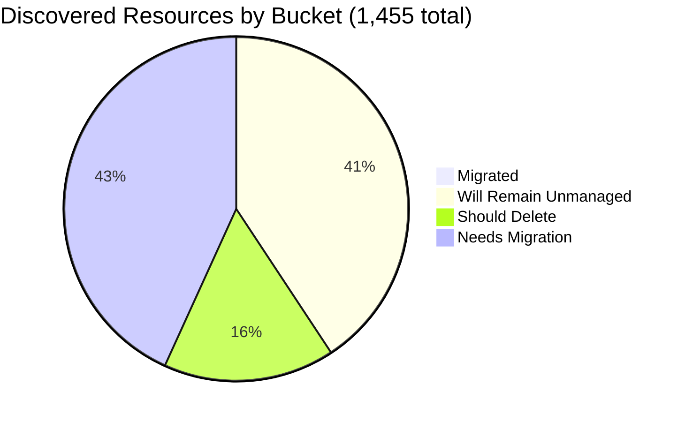

# Pulumi Migration Report — `pequod`

> **Generated:** September 11, 2026
> **Source:** Pulumi Insights (9 enrolled scan targets across 4 accounts) + Pulumi Cloud API
> **Scope:** All discovered cloud resources across enrolled Insights accounts.
> **Action taken:** None — this report only observes and recommends.
> **Previous report:** [2026-06-29](../2026-06-29/migration-report.md)

---

## 1. Executive Summary

**Org-wide migration coverage (Insights-discovered resources)**

```
░░░░░░░░░░░░░░░░░░░░ 0.4%  (6 of 1,455 discovered resources already under Pulumi IaC)
```

**Context:** `pequod` is the Pulumi CE (Customer Engineering) team's shared demo and workshop organization. Since the last report, the single largest AWS account (`aws-pulumi-ce-052848974346`, 4,651 resources / 78% of the prior estate) **no longer appears in Insights** — it returns HTTP 404 on lookup, meaning it was either deleted or de-enrolled. That single change explains most of the swing in every headline number below.

| Bucket | Count | % of Discovered | % of Migratable Base |
|--------|------:|----------------:|--------------------:|
| ✅ Migrated (in Pulumi IaC stack) | 6 | 0.4% | 0.7% |
| 🔒 Will remain unmanaged | 590 | 40.5% | — |
| 🗑️ Should be deleted | 233 | 16.0% | 26.9% |
| ⚠️ Needs migration | 626 | 43.0% | 72.4% |
| **Total discovered** | **1,455** | 100% | — |

*Migratable base = 865 (total − will-remain-unmanaged). Buckets sum to account totals; accounts sum to 1,455.*
*Plus a separate, smaller IaC footprint: 10 Pulumi stacks visible to this scan totaling 221 IaC resources (mostly outside Insights-scanned account/resource types — EKS/AKS clusters, ESC/OIDC config).*

**Single biggest takeaway:** the org's discovered footprint collapsed **75.5%** (5,946 → 1,455) week-over-week almost entirely because the noisiest AWS account was removed from Insights. Within what remains, **the Azure estate is now over half junk**: 183 of 344 Azure resources (53%) sit in ~59 abandoned, hex-suffixed demo resource groups — up from 24% last report.

**Data-quality caveats:**
- **Duplicate scanning of the same AWS account:** `aws-neo-eu-west-2-420942475186` (owner Robert Smith) and `aws-pulumi-ce-workshops-420942475186` (owner mitchgerdisch) are two *separate* Insights account registrations, but both scan AWS account **420942475186** — their `/global` sub-scans show identical IAM service-linked roles, the same `workshops.pulumi-ce.team` Route 53 zone, and the same `lambda-for-account-cleanup` function. This double-counts roughly 100+ resources in the totals below and splits ownership of the same real infrastructure across two people. Recommend de-registering one of the two.
- `aws-pulumi-ce-workshops-420942475186` has 4 of its 5 region sub-scans stale since **July 30, 2026** (6+ weeks); only `us-east-1` was refreshed since (Aug 25).
- Only **10 Pulumi stacks** were visible to this scan's credentials (221 resources), versus 21 stacks / 297 resources in the last report. Several previously-listed demo stacks (`demo-app`, `demo-aws-container-services-py-0629`, `lotctl-k8s-aws`) no longer appear — this may reflect real cleanup or a narrower access scope for this session; recommend confirming with an org-admin view.
- No formal Pulumi Teams are configured; ownership below is attributed by Insights account owner and resource name prefix (mapping stated in §6).

---

## 2. Migration Progress

### Org-wide four-bucket split (% of 1,455 discovered)

| Bucket | Bar | % |
|--------|-----|--:|
| Migrated | `░░░░░░░░░░░░░░░░░░░░` | 0.4% |
| Will remain unmanaged | `████████░░░░░░░░░░░░` | 40.5% |
| Should delete | `███░░░░░░░░░░░░░░░░░` | 16.0% |
| Needs migration | `█████████░░░░░░░░░░░` | 43.0% |



### % Migrated by Account (of that account's discovered resources)

| Account | Bar | Migrated / Total |
|---------|-----|----------------:|
| aws-neo-eu-west-2-420942475186 | `░░░░░░░░░░░░░░░░░░░░` | 0 / 173 — 0.0% |
| aws-pulumi-ce-workshops-420942475186 | `░░░░░░░░░░░░░░░░░░░░` | 0 / 334 — 0.0% |
| azure-team-ce-subscription | `░░░░░░░░░░░░░░░░░░░░` | 3 / 344 — 0.9% |
| google-pulum-ce-team-438338752289 | `░░░░░░░░░░░░░░░░░░░░` | 3 / 604 — 0.5% |

*Every AWS resource discovered this week is currently outside Pulumi management — both AWS accounts show 0% migrated, down from 43 combined resources visible as managed last report.*

### % Migrated by Team (of "needs migration + migrated" in that team's scope)

*Ownership signal: Insights account owner (primary) → resource name prefix (secondary). See §6 for mapping.*

| Team / Owner | Needs Migration | Migrated | Bar |
|-------------|----------------:|---------:|-----|
| GCP CE (google-pulum-ce-team-438338752289) | 339 | 3 — 0.9% | `░░░░░░░░░░░░░░░░░░░░` |
| Azure CE (azure-team-ce-subscription) | 111 | 3 — 2.6% | `░░░░░░░░░░░░░░░░░░░░` |
| Workshops/AWS CE (mitchgerdisch) | 133 | 0 — 0.0% | `░░░░░░░░░░░░░░░░░░░░` |
| Robert Smith (aws-neo-eu-west-2) | 43 | 0 — 0.0% | `░░░░░░░░░░░░░░░░░░░░` |

---

## 3. Momentum

**Active Pulumi footprint (pequod org, visible to this scan):** 10 stacks · 10 projects · 221 IaC-managed resources · 9 stacks with active resources

*Bars below = stacks last-updated per month, scaled to the busiest month (3). API exposes `lastUpdate`, not creation date, so these reflect activity, not new-stack counts.*

```
Sep 2026 ████████████████████ 3  ← busiest month on record
Jul 2026 █████████████░░░░░░░ 2
May 2025 █████████████░░░░░░░ 2
Aug 2026 ███████░░░░░░░░░░░░░ 1
Mar 2026 ███████░░░░░░░░░░░░░ 1
Feb 2025 ███████░░░░░░░░░░░░░ 1
```

**Activity pattern:** September 2026 is the busiest month on record (3 of 10 stacks touched so far this month), driven by new OIDC/cleanup tooling (`githubactions-pulumi-oidcissuer`, `demo-cleaner`, `deployment-agent-runners`). May 2025 and July 2026 each had 2 updates; the rest of the timeline shows only 1 update per active month — consistent with a small CE org where most work is ephemeral.

**Largest stacks by IaC resources (pequod org):**

| Project | Stack | IaC Resources | Last Updated |
|---------|-------|--------------|-------------|
| shared-dev-eks | dev | 88 | Mar 2026 |
| pequod-user-mgmt | prod | 79 | Aug 2026 |
| shared-dev-aks | dev | 17 | Jul 2026 |
| azure-oidc-env-config | prod | 12 | May 2025 |
| gcp-oidc-env-config | prod | 9 | May 2025 |
| insights-azure-creds | prod | 9 | Feb 2025 |
| githubactions-pulumi-oidcissuer | prod | 3 | Sep 2026 |
| demo-cleaner | prod | 3 | Sep 2026 |
| rhum-monitor | prod | 1 | Jul 2026 |
| deployment-agent-runners | prod | 0 | Sep 2026 |

Share of footprint active this month: **30%** of visible stacks (3 of 10) updated in September 2026 alone; 90% (9 of 10) hold at least one resource.

---

## 4. Coverage by Enrolled Account

> **Important:** Insights coverage reflects only enrolled accounts/regions. The 221 IaC resources in pequod stacks largely live in resource types or accounts not enrolled in Insights (shared EKS/AKS clusters, OIDC config), explaining why only 6 show as managed in Insights scans.

| Account | Cloud | Pulumi-Managed | Total Discovered | Coverage % | Bar | Last Scan |
|---------|-------|---------------:|-----------------:|------------|-----|-----------|
| aws-neo-eu-west-2-420942475186 | AWS | 0 | 173 | 0.0% | `░░░░░░░░░░░░░░░░░░░░` | Sep 10, 2026 |
| aws-pulumi-ce-workshops-420942475186 | AWS | 0 | 334 | 0.0% | `░░░░░░░░░░░░░░░░░░░░` | **4/5 regions stale — May 28 2025 to Jul 30 2026 ⚠️** |
| azure-team-ce-subscription | Azure | 3 | 344 | 0.9% | `░░░░░░░░░░░░░░░░░░░░` | Sep 10, 2026 |
| google-pulum-ce-team-438338752289 | GCP | 3 | 604 | 0.5% | `░░░░░░░░░░░░░░░░░░░░` | Sep 10, 2026 |
| **Org Total** | — | **6** | **1,455** | **0.4%** | `░░░░░░░░░░░░░░░░░░░░` | — |

**⚠️ Stale scans:** `aws-pulumi-ce-workshops-420942475186/global`, `/us-east-2`, `/us-west-1`, `/us-west-2` have not been rescanned since **July 30, 2026** (6+ weeks). Only `/us-east-1` refreshed since (Aug 25). Trigger fresh scans before acting on region data outside us-east-1.

**Enrollment gaps:** enrolling the AWS/Azure accounts backing `shared-dev-eks` (88 IaC resources) and `shared-dev-aks` (17 IaC resources) would close most of the gap between the 221 stack-managed resources and the 6 currently visible in Insights.

**Removed/missing account:** `aws-pulumi-ce-052848974346` — enrolled and scanned as of the last report (4,651 resources, 78% of the org's discovered footprint) — now returns 404 from the Insights API. Confirm whether this was an intentional decommission or an accidental de-enrollment; if intentional, no further action needed here.

---

## 5. Data Analysis

| Account | Cloud | Total | Migrated | Will Remain Unmanaged | Should Delete | Needs Migration | % Mig (All) | % Mig (Migratable) |
|---------|-------|------:|---------:|----------------------:|--------------:|----------------:|------------:|-------------------:|
| aws-neo-eu-west-2-420942475186 | AWS | 173 | 0 | 127 | 3 | 43 | 0.0% | 0.0% |
| aws-pulumi-ce-workshops-420942475186 | AWS | 334 | 0 | 183 | 18 | 133 | 0.0% | 0.0% |
| azure-team-ce-subscription | Azure | 344 | 3 | 47 | 183 | 111 | 0.9% | 1.0% |
| google-pulum-ce-team-438338752289 | GCP | 604 | 3 | 233 | 29 | 339 | 0.5% | 0.8% |
| **Org Total** | — | **1,455** | **6** | **590** | **233** | **626** | **0.4%** | **0.7%** |

**Classification methodology:**
- *Will remain unmanaged:* AWS Service Linked Roles + their policy attachments; CloudFront `Managed-*` cache/origin/response-header policies; default VPCs/subnets/route tables/SGs/DHCP options (matched on the classic `172.31.0.0/16` default-VPC CIDR); AWS Organizations/SSO auto-created roles (`OrganizationAccountAccessRole`, `AWSReservedSSO_*`, `*_DO_NOT_DELETE` SAML providers); CDK Toolkit bootstrap resources (`cdk-hnb659fds-*`, `CDKToolkit` stack); Athena `primary` workgroup, default MemoryDB/ElastiCache users, default EventBus, X-Ray `Default` group/rule, IoT domain configs, S3 Storage Lens default dashboard, AWS service-quota records — all AWS auto-scaffolding. Azure `NetworkWatcherRG`, `DefaultResourceGroup-*`, AKS-managed `MC_*` node RGs, Cloud Shell storage RGs, Application-Insights-managed `ai_*_managed` RGs. GCP default network/subnetwork/firewall rules, `gcp:projects/service:Service` API enablements, App Engine/Cloud Functions/Composer/Dataproc auto-created buckets, default service accounts, default logging sink/bucket.
- *Should delete:* resources judged orphaned or explicitly test-named (detailed in §6).
- *Needs migration:* all remaining active cloud infrastructure not yet in Pulumi IaC, including resources already under **CloudFormation/CDK** (AWS) or **ARM** (Azure) — these are prime CloudFormation/ARM-to-Pulumi migration candidates, not click-ops resources.
- *Classification confidence:* HIGH for "will remain unmanaged" (deterministic type/name patterns, verified programmatically against the full resource dump for every account). MEDIUM for "should delete" and the two largest "global" AWS IAM/CloudFront scans (naming heuristics with modest rounding on repeated service-linked-role groups) — human review required before acting.

**Three noteworthy specifics:**
- **The Azure estate is now majority cruft.** 183 of 344 Azure resources (53%, up from 24% last report) sit inside ~59 abandoned, hex-suffixed resource groups (`resourceGroup2dca640c`, `resource_group177e52b5`, `myRg80174c2a`, etc.) and their child storage accounts, VNets, NICs, VMs, and disks.
- **The same AWS account is double-registered in Insights.** `aws-neo-eu-west-2-420942475186` and `aws-pulumi-ce-workshops-420942475186` both scan AWS account `420942475186`; their `/global` sub-scans return identical IAM/CloudFront/Route 53 resources under two different owners, inflating both the AWS "needs migration" total and the per-owner attribution below.
- **`aws-pulumi-ce-workshops-420942475186/us-east-1` holds a real, unmanaged CDK app** (`PostgresLambdaStack`: Aurora PostgreSQL cluster, 5 Lambda functions, custom VPC, Secrets Manager secret) — a concrete CloudFormation-to-Pulumi migration candidate, not scaffolding.

---

## 6. Actions Needed

### Migration Queue by Team

**Ownership mapping used:**
(1) Insights account owner (primary signal for all accounts below — no per-resource owner tags were found in AWS/GCP; Azure resource groups occasionally carry a name prefix) →
(2) Resource/RG name prefix → individual mapping: `mitch-*` → MitchGerdisch; `zbuchheit-*` → Z. Buchheit; `piers-*` → Piers Karsenbarg; `pk-*` → PK (individual CE); `wladi-*`/`rg-dbw-*-wladi-*` → Wladi; `rg-dbw-*` → Databricks CE subteam; `aureq-*`, `menfin-*` → individual CEs; `geoff*` → Geoff; `elisabeth*` → Elisabeth →
(3) Insights account owner as fallback for everything else.

---

**GCP CE Team** (339 resources needing migration)
*Account: google-pulum-ce-team-438338752289; owner Mitch Gerdisch; no single resource-level owner*

| Priority | Resource(s) | Why |
|----------|------------|-----|
| 🔴 High | `pulumi-team-ce-tf-state`, `aureq-pulumi-diy-state-storage`, `menfin-demo-diy-state-storage-bucket-36159f1` buckets | **Terraform/Pulumi state storage** — losing these breaks other stacks; must be in IaC immediately |
| 🔴 High | `my-demo-network` VPC + 43 auto-mode subnets across regions + 6 firewall rules | Custom network backing active compute workloads; largest single migration item in the org |
| 🔴 High | `mitchselfhosted-mitchsh-network-afa8380` VPC + 42 subnets + `mitchselfhosted-mitchsh-{checkpoints,esc,policypacks}` buckets | Self-hosted Pulumi infra (network + state/ESC/policy-pack storage) |
| 🟡 Medium | 24 named workload-identity pools/providers + service accounts (`pulumi-oidc-mtan`, `wladi-gcp-pool`, `shaht-gcp-oidc-openid-wf`, `team-ce-oidc-sa`, …) | Active OIDC auth for individual CE members; losing these breaks their AWS/GCP access |
| 🟡 Medium | 11 `backend-*`/`httpbin-*`/`echo-backend-*`/`nginx-backend-*` load-balancer backend services | Active demo load balancers with no IaC backing |
| 🟢 Low | `geoff.int.` DNS zone records (11), Firestore `constructconnect-db3`, 4 VM instances, 6 Secret Manager secrets | Smaller active items; good hygiene to bring under IaC |
| +260 more | Remaining custom subnets/backend services/firewalls/service-account IAM bindings | Group by resource-owner name prefix; tackle state buckets and networks first |

---

**Azure CE Team** (111 resources needing migration)
*Account: azure-team-ce-subscription; owner mitchgerdisch; mixed CE member resources*

| Priority | Resource(s) | Why |
|----------|------------|-----|
| 🔴 High | `rg-shared-services-dev` (Key Vault `kv-demo-plat-dev` + Log Analytics `log-demo-platform-dev`) | Shared platform services consumed by other resources |
| 🔴 High | 9 `rg-dbw-*` Databricks resource groups (workspaces, VNets, NSGs — `my-team-1`, `my-team-beta`, `my-team-wladi`, `team-alpha`, managed variants) | Active Databricks environments for multiple CE members |
| 🔴 High | `podinfo-webapp-rg` (CosmosDB `podinfo-cosmosdb-28525` + WebApp + App Service Plan) | Running web application |
| 🟡 Medium | `pequod-keyvault`, `pk-demo-keyvault-rg`, `rg-hub-network-dev` (hub VNet + VPN gateway + NVA) | Shared secrets and hub-and-spoke networking used by spoke workloads |
| 🟡 Medium | `mitch-selfhosted`, `mitch-rg-020625`, `pk-vm-win-box`, `databricks-rg-meggy-dku7r6arn4v2g` | Active individual-CE infra |
| +99 more | `rg-apim`, `rg-blobstorage`, `rg-webAppVNet-dev`, `synapse`, `rsv-rg`, `vnet`, and their child resources (storage, NSGs, identities) | Group by resource-group owner; none carry ownership tags |

---

**Workshops/AWS CE** (133 resources needing migration)
*Account: aws-pulumi-ce-workshops-420942475186; owner mitchgerdisch; spans 5 regions, 4 of them scanned 6+ weeks ago*

| Priority | Resource(s) | Why |
|----------|------------|-----|
| 🔴 High | `PostgresLambdaStack` (us-east-1): Aurora PostgreSQL cluster + 5 Lambda functions + custom VPC + Secrets Manager secret, all CloudFormation-managed | Real running workload already under CloudFormation — top CFN-to-Pulumi migration candidate in the org |
| 🔴 High | `workshops.pulumi-ce.team` Route 53 zone + records | Active DNS for all workshop participants |
| 🟡 Medium | `pulumi-esc-ediri`, `zbuchheit-oidc`, `pulumi-esc-oidc-paul-umi-AdministratorAccess-role` OIDC roles | Active ESC/OIDC auth roles; losing these breaks credential issuance |
| 🟡 Medium | `lambda-role-for-account-cleanup` + `lambda-for-account-cleanup` Lambda (duplicated across all 5 regions) | Account-hygiene automation; consolidate into one IaC-managed multi-region deployment |
| 🟢 Low | `insights-account-scan`, `workshop-instructor-role`, `ContinuousDeliveryAdminRole`, `AdminWorkshop`, `MCOrient`/`VNOrient`, 10 cost budgets | Operational roles and budgets; low risk, good hygiene to bring under IaC |
| +~115 more | Remaining CloudFormation-managed VPC networking, RDS subnet/parameter groups, and per-region duplicates of the above | Rescan stale regions first; then import the CFN stack as a unit |

---

**Robert Smith** (43 resources needing migration)
*Account: aws-neo-eu-west-2-420942475186*

| Priority | Resource(s) | Why |
|----------|------------|-----|
| 🔴 High | `workshops.pulumi-ce.team` Route 53 zone + records *(same physical zone as the Workshops/AWS entry above — see duplicate-scanning caveat)* | Active DNS |
| 🟡 Medium | `zbuchheit-oidc`, `pulumi-esc-ediri`, `pulumi-esc-oidc-paul-umi-AdministratorAccess-role`, `ESCWksp` OIDC/ESC roles | Active credential-issuance roles |
| 🟡 Medium | `lambda-role-for-account-cleanup` + `lambda-for-account-cleanup` (eu-west-2 + global) | Account-hygiene automation |
| 🟢 Low | 2 cost budgets, `AmazonBedrockAgentCoreHarnessDefaultServiceRole-q81d1` + policy | Low risk; good hygiene to bring under IaC |
| +~30 more | Remaining resources are largely duplicates of the Workshops/AWS entries above (same account 420942475186) | Resolve the duplicate-registration issue before building a separate migration queue for this "team" |

---

### Deletion Candidates

*Recommend human review before deleting any of these. Classification is based on naming heuristics.*

| Pattern | Count | Account | Reason |
|---------|------:|---------|--------|
| Generic hex-suffixed resource groups (`resourceGroup*`, `resource_group*`, `resource-group*`, `myRg*`, `pkresourceGroup*`, `rgde*`/`rgf6*`, `hub-*-rg*`, `webapp-rg*`, `spoke1-vnet-rg*`, `rg-*-location*`, `6680-*`, etc.) + all child resources | 156 | azure-team-ce-subscription | Auto-generated hex-suffix names from repeated demo runs; child resources (storage, VNets, NICs, VMs, disks, PIPs, NSGs, App Service Plans) inherit the same fate |
| Explicit test/scratch resource groups (`rs-test`, `elisabeth-test`, `neo-test-sqldb`, `rg-pulumi-test`, `rg-sentinel-pulumi-test`, `VnetConfigTestGroup`, `ilb-app-service-neo-test`, `piers-resourcegroup-import-test`, `reuse-tf-module-test-workspace`, `myTFResourceGroup`, `example-rg`, `pk-keyvault-test894d8e7d`, `elisabethtest`) + children | 27 | azure-team-ce-subscription | Explicit test/scratch names |
| `my-bucket-*`/`app-bucket-*` generic buckets (`my-bucket-a2656a9`, `-00bc2ad`, `-bd4ceb7`, `app-bucket-e232f6b`) + ownership/access-block sub-resources | 12 | aws-pulumi-ce-workshops-420942475186/us-east-1 | Generic auto-named workshop leftovers with no owner tag (one carries only a `workshop: aicamp` tag) |
| `mitch-assumerole-test*` (role, bucket, policy, sub-resources, 2 regions + global) | 6 | aws-pulumi-ce-workshops-420942475186, aws-neo-eu-west-2-420942475186 | Explicit test/experiment name, recurring pattern from last report |
| `my-bucket-*` generic buckets (`my-bucket-01f4221`, `-1-245c799`, `-628ad18`, `-f50a09b`) + IAM/ACL bindings | 19 | google-pulum-ce-team-438338752289 | Generic/test-named; confirm not backing an active demo before deleting |
| `phil-cosmic-test-oauth`, `piers-test-bucket`, `pulumi-tutorial-storage-bucket-megan` buckets + bindings | 6 | google-pulum-ce-team-438338752289 | Explicit test/tutorial names |
| `aureq-test-sa`, `demos_weekly_test` service accounts + IAM policies | 4 | google-pulum-ce-team-438338752289 | Explicit test names |
| `my-app-secret` | 1 | google-pulum-ce-team-438338752289 | Generic/test-named secret, no owner tag |

---

### Unattributed Resources (significant items where ownership could not be resolved)

*These require a human to assign an owner before migration or deletion decisions can be made.*

| Resource | Account | Why Unresolved |
|----------|---------|---------------|
| `snqawpscpmsharedacr` Container Registry, `sentinel-pulumi-test` Log Analytics workspace, `initech` resource group + keyvault | azure-team-ce-subscription | Opaque or "Initech" demo-org names; no owner prefix or tag |
| `initech-identity-pool` workload identity pool, `initech-access` service account | google-pulum-ce-team-438338752289 | "Initech" appears to be a demo-org placeholder; confirm with CE team before acting |

---

*Percentages and counts are exact for every resource returned by this scan (full enumeration, not sampled), except where explicitly marked "~" for the two large AWS `/global` IAM scans, where repeated service-linked-role/attachment pairs were counted by consistent pattern rather than resource-by-resource due to volume. See the duplicate-AWS-account-scanning caveat in §1 before treating AWS totals as a unique-resource count.*
