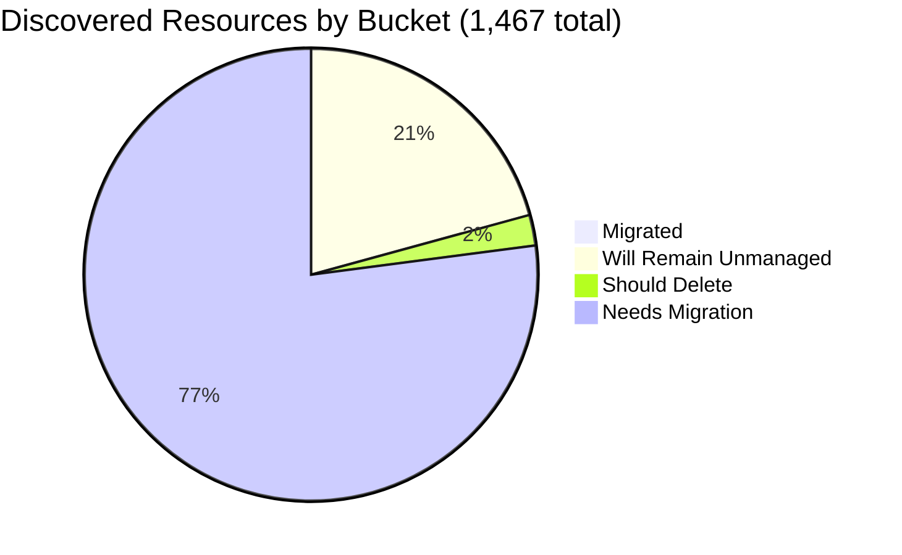

# Pulumi Migration Report — `pequod`

> **Generated:** September 18, 2026
> **Source:** Pulumi Insights (4 enrolled accounts, 11 scan units) + Pulumi Cloud API
> **Scope:** All discovered cloud resources across enrolled Insights accounts, plus Pulumi IaC stacks.
> **Action taken:** None — this report only observes and recommends.

---

## 1. Executive Summary

**Org-wide migration coverage (Insights-discovered resources)**

```
░░░░░░░░░░░░░░░░░░░░ 0.4%  (6 of 1,467 discovered resources already under Pulumi IaC)
```

**Headline change since the June 29, 2026 report: the org's largest scanned account, `aws-pulumi-ce-052848974346` (4,651 resources — 78% of the prior discovered estate), has been fully removed from Pulumi Insights** (`ReadAccount` now returns 404 — deleted, not paused). Org-wide discovered resources dropped from 5,946 → 1,467 (‑75%) as a direct result. This is almost certainly account de-enrollment/cleanup rather than real infrastructure deletion; treat all comparisons to last week's absolute counts with that in mind.

**Context:** `pequod` is the Pulumi CE (Customer Engineering) team's shared demo and workshop organization. Separately, the org runs **12 active Pulumi stacks across 12 projects, managing 265 IaC resources** — mostly durable shared platform infrastructure (EKS/AKS clusters, OIDC/ESC config) plus a couple of demo stacks created today. Most stacks in this org carry a 24-hour TTL and self-delete, so the live stack count is intentionally small and volatile week to week.

| Bucket | Count | % of Discovered | % of Migratable Base |
|--------|------:|----------------:|--------------------:|
| ✅ Migrated (in Pulumi IaC stack) | 6 | 0.4% | 0.5% |
| 🔒 Will remain unmanaged | 303 | 20.7% | — |
| 🗑️ Should be deleted | 32 | 2.2% | 2.8% |
| ⚠️ Needs migration | 1,126 | 76.8% | 96.7% |
| **Total discovered** | **1,467** | 100% | — |

*Migratable base = 1,164 (total − will-remain-unmanaged). Buckets sum to account totals; accounts sum to 1,467.*
*Plus 259 Pulumi IaC resources in stacks/resource types not enrolled in Insights (Kubernetes objects, ESC/OIDC config, etc.) — 265 total IaC resources − 6 also visible via cloud scan = 259.*

**Single biggest takeaway:** the deletion of `aws-pulumi-ce-052848974346` removed most of the org's historical cleanup backlog (the ~700 orphaned `serverless-comp-*` IAM policies flagged last week are gone from view). What remains is a smaller, cleaner estate dominated by legitimate active infrastructure (`needs_migration` = 76.8%) rather than junk.

**Data-quality caveats:**
- `aws-pulumi-ce-052848974346` is gone from Insights entirely — confirm with the org whether this was an intentional de-enrollment/account closure before treating the coverage numbers below as representative of the full estate.
- `aws-pulumi-ce-workshops-420942475186`'s five regional scan units have `scheduledScanEnabled: false` and were last scanned Jul 30–Aug 25, 2026 (3–7 weeks stale).
- No formal Pulumi Teams are configured; ownership below is attributed by account ownership and name-prefix convention (mapping stated in §6) — a large share of resources (default-named cloud objects inside shared resource groups/subnets) could not be resolved to an individual and fall back to account owner.

---

## 2. Migration Progress

### Org-wide four-bucket split (% of 1,467 discovered)

| Bucket | Bar | % |
|--------|-----|--:|
| Migrated | `░░░░░░░░░░░░░░░░░░░░` | 0.4% |
| Will remain unmanaged | `████░░░░░░░░░░░░░░░░` | 20.7% |
| Should delete | `░░░░░░░░░░░░░░░░░░░░` | 2.2% |
| Needs migration | `███████████████░░░░░` | 76.8% |



### % Migrated by Account (of that account's discovered resources)

| Account | Bar | Migrated / Total |
|---------|-----|----------------:|
| aws-neo-eu-west-2-420942475186 | `░░░░░░░░░░░░░░░░░░░░` | 0 / 174 — 0.0% |
| aws-pulumi-ce-workshops-420942475186 ⚠️ | `░░░░░░░░░░░░░░░░░░░░` | 0 / 334 — 0.0% |
| azure-team-ce-subscription | `░░░░░░░░░░░░░░░░░░░░` | 3 / 355 — 0.8% |
| google-pulum-ce-team-438338752289 | `░░░░░░░░░░░░░░░░░░░░` | 3 / 604 — 0.5% |

*All accounts under 1% — the deleted account was also the only one carrying meaningful migrated volume last week.*

### % Migrated by Responsible Team (of "needs migration" scope, see §6 for mapping)

| Team / Owner | Needs Migration | Migrated (in-account) | Bar |
|-------------|----------------:|---------:|-----|
| GCP CE Team (account fallback) | 377 | 3 — 0.8% | `░░░░░░░░░░░░░░░░░░░░` |
| Azure CE Team (account fallback) | 269 | 3 — 1.1% | `░░░░░░░░░░░░░░░░░░░░` |
| MitchGerdisch / Workshops (account fallback) | 183 | 0 — 0.0% | `░░░░░░░░░░░░░░░░░░░░` |
| MitchGerdisch (named resources) | 70 | 0 — 0.0% | `░░░░░░░░░░░░░░░░░░░░` |
| Robert Smith (account fallback) | 48 | 0 — 0.0% | `░░░░░░░░░░░░░░░░░░░░` |

---

## 3. Momentum

**Active Pulumi footprint (pequod org):** 12 stacks · 12 projects · 265 IaC-managed resources · all 12 stacks have resources.

*Bars = stacks by last-update month, scaled to Sep 2026 peak (5). API exposes `lastUpdate` (activity), not creation date.*

```
Sep 2026 ████████████████████ 5  ← busiest month on record
Aug 2026 ████░░░░░░░░░░░░░░░░ 1
Jul 2026 ████████░░░░░░░░░░░░ 2
Mar 2026 ████░░░░░░░░░░░░░░░░ 1
May 2025 ████████░░░░░░░░░░░░ 2
Feb 2025 ████░░░░░░░░░░░░░░░░ 1
```

**Activity pattern:** 5 of 12 stacks updated in September 2026 alone (2 of those — `aws-ec2-py-39-piers/dev` and `k8s-container-ts-20-piers/dev` — updated today). The org's durable platform stacks (`shared-dev-eks`, `shared-dev-aks`, `pequod-user-mgmt`) update every 1–2 months; the rest of the footprint is short-lived demo activity that typically doesn't survive long enough to show up as sustained "momentum."

**Stacks by IaC resource count:**

| Project | Stack | IaC Resources | Last Updated |
|---------|-------|--------------:|-------------|
| shared-dev-eks | dev | 88 | Mar 2026 |
| pequod-user-mgmt | prod | 79 | Aug 2026 |
| k8s-container-ts-20-piers | dev | 24 | Sep 18, 2026 |
| aws-ec2-py-39-piers | dev | 20 | Sep 18, 2026 |
| shared-dev-aks | dev | 17 | Jul 2026 |
| azure-oidc-env-config | prod | 12 | May 2025 |
| insights-azure-creds | prod | 9 | Feb 2025 |
| gcp-oidc-env-config | prod | 9 | May 2025 |
| +4 more | demo-cleaner, rhum-monitor, githubactions-pulumi-oidcissuer, deployment-agent-runners | 0–3 each | Jul–Sep 2026 |

Share of footprint active in the last 12 months: **100%** of stacks (12 of 12) have been updated at least once (org has a short retention window by design — see TTL note in §1).

---

## 4. Coverage by Enrolled Account

> **Important:** Insights coverage reflects only enrolled accounts. Most of pequod's 265 IaC resources live in accounts/resource types not enrolled in Insights (Kubernetes objects inside EKS/AKS, ESC/OIDC config), explaining why only 6 are visible as "migrated" in Insights scans.

| Account | Cloud | Pulumi-Managed | Total Discovered | Coverage % | Bar | Last Scan |
|---------|-------|---------------:|-----------------:|------------|-----|-----------|
| aws-neo-eu-west-2-420942475186 | AWS | 0 | 174 | 0.0% | `░░░░░░░░░░░░░░░░░░░░` | Sep 17, 2026 |
| aws-pulumi-ce-workshops-420942475186 ⚠️ | AWS | 0 | 334 | 0.0% | `░░░░░░░░░░░░░░░░░░░░` | Jul 30 – Aug 25, 2026 |
| azure-team-ce-subscription | Azure | 3 | 355 | 0.8% | `░░░░░░░░░░░░░░░░░░░░` | Sep 17, 2026 |
| google-pulum-ce-team-438338752289 | GCP | 3 | 604 | 0.5% | `░░░░░░░░░░░░░░░░░░░░` | Sep 17, 2026 |
| **Org Total** | — | **6** | **1,467** | **0.4%** | `░░░░░░░░░░░░░░░░░░░░` | — |

**⚠️ Deleted account:** `aws-pulumi-ce-052848974346` no longer exists in Insights (`ReadAccount` → 404). It was the org's largest single account last week. Confirm with the account owner whether this was intentional.

**⚠️ Stale scans:** `aws-pulumi-ce-workshops-420942475186`'s regional scan units have scheduled scanning disabled and are 3–7 weeks stale; trigger a fresh scan before acting on its resource data.

---

## 5. Data Analysis

| Account | Cloud | Total | Migrated | Will Remain Unmanaged | Should Delete | Needs Migration | % Mig (All) | % Mig (Migratable) |
|---------|-------|------:|---------:|----------------------:|--------------:|----------------:|------------:|-------------------:|
| aws-neo-eu-west-2-420942475186 | AWS | 174 | 0 | 84 | 3 | 87 | 0.0% | 0.0% |
| aws-pulumi-ce-workshops-420942475186 ⚠️ | AWS | 334 | 0 | 104 | 6 | 224 | 0.0% | 0.0% |
| azure-team-ce-subscription | Azure | 355 | 3 | 23 | 12 | 317 | 0.8% | 0.9% |
| google-pulum-ce-team-438338752289 | GCP | 604 | 3 | 92 | 11 | 498 | 0.5% | 0.6% |
| **Org Total** | — | **1,467** | **6** | **303** | **32** | **1,126** | **0.4%** | **0.5%** |

**Classification methodology:**
- *Will remain unmanaged (HIGH confidence, deterministic patterns):* AWS Service Linked Roles + their policy attachments/inline policies; AWS-managed CloudFront `Managed-*`/`UseOriginCacheControlHeaders*` policies; default security groups, VPC DHCP options; default ElastiCache/MemoryDB users & ACLs; default Athena `primary` workgroup; default EventBus; IoT system domain configs (`iot:*`); default X-Ray `Default` group/sampling rule; AWS-autodefined Route53 resolver associations; AWS SSO `DO_NOT_DELETE` SAML provider; Azure `NetworkWatcher`, `DefaultResourceGroup*`, AKS auto-created `MC_*` node RGs, Databricks-managed RGs; GCP auto-enabled `projects/service` APIs and default regional subnetworks.
- *Should delete (MEDIUM confidence — human review required):* explicit test/scratch naming (`*-test`, `test-*`, `*test*`) not otherwise tied to an active security/monitoring tool.
- *Needs migration:* all remaining active cloud infrastructure not yet in Pulumi IaC.
- One naming pattern (`sentinel-pulumi-test*`, 5 resources in `azure-team-ce-subscription`) contains "test" but backs an apparently active Microsoft Sentinel/Log Analytics deployment — classified as **needs migration / unattributed** rather than delete, pending human confirmation.

**Three noteworthy specifics:**
- **`google-pulum-ce-team-438338752289`** is now the largest scanned account (41% of the org total) and holds the biggest "needs migration" queue (498 resources), led by ~100 `bucketAccessControl` ACL entries and ~90 subnetworks spread across a custom global network.
- **`azure-team-ce-subscription`** contains 95 resource groups, most named by individual CE member or demo (e.g. `rg-dbw-*` Databricks workspaces, `podinfo-webapp-rg`) rather than by team — ownership had to fall back to "Azure CE Team (mixed)" for the majority (269 of 317 needs-migration resources).
- **GCP account name is still misspelled** (`google-pulum-ce-team` — missing an `i`), carried over from last week; worth correcting at account re-registration.

---

## 6. Actions Needed

### Migration Queue by Team

**Ownership mapping used:**
(1) Resource tag (not consistently populated on these scanned resources, so not usable at scale this week) →
(2) Resource/resource-group name prefix → individual mapping: `mitch-*`, `mitchselfhosted-*` → MitchGerdisch; `piers-*` → Piers Karsenbarg; `pk-*` → PK; `zbuchheit-*` → Z. Buchheit; `jconnell-*` → J. Connell; `wladi-*`, `rg-dbw-managed-my-team-wladi-*` → Wladi; `rg-dbw-*` → Databricks CE subteam; `aureq-*` → A. Requeno; `menfin-*` → M. Enfin; `meggy*` → Meggy; `elisabeth*` → Elisabeth; `boog-*` → Boog; `phil-*` → Phil →
(3) Account owner as fallback for everything else (mostly default-named cloud objects — VPCs, subnets, NSGs, storage accounts — inside shared resource groups/projects with no individual-attributable prefix).

---

**GCP CE Team** (~377 resources needing migration, account fallback — no single owner resolved)
*Account owner: Mitch Gerdisch (account-level), but resources belong to many individual CE members*

| Priority | Resource(s) | Why |
|----------|------------|-----|
| 🔴 High | `my-demo-network` VPC + ~90 subnetworks across 30+ regions | Custom network backing compute workloads; no IaC — high blast-radius if deleted |
| 🔴 High | `pulumi-ce-team` GCP project + `pulumi-ce-team.appspot.com` bucket | Project-level scaffolding; should be captured in IaC to prevent config drift |
| 🟡 Medium | ~100 `storage/bucketAccessControl` ACL entries | Tied 1:1 to the ~54 buckets already in this queue; migrate together with their parent buckets |
| 🟡 Medium | `gcf-sources-438338752289-us-east4` Cloud Functions source bucket | Supporting infra for deployed functions |
| +373 more | Service accounts, WIF pools/providers, DNS record sets, secrets | Group by resource owner name prefix where present, else by GCP service domain |

---

**Azure CE Team** (~269 resources needing migration, account fallback — no single owner resolved)
*Account: azure-team-ce-subscription; resource groups span many individual demos*

| Priority | Resource(s) | Why |
|----------|------------|-----|
| 🔴 High | `rsv-rg` (Recovery Services Vault RG) | Backup/DR infrastructure — losing config context risks data-protection gaps |
| 🔴 High | `aks-vnet-10930102` + `aks-agentpool-38808952-nsg` | AKS cluster networking without IaC backing |
| 🟡 Medium | `vnet-appconfig7870ad1e` + `uptime-rg21c74a0b` | Supporting infra for App Configuration / uptime-monitoring demos |
| 🟡 Medium | `vnet-dbw-my-team-beta-dev` + related Databricks VNets (5 workspaces total) | Active Databricks environments for multiple CE members |
| +265 more | Storage accounts, key vaults, container registries, VM/VMSS, CDN profiles | Group by resource-group owner; tackle networking + identity first |

---

**MitchGerdisch / Workshops account** (~183 resources needing migration, account fallback)
*Account owner: mitchgerdisch (aws-pulumi-ce-workshops-420942475186)*

| Priority | Resource(s) | Why |
|----------|------------|-----|
| 🔴 High | Workshop VPC + subnets + route tables (us-east-1, 5 regions total) | Core workshop networking, no IaC — foundational to all workshop demos |
| 🔴 High | 2 `aws:cloudformation/stack` (`postgreslambdastack`, CDK toolkit) | CFN-managed workshop content; candidate for CFN→Pulumi conversion |
| 🟡 Medium | 10 Lambda functions + RDS Aurora cluster (postgreslambdastack) | Active workshop application backend |
| 🟡 Medium | 7 S3 buckets + ownership/public-access-block controls | Workshop content/state storage |
| +179 more | KMS keys, ECR repo, Route53 records, budgets, IoT/X-Ray configs | Stale scan (3–7 weeks) — refresh before large migration push |

---

**MitchGerdisch (named resources)** (70 resources needing migration)
*Signal: `mitch-*` / `mitchselfhosted-*` name prefix, spans azure-team-ce-subscription + google-pulum-ce-team*

| Priority | Resource(s) | Why |
|----------|------------|-----|
| 🔴 High | `mitchselfhosted-mitchsh-network-afa8380` (GCP subnetwork, 3 regions) | Self-hosted Pulumi network infra — active |
| 🟡 Medium | `mitch-selfhosted` RG + `mitch-selfhosted.com` DNS zone (Azure) | Self-hosted Pulumi demo domain |
| 🟡 Medium | `mitch-rg-020625` resource group | Dated demo RG — confirm still in use |
| +67 more | Supporting VMs, storage, service accounts | Consolidate into a single self-hosted-Pulumi IaC project |

---

**Robert Smith** (~48 resources needing migration, account fallback)
*Account owner: aws-neo-eu-west-2-420942475186*

| Priority | Resource(s) | Why |
|----------|------------|-----|
| 🔴 High | `workshops.pulumi-ce.team` Route53 zone + NS/SOA records | Active DNS zone for all workshop participants — critical, single point of failure |
| 🟡 Medium | `cdk-hnb659fds-*` CDK bootstrap roles (9 resources) | Standard CDK toolkit scaffolding; low priority to migrate individually |
| 🟡 Medium | `AWSReservedSSO_AdministratorAccess_*`, `ContinuousDeliveryAdminRole`, `zbuchheit-oidc`, `pulumi-esc-ediri` roles | Active OIDC/SSO access roles — audit before importing |
| 🟢 Low | `420942475186-budget-150-*`, `420942475186-budget-fc8c40b` | Account cost budgets — good hygiene to have in IaC |
| +42 more | KMS key, Lambda (account-cleanup automation), VPC/subnets | Mostly account-level control-plane scaffolding |

---

### Deletion Candidates

*Recommend human review before deleting any of these. Classification is based on naming heuristics.*

| Pattern | Count | Account(s) | Reason |
|---------|------:|------------|--------|
| `mitch-assumerole-test*` (role, policy, attachment, S3 bucket) | 9 | aws-neo-eu-west-2, aws-pulumi-ce-workshops | Explicit test/experiment name, duplicated across 2 accounts |
| Azure RGs/resources with explicit test names (`rs-test`, `elisabeth-test`, `elisabethtest`, `neo-test-sqldb`, `piers-resourcegroup-import-test`, `rg-pulumi-test`, `reuse-tf-module-test-workspace`, `ilb-app-service-neo-test`, `testNetwork`, `neotest`/`test-plan`, `test-app0ba91a3b`) | 12 | azure-team-ce-subscription | Explicit test/scratch names; carried over from last week's list, still present |
| GCP `*-test*` resources (`piers-test-bucket` x2, `phil-cosmic-test-oauth` x2, `mitch-kms-test` x2, `boog-kms-test`, `demos_weekly_test`/`demos-weekly-test`, `aureq-test-sa` x2) | 11 | google-pulum-ce-team | Generic/test-named service accounts, buckets, KMS key rings — confirm not backing an active demo |

### Unattributed Resources (significant items where ownership could not be resolved)

*These require a human to assign an owner before migration or deletion decisions can be made.*

| Resource | Account | Why Unresolved |
|----------|---------|---------------|
| `rg-sentinel-pulumi-test` (RG) + `sentinel-pulumi-test` Log Analytics workspace/DCE + `dcr-sentinel-pulumi-test-*` DCR (5 resources) | azure-team-ce-subscription | Name contains "test" but appears to be an active Microsoft Sentinel demo/monitoring workspace, not scratch — flagged, not deleted |
| `podinfo-webapp-rg` (CosmosDB + WebApp + App Service Plan, 8 resources) | azure-team-ce-subscription | Running web application with no owner tag or name-prefix signal |
| `oidc` OIDC provider (both AWS accounts) + `pulumi-oidc-*` WIF pools/providers/service accounts (GCP, 27 resources total) | all 3 clouds | Generic OIDC/auth naming with no individual attribution; likely shared platform infra used by many demos |
| `rsv-rg` Recovery Services Vault, `uptime-rg21c74a0b` | azure-team-ce-subscription | Opaque/hash-suffixed names; purpose inferred from resource type only |

---

*All counts are exact, computed from a full paginated scan of every resource in each of the 4 currently enrolled Insights accounts (1,467 resources) plus the Pulumi Cloud stacks API (12 stacks, 265 resources) — no sampling or extrapolation. The workshops account's regional scan units are 3–7 weeks stale (noted in §4); all other data reflects scans from September 17, 2026 or later.*
