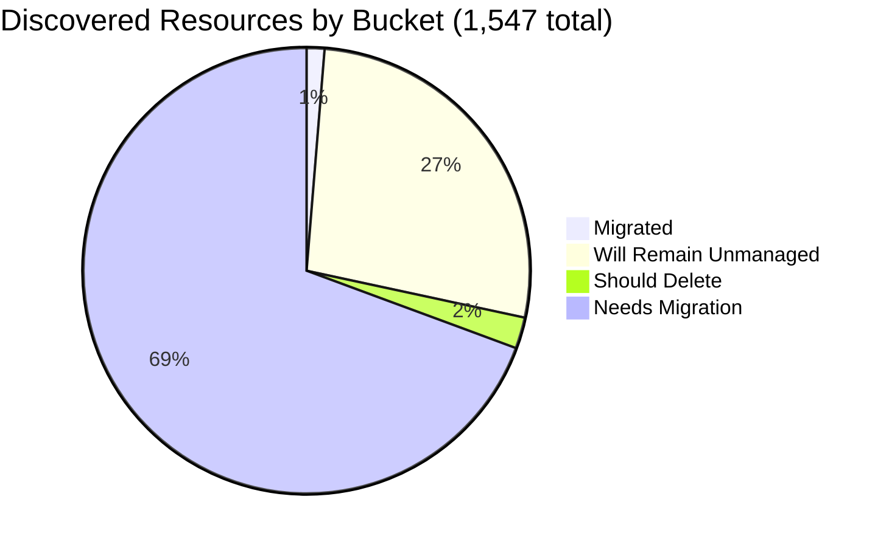

# Pulumi Migration Report — `pequod`

> **Generated:** September 25, 2026
> **Source:** Pulumi Insights (4 enrolled accounts) + Pulumi Cloud API
> **Scope:** All discovered cloud resources across enrolled Insights accounts.
> **Action taken:** None — this report only observes and recommends.

---

## 1. Executive Summary

**Org-wide migration coverage (Insights-discovered resources)**

```
░░░░░░░░░░░░░░░░░░░░ 1.3%  (20 of 1,547 discovered resources already under Pulumi IaC)
```

**Context:** `pequod` is the Pulumi CE (Customer Engineering) team's shared demo and workshop organization. **A major coverage change since the last report (June 29, 2026): the account `aws-pulumi-ce-052848974346` — previously 78% of the org's discovered footprint (4,651 of 5,946 resources) — is no longer enrolled in Insights.** This is not migration progress; it is a drop in scan coverage (the account was likely de-enrolled or decommissioned) and it makes this week's totals much smaller and not directly comparable to prior reports. Only 4 accounts are enrolled this week (was 5).

Separately, the org's active Pulumi IaC footprint is **12 stacks managing 230 resources across 12 projects** — down from 21 stacks / 19 projects / ~297 resources in June, consistent with routine demo teardown in a CE org rather than a regression.

| Bucket | Count | % of Discovered | % of Migratable Base |
|--------|------:|----------------:|--------------------:|
| ✅ Migrated (in Pulumi IaC stack) | 20 | 1.3% | 1.8% |
| 🔒 Will remain unmanaged | 419 | 27.1% | — |
| 🗑️ Should be deleted | 35 | 2.3% | 3.1% |
| ⚠️ Needs migration | 1,073 | 69.4% | 95.1% |
| **Total discovered** | **1,547** | 100% | — |

*Migratable base = 1,128 (total − will-remain-unmanaged). Buckets sum to account totals; accounts sum to 1,547.*
*Plus 210 additional Pulumi IaC resources in stacks not enrolled in Insights (the other 20 of the 230 total stack resources were also matched by a cloud scan and are already counted above).*

**Single biggest takeaway:** the loss of the `aws-pulumi-ce-052848974346` account from Insights is the dominant story this week, not migration velocity — confirm with the account owner whether this is intentional (decommissioned) or an enrollment/scanning issue, since it previously held most of the org's tracked resource inventory and its "needs migration" backlog (~3,200 items) is currently invisible to this report.

**Data-quality caveats:** all 4 remaining accounts show scan activity within the last few days (as of Sep 25, 2026) — no stale-scan issue this week (last report flagged `aws-pulumi-ce-workshops-420942475186` as 13 months stale; that has since been refreshed). No formal Pulumi Teams are configured; ownership is attributed primarily by account (fallback), then by resource name-prefix/tag where available — coverage of the latter is low (most resources are cryptic auto-named cloud IDs with no tags), so the bulk of "needs migration" work below is attributed to the account owner rather than an individual. No Control Tower, GuardDuty, Security Hub, or Firewall Manager resources were found in any enrolled account (either not present or not in scan scope).

---

## 2. Migration Progress

### Org-wide four-bucket split (% of 1,547 discovered)

| Bucket | Bar | % |
|--------|-----|--:|
| Migrated | `░░░░░░░░░░░░░░░░░░░░` | 1.3% |
| Will remain unmanaged | `█████░░░░░░░░░░░░░░░` | 27.1% |
| Should delete | `░░░░░░░░░░░░░░░░░░░░` | 2.3% |
| Needs migration | `██████████████░░░░░░` | 69.4% |



### % Migrated by Account (of that account's discovered resources)

| Account | Bar | Migrated / Total |
|---------|-----|----------------:|
| aws-neo-eu-west-2-420942475186 | `░░░░░░░░░░░░░░░░░░░░` | 0 / 177 — 0.0% |
| aws-pulumi-ce-workshops-420942475186 | `░░░░░░░░░░░░░░░░░░░░` | 0 / 397 — 0.0% |
| azure-team-ce-subscription | `█░░░░░░░░░░░░░░░░░░░` | 12 / 364 — 3.3% |
| google-pulum-ce-team-438338752289 | `░░░░░░░░░░░░░░░░░░░░` | 8 / 609 — 1.3% |

*Azure leads only because 12 of its Pulumi-provisioned resources (AKS, container apps, etc.) happen to also be re-discovered by the cloud scan; both AWS accounts show zero scan-visible Pulumi resources — their Pulumi-managed infra (EKS, OIDC) mostly isn't Insights-scannable.*

### % Migrated by Team (of "needs migration" in that team's scope)

*Ownership signal: account ownership (primary, since no formal Pulumi Teams exist) → resource name-prefix/tag (secondary, low coverage this week). See §6 for the full mapping.*

| Team / Account Owner | Needs Migration | Migrated | Bar |
|-------------|----------------:|---------:|-----|
| Robert Smith (aws-neo-eu-west-2-420942475186)† | 102 | 0 — 0.0% | `░░░░░░░░░░░░░░░░░░░░` |
| Workshops account (aws-pulumi-ce-workshops-420942475186, shared) | 212 | 0 — 0.0% | `░░░░░░░░░░░░░░░░░░░░` |
| Azure CE Team (azure-team-ce-subscription, shared) | 314 | 12 — 3.7% | `█░░░░░░░░░░░░░░░░░░░` |
| GCP CE Team (google-pulum-ce-team-438338752289, shared) | 445 | 8 — 1.8% | `░░░░░░░░░░░░░░░░░░░░` |

*† Attribution carried over from the prior report's account-ownership mapping; not independently reconfirmed this run. With `aws-pulumi-ce-052848974346` gone, the workshops account is no longer being combined with an individual's inventory and is treated here as shared/unattributed.*

---

## 3. Momentum

**Active Pulumi footprint (pequod org):** 12 stacks · 12 projects · 230 IaC-managed resources

*Bars below = stacks with an update in that month, scaled to the Sep 2026 peak (7). API exposes `lastUpdate`, not creation date, so this reflects activity, not new-stack counts.*

```
Sep 2026 ████████████████████ 7  ← busiest month on record (partial month, as of Sep 25)
May 2025 ██████░░░░░░░░░░░░░░ 2
Jul 2026 ███░░░░░░░░░░░░░░░░░ 1
Mar 2026 ███░░░░░░░░░░░░░░░░░ 1
Feb 2025 ███░░░░░░░░░░░░░░░░░ 1
```

**Activity pattern:** 7 of 12 stacks updated this month alone (Sep 2026), including several brand-new demo-support projects (`demo-cleaner`, `deployment-agent-runners`, `k8s-hybrid-app`, `k8s-hybrid-workload`). This looks like active cleanup/tooling work rather than steady-state operation — consistent with a CE org where infra churns quickly.

**Largest projects by IaC resources (pequod org):**

| Project | Stack | IaC Resources | Last Updated |
|---------|-------|--------------:|-------------|
| shared-dev-eks | dev | 88 | Mar 2026 |
| pequod-user-mgmt | prod | 81 | Sep 2026 |
| shared-dev-aks | dev | 18 | Sep 2026 |
| azure-oidc-env-config | prod | 12 | May 2025 |
| insights-azure-creds | prod | 9 | Feb 2025 |
| gcp-oidc-env-config | prod | 9 | May 2025 |
| k8s-hybrid-workload | dev | 6 | Sep 2026 |
| demo-cleaner | prod | 3 | Sep 2026 |
| githubactions-pulumi-oidcissuer | prod | 3 | Sep 2026 |
| rhum-monitor | prod | 1 | Jul 2026 |

Share of footprint active in the last 12 months: **75%** of stacks (9 of 12) have been updated since Sep 2025. The other 3 (`insights-azure-creds`, `azure-oidc-env-config`, `gcp-oidc-env-config` — all OIDC/credential config for Insights scanning itself) haven't been touched in 16+ months; that's expected for stable, rarely-changed bootstrap config rather than a stalled team.

---

## 4. Coverage by Enrolled Account

> **Important:** Insights coverage reflects only enrolled accounts. `aws-pulumi-ce-052848974346` dropped out of Insights entirely since the last report — its resources (thousands, per the June 29 report) are invisible to this week's scan and excluded from every count above.

| Account | Cloud | Pulumi-Managed | Total Discovered | Coverage % | Bar | Scan Freshness |
|---------|-------|---------------:|-----------------:|------------|-----|-----------|
| aws-neo-eu-west-2-420942475186 | AWS | 0 | 177 | 0.0% | `░░░░░░░░░░░░░░░░░░░░` | Fresh (Sep 24, 2026) |
| aws-pulumi-ce-workshops-420942475186 | AWS | 0 | 397 | 0.0% | `░░░░░░░░░░░░░░░░░░░░` | Fresh (Sep 24, 2026) |
| azure-team-ce-subscription | Azure | 12 | 364 | 3.3% | `█░░░░░░░░░░░░░░░░░░░` | Fresh (Sep 24, 2026) |
| google-pulum-ce-team-438338752289 | GCP | 8 | 609 | 1.3% | `░░░░░░░░░░░░░░░░░░░░` | Fresh (Sep 22, 2026) |
| **Org Total** | — | **20** | **1,547** | **1.3%** | `░░░░░░░░░░░░░░░░░░░░` | — |

**⚠️ Missing account:** `aws-pulumi-ce-052848974346` (AWS, MitchGerdisch's account per the prior report) is absent from all search results this run — confirm with the account owner whether it was intentionally removed from Insights or whether re-enrollment is needed to restore visibility.

**Enrollment gaps:** Enrolling the AWS account backing `shared-dev-eks` (88 IaC resources) and the Azure account/subscription backing `shared-dev-aks` (18 IaC resources) would let Insights directly confirm those Pulumi-managed clusters instead of relying on the stack API.

---

## 5. Data Analysis

| Account | Cloud | Total | Migrated | Will Remain Unmanaged | Should Delete | Needs Migration | % Mig (All) | % Mig (Migratable) |
|---------|-------|------:|---------:|----------------------:|--------------:|----------------:|------------:|-------------------:|
| aws-neo-eu-west-2-420942475186 | AWS | 177 | 0 | 72 | 3 | 102 | 0.0% | 0.0% |
| aws-pulumi-ce-workshops-420942475186 | AWS | 397 | 0 | 179 | 6 | 212 | 0.0% | 0.0% |
| azure-team-ce-subscription | Azure | 364 | 12 | 22 | 16 | 314 | 3.3% | 3.7% |
| google-pulum-ce-team-438338752289 | GCP | 609 | 8 | 146 | 10 | 445 | 1.3% | 1.8% |
| **Org Total** | — | **1,547** | **20** | **419** | **35** | **1,073** | **1.3%** | **1.8%** |

**Classification methodology:**
- *Will remain unmanaged:* AWS Service Linked Roles + their policy/role attachments; CloudFront `Managed-*` cache/origin-request/response-headers policies; IoT system domain configs (`iot:Data-ATS`); untagged default-looking VPC/subnet/route-table/IGW/DHCP-options/ENI scaffolding; default ElastiCache/MemoryDB users & ACLs, Athena `primary` workgroup, default CloudWatch event bus, default X-Ray group/sampling rule, AWS service quota records, default S3 Storage Lens dashboard; the CDK bootstrap stack (`CDKToolkit`, 12 resources); GCP `default` network/subnetworks/firewalls, project service-API enablement records, GCF/App Engine auto-created buckets and default service accounts, the core `pulumi-ce-team` project resource itself; Azure `DefaultResourceGroup-*`, `NetworkWatcher_*`, and AKS auto-managed `MC_*` node resource groups.
- *Should delete:* resources with explicit test/scratch naming (detailed in §6). Naming-heuristic confidence only — human review required.
- *Needs migration:* all remaining active cloud infrastructure not yet in Pulumi IaC, including the CDK-deployed `PostgresLambdaStack` workshop demo (53 resources, currently CloudFormation-managed rather than Pulumi).
- *Classification confidence:* HIGH for "will remain unmanaged" (deterministic type/name patterns); MEDIUM for "should delete" (naming heuristics only). Ownership attribution confidence is LOW this week — most resources have no owner tag and no recognizable name prefix, so they fall back to account-level attribution (see §2 and §6).

**Three noteworthy specifics:**
- **`aws-pulumi-ce-052848974346` is missing from Insights entirely** — this is the single most impactful change since the last report and dwarfs any organic migration movement (see §1/§4).
- **Azure's raw scan produced 531 resource records but only 364 unique physical resources** — many Azure resources are discovered twice (once at subscription scope, once at resource-group scope). All counts in this report use the deduplicated figure; be aware that other tooling querying raw scan records may over-count Azure by ~1.5x.
- **GCP account name is still misspelled** (`google-pulum-ce-team` — missing an `i`), same as noted in the prior report; worth correcting at account-registration time.

---

## 6. Actions Needed

### Migration Queue by Team

**Ownership mapping used:**
(1) Resource tag `Owner`/`owner`/`team`/`cost-center` where present →
(2) Resource name prefix → individual/subteam: `mitchselfhosted-*`/`mitch-*` → MitchGerdisch; `workshop*` → Workshop Team; `piers-*`/`pk-*` → Piers Karsenbarg; `wladi*`/`rg-dbw-*-wladi-*` → Wladi; `rg-dbw-managed-team-alpha-*` / `rg-dbw-managed-my-team-beta-*` → Databricks CE subteams; `aureq-*` → aureq; `menfin-*` → menfin; `meggy*` → Meggy; `podinfo-*` → Podinfo demo (unattributed); `initech*` → Initech demo (unattributed) →
(3) Account owner as fallback for everything else. **Coverage of (1) and (2) is low this week** — the large majority of resources in every account fall back to (3), meaning most of the queue below needs a human to assign an actual owner before work can be scheduled.

---

**Robert Smith** (aws-neo-eu-west-2-420942475186 — 102 resources needing migration)

| Priority | Resource(s) | Why |
|----------|------------|-----|
| 🔴 High | `workshops.pulumi-ce.team` Route53 zone + records | Active DNS zone for workshop participants — critical if still in use |
| 🔴 High | `workshop-instructor-role`, `lambda-role-for-account-cleanup` | Active IAM roles backing workshop provisioning / account cleanup automation |
| 🟡 Medium | `insights-account-scan` role + `ReadOnlyAccess` policy attachment | Role Insights itself uses to scan this account — should be in IaC |
| 🟡 Medium | `ContinuousDeliveryAdminRole`, `AWSServiceRoleForOrganizations`-adjacent custom roles | OIDC/CI roles without IaC backing |
| 🟢 Low | 2x `*-budget-*` cost budgets | Low risk; good hygiene to bring into IaC |
| +~95 more | Remaining IAM role/policy attachments, Route53 resolver rule associations | Mostly auto-created service roles; triage for anything still actively used before migrating |

---

**Workshops account** (aws-pulumi-ce-workshops-420942475186 — 212 resources needing migration; shared, unattributed)

| Priority | Resource(s) | Why |
|----------|------------|-----|
| 🔴 High | `PostgresLambdaStack` (53 resources: VPC, Lambda, Aurora Postgres cluster, IAM) | Active workshop demo currently deployed via CDK/CloudFormation, not Pulumi |
| 🔴 High | `MCOrient` IAM role + `PermsForWorkshop`/`AdministratorAccess` policies | Broad-permission role tied to a named workshop — confirm still needed, then bring into IaC or retire |
| 🟡 Medium | 8x KMS keys, `420942475186-budget-fc8c40b` budget | Real account resources with no IaC backing |
| 🟡 Medium | 10x Lambda functions (incl. `PostgresLambdaStack-*`), 9 security groups | Supporting demo infra |
| 🟢 Low | 2x untagged `my-bucket-*` S3 buckets | Low-risk cleanup or import candidates — confirm purpose first |
| +~200 more | Remaining IAM service-role attachments, S3 bucket policy scaffolding across 5 regions | Group by workshop name where identifiable; the rest is largely auto-created service-role noise |

---

**Azure CE Team** (azure-team-ce-subscription — 314 resources needing migration; shared, unattributed)

| Priority | Resource(s) | Why |
|----------|------------|-----|
| 🔴 High | `rg-shared-services-dev` → `kv-demo-plat-dev` + `id-demo-platform-dev` | Shared platform services consumed by other resources |
| 🔴 High | 5x Databricks workspaces + access connectors (`rg-dbw-managed-*`) | Active multi-team Databricks environments |
| 🔴 High | `podinfo-webapp-rg` (Cosmos DB `podinfo-cosmosdb-28525` + App Service + Insights) | Running web application |
| 🟡 Medium | `shared-dev-aks-k8s` AKS cluster + `cluster-fair-hamster` AKS cluster, VNets, NSGs | Active Kubernetes infra; `shared-dev-aks-k8s` is likely already Pulumi-adjacent (same name as the `shared-dev-aks` stack) — confirm before treating as unmanaged |
| 🟡 Medium | `snqawpscpmsharedacr` Container Registry | Opaque name, no owner signal, appears shared across demos — same unresolved item as last report |
| +~305 more | Storage accounts, NSGs, VMs, Key Vaults across ~25 resource groups | Group by resource-group owner prefix where possible |

---

**GCP CE Team** (google-pulum-ce-team-438338752289 — 445 resources needing migration; shared, unattributed)

| Priority | Resource(s) | Why |
|----------|------------|-----|
| 🔴 High | `menfin-demo-diy-state-storage-bucket-36159f1` | **Pulumi state storage bucket** — losing this breaks a stack; must be in IaC immediately |
| 🔴 High | `my-demo-network` + `mitchselfhosted-mitchsh-network-afa8380` VPCs and their per-region subnets (~90 subnet resources across both) | Custom networks used by active workloads; high resource count from GCP auto-mode subnet creation, but the networks themselves are real and unmanaged |
| 🟡 Medium | `pulumi-oidc-mtan` + `pk-gitlab-*` Workload Identity Pools/providers | Active OIDC federation infra |
| 🟡 Medium | `dwcore_dev_dataset_1` BigQuery dataset | Active data warehouse dataset, no owner tag |
| 🟡 Medium | 26x service accounts + IAM policy bindings (various individual-CE prefixes) | Audit per-owner; import the ones still in active use |
| +~435 more | Storage bucket ACLs/IAM policies, DNS records, backend services | Group by owner prefix (`MitchGerdisch`: 67, `menfin`: 14, `aureq`: 6, `Piers Karsenbarg`: 6, others unattributed) |

---

### Deletion Candidates

*Recommend human review before deleting any of these. Classification is based on naming heuristics.*

| Pattern | Count | Account | Reason |
|---------|------:|---------|--------|
| `mitch-assumerole-test*` (role, policy, attachment; S3 bucket + controls in workshops account) | 9 | aws-neo-eu-west-2-420942475186, aws-pulumi-ce-workshops-420942475186 | Explicit test/experiment name, same item flagged in the June 29 report — still not cleaned up |
| Azure `*-test`/`test-*` resource groups and contents (`rs-test`, `elisabeth-test`, `reuse-tf-module-test-workspace`, `piers-resourcegroup-import-test`, `ilb-app-service-neo-test`, `neo-test-sqldb`, `rg-pulumi-test`) | ~10 | azure-team-ce-subscription | Explicit test/scratch resource-group names |
| `sentinel-pulumi-test` / `rg-sentinel-pulumi-test` (Log Analytics workspace, Data Collection Rule/Endpoint) | 4 | azure-team-ce-subscription | Named test workspace; same item flagged last report — confirm still unused before deleting |
| `jamesneotest433` (Cosmos DB + Cognitive Search) | 2 | azure-team-ce-subscription | Explicit test naming |
| GCP `*-test-*`/`*-test` buckets, KMS keys/rings, service accounts (`piers-test-bucket`, `phil-cosmic-test-oauth`, `mitch-kms-test`, `boog-kms-test`, `aureq-test-sa`, `demos-weekly-test`) | 10 | google-pulum-ce-team-438338752289 | Explicit test/experiment naming |

### Unattributed Resources (significant items where ownership could not be resolved)

*These require a human to assign an owner before migration or deletion decisions can be made.*

| Resource | Account | Why Unresolved |
|----------|---------|---------------|
| `snqawpscpmsharedacr` Container Registry | azure-team-ce-subscription | Opaque name; no owner prefix or tag; unresolved for at least two report cycles now |
| `dwcore_dev_dataset_1` BigQuery dataset | google-pulum-ce-team-438338752289 | No owner tag or identifiable name prefix |
| `podinfo-webapp-rg` (Cosmos DB, App Service, Insights) | azure-team-ce-subscription | Demo app with no owner tag; unclear if still actively demoed |
| `initech-kv` Key Vault (`initech` resource group) | azure-team-ce-subscription | "Initech" naming suggests a demo scenario, not a real team; confirm owner |
| Most of the ~1,073 "needs migration" items org-wide | all 4 accounts | The majority of resources in every account carry no owner tag and no recognizable name prefix; this report attributes them to the account owner by default, which is a weak signal for a shared/team-owned account |

**Most impactful open question:** whether `aws-pulumi-ce-052848974346` was intentionally removed from Insights or needs re-enrollment — this determines whether next week's report should treat this org as ~1,550 resources (current view) or ~6,500+ resources (prior scope).

---

*Counts are exact for all currently-enrolled accounts, based on a full scan of every discovered resource (deduplicated by physical resource — see the Azure note in §5). `aws-pulumi-ce-052848974346` could not be scanned because it is no longer visible to Insights; its prior-week figures (~4,651 resources) are excluded entirely rather than estimated.*
