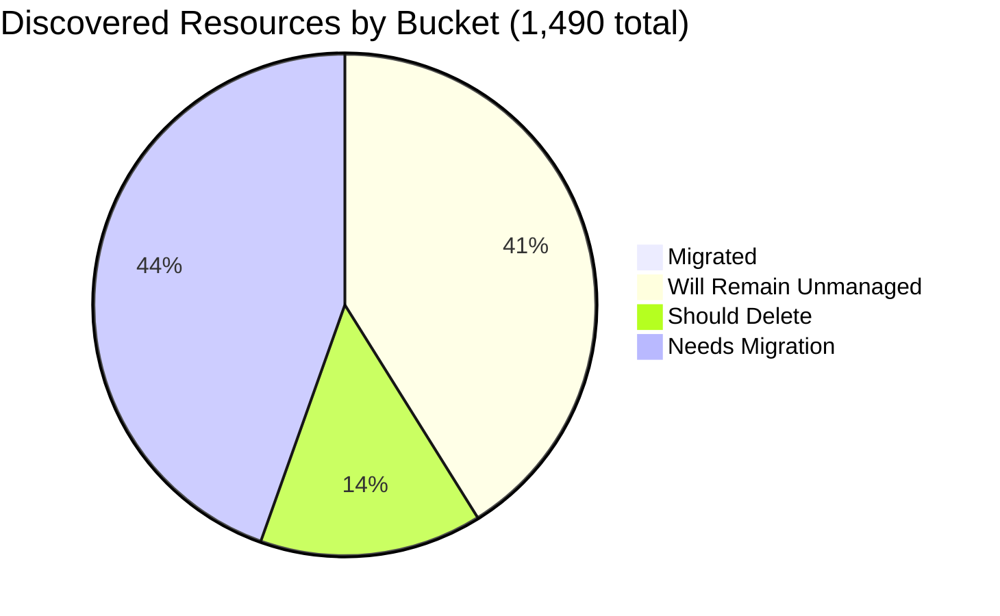

# Pulumi Migration Report — `pequod`

> **Generated:** October 2, 2026
> **Source:** Pulumi Insights (4 enrolled cloud accounts, 9 scan scopes) + Pulumi Cloud stacks API
> **Scope:** Every discovered resource in every enrolled Insights account (full paginated scan, 1,490 of 1,490 resources classified, no sampling).
> **Action taken:** None. This report only observes and recommends.

---

## 1. Executive Summary

**Org-wide migration coverage (Insights-discovered resources)**

```
░░░░░░░░░░░░░░░░░░░░ 0.6%  (9 of 1,490 discovered resources are in a Pulumi stack)
```

**Context:** `pequod` is the Pulumi CE team's shared demo and workshop organization. Insights now sees **1,490 resources in 4 accounts**. Separately, the org runs **15 stacks / 15 projects / 273 IaC resources**. Most of those live in Kubernetes, provider and non-cloud-scanned types, or in accounts Insights does not scan.

| Bucket | Count | % of Discovered | % of Migratable Base |
|--------|------:|----------------:|---------------------:|
| Migrated (in a Pulumi stack) | 9 | 0.6% | 1.0% |
| Will remain unmanaged | 609 | 40.9% | n/a |
| Should be deleted (review) | 212 | 14.2% | 24.1% |
| Needs migration | 660 | 44.3% | 74.9% |
| **Total discovered** | **1,490** | 100% | |

*Migratable base = 881 (1,490 total − 609 will-remain-unmanaged). Buckets sum to account totals; accounts sum to 1,490.*

**Biggest takeaway:** Three quarters of the migratable estate (660 of 881) still needs migration. 207 of those are GCP resources with no tag or name signal, and 176 Azure resources (20% of the migratable base) look like demo leftovers that should be deleted rather than migrated.

**Change since the June 29 report:** The June report covered 5 enrolled accounts and 5,946 resources. The main CE AWS account (`aws-pulumi-ce-052848974346`, 4,651 resources then) **is no longer listed in Insights**, which explains most of the drop in discovered resources (5,946 to 1,490) and migrated resources (53 to 9). This is an enrollment change, not a migration regression. Stack count also fell from 21 to 15.

**Data-quality caveats:** `aws-pulumi-ce-workshops-420942475186` has scheduled scans disabled; its five scopes were last scanned Jul 30 to Aug 25, 2026 (5 to 9 weeks old). 40 Azure resources carry a `managed-by: pulumi` tag but are not linked to any indexed stack. 81 "needs migration" resources are already managed by CloudFormation (37) or ARM (44).

---

## 2. Migration Progress

### Org-wide four-bucket split (of 1,490 discovered)

| Bucket | Bar | % |
|--------|-----|--:|
| Migrated | `░░░░░░░░░░░░░░░░░░░░` | 0.6% |
| Will remain unmanaged | `████████░░░░░░░░░░░░` | 40.9% |
| Should delete | `███░░░░░░░░░░░░░░░░░` | 14.2% |
| Needs migration | `█████████░░░░░░░░░░░` | 44.3% |



### % Migrated by Account

| Account | Bar | Migrated / Total |
|---------|-----|-----------------:|
| aws-neo-eu-west-2-420942475186 | `░░░░░░░░░░░░░░░░░░░░` | 0 / 180 (0.0%) |
| aws-pulumi-ce-workshops-420942475186 | `░░░░░░░░░░░░░░░░░░░░` | 0 / 334 (0.0%) |
| azure-team-ce-subscription | `░░░░░░░░░░░░░░░░░░░░` | 6 / 354 (1.7%) |
| google-pulum-ce-team-438338752289 | `░░░░░░░░░░░░░░░░░░░░` | 3 / 622 (0.5%) |

*Every account is below 2%, so the bars render empty by design. Both AWS accounts have zero Pulumi-managed resources.*

### % Migrated by Responsible Team (migrated / (migrated + needs migration))

| Team | Migrated | Needs Migration | Bar | % |
|------|---------:|----------------:|-----|--:|
| CE platform (OIDC / ESC / Insights access, shared AKS) | 6 | 55 | `██░░░░░░░░░░░░░░░░░░` | 9.8% |
| Data Platform (Databricks demo) | 3 | 53 | `█░░░░░░░░░░░░░░░░░░░` | 5.4% |
| All other teams (14 groups) | 0 | 552 | `░░░░░░░░░░░░░░░░░░░░` | 0.0% |

*The 9 migrated resources are the `pequodgcp-access` workload identity pool, provider and service account (3), the `shared-dev-aks` resource group, identity and cluster (3), and the Databricks managed identity, storage account and access connector (3). Team mapping is explained in section 6.*

---

## 3. Momentum

**Active Pulumi footprint (pequod org):** 15 stacks · 15 projects · 273 IaC-managed resources · 13 stacks with resources · 10 stacks updated in the last 90 days

*Bars show stacks created per month, using each stack's first update as the creation date. The last 12 months are shown, scaled to the busiest month on record (Sep 2026, 4 stacks).*

```
Oct 2026 ░░░░░░░░░░░░ 0   (month in progress)
Sep 2026 ████████████ 4   <- busiest month on record
Aug 2026 ░░░░░░░░░░░░ 0
Jul 2026 ░░░░░░░░░░░░ 0
Jun 2026 ░░░░░░░░░░░░ 0
May 2026 ░░░░░░░░░░░░ 0
Apr 2026 ░░░░░░░░░░░░ 0
Mar 2026 ░░░░░░░░░░░░ 0
Feb 2026 ░░░░░░░░░░░░ 0
Jan 2026 ░░░░░░░░░░░░ 0
Dec 2025 ░░░░░░░░░░░░ 0
Nov 2025 ░░░░░░░░░░░░ 0
Oct 2025 ░░░░░░░░░░░░ 0
```

**Earlier history:** Nov 2023 to Jan 2024 saw 6 stacks created (peak Jan 2024, 3). Then 4 more between Dec 2024 and Jul 2025. `wladi-deployments` has no updates yet.

**Share of footprint built in the last 12 months:** 4 of 15 stacks (27%) and 49 of 273 resources (18%). All four were created in September 2026.

**Accelerating:**
- **CE platform:** `k8s-hybrid-app` (21 resources) and `k8s-hybrid-workload` (6), both created Sep 23 to 24 and updated Sep 28.
- **Data / Azure:** `azure-wladi-subscription-dev` (5), created Sep 30.
- **Terraform-to-Pulumi HCL migration:** `pulumi-mrg-aws-ec2-s3-pcloud-tf-hcl` (17), created Sep 29.

**Stalled (no update in 90+ days):** `shared-dev-eks` (88 resources, last update Mar 20, 2026), `azure-oidc-env-config` and `gcp-oidc-env-config` (last update May 1, 2025), `insights-azure-creds` (Feb 2025), `wladi-deployments` (never updated).

**Largest stacks by IaC resources:**

| Project / Stack | IaC Resources | Last Updated |
|-----------------|--------------:|--------------|
| shared-dev-eks / dev | 88 | Mar 2026 |
| pequod-user-mgmt / prod | 81 | Sep 22, 2026 |
| k8s-hybrid-app / dev | 21 | Sep 28, 2026 |
| shared-dev-aks / dev | 18 | Sep 28, 2026 |
| pulumi-mrg-aws-ec2-s3-pcloud-tf-hcl / dev | 17 | Sep 30, 2026 |

*Stack creation dates are derived from each stack's first recorded update. The Cloud API does not expose a separate created-at field.*

---

## 4. Coverage by Enrolled Account

> **Important:** Insights coverage reflects enrolled accounts only, not the full estate. Of the 273 resources in `pequod` stacks, only 9 are visible as managed in Insights scans. The rest are Kubernetes and provider resources or sit in accounts and regions Insights does not scan (for example the EKS cluster behind `shared-dev-eks`).

| Account | Cloud | Pulumi-Managed | Total Discovered | Coverage | Last Scan (UTC) | Enrolled |
|---------|-------|---------------:|-----------------:|----------|-----------------|----------|
| aws-neo-eu-west-2-420942475186 | AWS | 0 | 180 | `░░░░░░░░░░░░░░░░░░░░` 0.0% | Oct 1, 2026 | n/a |
| aws-pulumi-ce-workshops-420942475186 | AWS | 0 | 334 | `░░░░░░░░░░░░░░░░░░░░` 0.0% | Jul 30 to Aug 25, 2026 (stale) | n/a |
| azure-team-ce-subscription | Azure | 6 | 354 | `░░░░░░░░░░░░░░░░░░░░` 1.7% | Oct 1, 2026 | n/a |
| google-pulum-ce-team-438338752289 | GCP | 3 | 622 | `░░░░░░░░░░░░░░░░░░░░` 0.5% | Oct 1, 2026 | n/a |
| **Org Total** | | **9** | **1,490** | `░░░░░░░░░░░░░░░░░░░░` 0.6% | | |

*Enrollment date is not exposed by the Insights accounts API.*

**Scan scopes:** `aws-neo` is scanned in `eu-west-2` (29 resources) and `global` (151). `aws-pulumi-ce-workshops` is scanned in `global` (109), `us-east-1` (134), `us-east-2` (29), `us-west-1` (26) and `us-west-2` (36). All 9 scopes last succeeded; none failed. The parent account entries hold no resources themselves.

**Stale scans:** Scheduled scanning is **disabled** for `aws-pulumi-ce-workshops-420942475186`. Trigger a fresh scan before acting on its data.

**Enrollment gap:** The main CE AWS account (`aws-pulumi-ce-052848974346`, 4,651 resources in the June report) and the AWS account behind `shared-dev-eks` are not in the enrolled list. Re-enrolling them would restore most of the visibility lost since June.

---

## 5. Data Analysis

| Account | Cloud | Total | Migrated | Will Remain Unmanaged | Should Delete | Needs Migration | % Mig (All) | % Mig (Migratable) |
|---------|-------|------:|---------:|----------------------:|--------------:|----------------:|------------:|-------------------:|
| aws-neo-eu-west-2-420942475186 | AWS | 180 | 0 | 124 | 3 | 53 | 0.0% | 0.0% |
| aws-pulumi-ce-workshops-420942475186 | AWS | 334 | 0 | 175 | 15 | 144 | 0.0% | 0.0% |
| azure-team-ce-subscription | Azure | 354 | 6 | 60 | 176 | 112 | 1.7% | 2.0% |
| google-pulum-ce-team-438338752289 | GCP | 622 | 3 | 250 | 18 | 351 | 0.5% | 0.8% |
| **Org Total** | | **1,490** | **9** | **609** | **212** | **660** | **0.6%** | **1.0%** |

**Classification methodology (every resource is in exactly one bucket):**
- *Migrated:* Insights `managed = Pulumi`.
- *Will remain unmanaged (609):* AWS service-linked, SSO and Organizations roles plus attachments (111); AWS default VPC scaffolding, identified by the default `172.31.0.0/16` VPC and the subnets, route tables, IGWs, DHCP options and default SG attached to it (66); CloudFront AWS-managed policies (56); AWS account defaults such as the default EventBus, Athena `primary`, X-Ray `Default`, MemoryDB/ElastiCache defaults, RDS default groups, and `AutoScalingManagedRule` (49); IoT system domain configs (15); AWS SSO SAML providers (2); GCP auto-created bucket project ACLs (93), default-network subnets, network and firewalls (50), project service APIs (49), Composer/Metastore buckets (32), Cloud Functions / App Engine / artifact buckets (24), default logging sinks (2); Azure AKS `MC_*` node resource groups (24), NetworkWatchers (16), default RGs/workspaces (11), Cloud Shell storage (5), App Insights managed RGs (4).
- *Should delete (212):* naming heuristics only (see section 6). Recommendations for human review.
- *Needs migration (660):* all remaining active infrastructure not in a Pulumi stack.
- *Confidence:* high for "will remain unmanaged" (deterministic patterns). Medium for "should delete" (name-based). The default-VPC rule is inferred from the CIDR, not an explicit `isDefault` flag.

**Noteworthy specifics:**
- **Azure holds 83% of the deletion candidates** (176 of 212). 47 auto-named demo resource groups (hex suffix) account for 136 of them.
- **ARM and CloudFormation already manage 81 "needs migration" resources** (44 Azure ARM, 37 AWS CloudFormation, mostly the `PostgresLambdaStack` and CDK bootstrap). They are IaC-managed, so the migration is a tool swap rather than a from-scratch import. A further 14 ARM-managed resources sit in the delete bucket.
- **Reclassification risk:** 22 AWS network interfaces and attachments in the workshops account are counted under "needs migration". They are service-created and probably follow their parent resources, which would lower the migration queue by about 22.

---

## 6. Actions Needed

### Migration Queue by Team

**Ownership signals used:** (1) resource tags `team`, `Owner`, `owner`, `Resource Owner`: 55 resources. (2) Name and resource-group prefix mapping: 261 resources. (3) GitHub code search across `pulumi-pequod` for 5 sampled resource names returned no hits, so it resolved nothing. (4) Insights account owner as fallback: 344 resources.

**Name mapping used (please validate):** `mitch*`, `selfhosted` → Mitch Gerdisch. `piers*`, `pk-*` → Piers Karsenbarg. `zbuchheit*` → Z. Buchheit. `menfin*`, `aureq*`, `*diy-state*` → Menfin / Aureq (CE). `geoff*`, `aptos*` → Geoff. `elisabeth*` → Elisabeth. `workshop*`, `aicamp` → Workshops team. `rg-dbw-*`, `dbw-*`, `databricks*`, `unity-catalog*`, `wladi*` → Data Platform (Databricks demo). `pequod*`, `*oidc*`, `pulumi-esc*`, `insights-account-scan`, `ESCWksp` → CE platform. `*account-cleanup*` → Build Engineering. `podinfo*`, `sentinel*`, `uptime*`, `beacon*` → CE demo apps. `cdk-hnb659fds*`, `PostgresLambda*` → CDK / Postgres demo. The four Pulumi Teams in the org (`ClaudeAccess`, `DevTeam`, `env-admin-pk`, `PlatformTeam`) do not map to resource ownership.

Largest queue first:

| Team | Needs Migration | Signal | Highest-leverage items |
|------|----------------:|--------|------------------------|
| GCP CE project (unresolved, account owner) | 207 | account | `core-network-*` / `main-vpc` / `my-demo-network` VPCs and 47 subnets; 11 `backend-*` services with 5 NEGs; app buckets (`app-bucket-8270249`, `dwcore-dev-bucket-1`); default and CD service accounts |
| Mitch Gerdisch | 153 | name (63), account (90) | GCP `mitchselfhosted-*` network, 42 regional subnets, checkpoint/ESC buckets and KMS key ring; AWS workshops VPC/route/KMS/budget resources (`PostgresLambdaStack` networking, 7 KMS keys, 8 budgets) |
| CE platform | 55 | name (49), tag (6) | AWS OIDC roles `pulumi-esc-ediri`, `ESCWksp`, `insights-account-scan`; GCP OIDC pools, providers and service accounts; `pequod-keyvault` |
| Data Platform (Databricks) | 53 | tag `team` (37), name (16) | 5 Databricks workspaces (`dbw-*-dev`) and 4 Unity Catalog access connectors; workspace VNets, NSGs and NAT gateway; managed RGs and storage |
| Azure CE subscription (unresolved, account owner) | 35 | account | `kv-demo-plat-dev`, `log-demo-platform-dev`, `id-demo-platform-dev`; `6680-*` CDN profiles and storage; `initech-kv` |
| CDK / PostgresLambda demo (CFN) | 29 | name | `PostgresLambdaStack` (Aurora cluster, 5 Lambdas, SGs, secret) and CDK bootstrap roles. CloudFormation-managed, so import or re-author |
| Menfin / Aureq (CE) | 26 | name | 5 DIY state-storage buckets plus IAM policies (`aureq-pulumi-diy-state-storage`, `m-*-diy-state-storage-bucket`); 4 OIDC pool/provider/service-account sets |
| Geoff | 17 | name | `geoff` DNS zone, 11 Aptos fullnode record sets, `aptos-default-backup` bucket and service account |
| Workshops team | 16 | name, tag | `workshops.pulumi-ce.team` Route53 zone and records; `workshop-instructor-role`; `AdminWorkshop` |
| Build Engineering (account-cleanup) | 16 | tag | `lambda-for-account-cleanup` in 5 regions; `lambda-role-for-account-cleanup` and policy |
| CE demo apps | 15 | name, tag | `podinfo-webapp-28525` (web app, plan, Cosmos DB); `sentinel-pulumi-test` workspace and DCRs; `beaconPlatformAcr03493717` |
| Piers Karsenbarg | 12 | name | `pk-vm-win-box` VNet/NSG; `pk-gitlab` workload identity pool and provider; `pk-demo-kv` |
| Robert Smith (AWS Neo account) | 12 | account | `MCOrient`, `VNOrient`, `lambdaRole-482bdf2`; two account budgets |
| Z. Buchheit | 7 | name | `zbuchheit-oidc` role and attachments; `zbuchheit-bucket-bbb152b` |
| Zendesk demo (individual unattributed) | 6 | name | `zendesk-domestic-vpc`, subnet, firewalls and VM |
| Elisabeth | 1 | name | `elisabeth-key-pair` |

### Deletion Candidates

*Recommend human review before deleting anything. Classification is name-based. Resource counts include child resources.*

| Pattern | Resources | Account | Reason |
|---------|----------:|---------|--------|
| Auto-named demo resource groups with hex suffix (`resourceGroup2dca640c`, `hub-vnet-rg867281c0`, `onprem-vnet-rg2a52eb0f`, `resource-groupb9f3f2db`, `pulumi-aca-webapp-rgedacecd7`, +42 more) | 136 (47 RGs) | azure-team-ce-subscription | Randomly suffixed names from Pulumi example and test runs, typically a single-use hub/spoke, VPN or web-app demo. `uptime-rg21c74a0b` contains App Insights, so confirm nothing is still alerting |
| Explicit test or scratch resource groups (`rs-test`, `elisabeth-test`, `neo-test-sqldb`, `reuse-tf-module-test-workspace`, `piers-resourcegroup-12345`, +13 more) | 40 (18 RGs) | azure-team-ce-subscription | Test names, examples, personal scratch RGs |
| GCP test, scratch or repro names (`piers-test-bucket`, `mitch-kms-test`, `boog-kms-test`, `repro-urlmap-bdeb6f8`, `nelsons-bucket-for-issue-repro-7f613bf`) | 14 | google-pulum-ce-team | Explicit test or issue-repro names; confirm no demo depends on them |
| Workshop placeholder buckets (`my-bucket-00bc2ad`, `my-bucket-a2656a9`, `my-bucket-bd4ceb7`, tagged `workshop=aicamp`) with ownership and public-access-block children | 9 | aws-pulumi-ce-workshops | Generic names from a finished workshop (data is from a stale scan) |
| `mitch-assumerole-test*` bucket, role, policy and attachments | 9 | aws-neo, aws-pulumi-ce-workshops | Explicit test or experiment name in two accounts |
| GCP placeholder buckets (`my-bucket-01f4221`, `my-bucket-1-245c799`, `my-bucket-628ad18`, `my-bucket-f50a09b`) | 4 | google-pulum-ce-team | Generic placeholder names |

*14 of the 212 are ARM-managed. Deleting them means destroying the ARM deployment, not just the resource.*

### Unattributed

Significant resources with no tag, name signal or repo hit; a human should assign an owner.

| Resource | Account | Why unresolved |
|----------|---------|----------------|
| `core-network-*`, `main-vpc`, `gke-network-*` VPCs and 47 subnets | google-pulum-ce-team | No owner tag or prefix; several networks and NAT routers depend on them |
| `backend-alpha`..`backend-delta`, `httpbin`/`nginx`/`echo` backends, NEGs, URL maps | google-pulum-ce-team | Load-balancer demo set, no owner |
| `app-bucket-8270249`, `appengine-static-content-ac017ac`, `demo-k8s-ts-nginx-6356eb8`, `dwcore-dev-bucket-1` | google-pulum-ce-team | Generic app buckets, no labels |
| `dwcore_dev_dataset_1` BigQuery dataset | google-pulum-ce-team | No owner label |
| `codefresh-ci-cd-access` and `CD Access` service accounts | google-pulum-ce-team | Service accounts without an owner |
| `kv-demo-plat-dev`, `log-demo-platform-dev`, `id-demo-platform-dev` | azure-team-ce-subscription | Shared platform services without tags |
| `initech-kv`, `yteappmgmt`, `rsvtest01` | azure-team-ce-subscription | No owner prefix or tag |

---

*All counts are exact: the scan enumerated all 1,490 discovered resources across all 9 scan scopes. Values marked as inferred are heuristics (default-VPC detection, name-based deletion and ownership) and should be validated by a human before action. GitHub code search was attempted for ownership but produced no matches.*
