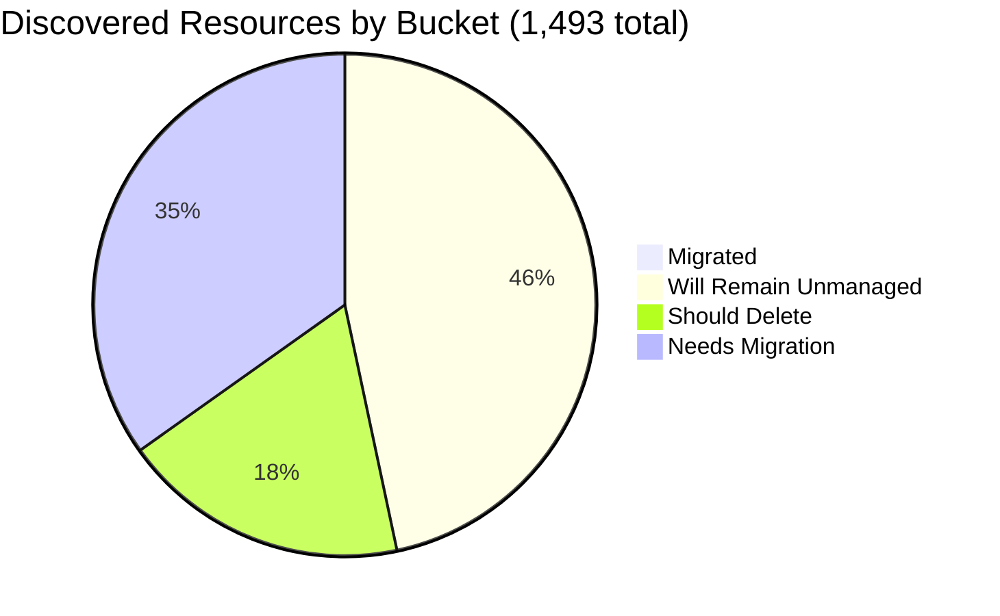

# Pulumi Migration Report — `pequod`

> **Generated:** October 9, 2026 (week of Oct 5)  
> **Source:** Pulumi Insights (4 enrolled parent accounts, 7 child region accounts) + Pulumi Cloud API  
> **Scan method:** Full, exact export of every discovered resource (1,493 records, paginated, no sampling) classified one-by-one; stack data from the Pulumi Cloud stacks API.  
> **Previous report in repo:** June 29, 2026 (15 weeks ago) — comparisons below are against that report.  
> **Action taken:** None. This report only observes and recommends.

---

## 1. Executive Summary
**Org-wide migration (Insights-discovered resources)**

```
░░░░░░░░░░░░░░░░░░░░ 0.4%  (6 of 1,493 discovered resources under Pulumi management)
```
`pequod` is the CE team's shared demo and workshop estate, so a low migrated share is expected. **Only 6 of 1,493 discovered resources (0.4%) are Pulumi-managed; 0.8% of the migratable base (799).** The estate is 46.5% platform scaffolding that should stay unmanaged and 18.4% delete candidates, leaving **518 resources that genuinely need migration**. Separately, the org runs **12 stacks / 12 projects managing 224 IaC resources**. Most of those do not appear as managed in any enrolled account, which points to un-enrolled accounts. Versus June 29, discovered resources fell from 5,946 to 1,493 because `aws-pulumi-ce-052848974346` (4,651 resources, 78% of the old estate) no longer exists in Insights.

| Bucket | Count | % of all discovered | % of migratable base |
|--------|------:|--------------------:|---------------------:|
| Migrated (Pulumi-managed) | 6 | 0.4% | 0.8% |
| Will remain unmanaged | 694 | 46.5% | n/a |
| Should be deleted (human review) | 275 | 18.4% | 34.4% |
| Needs migration | 518 | 34.7% | 64.8% |
| **Total discovered** | **1,493** | 100% | n/a |

*Migratable base = total minus "will remain unmanaged" = 799. Buckets sum to account totals and accounts sum to 1,493.*

**Data-quality caveats:** (1) `aws-neo-eu-west-2-420942475186` and `aws-pulumi-ce-workshops-420942475186` are the same AWS account (420942475186); 109 global resources appear in both, so de-duplicated physical resources are **1,384**. (2) Workshops AWS regions were last scanned Jul 30 to Aug 25 and scheduled scans are off. (3) No Insights account is assigned to a Pulumi Team, so ownership is inferred (see section 6).

---

## 2. Migration Progress

### Org-wide four-bucket split (of 1,493)

| Bucket | Bar | % |
|--------|-----|--:|
| Migrated | `░░░░░░░░░░░░░░░░░░░░` | 0.4% |
| Will remain unmanaged | `█████████░░░░░░░░░░░` | 46.5% |
| Should delete | `████░░░░░░░░░░░░░░░░` | 18.4% |
| Needs migration | `███████░░░░░░░░░░░░░` | 34.7% |



### % migrated by account (of the account's discovered resources)

| Account | Bar | Migrated / Total |
|---------|-----|-----------------:|
| aws-neo-eu-west-2-420942475186 | `░░░░░░░░░░░░░░░░░░░░` | 0 / 180 (0.0%) |
| aws-pulumi-ce-workshops-420942475186 | `░░░░░░░░░░░░░░░░░░░░` | 0 / 334 (0.0%) |
| azure-team-ce-subscription | `░░░░░░░░░░░░░░░░░░░░` | 3 / 353 (0.8%) |
| google-pulum-ce-team-438338752289 | `░░░░░░░░░░░░░░░░░░░░` | 3 / 626 (0.5%) |

*Only Azure and GCP have any Pulumi-managed resources (3 each: the `shared-dev-aks` cluster pieces and the `pequod-gcp-access` OIDC pool, provider and service account). Both AWS accounts are at 0%.*

### % migrated by responsible team (migrated / (migrated + needs migration))

| Team | Bar | Migrated | Needs migration | % |
|------|-----|---:|---:|--:|
| Mitch Gerdisch (CE workshops / self-hosted / account owner) | `░░░░░░░░░░░░░░░░░░░░` | 3 | 300 | 1.0% |
| Identity & Cloud Access (OIDC / ESC) | `█░░░░░░░░░░░░░░░░░░░` | 3 | 85 | 3.4% |
| Customer-repro demos (zendesk, aptos, geoff, core-network) | `░░░░░░░░░░░░░░░░░░░░` | 0 | 43 | 0.0% |
| Azure Data Platform (Databricks) | `░░░░░░░░░░░░░░░░░░░░` | 0 | 38 | 0.0% |
| Individual CE demos (menfin, aureq, piers, pk, ...) | `░░░░░░░░░░░░░░░░░░░░` | 0 | 30 | 0.0% |
| Pulumi Build Engineering (account cleanup) | `░░░░░░░░░░░░░░░░░░░░` | 0 | 16 | 0.0% |
| Robert Smith (aws-neo account owner) | `░░░░░░░░░░░░░░░░░░░░` | 0 | 6 | 0.0% |

*Migrated resources were attributed the same way: the 3 GCP OIDC resources to Identity & Cloud Access, the 3 `shared-dev-aks` Azure resources to the account owner (Mitch Gerdisch).*

---

## 3. Momentum

**Active Pulumi footprint (`pequod`):** 12 stacks · 12 projects · 224 managed resources · 9 stacks currently hold resources (3 are empty or destroyed between runs).

*New stacks per month, last 12 months (creation = first recorded update or stack root resource), scaled to the busiest month (3).*

```
Nov 2025 ░░░░░░░░░░░░ 0
Dec 2025 ░░░░░░░░░░░░ 0
Jan 2026 ████░░░░░░░░ 1   shared-dev-eks
Feb 2026 ░░░░░░░░░░░░ 0
Mar 2026 ░░░░░░░░░░░░ 0
Apr 2026 ░░░░░░░░░░░░ 0
May 2026 ░░░░░░░░░░░░ 0
Jun 2026 ░░░░░░░░░░░░ 0
Jul 2026 ░░░░░░░░░░░░ 0
Aug 2026 ░░░░░░░░░░░░ 0
Sep 2026 ████████████ 3   shared-dev-aks, k8s-hybrid-app, k8s-hybrid-workload
Oct 2026 ░░░░░░░░░░░░ 0   (to date)
```

- **Busiest months on record:** Sep 2026 and Jan 2024, tied at 3 new stacks each.
- **Share of footprint built in the last 12 months:** 4 of 12 stacks (33%) and 106 of 224 resources (47%).
- **Accelerating (updated in the last 90 days): 7 stacks.** `k8s-hybrid-app` (37 updates since Sep 24) and `k8s-hybrid-workload` (24 since Sep 23) are the most active builds. `deployment-agent-runners` and `demo-cleaner` are scheduled automation that updates daily. `pequod-user-mgmt`, `githubactions-pulumi-oidcissuer` and `shared-dev-aks` were updated in the last three weeks.
- **Stalled (no update in over 90 days): 5 stacks.** `insights-azure-creds` (Feb 2025), `azure-oidc-env-config` and `gcp-oidc-env-config` (May 2025), `shared-dev-eks` (Mar 2026), `rhum-monitor` (Jul 8, last run failed).

| Largest stacks | IaC resources | Last update |
|----------------|--------------:|-------------|
| shared-dev-eks / dev | 88 | Mar 20, 2026 |
| pequod-user-mgmt / prod | 81 | Sep 22, 2026 |
| shared-dev-aks / dev | 18 | Sep 28, 2026 |
| azure-oidc-env-config / prod | 12 | May 1, 2025 |
| insights-azure-creds / prod | 9 | Feb 5, 2025 |
| gcp-oidc-env-config / prod | 9 | May 1, 2025 |
| +6 smaller stacks | 7 | n/a |

**Change since June 29:** stacks 21 to 12, projects 19 to 12, IaC resources about 297 to 224, Insights-visible managed resources 53 to 6. Several demo stacks from the earlier report (for example `demo-app`, `lotctl-k8s-aws`) are gone, and `shared-dev-aks` was recreated on Sep 28.

---

## 4. Coverage by Enrolled Account

> **Important:** Insights coverage reflects only enrolled accounts, not the full estate. The 224 stack-managed resources include `shared-dev-eks` (88 resources, 55 of them AWS/EKS), but no AWS account shows any Pulumi-managed resource. That EKS stack most likely lives in an AWS account that is not enrolled.

| Account | Cloud | Pulumi-managed | Total discovered | Coverage | Bar | Last scan | Scheduled scans |
|---------|-------|---------------:|-----------------:|---------:|-----|-----------|:---:|
| aws-neo-eu-west-2-420942475186 | AWS | 0 | 180 | 0.0% | `░░░░░░░░░░░░░░░░░░░░` | Oct 8, 2026 | on |
| aws-pulumi-ce-workshops-420942475186 | AWS | 0 | 334 | 0.0% | `░░░░░░░░░░░░░░░░░░░░` | Jul 30 to Aug 25, 2026 (45 to 71 days old) | off |
| azure-team-ce-subscription | Azure | 3 | 353 | 0.8% | `░░░░░░░░░░░░░░░░░░░░` | Oct 8, 2026 | on |
| google-pulum-ce-team-438338752289 | GCP | 3 | 626 | 0.5% | `░░░░░░░░░░░░░░░░░░░░` | Oct 8, 2026 | on |
| **Org total** | n/a | **6** | **1,493** | **0.4%** | `░░░░░░░░░░░░░░░░░░░░` | n/a | n/a |

*Enrollment dates are not exposed by the Insights API, so they are omitted.*

- **Removed account:** `aws-pulumi-ce-052848974346` (4,651 resources on June 29) now returns 404. Confirm whether the removal was intentional, because it held the bulk of the earlier backlog (including about 700 `serverless-comp-NNN-consumer-*` IAM policies).
- **Stale scans:** the workshops account has scheduled scans disabled, so its numbers will not move until someone triggers a scan.
- **Visibility gain from more enrollment:** enrolling the account behind `shared-dev-eks` would make the 55 AWS/EKS resources in that stack visible and attribute them to the Identity/Platform owners.

---

## 5. Data Analysis

| Account | Cloud | Total | Migrated | Will remain unmanaged | Should delete | Needs migration | % migrated (all) | % migrated (migratable) |
|---------|-------|------:|---------:|----------------------:|--------------:|----------------:|-----------------:|------------------------:|
| aws-neo-eu-west-2-420942475186 | AWS | 180 | 0 | 139 | 5 | 36 | 0.0% | 0.0% |
| aws-pulumi-ce-workshops-420942475186 | AWS | 334 | 0 | 218 | 29 | 87 | 0.0% | 0.0% |
| azure-team-ce-subscription | Azure | 353 | 3 | 84 | 185 | 81 | 0.8% | 1.1% |
| google-pulum-ce-team-438338752289 | GCP | 626 | 3 | 253 | 56 | 314 | 0.5% | 0.8% |
| **Org total** | n/a | **1,493** | **6** | **694** | **275** | **518** | **0.4%** | **0.8%** |

**Classification method:** every record was classified individually.
- *Unmanaged:* AWS service-linked and SSO-reserved roles, CloudFront `Managed-*` policies, default VPCs and dependents, IoT system domains, default EventBridge/Athena/MemoryDB/ElastiCache/X-Ray objects, CDK bootstrap resources, auto-created ENIs, GCP project service APIs, default network, GCF/Composer/Metastore/App Engine buckets, Azure NetworkWatchers, `MC_*` AKS node RGs, `DefaultResourceGroup-*`, Cloud Shell storage and Databricks-managed RGs.
- *Delete:* explicit test, scratch or placeholder names, Pulumi auto-named (hex-suffix) Azure demo RGs, and one untagged orphaned AWS demo. These are judgment calls for human review.
- *Needs migration:* everything else not under Pulumi. CloudFormation-managed (37) and ARM-managed (68) resources are not Pulumi-managed, so they are counted here or in delete, never as migrated.
- *Confidence:* high for unmanaged (deterministic patterns), medium for delete (naming heuristics).

**Noteworthy:**
- **Azure holds 185 of the 275 delete candidates (67%)**, almost all auto-named demo resource groups from earlier Pulumi runs. Removing them would shrink the Azure inventory from 353 to 168 resources.
- **GCP carries the largest migration backlog (314 of 518, 61%)**, mostly two custom VPCs with 85 subnets plus load-balancer demo stacks.
- **Azure resource groups tagged `managed-by=pulumi`** (the `rg-dbw-*` Databricks set) have no stack in `pequod`, so they are probably managed from another org. Confirm before importing.

---

## 6. Actions Needed

### Migration queue by team

**Ownership signals used (in order):** (1) resource tags: `Owner`, `workshop`, `team`, `project`, plus the repo path in `Owner=github.com/pulumi/aws-account-cleanup/...`; (2) name and resource-group prefixes mapped to teams; (3) Insights account owner as fallback. The mapping below is inferred, so please validate it:
- `oidc`, `esc`, `workloadidentity`, `insights-account`, `continuousdeliveryadmin` to **Identity & Cloud Access**
- `mitch*`, `selfhosted`, `workshop`, `postgreslambda`, `m-*-diy-state` to **Mitch Gerdisch**
- `menfin`, `aureq`, `piers`, `pk-`, `elisabeth`, `zbuchheit`, `tushar` to **Individual CE demos**
- `zendesk`, `aptos`, `geoff`, `initech`, `core-network`, `dwcore`, `main-vpc` to **Customer-repro demos**
- `rg-dbw-*`, `databricks-rg-*` and tag `project=azure-data-platform` to **Azure Data Platform**
- Fallback: Mitch Gerdisch for workshops, Azure and GCP accounts; Robert Smith for the aws-neo account.

Signal breakdown for the 518 needing migration: 280 by name/RG prefix, 47 by tag, 191 by account-owner fallback (37%).

---

**Mitch Gerdisch** (300) — fallback owner for 185 of these.

| Priority | Resource(s) | Why |
|----------|-------------|-----|
| High | GCP `mitchselfhosted-mitchsh-network-afa8380` (42 subnets) and `mitchselfhosted-mitchsh-*` policypacks/checkpoints/ESC buckets | Self-hosted Pulumi backend infrastructure |
| High | GCP `my-demo-network` VPC with 43 subnets, router and NAT | Custom network used by compute and load-balancer demos |
| High | AWS `workshops.pulumi-ce.team` Route53 zone and records, `workshop-instructor-role`, `AdminWorkshop` | Workshop provisioning depends on these |
| Medium | AWS CDK `PostgresLambdaStack` (34 resources: Aurora cluster, Lambdas, VPC) | CloudFormation-managed; good CDK-to-Pulumi migration candidate |
| Medium | GCP 11 backend services, 5 NEGs and 3 URL maps (httpbin, echo, nginx) | Load-balancer demos with no IaC |
| +295 more | Subnets, bucket ACLs/IAM, Azure `podinfo-webapp-rg`, CDN profiles | Group by cloud, then by service |

**Identity & Cloud Access (OIDC / ESC)** (85)

| Priority | Resource(s) | Why |
|----------|-------------|-----|
| High | AWS `insights-account-scan` role (tag `Owner=pequod`) | Role Insights uses to scan; losing it breaks coverage |
| High | AWS `ContinuousDeliveryAdminRole`, `pulumi-esc-ediri`, `pulumi-esc-oidc-paul-umi-AdministratorAccess-role`, `ESCWksp`, `zbuchheit-oidc` | Admin-level OIDC/ESC roles with no IaC |
| High | 2 AWS `oidc` OpenID Connect providers | Trust anchor for the roles above |
| Medium | GCP 12 workload identity pools and 13 providers (menfin-*, shaht, megan, mtan, pk-gitlab) | Per-person OIDC demos; audit which are still used |
| +67 more | GCP OIDC service accounts and their IAM policies | Import active ones, retire the rest |

**Customer-repro demos** (43)

| Priority | Resource(s) | Why |
|----------|-------------|-----|
| Medium | GCP `geoff` managed zone and 11 `*.geoff.int` record sets | Aptos fullnode DNS |
| Medium | GCP `main-vpc`, router, NAT and firewall | Network backing repro workloads |
| Medium | GCP `zendesk-domestic-vpc-0398fb1`, `zendesk-domwg-i-3e98473` | Customer repro VPC and VM |
| Low | GCP `dwcore_dev_dataset_1` BigQuery dataset and `dwcore-dev-bucket-1` | Dev data warehouse |
| +38 more | `core-network-*`, `gke-network-*`, `aptos-default-backup` | Confirm each repro is still needed |

**Azure Data Platform (Databricks)** (38)

| Priority | Resource(s) | Why |
|----------|-------------|-----|
| High | `rg-dbw-*` for my-team, my-team-1, my-team-beta, my-team-wladi, team-alpha (workspaces, VNets, 10 NSGs) | Five Databricks environments; tagged `managed-by=pulumi` but no stack here |
| High | `rg-shared-services-dev` (`kv-demo-plat-dev`, `log-demo-platform-dev`) | Shared platform services |
| Medium | `rg-hub-network-dev` (`vnet-hub-dev`) | Hub network |
| Medium | `rg-sentinel-pulumi-test` (Log Analytics, DCE, DCR, workbook) | Sentinel audit-log pipeline; name says test but it looks active |

**Individual CE demos** (30)

| Priority | Resource(s) | Why |
|----------|-------------|-----|
| High | GCP `aureq-pulumi-diy-state-storage` bucket | Pulumi DIY state storage; loss breaks stacks |
| Medium | Azure `pk-vm-win-box` (VM RG, VNet, NSGs), `pk-demo-keyvault-rg` | Active personal demo infra |
| Medium | GCP `piers-service-account-insights`, `pk-gitlab-*` service account | Service accounts used by integrations |
| Low | AWS `zbuchheit-bucket-bbb152b`, `elisabeth-key-pair` | Personal resources |
| +21 more | menfin OIDC service accounts, `tushar`, `cameron` | Confirm owners |

**Pulumi Build Engineering (account cleanup)** (16): `lambda-for-account-cleanup` in 5 regions, `lambda-role-for-account-cleanup` and its policy, in both AWS views. The tag points to repo `github.com/pulumi/aws-account-cleanup` and stack `pulumi/AWS_Account_Cleanup-IAMRoles/pulumi-ce-workshops`. These are already IaC-managed in another org, so **no import is needed**. Confirm and reclassify.

**Robert Smith (aws-neo account owner)** (6): budgets `420942475186-budget-150-e6909b6` and `420942475186-budget-fc8c40b` (low risk), and roles `MCOrient`, `VNOrient` with their inline and attached policies.

---

### Deletion candidates

*Recommend human review before deleting anything below. Classification is based on naming heuristics only.*

| Pattern | Resources | Account(s) | Reason |
|---------|----------:|------------|--------|
| Auto-named hex-suffix resource groups, for example `resource-group*`, `resource_group*`, `hub-*-rg*`, `webapp-rg*`, `uptime-rg*` (51 RGs) | 151 | azure-team-ce-subscription | Pulumi autonaming from demo runs, no tags, no owner |
| Explicit test or scratch RGs: `elisabeth-test`, `rs-test`, `neo-test-sqldb`, `rg-pulumi-test`, `piers-resourcegroup-import-test` (+12 RGs) | 34 | azure-team-ce-subscription | Test names, one or two resources each |
| GCP test and placeholder buckets and secrets: `my-bucket-*`, `piers-test-bucket`, `phil-cosmic-test-oauth`, `nelsons-bucket-for-issue-repro`, `my-app-secret`, `dev-secret-*`/`prod-secret-*`, with their ACL/IAM children | 49 | google-pulum-ce-team | Placeholder names, no workload references found |
| GCP test KMS key rings and service accounts: `mitch-kms-test`, `boog-kms-test`, `aureq-test-sa`, `demos_weekly_test` | 7 | google-pulum-ce-team | Test names. Note GCP key rings cannot be deleted, only their key versions destroyed |
| Orphaned Pulumi-autonamed web app: `apiGateway-35a85b2` (+stage, route, integration, deployment), `webAppLambda-51d3904`, `lambdaRole-482bdf2`, `db-sg-*`, `app-bucket-e232f6b`, and an RDS instance | 16 | both AWS views | Untagged, no stack. **Snapshot the RDS instance before deleting** |
| AWS `my-bucket-*` placeholder buckets (tag `workshop=aicamp`) with public-access-block and ownership controls | 9 | aws-pulumi-ce-workshops | Generic placeholder names from a workshop |
| `mitch-assumerole-test*` IAM role, policy and attachments | 9 | both AWS views | Explicit test names |
| **Total** | **275** | | |

*Of these, 5 resources are counted in both AWS views because of the shared account ID.*

---

### Unattributed (fallback owner only; a human should assign)

| Resource | Account | Why unresolved |
|----------|---------|----------------|
| GCP bucket `pulumi-team-ce-tf-state` | google-pulum-ce-team | Terraform state bucket with no owner tag or prefix |
| GCP Firestore `constructconnect-db3` and Pub/Sub topics `user`, `identity-change-detection` (+2 subscriptions) | google-pulum-ce-team | Look active, no owner signal |
| GCP VMs `vm-0514d7a`, `vm2-7406698`, `vm-with-identity-7815830` | google-pulum-ce-team | Running compute with no tags |
| Azure `podinfo-webapp-rg` (Cosmos DB `podinfo-cosmosdb-28525`, WebApp) and `rg-apim` | azure-team-ce-subscription | Running app and API Management, no tags |
| Azure storage `ytestorageacct123`, `blobbucket1951`; vault `rsvtest01` | azure-team-ce-subscription | Opaque names, purpose unclear |

---

*Scope notes: counts are exact for the 4 enrolled parent accounts as of the Oct 8, 2026 scans. Child region accounts and CloudFormation/ARM nested entries are views of the same resources and are not added again. Nothing was deleted, modified or migrated.*
