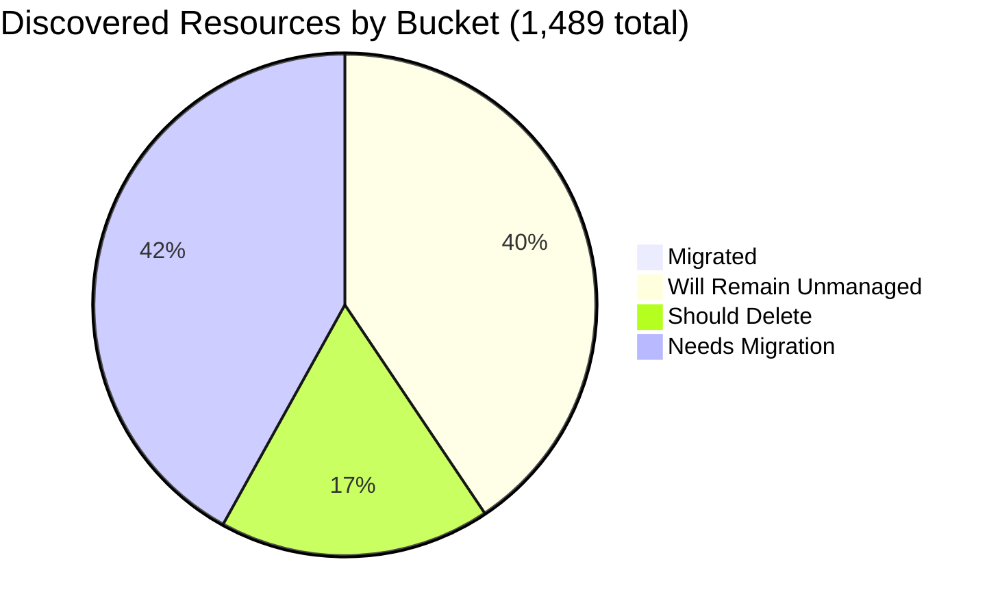

# Pulumi Migration Report — `pequod`

> **Generated:** October 16, 2026
> **Source:** Pulumi Insights (4 enrolled cloud accounts, 11 scan scopes) + Pulumi Cloud API
> **Scope:** Every resource discovered in enrolled Insights accounts (full scan of all 1,489 records, no sampling) plus stack/project data.
> **Action taken:** None. This report only observes and recommends.

---

## 1. Executive Summary

**Org-wide migration (Insights-discovered resources)**

```
░░░░░░░░░░░░░░░░░░░░ 0.4%   (6 of 1,489 discovered resources are under Pulumi IaC)
```

`pequod` is the Pulumi CE shared demo and workshop estate, not production. Only 6 discovered resources are Pulumi-managed. 622 resources need migration, 259 look like deletion candidates, and 602 are cloud-platform scaffolding that should stay unmanaged.

| Bucket | Count | % of Discovered | % of Migratable Base |
|--------|------:|----------------:|---------------------:|
| Migrated (in a Pulumi stack) | 6 | 0.4% | 0.7% |
| Will remain unmanaged | 602 | 40.4% | n/a |
| Should be deleted (human review) | 259 | 17.4% | 29.2% |
| Needs migration | 622 | 41.8% | 70.1% |
| **Total discovered** | **1,489** | 100% | n/a |

*Migratable base = 887 (total minus will-remain-unmanaged). Buckets sum to account totals; accounts sum to 1,489.*

**Biggest takeaway:** the previously largest account, `aws-pulumi-ce-052848974346` (4,651 resources on 2026-06-29), no longer exists in Insights (`ReadAccount` returns 404). That drops discovered resources from 5,946 to 1,489 and Pulumi-managed from 53 to 6. The 18 stacks in the org hold 243 IaC resources; at most 6 of them are visible as managed in Insights, so most sit in accounts Insights does not scan.

**Data-quality caveats**
- No formal Pulumi Teams are in use (4 teams exist, all with 0 members). Ownership is attributed by tag, naming convention, then account owner (see section 6).
- `aws-pulumi-ce-workshops-420942475186` has scheduled scans disabled and was last scanned 52-78 days ago. Its resources are stale.
- `aws-neo-eu-west-2-420942475186` and `aws-pulumi-ce-workshops-420942475186` point at the same AWS account (`420942475186`), so 157 of the 334 workshops records duplicate neo records. Counts follow Insights accounts as recorded; the de-duplicated physical total is about 1,332.
- 79 of the 622 "needs migration" resources (42 Azure ARM, 37 AWS CloudFormation) are already managed by ARM/CloudFormation, not unmanaged. They are conversion candidates rather than plain import candidates.

---

## 2. Migration Progress

### Org-wide four-bucket split (of 1,489)

| Bucket | Bar | % |
|--------|-----|--:|
| Migrated | `░░░░░░░░░░░░░░░░░░░░` | 0.4% |
| Will remain unmanaged | `████████░░░░░░░░░░░░` | 40.4% |
| Should delete | `███░░░░░░░░░░░░░░░░░` | 17.4% |
| Needs migration | `████████░░░░░░░░░░░░` | 41.8% |



### % migrated by account (of that account's discovered resources)

| Account | Bar | Migrated / Total |
|---------|-----|-----------------:|
| aws-neo-eu-west-2-420942475186 | `░░░░░░░░░░░░░░░░░░░░` | 0 / 180 (0.0%) |
| aws-pulumi-ce-workshops-420942475186 | `░░░░░░░░░░░░░░░░░░░░` | 0 / 334 (0.0%) |
| azure-team-ce-subscription | `░░░░░░░░░░░░░░░░░░░░` | 3 / 353 (0.8%) |
| google-pulum-ce-team-438338752289 | `░░░░░░░░░░░░░░░░░░░░` | 3 / 622 (0.5%) |

*Every account is below 1%, so all bars render empty.*

### % migrated by responsible team (migrated / (migrated + needs migration))

| Team | Needs Migration | Migrated | Bar |
|------|----------------:|---------:|-----|
| Mitch Gerdisch | 305 | 3 | `░░░░░░░░░░░░░░░░░░░░` 1.0% |
| CE demo platform | 67 | 0 | `░░░░░░░░░░░░░░░░░░░░` 0.0% |
| Workshops | 46 | 0 | `░░░░░░░░░░░░░░░░░░░░` 0.0% |
| Aureq / Menfin (CE) | 41 | 0 | `░░░░░░░░░░░░░░░░░░░░` 0.0% |
| Data Platform / Databricks | 36 | 0 | `░░░░░░░░░░░░░░░░░░░░` 0.0% |
| ESC / OIDC / Insights access | 34 | 3 | `██░░░░░░░░░░░░░░░░░░` 8.1% |
| Robert Smith (AWS neo account owner) | 34 | 0 | `░░░░░░░░░░░░░░░░░░░░` 0.0% |
| Individual CE members (misc.) | 19 | 0 | `░░░░░░░░░░░░░░░░░░░░` 0.0% |
| Build Engineering | 16 | 0 | `░░░░░░░░░░░░░░░░░░░░` 0.0% |
| Piers Karsenbarg | 14 | 0 | `░░░░░░░░░░░░░░░░░░░░` 0.0% |
| Z. Buchheit | 8 | 0 | `░░░░░░░░░░░░░░░░░░░░` 0.0% |
| Elisabeth (CE) | 2 | 0 | `░░░░░░░░░░░░░░░░░░░░` 0.0% |
| **Total** | **622** | **6** | `░░░░░░░░░░░░░░░░░░░░` 1.0% of (N+M) |

*The ESC / OIDC / Insights access group is the only one with visible progress: the `pequod-gcp-access` service account, workload identity pool and provider.*

### Change since last report (2026-06-29)

| Metric | 2026-06-29 | 2026-10-16 |
|--------|-----------:|-----------:|
| Insights accounts (root) | 5 | 4 |
| Discovered resources | 5,946 | 1,489 |
| Pulumi-managed (in Insights) | 53 | 6 |
| Stacks / projects | 21 / 19 | 18 / 18 |
| IaC resources in stacks | ~297 | 243 |

The drop is explained by the missing `aws-pulumi-ce-052848974346` account, not by migration regressions. Re-enrolling it would likely restore its 4,651 previously discovered resources, including the 43 seen as managed.

---

## 3. Momentum

**Active Pulumi footprint:** 18 stacks, 18 projects, 243 IaC-managed resources. 10 stacks hold resources; 8 are empty (destroyed or ephemeral).

*Bars show stacks created per month, scaled to the busiest month (Oct 2026 = 7). Stack creation is approximated by the first recorded update of stacks that still exist, so deleted TTL stacks are not counted.*

```
Nov 2025 ░░░░░░░░░░░░░░░░░░░░ 0
Dec 2025 ░░░░░░░░░░░░░░░░░░░░ 0
Jan 2026 ░░░░░░░░░░░░░░░░░░░░ 0
Feb 2026 ░░░░░░░░░░░░░░░░░░░░ 0
Mar 2026 ░░░░░░░░░░░░░░░░░░░░ 0
Apr 2026 ░░░░░░░░░░░░░░░░░░░░ 0
May 2026 ░░░░░░░░░░░░░░░░░░░░ 0
Jun 2026 ░░░░░░░░░░░░░░░░░░░░ 0
Jul 2026 ░░░░░░░░░░░░░░░░░░░░ 0
Aug 2026 ░░░░░░░░░░░░░░░░░░░░ 0
Sep 2026 ██████░░░░░░░░░░░░░░ 2
Oct 2026 ████████████████████ 7   <- busiest month on record (to Oct 16)
```

- **Share built in the last 12 months:** 9 of 18 stacks (50%), but only 17 of 243 resources (7%). The established estate dates from Nov 2023 to Jul 2025.
- **Accelerating:** a burst of new agent/AI-platform projects since Sep 23, 2026 (`k8s-hybrid-app`, `k8s-hybrid-workload`, `platform`, `triage`, `factory`, `llm`, `shopfront`, `agent`, `eks-deployment-agent-pool-py`). Most are currently empty after destroy.
- **Stalled (no update in 90+ days):** `azure-oidc-env-config` and `gcp-oidc-env-config` (last updated May 2025), `insights-azure-creds` (Feb 2025), `rhum-monitor` (Jul 8, 2026, 100 days).
- **Largest stacks:** `shared-dev-eks/dev` (88), `pequod-user-mgmt/prod` (83), `shared-dev-aks/dev` (18), `eks-deployment-agent-pool-py/prod` (17), `azure-oidc-env-config/prod` (12).

---

## 4. Coverage by Enrolled Account

> Insights coverage reflects only enrolled accounts, not the full estate. At most 6 of the 243 stack-managed resources are visible as managed in an enrolled account; the large stacks (for example `shared-dev-eks`, `eks-deployment-agent-pool-py`) deploy elsewhere.

| Account | Cloud | Pulumi-Managed | Total Discovered | Coverage | Last Scan | Scheduled |
|---------|-------|---------------:|-----------------:|----------|-----------|-----------|
| aws-neo-eu-west-2-420942475186 | AWS | 0 | 180 | `░░░░░░░░░░░░░░░░░░░░` 0.0% | Oct 15, 2026 | yes (eu-west-2, global) |
| aws-pulumi-ce-workshops-420942475186 | AWS | 0 | 334 | `░░░░░░░░░░░░░░░░░░░░` 0.0% | Jul 30 to Aug 25, 2026 (stale) | **no** |
| azure-team-ce-subscription | Azure | 3 | 353 | `░░░░░░░░░░░░░░░░░░░░` 0.8% | Oct 15, 2026 | yes |
| google-pulum-ce-team-438338752289 | GCP | 3 | 622 | `░░░░░░░░░░░░░░░░░░░░` 0.5% | Oct 15, 2026 | yes |
| **Org total** | | **6** | **1,489** | `░░░░░░░░░░░░░░░░░░░░` 0.4% | | |

Enrollment dates are not exposed by the API and are listed as unknown.

- **Stale scans:** workshops scopes were last scanned Jul 30 (global, us-east-2, us-west-1, us-west-2) and Aug 25 (us-east-1). Rescan before acting on its data.
- **Region coverage:** the AWS account is scanned in only 5 regions (eu-west-2, us-east-1, us-east-2, us-west-1, us-west-2) plus global. Other regions are not enrolled.
- **Missing account:** `aws-pulumi-ce-052848974346` is gone from Insights. Re-enrolling it would likely restore visibility into the AWS resources behind the EKS stacks.

---

## 5. Data Analysis

| Account | Cloud | Total | Migrated | Will Remain Unmanaged | Should Delete | Needs Migration | % Mig (All) | % Mig (Migratable) |
|---------|-------|------:|---------:|----------------------:|--------------:|----------------:|------------:|-------------------:|
| aws-neo-eu-west-2-420942475186 | AWS | 180 | 0 | 103 | 4 | 73 | 0.0% | 0.0% |
| aws-pulumi-ce-workshops-420942475186 | AWS | 334 | 0 | 166 | 26 | 142 | 0.0% | 0.0% |
| azure-team-ce-subscription | Azure | 353 | 3 | 84 | 159 | 107 | 0.8% | 1.1% |
| google-pulum-ce-team-438338752289 | GCP | 622 | 3 | 249 | 70 | 300 | 0.5% | 0.8% |
| **Org total** | | **1,489** | **6** | **602** | **259** | **622** | **0.4%** | **0.7%** |

**Classification method**
- *Migrated:* Insights `managed = Pulumi`.
- *Will remain unmanaged (602), top patterns:*
  - GCP service-created buckets (GCF, App Engine, Composer, Metastore): 128
  - AWS Service Linked / SSO reserved roles: 66
  - Default VPC scaffolding: 65
  - CloudFront Managed-* / AWS-provided policies: 56
  - GCP project service APIs: 49
  - GCP default-network subnetworks: 43
  - Azure Databricks-managed RGs: 24
  - AKS `MC_*` node RGs: 23
  - Other defaults (+148): NetworkWatchers, DefaultResourceGroup, IoT domain configs, default X-Ray, EventBridge, MemoryDB and ElastiCache entries, GKE firewalls, and so on.
- *Should delete (259):* naming-based judgement (test, scratch, placeholder, random hex suffix). Medium confidence, and these need human review.
- *Needs migration (622):* everything else, including 79 already under ARM (42) or CloudFormation (37).
- *Unsure whether platform-managed:* CDK bootstrap resources (`cdk-hnb659fds-*`) are counted as needs migration because they are CloudFormation-managed. Confirm whether to treat them as scaffolding.

**Noteworthy**
- **Azure holds 159 of the 259 deletion candidates.** 134 resources sit in 45 random-hex-suffixed demo resource groups, such as `resourceGroup2dca640c`, `rgde738912`, `onprem-vnet-rg2a52eb0f` and `webapp-rg0fd85541`.
- **GCP is the largest migration backlog (300).** 89 of them are subnets of two custom networks (`my-demo-network`: 43, `mitchselfhosted-mitchsh-network`: 42).
- **Mitch-owned self-hosted state buckets are not in IaC**, including `mitchselfhosted-mitchsh-checkpoints/esc/policypacks` and the DIY state buckets (`aureq-pulumi-diy-state-storage`, `m-{demo,ent,ess,pro}-diy-state-storage-bucket`).

---

## 6. Actions Needed

### Ownership method

Ownership signals, in order: (1) resource tags (`Owner`, `team`, `Resource Owner`) for 40 resources; (2) name/prefix mapping for 317 resources; (3) Insights account owner as fallback for 265 resources. No GitHub code or CODEOWNERS search was run, so ownership stays unverified.

Prefix mapping used (review and correct):
- `mitch*`, `mitchselfhosted*`, `lotctl*` -> Mitch Gerdisch
- `pk-*`, `piers*` -> Piers Karsenbarg
- `zbuchheit*`, `stoo*` -> Z. Buchheit
- `wladi*`, `rg-dbw-*`, `dwcore*`, `databricks*`, `composer`/`airflow` -> Data Platform / Databricks
- `aureq*`, `menfin*`, `m-{demo,ent,ess,pro}-diy*` -> Aureq / Menfin
- `elisabeth*` -> Elisabeth
- `workshop*`, `PostgresLambdaStack*`, `cdk-hnb659fds*`, `Owner=workshops` -> Workshops
- `zendesk*`, `initech*`, `podinfo*`, `httpbin*`/`echo*`/`nginx*` backends, `uptime*`, `sentinel*`, `rg-hub-network*`, `rg-shared-services*` -> CE demo platform
- `pulumi-oidc*`, `pulumi-esc*`, `insights-account-scan`, `pequod*`, `Owner=pequod|pulumi` -> ESC / OIDC / Insights access
- `Owner=pulumi-build-engineering`, `account-cleanup` -> Build Engineering
- Anything unresolved falls to the account owner: Mitch Gerdisch (workshops AWS, Azure, GCP) or Robert Smith (neo AWS).

### Migration queue by team (largest first)

**Mitch Gerdisch (305)**

| Priority | Resource(s) | Why |
|----------|-------------|-----|
| High | `mitchselfhosted-mitchsh-checkpoints/esc/policypacks` buckets, `mitch-selfhosted`, `mitch-selfmanaged`, `pulumi-team-ce-tf-state` (GCS) | Self-hosted Pulumi state, ESC and policy-pack storage; loss breaks stacks |
| High | `my-demo-network`, `mitchselfhosted-mitchsh-network`, `main-vpc`, `gke-network`, `core-network` VPCs (+89 subnets) | Custom networks backing active compute and GKE |
| High | `vpc-096a656511ef6aa93` + NAT/EIP/IGW (us-east-1, tagged `PostgresLambdaStack`) | Core AWS networking with no IaC; owner assigned by account fallback |
| Medium | `geoff` DNS zone (+11 record sets), `main-vpc-nat`, `my-demo-nat`, 3 URL maps | Active DNS/LB infra with no IaC |
| Medium | Azure `mitch-rg-020625` and `mitch-selfhosted` resource groups | Mitch-named Azure groups |
| Remaining | Subnets, ENIs, routes, role-policy attachments, bucket ACLs | Group by network or service |

**CE demo platform (67)**

| Priority | Resource(s) | Why |
|----------|-------------|-----|
| High | `podinfo-webapp-rg` (Cosmos DB, WebApp, App Service Plan; ARM-managed) | Running web app |
| High | `rg-shared-services-dev` (Key Vault, Log Analytics) and `rg-hub-network-dev` (hub VNet, VPN gateway) | Shared platform services |
| Medium | `rg-sentinel-pulumi-test` (7 resources, ARM-managed) | Active monitoring workspace; name suggests test |
| Medium | 11 GCP backend services (httpbin/echo/nginx/backend-alpha..echo) and 5 NEGs | Load-balanced demo services |
| Medium | `zendesk-domestic-vpc`, `zendesk-domwg-i` VM and firewalls | Zendesk demo network |

**Workshops (46)**

| Priority | Resource(s) | Why |
|----------|-------------|-----|
| High | `workshops.pulumi-ce.team` Route53 zone + NS/SOA records (both AWS scopes) | DNS for all workshop participants |
| High | `workshop-instructor-role`, `AdminWorkshop` | Roles that provision participant accounts |
| Medium | `PostgresLambdaStack` Aurora cluster, 5 Lambdas, secret (CloudFormation) | Workshop stack; convert or import |
| Medium | `CDKToolkit` CFN stack, `cdk-hnb659fds-*` bucket and ECR | CDK bootstrap |
| Remaining | Roles, policies and security groups | |

**Aureq / Menfin (41)**

| Priority | Resource(s) | Why |
|----------|-------------|-----|
| High | `aureq-pulumi-diy-state-storage` and `m-{demo,ent,ess,pro}-diy-state-storage-bucket` | Pulumi DIY state buckets |
| Medium | 4 `menfin-*` workload identity pools, providers and service accounts | OIDC access for demo orgs |
| Remaining | Bucket ACLs and IAM policies | |

**Data Platform / Databricks (36)**

| Priority | Resource(s) | Why |
|----------|-------------|-----|
| High | 5 `rg-dbw-*` Databricks workspaces, VNets and NSGs | Active data-platform environments |
| Medium | `dwcore_dev_dataset_1` BigQuery dataset, `dwcore-dev-bucket-1-9641016`, `wladi-gcp-pool` | Data warehouse dev assets |

**ESC / OIDC / Insights access (34)**: `insights-account-scan` role, `pulumi-esc-ediri`, `pulumi-esc-oidc-*` roles, `ContinuousDeliveryAdminRole`, OIDC providers and GCP pools. Migrate first; they gate Pulumi's own access.

**Robert Smith, AWS neo account (34)**: `VNOrient`, `MCOrient`, `ESCWksp` roles (+ 25 policy attachments), `AmazonBedrockAgentCoreHarness*` role and policy, two budgets.

**Smaller queues:** Individual CE members (19: per-user OIDC pools and service accounts), Build Engineering (16: account-cleanup Lambda, role, policies; Owner tag `pulumi-build-engineering`), Piers Karsenbarg (14), Z. Buchheit (8), Elisabeth (2).

### Deletion candidates (recommend human review before deleting anything)

| Pattern | Count | Account | Reason |
|---------|------:|---------|--------|
| Random-hex-suffix demo RGs (`resourceGroup*`, `resource_group*`, `rgde738912`, `hub-vnet-rg867281c0`, `webapp-rg0fd85541`) | 134 (45 RGs) | azure-team-ce-subscription | Auto-named demo leftovers, no tags, no ARM management |
| Test/scratch RGs (`piers-resourcegroup-*`, `elisabeth-test`, `rg-pulumi-test`, `VnetConfigTestGroup`, `example-rg`, `vnet`, `synapse`) | 25 (16 RGs) | azure-team-ce-subscription | Test or generic names |
| GCP test/placeholder buckets with ACLs and IAM (`my-bucket-*`, `piers-test-bucket`, `nelsons-bucket-for-issue-repro`, `phil-cosmic-test-oauth`, `app-bucket-*`, `demo-k8s-ts-nginx-*`) | 41 (10 buckets) | google-pulum-ce-team | Placeholder or repro names |
| GCP placeholder secrets (`my-app-secret`, `dev-secret-1/2`, `prod-secret-1/2`) | 18 (5 secrets) | google-pulum-ce-team | Generic names |
| GCP test service accounts (`my-account`, `service-account-id-2`, `demos-weekly-test`, `aureq-test-sa`) | 8 (4 SAs) | google-pulum-ce-team | Test or placeholder identities |
| AWS placeholder S3 buckets (`my-bucket-*` tagged `workshop=aicamp`, `zbuchheit-bucket-*`, `app-bucket-*`) | 15 | aws-pulumi-ce-workshops | Placeholder names |
| `mitch-assumerole-test*` bucket, role, policy and attachments | 9 | both AWS accounts | Experiment leftovers |
| GCP test KMS key rings (`mitch-kms-test`, `boog-kms-test`) | 3 | google-pulum-ce-team | Test names; confirm key not in use |
| AWS demo Lambda / RDS networking / key pair (`lambdaRole-482bdf2`, `webAppLambda-51d3904`, `db-sg-743330b`, `elisabeth-key-pair`) | 6 | both AWS accounts | Placeholder or personal scratch |
| **Total** | **259** | | |

Not listed as deletions despite generic names: `sql-instancef63ee7a` (RDS instance, stateful) and anything under ARM or CloudFormation management.

### Unattributed (ownership fell back to account owner; assign a real owner)

| Resource | Account | Why unresolved |
|----------|---------|----------------|
| `YTE_API_KEY` secret, `codefresh-ci-cd-access` and `pulumi-sa` service accounts | google-pulum-ce-team | No owner prefix or label |
| `identity-change-detection` and `user` Pub/Sub topics, subscriptions | google-pulum-ce-team | Purpose unclear |
| `constructconnect-db3` Firestore database, `aptos-default-backup` bucket and service account | google-pulum-ce-team | Customer-named; unclear ownership |
| `HyperVImages`, `6680-classic` and `6680-native` RGs (CDN, storage) | azure-team-ce-subscription | Opaque names |
| `sqlTest-dev-sql`, `sqlTest-dev-db` | azure-team-ce-subscription | Possible test; ownership unknown |
| `budget-150`, `budget-fc8c40b` (account budgets) | both AWS accounts | No tags |
| `sbcdzzbuv4` API Gateway (5 resources) | aws-pulumi-ce-workshops | No tags or name hints |

---

*All counts are exact (1,489 records enumerated). Classification beyond "Migrated" is heuristic and meant for review. The stack-managed resources outside enrolled accounts are not part of the discovered totals above.*
