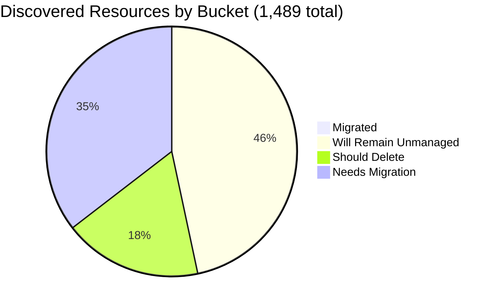

# Pulumi Migration Report — `pequod`

> **Generated:** October 23, 2026 (week of Oct 19 – Oct 23)  
> **Source:** Pulumi Insights (4 enrolled accounts, 9 scan units) + Pulumi Cloud API  
> **Scope:** Every discovered resource in every enrolled Insights account (full paginated scan, no sampling).  
> **Action taken:** None. This report only observes and recommends.

---

## 1. Executive Summary

**Org-wide migration (Insights-discovered resources)**

```
░░░░░░░░░░░░░░░░░░░░ 0.4%  (6 of 1,489 discovered resources are in a Pulumi stack)
```

`pequod` is the Pulumi CE team's shared demo and workshop org. Insights discovered **1,489** resources, of which **6** are under Pulumi management. The org runs **20 stacks / 20 projects / 229 IaC resources**; most of those live in clusters and config that Insights does not map back to a discovered resource.

| Bucket | Count | % of Discovered | % of Migratable Base |
|--------|------:|----------------:|---------------------:|
| Migrated (in a Pulumi stack) | 6 | 0.4% | 0.8% |
| Will remain unmanaged | 692 | 46.5% | n/a |
| Should be deleted (review) | 265 | 17.8% | 33.2% |
| Needs migration | 526 | 35.3% | 66.0% |
| **Total discovered** | **1,489** | 100% | n/a |

*Migratable base = 797 (total 1,489 minus 692 will-remain-unmanaged). Buckets sum to account totals and accounts sum to 1,489.*

**Biggest takeaway:** 265 resources (17.8%) are deletion candidates, nearly two thirds of them auto-named Azure scratch resource groups. Retiring them before migrating shrinks the migration queue to the 526 resources that matter, 61 of which are already CloudFormation or ARM managed and can be converted rather than imported.

**Change since the 2026-06-29 report:** the Insights footprint shrank from 5 accounts / 5,946 resources to 4 accounts / 1,489. Account `aws-pulumi-ce-052848974346` (4,651 resources last time) no longer exists (API returns 404, zero resources in search). Percentages are therefore not comparable week over week for that reason.

**Data-quality caveats:** `aws-pulumi-ce-workshops-420942475186` has scheduled scans disabled and its regional data is 59 to 85 days old. `aws-neo-eu-west-2-420942475186` and `aws-pulumi-ce-workshops-420942475186` are the same AWS account (420942475186) enrolled twice, so global IAM / CloudFront resources appear in both (72 identical type+name pairs). No Pulumi Teams are configured, so ownership is attributed by tag, name prefix and account owner (mapping in section 6).

---

## 2. Migration Progress

### Org-wide four-bucket split (of 1,489 discovered)

| Bucket | Bar | % |
|--------|-----|--:|
| Migrated | `░░░░░░░░░░░░░░░░░░░░` | 0.4% |
| Will remain unmanaged | `█████████░░░░░░░░░░░` | 46.5% |
| Should delete | `████░░░░░░░░░░░░░░░░` | 17.8% |
| Needs migration | `███████░░░░░░░░░░░░░` | 35.3% |



### % Migrated by Account

| Account | Bar | Migrated / Total |
|---------|-----|-----------------:|
| aws-neo-eu-west-2-420942475186 | `░░░░░░░░░░░░░░░░░░░░` | 0 / 180 (0.0%) |
| aws-pulumi-ce-workshops-420942475186 | `░░░░░░░░░░░░░░░░░░░░` | 0 / 334 (0.0%) |
| azure-team-ce-subscription | `░░░░░░░░░░░░░░░░░░░░` | 3 / 353 (0.8%) |
| google-pulum-ce-team-438338752289 | `░░░░░░░░░░░░░░░░░░░░` | 3 / 622 (0.5%) |

Only Azure and GCP have any Pulumi-managed resources in Insights; both AWS accounts are at zero.

### % Migrated by Responsible Team (migrated / (migrated + needs migration))

*Ownership signals: tag, then name prefix, then Insights account owner. See section 6.*

| Team / Owner | Needs Migration | Migrated | Bar |
|---|---:|---:|---|
| Mitch Gerdisch | 317 | 3 | `░░░░░░░░░░░░░░░░░░░░` 0.9% |
| Pequod platform / ESC-OIDC | 47 | 3 | `█░░░░░░░░░░░░░░░░░░░` 6.0% |
| Menfin (CE) | 36 | 0 | `░░░░░░░░░░░░░░░░░░░░` 0.0% |
| Databricks demo (Wladi/Meggy) | 23 | 0 | `░░░░░░░░░░░░░░░░░░░░` 0.0% |
| Build Engineering | 16 | 0 | `░░░░░░░░░░░░░░░░░░░░` 0.0% |
| Workshops | 16 | 0 | `░░░░░░░░░░░░░░░░░░░░` 0.0% |
| Unattributed | 11 | 0 | `░░░░░░░░░░░░░░░░░░░░` 0.0% |
| Robert Smith | 10 | 0 | `░░░░░░░░░░░░░░░░░░░░` 0.0% |
| PK (CE) | 10 | 0 | `░░░░░░░░░░░░░░░░░░░░` 0.0% |
| Wladi (CE) | 9 | 0 | `░░░░░░░░░░░░░░░░░░░░` 0.0% |
| Z. Buchheit | 7 | 0 | `░░░░░░░░░░░░░░░░░░░░` 0.0% |
| Stoo (CE) | 6 | 0 | `░░░░░░░░░░░░░░░░░░░░` 0.0% |
| Aureq (CE) | 5 | 0 | `░░░░░░░░░░░░░░░░░░░░` 0.0% |
| Megan (CE) | 4 | 0 | `░░░░░░░░░░░░░░░░░░░░` 0.0% |
| Shaht (CE) | 4 | 0 | `░░░░░░░░░░░░░░░░░░░░` 0.0% |
| Piers Karsenbarg | 2 | 0 | `░░░░░░░░░░░░░░░░░░░░` 0.0% |
| Vasu (CE) | 2 | 0 | `░░░░░░░░░░░░░░░░░░░░` 0.0% |
| Elisabeth (CE) | 1 | 0 | `░░░░░░░░░░░░░░░░░░░░` 0.0% |

---

## 3. Momentum

**Active Pulumi footprint (pequod org):** 20 stacks, 20 projects, 229 IaC-managed resources, 10 stacks with resources. 15 stacks updated in the last 30 days.

*Bars = stacks first deployed per month (first update in stack history), scaled to the busiest month.*

```
Nov 2025              0
Dec 2025              0
Jan 2026              0
Feb 2026              0
Mar 2026              0
Apr 2026              0
May 2026              0
Jun 2026              0
Jul 2026              0
Aug 2026              0
Sep 2026 ███          2
Oct 2026 ████████████ 9
```

- Busiest month in the window: **Oct 2026** with 9 new stacks. The Oct 2026 cluster is `platform`, `triage`, `factory`, `llm`, `agent`, `shopfront`, `mrg-aws-ec2-s3-python-with-hcl`, `aws-container-services-ts-22/elisabeth-dev`, `eks-deployment-agent-pool-py`; most hold zero resources (agent / demo scaffolding).
- Share of footprint created in the last 12 months: **11 of 20 stacks (55.0%)**, holding 29 of 229 IaC resources (12.7%). The long-lived core (pequod-user-mgmt, shared-dev-eks, shared-dev-aks, demo-cleaner, OIDC config) predates this window.
- **Accelerating:** the Oct 2026 agent / platform projects above; `shared-dev-eks` (246 updates, last Oct 20) and `demo-cleaner` (1,165 updates, last Oct 23).
- **Stalled (no update in 90+ days):** `insights-azure-creds/prod` (2025-02-05), `azure-oidc-env-config/prod` (2025-05-01), `gcp-oidc-env-config/prod` (2025-05-01), `rhum-monitor/prod` (2026-07-08).

| Largest stacks | IaC Resources | Last Updated |
|---|---:|---|
| pequod-user-mgmt/prod | 83 | 2026-10-09 |
| shared-dev-eks/dev | 62 | 2026-10-20 |
| mrg-aws-ec2-s3-python-with-hcl/dev | 29 | 2026-10-22 |
| shared-dev-aks/dev | 18 | 2026-09-28 |
| azure-oidc-env-config/prod | 12 | 2025-05-01 |
| gcp-oidc-env-config/prod | 9 | 2025-05-01 |

---

## 4. Coverage by Enrolled Account

> Insights coverage reflects only enrolled accounts, not the full estate. Stack-managed resources that are not discovered by a scan (Kubernetes objects, ESC / OIDC config, etc.) do not show up as migrated here.

| Account | Cloud | Pulumi-Managed | Total Discovered | Coverage | Last Scan | Enrolled |
|---|---|--:|--:|---|---|---|
| aws-neo-eu-west-2-420942475186 | AWS | 0 | 180 | `░░░░░░░░░░░░░░░░░░░░` 0.0% | Oct 22, 2026 (scheduled) | n/a (not exposed by API) |
| aws-pulumi-ce-workshops-420942475186 | AWS | 0 | 334 | `░░░░░░░░░░░░░░░░░░░░` 0.0% | Jul 30 to Aug 25, 2026 (scheduled scans OFF, stale) | n/a (not exposed by API) |
| azure-team-ce-subscription | Azure | 3 | 353 | `░░░░░░░░░░░░░░░░░░░░` 0.8% | Oct 22, 2026 (scheduled) | n/a (not exposed by API) |
| google-pulum-ce-team-438338752289 | GCP | 3 | 622 | `░░░░░░░░░░░░░░░░░░░░` 0.5% | Oct 22, 2026 (scheduled) | n/a (not exposed by API) |
| **Org Total** | | **6** | **1,489** | `░░░░░░░░░░░░░░░░░░░░` 0.4% | | |

- **Stale scan:** the workshops account regional scans last ran Jul 30 (us-east-2, us-west-1, us-west-2, global) and Aug 25 (us-east-1) with scheduled scans disabled. Re-scan before acting on its data.
- **Enrollment gaps:** the workshops account is enrolled for `global`, `us-east-1`, `us-east-2`, `us-west-1`, `us-west-2` only, and the neo account for `global` and `eu-west-2` only. Enrolling the AWS account / regions that host the `shared-dev-eks` cluster (62 IaC resources) would give the CE team visibility into most of the stack-managed footprint that Insights cannot see today.
- Scan units that failed: none. Accounts that could not be read: none. Sub-accounts that Insights lists for CloudFormation stacks (`CDKToolkit`, `PostgresLambdaStack`) and ARM resource groups (23) are stack-level views of resources already counted in the parent scans, so they are excluded to avoid double counting (Azure parent scan count 353 equals the sum of its buckets).

---

## 5. Data Analysis

| Account | Cloud | Total | Migrated | Will Remain Unmanaged | Should Delete | Needs Migration | % Mig (All) | % Mig (Migratable) |
|---|---|--:|--:|--:|--:|--:|--:|--:|
| aws-neo-eu-west-2-420942475186 | AWS | 180 | 0 | 137 | 3 | 40 | 0.0% | 0.0% |
| aws-pulumi-ce-workshops-420942475186 | AWS | 334 | 0 | 218 | 15 | 101 | 0.0% | 0.0% |
| azure-team-ce-subscription | Azure | 353 | 3 | 85 | 176 | 89 | 0.8% | 1.1% |
| google-pulum-ce-team-438338752289 | GCP | 622 | 3 | 252 | 71 | 296 | 0.5% | 0.8% |
| **Org Total** | | **1,489** | **6** | **692** | **265** | **526** | **0.4%** | **0.8%** |

**Classification method** (rule-based on resource type, name, tags, and properties; every resource lands in exactly one bucket):
- *Migrated:* Insights `managed = Pulumi`.
- *Will remain unmanaged:* AWS service-linked roles, SSO / Organizations roles, CloudFront `Managed-*` policies, default VPC scaffolding (172.31.0.0/16 VPCs, subnets, IGWs, route tables, default SGs, DHCP), IoT / ElastiCache / MemoryDB / X-Ray / Athena defaults, CDK bootstrap (`CDKToolkit`), service-created ENIs; GCP project service APIs, default-network subnetworks and firewalls, GCF / App Engine / Composer / Cloud Build buckets, Google default service accounts; Azure NetworkWatchers, `MC_*` AKS node RGs, `DefaultResourceGroup-*`, Cloud Shell storage, Databricks managed RGs, `ai_*_managed` RGs. Unconfirmed: Azure `HyperVImages` RG and untagged AWS KMS keys without a description were treated as platform-created.
- *Should delete:* test / placeholder / auto-named scratch resources (patterns in section 6). Heuristic, human review required.
- *Needs migration:* everything else. Of these, 33 are CloudFormation-managed (CDK `PostgresLambdaStack`) and 28 are ARM-managed, so they need conversion rather than a plain import. 14 ARM-managed resources fall in the delete bucket and should be checked first.
- *Confidence:* high for unmanaged (deterministic patterns), medium for delete.

**Noteworthy specifics:**
- **GCP is the largest estate** (622 of 1,489, 41.8%) and 40% of it is auto-created platform scaffolding (service APIs, default subnets, GCF buckets).
- **Azure has the highest delete share** (176 of 353, 49.9%), driven by hex-suffixed `resource_group*` / `resourceGroup*` demo leftovers.
- **Same AWS account enrolled twice** (420942475186 as `aws-neo-eu-west-2` and `aws-pulumi-ce-workshops`): migrating global IAM once covers both accounts; the AWS rows overlap by at least 72 resources.

---

## 6. Actions Needed

**Ownership mapping used** (signal in parentheses):
1. Resource tag `Owner` (e.g. `Owner=workshops`, `Owner=pequod`, `Owner=pulumi-build-engineering`).
2. Name prefix: `mitch*`, `selfhosted`, `selfmanaged` -> Mitch Gerdisch; `menfin*`, `m-(demo|ent|ess|pro)-*` -> Menfin (CE, inferred, please validate); `pk*` -> PK; `piers*`, `zbuchheit*`, `aureq*`, `wladi*`, `stoo*`, `megan*`, `shaht*`, `vasu*`, `elisabeth*` -> that CE; `workshop*` -> Workshops; OIDC / ESC / `insights-account-scan` / `pequod*` -> Pequod platform; `dbw` / `databricks` / `meggy` -> Databricks demo; `initech` / `zendesk` -> unattributed.
3. Fallback to the Insights account owner (Robert Smith for the neo account, mitchgerdisch for workshops and Azure, Mitch Gerdisch for GCP).
4. GitHub / CODEOWNERS search was not performed in this run.

Signals used for the 526 needs-migration resources: account owner fallback 256, name prefix 205, tag 20, name prefix (inferred) 20, name/tag 14, ambiguous 11.

### Migration Queue by Team

**Mitch Gerdisch** (317 resources needing migration; GCP 209, AWS workshops 61, Azure 47)
- GCP: `mitchselfhosted-mitchsh-network` (42 subnets) and `my-demo-network` (43 subnets) with routers / NAT, 3 URL maps and 11 backend services
- GCP: self-hosted Pulumi buckets (`mitchselfhosted-mitchsh-*`, `mitch-selfhosted`, `mitch-selfmanaged`, `pulumi-team-ce-tf-state`) and their IAM
- AWS: CloudFormation-managed `PostgresLambdaStack` (VPC, RDS Aurora, 5 Lambdas, secrets): convert with the CFN to Pulumi path
- AWS: untracked demo app (API Gateway `apiGateway-35a85b2`, `webAppLambda`, RDS `db-QKB2...`, `app-bucket-e232f6b`)
- Azure: `rg-shared-services-dev`, `podinfo-webapp-rg`, `rg-hub-network-dev`, `rg-sentinel-pulumi-test` (ARM-managed, 7), `6680-classic` / `6680-native`

**Pequod platform / ESC-OIDC** (47 resources needing migration; AWS workshops 16, AWS neo 14, GCP 13, Azure 4)
- AWS: `insights-account-scan` role (+ AdministratorAccess / ReadOnlyAccess attachments): the role Insights uses to scan
- AWS: OIDC roles `pulumi-esc-ediri`, `pulumi-esc-oidc-paul-umi-AdministratorAccess-role`, `ESCWksp`, `ContinuousDeliveryAdminRole`, `oidc` provider
- GCP: OIDC workload identity pools / providers and service accounts (`pulumi-oidc*`, `team-ce-oidc-sa`, `pulumi-sa`)
- Azure: `pequod-keyvault` RG (Key Vault)

**Menfin (CE)** (36 resources needing migration; GCP 36)
- GCP: 4 OIDC workload identity pools / providers / service accounts (`menfin-*`)
- GCP: `m-demo|ent|ess|pro-diy-state-storage-bucket` Pulumi DIY state buckets (inferred owner, validate)

**Databricks demo (Wladi/Meggy)** (23 resources needing migration; Azure 23)
- Azure: 5 Databricks workspaces (`dbw-my-team-1-dev`, `-beta-`, `-dev`, `-wladi-`, `team-alpha`) with VNets and NSGs in `rg-dbw-*`
- Azure: `meggy292d713c4` RG and `vnet-appconfig*` / App Configuration store

**Build Engineering** (16 resources needing migration; AWS workshops 10, AWS neo 6)
- AWS: account-cleanup stack (`lambda-for-account-cleanup` in 4 regions, `lambda-role-for-account-cleanup`, policy, EventBridge permission). Resource tags point at `github.com/pulumi/aws-account-cleanup` and stack `pulumi/AWS_Account_Cleanup-IAMRoles/pulumi-ce-workshops`, so these are probably already managed by a stack in another org; confirm before importing

**Workshops** (16 resources needing migration; AWS neo 8, AWS workshops 8)
- AWS: `workshops.pulumi-ce.team` Route53 zone + records (present in both neo and workshops entries)
- AWS: `workshop-instructor-role`, `AdminWorkshop`, `PermsForWorkshop` inline policy

**Unattributed** (11 resources needing migration; GCP 9, Azure 2)
- GCP: `zendesk-domestic-vpc` + subnet, firewalls, `zendesk-domwg-i` VM and IAM
- GCP / Azure: `initech-*` identity pool, `initech-access` SA, `initech` RG, `initech-kv` Key Vault

**Robert Smith** (10 resources needing migration; AWS neo 10)
- Budget `420942475186-budget-150-e6909b6`, Budget `420942475186-budget-fc8c40b`, Policy `AmazonBedrockAgentCoreHarnessExecu`, Role `AmazonBedrockAgentCoreHarnessDefau` (+6 more)

**PK (CE)** (10 resources needing migration; Azure 6, GCP 4)
- Account `pk-gitlab-bdd7cff`, IAMPolicy `pk-gitlab-bdd7cff`, NetworkSecurityGroup `pk-vm-win-box-nsg`, NetworkSecurityGroup `pkvmwinboxnsg260` (+6 more)

**Wladi (CE)** (9 resources needing migration; Azure 5, GCP 4)
- Account `wladi-gcp-oidc-sa`, IAMPolicy `wladi-gcp-oidc-sa`, NetworkSecurityGroup `nsg-dbw-private-my-team-wladi-dev`, NetworkSecurityGroup `nsg-dbw-public-my-team-wladi-dev` (+5 more)

**Z. Buchheit** (7 resources needing migration; AWS workshops 5, AWS neo 2)
- Bucket `zbuchheit-bucket-bbb152b`, BucketOwnershipControls `zbuchheit-bucket-bbb152b`, BucketPublicAccessBlock `zbuchheit-bucket-bbb152b`, Role `zbuchheit-oidc` (+3 more)

**Stoo (CE)** (6 resources needing migration; GCP 4, Azure 2)
- Account `Pulumi OIDC Service Account`, IAMPolicy `pulumi-oidc-service-acct-stooj`, Registry `reg8264stoojd8307662`, ResourceGroup `rg-8264-stooj02e505a1` (+2 more)

**Aureq (CE)** (5 resources needing migration; GCP 5)
- Bucket `aureq-pulumi-diy-state-storage`, BucketAccessControl `project-editors-438338752289`, BucketAccessControl `project-owners-438338752289`, BucketAccessControl `project-viewers-438338752289` (+1 more)

**Megan (CE)** (4 resources needing migration; GCP 4)
- Account `pulumi-oidc-megan`, IAMPolicy `pulumi-oidc-megan`, WorkloadIdentityPool `pulumi-oidc-megan`, WorkloadIdentityPoolProvider `pulumi-oidc-megan-provider`

**Shaht (CE)** (4 resources needing migration; GCP 4)
- Account `shaht-oidc-openid-serviceact`, IAMPolicy `shaht-oidc-openid-serviceact`, WorkloadIdentityPool `shaht-gcp-oidc-openid-wf`, WorkloadIdentityPoolProvider `shaht-openid-oidc-provider`

**Piers Karsenbarg** (2 resources needing migration; GCP 2)
- Account `piers-service-account-insights`, IAMPolicy `piers-service-account-insights`

**Vasu (CE)** (2 resources needing migration; GCP 2)
- Account `gcp_oidc_vasu`, IAMPolicy `gcp-oidc-vasu`

**Elisabeth (CE)** (1 resource needing migration; AWS workshops 1)
- KeyPair `elisabeth-key-pair`

### Deletion Candidates

*Recommend human review before deleting anything below. Classification is heuristic (names, tags, no stack reference).*

| Pattern | Count | Account | Reason |
|---|--:|---|---|
| Auto-named / scratch resource groups | 176 | azure-team-ce-subscription | Pulumi auto-named demo leftovers (`resource_group*`, `resourceGroup*`, hub / spoke, `rg*` + hex), plus test / example RGs (`neo-test-sqldb`, `rs-test`, `example-rg`, `elisabeth*`, `piers-resourcegroup*`) |
| Placeholder / test-named buckets | 42 | google-pulum-ce-team-438338752289 | `my-bucket-*`, `app-bucket-*`, `piers-test-bucket`, `phil-cosmic-test-oauth`, `nelsons-bucket-for-issue-repro`, tutorial buckets, including their ACL / IAM children |
| Placeholder secrets | 18 | google-pulum-ce-team-438338752289 | `my-app-secret`, `dev-secret-1/2`, `prod-secret-1/2` with versions and IAM |
| Placeholder-named my-bucket-* S3 buckets | 9 | aws-pulumi-ce-workshops-420942475186 | `my-bucket-*` tagged `workshop=aicamp` (workshop leftovers), with ownership controls and public access blocks |
| Test / placeholder service accounts | 8 | google-pulum-ce-team-438338752289 | `aureq-test-sa`, `demos-weekly-test`, `service-account-id-2`, `my-account` and their IAM policies |
| Test-named: mitch-assumerole-test | 6 | aws-pulumi-ce-workshops-420942475186 | Explicit experiment name (role, policy, attachment, bucket) |
| Test-named: mitch-assumerole-test | 3 | aws-neo-eu-west-2-420942475186 | Explicit experiment name (role, policy, attachment, bucket) |
| Test-named KMS key rings | 3 | google-pulum-ce-team-438338752289 | `mitch-kms-test`, `boog-kms-test` |

*14 of the Azure deletion candidates are ARM-managed (deployed through ARM templates); confirm the deployment is retired first.*

### Unattributed (needs a human owner)

| Resource | Account | Why Unresolved |
|---|---|---|
| `zendesk-domestic-vpc` network, subnet, firewalls, `zendesk-domwg-i` VM | google-pulum-ce-team | No owner tag; "zendesk" prefix is not a known CE |
| `initech-identity-pool`, `initech-access` SA | google-pulum-ce-team | Demo customer name; confirm whether still used |
| `initech` RG, `initech-kv` Key Vault | azure-team-ce-subscription | Same demo name in Azure; ARM-managed |
| `m-demo/ent/ess/pro-diy-state-storage-bucket` | google-pulum-ce-team | Owner inferred (Menfin) from name only; these hold Pulumi state |
| `rg-8264-stooj*`, `synapse`, `rsv-rg`, `vnet` RGs | azure-team-ce-subscription | Generic names, no tags; defaulted to the account owner |

---

*All counts are exact for the 1,489 resources returned by the full Insights scan of the four enrolled accounts. No estimates or samples were used.*
