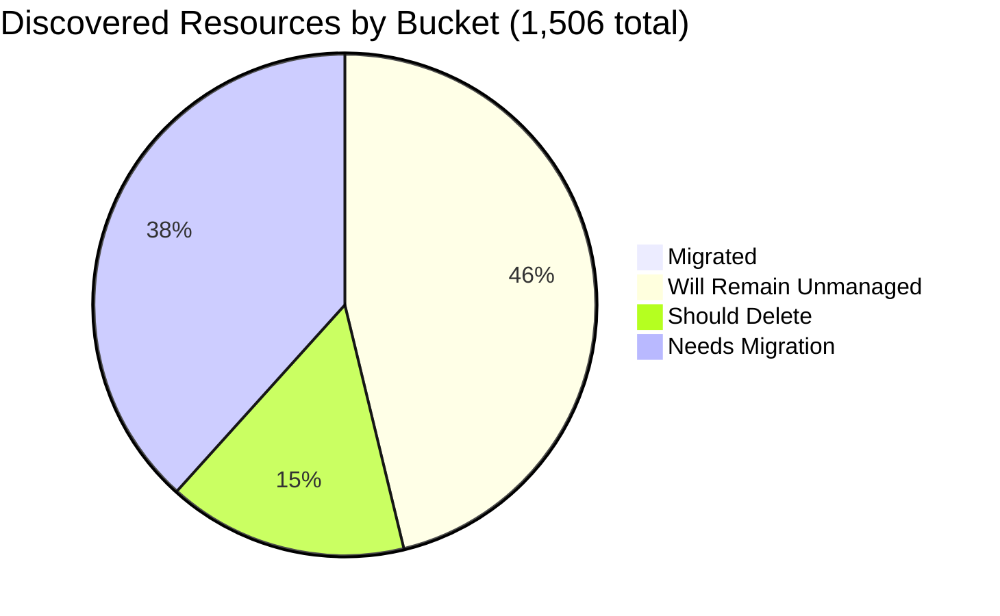

# Pulumi Migration Report — `pequod`

> **Generated:** October 30, 2026  
> **Source:** Pulumi Insights (4 enrolled accounts, 9 scanned scopes) + Pulumi Cloud resource search and stacks API  
> **Scope:** Every resource discovered in all enrolled Insights accounts, paginated in full (1,753 indexed records: 1,506 discovered + 247 in Pulumi stacks). No sampling.  
> **Action taken:** None. This report only observes and recommends.

---

## 1. Executive Summary

**Org-wide migration (Insights-discovered resources)**

```
░░░░░░░░░░░░░░░░░░░░ 0.7%  (11 of 1,506 discovered resources under Pulumi management)
```

**Context:** `pequod` is the Pulumi CE demo and workshop org, so the estate is mostly demo scaffolding rather than production. The org runs **19 stacks / 19 projects / 247 stack resources**, but the 61 AWS resources in those stacks live in AWS account `052848974346`, which is not enrolled in Insights.

| Bucket | Count | % of Discovered | % of Migratable Base |
|--------|------:|----------------:|---------------------:|
| Migrated (Pulumi-managed) | 11 | 0.7% | 1.3% |
| Will remain unmanaged | 691 | 45.9% | n/a |
| Should be deleted (review) | 231 | 15.3% | 28.3% |
| Needs migration | 573 | 38.0% | 70.3% |
| **Total discovered** | **1,506** | 100% | |

*Migratable base = 815 (total minus will-remain-unmanaged). Buckets sum to account totals; account totals sum to 1,506.*

**Biggest takeaway:** 28.3% of the migratable base (231 resources) looks like scratch or test leftovers, led by 124 resources in Azure scratch resource groups. Review and delete these before migrating, which shrinks the work from 804 to 573 resources. Stack creation has picked up (10 new stacks in the last 12 months, 8 in October).

### Notes and caveats

**Since the last report (2026-06-29):** `aws-pulumi-ce-052848974346` (4,651 resources, 78% of the prior total) is no longer enrolled, so discovered resources fell from 5,946 to 1,506 and migrated from 53 to 11. The two reports are not comparable. Stacks went from 21 to 19.

**Data-quality caveats:** (1) `aws-neo-eu-west-2-420942475186` and `aws-pulumi-ce-workshops-420942475186` are the **same AWS account (420942475186)** enrolled twice, so 161 records are duplicates (1,345 unique physical resources); counts below are per Insights record so they reconcile. (2) All 5 scan scopes of the workshops account are 66-92 days stale and have scheduled scans disabled. (3) Most discovered resources carry no tags, so ownership is mostly name- and account-derived; none of the existing Pulumi Teams (ClaudeAccess, DevTeam, env-admin-pk, PlatformTeam) is assigned to an Insights account.

---

## 2. Migration Progress

### Org-wide four-bucket split (% of 1,506 discovered)

| Bucket | Bar | % |
|--------|-----|--:|
| Migrated | `░░░░░░░░░░░░░░░░░░░░` | 0.7% |
| Will remain unmanaged | `█████████░░░░░░░░░░░` | 45.9% |
| Should delete | `███░░░░░░░░░░░░░░░░░` | 15.3% |
| Needs migration | `████████░░░░░░░░░░░░` | 38.0% |



*Under 1% is Pulumi-managed; nearly half of everything discovered is platform scaffolding that should stay as is.*

### % Migrated by Account (of the account's discovered resources)

| Account | Bar | Migrated / Total |
|---------|-----|-----------------:|
| aws-neo-eu-west-2-420942475186 | `░░░░░░░░░░░░░░░░░░░░` | 0 / 181 (0.0%) |
| aws-pulumi-ce-workshops-420942475186 | `░░░░░░░░░░░░░░░░░░░░` | 0 / 334 (0.0%) |
| azure-team-ce-subscription | `░░░░░░░░░░░░░░░░░░░░` | 8 / 369 (2.2%) |
| google-pulum-ce-team-438338752289 | `░░░░░░░░░░░░░░░░░░░░` | 3 / 622 (0.5%) |

*Only Azure (8) and GCP (3) have any Pulumi-managed resources; both AWS scopes are 0%.*

### % Migrated by Responsible Team (migrated / (migrated + needs migration))

| Team | Needs Migration | Migrated | Bar |
|------|----------------:|---------:|-----|
| Mitch Gerdisch | 372 | 11 | `█░░░░░░░░░░░░░░░░░░░` 2.9% |
| Individual CEs (name prefix) | 114 | 0 | `░░░░░░░░░░░░░░░░░░░░` 0.0% |
| Ambiguous demo/platform names | 47 | 0 | `░░░░░░░░░░░░░░░░░░░░` 0.0% |
| Workshops (instructor/DNS) | 14 | 0 | `░░░░░░░░░░░░░░░░░░░░` 0.0% |
| Pulumi Build Engineering | 13 | 0 | `░░░░░░░░░░░░░░░░░░░░` 0.0% |
| Robert Smith | 13 | 0 | `░░░░░░░░░░░░░░░░░░░░` 0.0% |

*Ownership signal order used: resource tag, then name prefix, then Insights account owner (fallback). Mapping is in section 6. All 11 migrated resources are attributed to Mitch Gerdisch via the account-owner fallback.*

---

## 3. Momentum

**Active Pulumi footprint (pequod):** 19 stacks, 19 projects, 247 resources under management (12 stacks hold resources; 7 are empty).

*Stack creation = timestamp of the stack's first update (the API does not return a created date). Stacks that have since been deleted are not counted.*

```
New stacks per month, last 12 months (scaled to busiest month)
Nov 2025 · 0
Dec 2025 · 0
Jan 2026 · 0
Feb 2026 · 0
Mar 2026 · 0
Apr 2026 · 0
May 2026 · 0
Jun 2026 · 0
Jul 2026 · 0
Aug 2026 · 0
Sep 2026 ███ 2
Oct 2026 ████████████ 8   <- busiest month on record
```

**Biggest month on record:** Oct 2026 with 8 new stacks. Before Sep 2026 the org added only 9 stacks over ~34 months (2023: 3, 2024: 4, 2025: 2).

**Share of footprint built in the last 12 months:** 10 of 19 stacks (52.6%) and 47 of 247 resources (19.0%).

| Team (stack source repo) | Stacks | Resources | Status |
|--------------------------|-------:|----------:|--------|
| pequod-platform (shared EKS/AKS, OIDC, GitHub Actions issuer) | 8 | 114 | Mixed: 4 active (`shared-dev-eks`, `shared-dev-aks`, `githubactions-pulumi-oidcissuer`, new `eks-deployment-agent-pool-py`); 4 stalled >90 days (azure-oidc-env-config, gcp-oidc-env-config, insights-azure-creds, rhum-monitor) |
| pequod-user-management | 1 | 83 | Active (last update Oct 9) |
| k8s-hybrid-workload | 2 | 27 | Accelerating (new Sep 2026, last update Oct 29) |
| pequod-reset (`demo-cleaner`) | 1 | 3 | Active (1,172 updates, last today) |
| gcp-vm-instance-py-11 | 1 | 20 | New today |
| pulumi/pjy-backup (agent-factory + shopfront demos) | 6 | 0 | Accelerating (6 stacks created Oct 9-16, 0 resources yet) |

**Largest stacks by resources:** `pequod-user-mgmt/prod` 83, `shared-dev-eks/dev` 62, `k8s-hybrid-app/dev` 21, `gcp-vm-instance-py-11/dev` 20, `shared-dev-aks/dev` 18.

---

## 4. Coverage by Enrolled Account

> **Caveat:** Insights coverage reflects only enrolled accounts, not the full estate. Enrollment dates are not exposed by the API, so they are listed as n/a.

| Account | Cloud | Pulumi-Managed | Total Discovered | Coverage | Oldest / Newest Scan | Enrolled |
|---------|-------|---------------:|-----------------:|----------|----------------------|----------|
| aws-neo-eu-west-2-420942475186 | AWS | 0 | 181 | `░░░░░░░░░░░░░░░░░░░░` 0.0% | 2026-10-29 / 2026-10-29 | n/a |
| aws-pulumi-ce-workshops-420942475186 | AWS | 0 | 334 | `░░░░░░░░░░░░░░░░░░░░` 0.0% | 2026-07-30 (stale) / 2026-08-25 | n/a |
| azure-team-ce-subscription | Azure | 8 | 369 | `░░░░░░░░░░░░░░░░░░░░` 2.2% | 2026-10-29 / 2026-10-29 | n/a |
| google-pulum-ce-team-438338752289 | GCP | 3 | 622 | `░░░░░░░░░░░░░░░░░░░░` 0.5% | 2026-10-29 / 2026-10-29 | n/a |
| **Org total** | | **11** | **1,506** | `░░░░░░░░░░░░░░░░░░░░` 0.7% | | |

**Stale scans:** `aws-pulumi-ce-workshops-420942475186` scopes `global`, `us-east-2`, `us-west-1`, `us-west-2` were last scanned 2026-07-30 (92 days) and `us-east-1` on 2026-08-25 (66 days); scheduled scanning is disabled. Re-scan before acting on its items.

**Enrollment gaps:** The 61 AWS resources in Pulumi stacks (e.g. `shared-dev-eks`) reference account `052848974346` (49 ARNs checked), which is not enrolled, so Insights cannot show them as managed. Re-enrolling it would give the pequod-platform stacks visibility and is the main reason coverage looks near zero for AWS. The four enrolled accounts all roll up to Mitch Gerdisch or Robert Smith.

---

## 5. Data Analysis

| Account | Cloud | Total | Migrated | Will Remain Unmanaged | Should Delete | Needs Migration | % Mig (All) | % Mig (Migratable) |
|---------|-------|------:|---------:|----------------------:|--------------:|----------------:|------------:|-------------------:|
| aws-neo-eu-west-2-420942475186 | AWS | 181 | 0 | 137 | 5 | 39 | 0.0% | 0.0% |
| aws-pulumi-ce-workshops-420942475186 | AWS | 334 | 0 | 215 | 33 | 86 | 0.0% | 0.0% |
| azure-team-ce-subscription | Azure | 369 | 8 | 90 | 124 | 147 | 2.2% | 2.9% |
| google-pulum-ce-team-438338752289 | GCP | 622 | 3 | 249 | 69 | 301 | 0.5% | 0.8% |
| **Org total** | | **1,506** | **11** | **691** | **231** | **573** | **0.7%** | **1.3%** |

**Classification methodology:** each resource lands in exactly one bucket, in this order: Pulumi-managed (`managed=Pulumi`), will remain unmanaged, should delete, needs migration. Resources managed by CloudFormation (37) or ARM (69) are not Pulumi-managed, so they count as needs migration unless a rule below applies.
- *Will remain unmanaged* (top patterns): AWS Service Linked Roles (and policy attachments) (106); Service-managed buckets (Cloud Composer/Airflow environments, Dataproc Metastore) (69); Default VPC scaffolding (default VPCs, subnets, IGWs, route tables, DHCP options, default SGs) (64); Azure auto-created scaffolding (NetworkWatcherRG / DefaultResourceGroup / MC_* AKS node RGs / Cloud Shell) (61); GCP auto-created buckets (GCF sources, App Engine / Container Registry artifacts) (59); AWS-managed CloudFront "Managed-*" / UseOrigin* policies (56); plus 23 smaller patterns. Child resources (policy attachments, bucket ACLs/IAM, subnets of default networks) inherit their parent's bucket.
- *Should delete*: scratch, test-named, or placeholder names, plus Pulumi auto-named demo leftovers with no owning stack. Judgement-based; see section 6.
- *Confidence:* high for will-remain-unmanaged (deterministic patterns), medium for should-delete (name heuristics), medium for ownership.

**Noteworthy:**
- **Azure holds the cleanup opportunity:** 124 of its 369 resources (33.6%) sit in 52 generic or test-named resource groups.
- **GCP is the largest migration queue:** 301 of 573 org-wide items, mostly custom-network subnets (90), OIDC federation objects and service accounts, and DIY state buckets.
- **Pulumi-owned IAM objects exist in AWS:** `lambda-role-for-account-cleanup` and its policy carry the tag `pulumi:stack-id=pulumi/AWS_Account_Cleanup-IAMRoles/pulumi-ce-workshops`, indicates a stack in the `pulumi` org already manages them. Confirm before importing into `pequod`.

---

## 6. Actions Needed

### Ownership mapping used

1. Resource tags (`Owner`, `workshop`): used for 27 resources including role children (`Owner=workshops`, `Owner=pulumi-build-engineering`, `Owner=pequod`, `Owner=pulumi`).
2. Name prefixes: `mitch*`, `m-*-diy-state*`, `self-hosted*` -> Mitch Gerdisch; `piers*` -> Piers Karsenbarg; `pk-*` -> PK; `zbuchheit*` -> Z. Buchheit; `wladi*`, `rg-dbw-*` -> Wladi; `aureq*`, `menfin*`, `megan*`, `shaht*`, `vasu*`, `stoo*`, `nelson*`, `elisabeth*`, `meggy*`, `geoff*`/`aptos*` -> that individual; `workshop*` -> Workshops. Names for Initech, Zendesk, DW Core, podinfo, and `pulumi-esc*` could not be tied to a person and are grouped as ambiguous.
3. Stack VCS tags (for stacks only): `pulumi-pequod/pequod-platform`, `pequod-user-management`, `k8s-hybrid-workload`, `pequod-reset`, `pulumi/pjy-backup`. GitHub code search for cloud resource names was not run for this report.
4. Fallback: Insights account owner. `aws-neo-eu-west-2-420942475186` -> Robert Smith (rsmith-pulumi-corp); `aws-pulumi-ce-workshops-420942475186`, `azure-team-ce-subscription` -> Mitch Gerdisch (MitchGerdisch); `google-pulum-ce-team-438338752289` -> Mitch Gerdisch (mitch-pulumi-corp).

### Migration queue by team (largest first)

**Mitch Gerdisch** (372 resources)

| Priority | Resources | Count | Why |
|----------|-----------|------:|-----|
| High | Self-hosted Pulumi backend on GCP: `mitchselfhosted-mitchsh-network-afa8380` VPC, subnets, NAT, keyring, checkpoints bucket, `mitch-selfhosted`/`mitch-selfmanaged` | 69 | Backing infra for self-hosted demos; hard to rebuild by hand |
| High | DIY state buckets (`m-demo/ent/ess/pro-diy-state-storage-bucket`, `pulumi-team-ce-tf-state`) | 22 | Losing these breaks stacks that use them |
| High | GCP OIDC federation: workload identity pools/providers and service accounts (`pulumi-oidc*`, `team-ce-oidc-sa`) | 21 | Used by ESC/OIDC demos across the CE team |
| Medium | Azure hub-and-spoke networking (`hub-vnet-rg*`, `hub-nva-rg*`, `onprem-vnet-rg*`, `spoke1-vnet-rg*`, `rg-hub-network-dev`) | 34 | Shared network used by spoke workloads |
| Medium | AWS CDK `PostgresLambdaStack` (VPC, Aurora, Lambdas, NAT) in `us-east-1` | 33 | CloudFormation-managed; candidate for CDK-to-Pulumi conversion |
| +193 more | Custom GCP networks and load balancers (`my-demo-network`), Azure shared services, budgets, OIDC providers | 193 | Group by network and resource group |

**Individual CEs (name prefix)** (114 resources)

| Priority | Resources | Count | Why |
|----------|-----------|------:|-----|
| High | Wladi: Databricks workspaces, VNets and NSGs in `rg-dbw-*`; GCP `wladi-gcp-pool` | 28 | Assign to the individual; confirm still in use |
| Medium | Geoff: `geoff.int` Cloud DNS zone and Aptos fullnode records | 17 | Assign to the individual; confirm still in use |
| High | Menfin: `menfin*` DIY state bucket and OIDC pools/service accounts | 16 | Assign to the individual; confirm still in use |
| Medium | PK: `pk-vm-win-box`, key vaults, `pk-gitlab` service account | 11 | Assign to the individual; confirm still in use |
| Medium | Piers Karsenbarg: `piers-resourcegroup-12345`, GCP service account | 7 | Assign to the individual; confirm still in use |
| +35 more | Nelson, Aureq, Shaht, Stoo, Megan, Meggy, Z. Buchheit, Elisabeth, Vasu | 35 | Small per-person sets (2-5 each) |

**Ambiguous demo/platform names** (47 resources)

| Priority | Resources | Count | Why |
|----------|-----------|------:|-----|
| High | CE platform (pequod): `insights-account-scan` and `ContinuousDeliveryAdminRole` IAM roles (tag `Owner=pequod`/`pulumi`) | 10 | No person-level signal; needs a human owner |
| Medium | CE demo apps: `podinfo-webapp-rg` (App Service, Cosmos DB), `pulumi-esc*` IAM roles | 18 | No person-level signal; needs a human owner |
| Medium | DW Core demo: BigQuery `dwcore_dev_dataset_1`, `dwcore-dev-bucket` | 7 | No person-level signal; needs a human owner |
| Medium | Initech demo: `initech` WIF pool, `initech-access` service account, `initech` resource group | 6 | No person-level signal; needs a human owner |
| Medium | Zendesk demo: `zendesk-domestic-vpc-0398fb1` network, firewalls, instance | 6 | No person-level signal; needs a human owner |

**Workshops (instructor/DNS)** (14 resources)

| Priority | Resources | Count | Why |
|----------|-----------|------:|-----|
| High | Route 53 zone `workshops.pulumi-ce.team` with NS and SOA records | 6 | DNS for all workshop participants |
| High | `workshop-instructor-role` and `AdminWorkshop` roles with administrator attachments | 8 | Provision workshop participants; admin-level access |
| Note | Each item appears in both AWS Insights accounts (same AWS account) | | Migrate once, not twice |

**Pulumi Build Engineering** (13 resources)

| Priority | Resources | Count | Why |
|----------|-----------|------:|-----|
| Verify | `lambda-for-account-cleanup` (5 regions), `lambda-role-for-account-cleanup`, `lambda-policy-for-account-cleanup` and attachments | 13 | Tagged `pulumi:stack-id=pulumi/AWS_Account_Cleanup-IAMRoles/...`; likely already managed by a stack in the `pulumi` org. Confirm before importing |

**Robert Smith** (13 resources)

| Priority | Resources | Count | Why |
|----------|-----------|------:|-----|
| Medium | IAM roles `MCOrient`, `VNOrient`, `ESCWksp`, `AmazonBedrockAgentCoreHarnessDefaultServiceRole-*` with their policies and attachments | 8 | Fallback owner; confirm they are still used |
| Low | Account budgets `420942475186-budget-150-e6909b6`, `-budget-fc8c40b` | 2 | Low risk, good hygiene |
| Low | OIDC provider `api.pulumi.com/oidc`, non-default subnet `subnet-003776b3879f28829`, policy `AmazonBedrockAgentCoreHa*` | 3 | Rest of the queue |

### Deletion candidates

*Recommend human review before deleting anything. Name-based heuristics only; children of a flagged parent are counted with it.*

| Pattern | Count | Account(s) | Reason / examples |
|---------|------:|------------|-------------------|
| Azure scratch/placeholder resource groups (generic or hex-suffixed demo names, test-named) | 124 | azure-team-ce-subscription (124) | Auto-named demo leftovers (`resourceGroup2dca640c`, `resource_group*`, `resource-group*`), test names (`rs-test`, `neo-test-sqldb`, `rg-pulumi-test`), `example-rg`, `myTFResourceGroup` |
| Generic/placeholder GCP buckets (app-bucket-*, demo-k8s-ts-nginx-*, my-bucket-*) | 32 | google-pulum-ce-team (32) | `app-bucket-8270249`, `demo-k8s-ts-nginx-6356eb8`, `pulumi-tutorial-storage-bucket-megan` plus default ACLs and IAM |
| Generic placeholder secrets (dev-secret-N, prod-secret-N, my-app-secret) | 18 | google-pulum-ce-team (18) | `dev-secret-1/2`, `prod-secret-1/2`, `my-app-secret` with versions and IAM policies |
| Generic/placeholder S3 buckets (my-bucket-*, app-bucket-*, zbuchheit-bucket-*, tagged workshop=aicamp) | 15 | aws-pulumi-ce-workshops (15) | `my-bucket-00bc2ad/a2656a9/bd4ceb7` (tag `workshop=aicamp`), `app-bucket-e232f6b`, `zbuchheit-bucket-bbb152b` |
| Orphaned auto-named Pulumi demo leftovers (sql-instance*, webAppLambda*, lambdaRole*, db-sg*, API Gateway sbcdzzbuv4) with no owning stack | 14 | aws-pulumi-ce-workshops (12), aws-neo-eu-west-2 (2) | `sql-instancef63ee7a`, `webAppLambda-51d3904`, `lambdaRole-482bdf2`, `db-sg-743330b`, API Gateway `sbcdzzbuv4`; no stack in pequod owns them |
| Test/generic placeholder service accounts (aureq-test-sa, demos_weekly_test, my-account, service-account-id-*, "Service Account") | 9 | google-pulum-ce-team (9) | `aureq-test-sa`, `demos_weekly_test`, `my-account`, `service-account-id-2`, unnamed "Service Account" |
| Explicit test/experiment resources (mitch-assumerole-test*) | 9 | aws-pulumi-ce-workshops (6), aws-neo-eu-west-2 (3) | `mitch-assumerole-test` bucket, role, policy and attachments |
| Generic demo VMs (vm-*, vm2-*, vm-with-identity-*) | 6 | google-pulum-ce-team (6) | `vm-0514d7a`, `vm2-7406698`, `vm-with-identity-7815830` and instance IAM |
| Test-named KMS keyrings/keys (boog-kms-test, mitch-kms-test) | 3 | google-pulum-ce-team (3) | `boog-kms-test`, `mitch-kms-test` keyrings and key |
| Repro/test load balancer artefacts (repro-urlmap-*) | 1 | google-pulum-ce-team (1) | `repro-urlmap-bdeb6f8` |

### Unattributed (needs a human owner)

| Resource | Account | Why unresolved |
|----------|---------|----------------|
| `rg-sentinel-pulumi-test` (Log Analytics workspace, data collection rules; 7 resources) | azure-team-ce-subscription | Name says test, but it holds an active-looking Sentinel workspace; kept out of the delete list on purpose |
| `initech` WIF pool, `initech-access` service account, `initech` resource group | GCP / Azure | Same demo name in two clouds; no owner tag |
| Zendesk demo network (`zendesk-domestic-vpc-0398fb1`, firewalls, `zendesk-domwg-i-3e98473`) | google-pulum-ce-team | Auto-suffixed names but no person prefix |
| `constructconnect-db3` Firestore database | google-pulum-ce-team | Customer-style name; unclear if a live demo |
| `PostgresLambdaStack` (CDK-deployed Aurora + Lambdas, 33 CloudFormation-managed resources) | aws-pulumi-ce-workshops | No owner tag; currently assigned to Mitch Gerdisch only by account-owner fallback |

---

*All counts are exact: every one of the 1,506 discovered records was classified, and bucket totals reconcile to account totals and to the org total. Values marked approximate in earlier reports are exact here. Classification rules and ownership mapping are described above and can be validated by the reader.*
