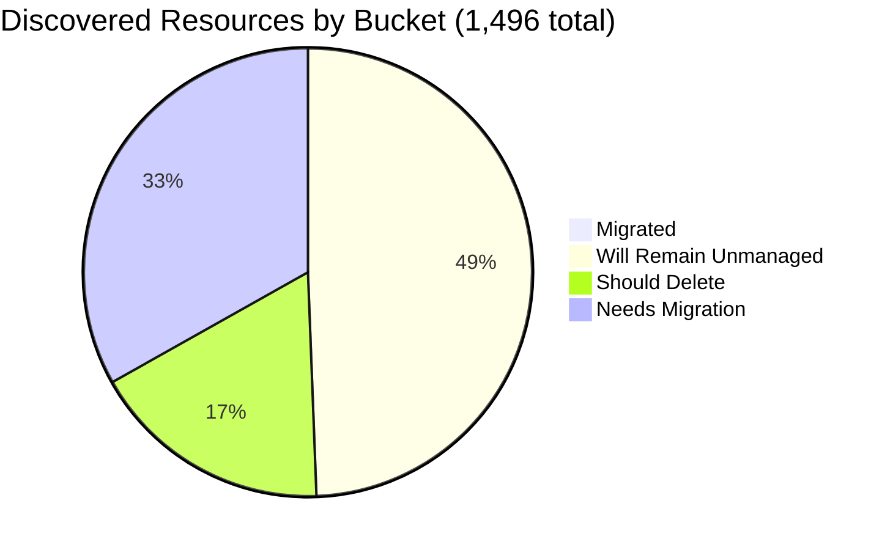

# Pulumi Migration Report — `pequod`

> **Generated:** November 6, 2026 (week of Nov 2)
> **Source:** Pulumi Insights (11 scan scopes in 4 cloud accounts) + Pulumi Cloud API
> **Scope:** All discovered resources across enrolled Insights accounts. Every resource was enumerated and classified (full scan, no sampling).
> **Action taken:** None. This report only observes and recommends.
> **Previous report:** [2026-06-29](../2026-06-29/migration-report.md)

---

## 1. Executive Summary

**Org-wide migration (Insights-discovered resources)**

```
░░░░░░░░░░░░░░░░░░░░ 0.4%   (6 of 1,496 discovered resources are Pulumi-managed)
```

`pequod` is the CE team's shared demo and workshop org. Only **6** discovered resources sit in a Pulumi stack. The biggest change since June 29 is scope: the main CE AWS account `aws-pulumi-ce-052848974346` (4,651 resources last report) is **no longer in the Insights account list**, so discovered resources fell from 5,946 to 1,496. The estate that remains is mostly platform scaffolding (49%) plus demo leftovers (17%).

| Bucket | Count | % of Discovered | % of Migratable Base |
|--------|------:|----------------:|---------------------:|
| Migrated (in a Pulumi stack) | 6 | 0.4% | 0.8% |
| Will remain unmanaged | 736 | 49.2% | n/a |
| Should be deleted (human review) | 260 | 17.4% | 34.2% |
| Needs migration | 494 | 33.0% | 65.0% |
| **Total discovered** | **1,496** | 100% | |

*Migratable base = 1,496 - 736 = 760. Buckets sum to account totals and accounts sum to 1,496.*

**Data-quality caveats:**
- AWS account `420942475186` is enrolled twice (`aws-neo-eu-west-2-*` and `aws-pulumi-ce-workshops-*`). All 109 records in `workshops/global` duplicate `neo/global`. Unique physical resources are **1,387** (Migrated 6, Unmanaged 662, Delete 255, Needs 464). Tables below keep the per-account record counts so they reconcile.
- The 4 `aws-pulumi-ce-workshops` regional scopes were last scanned 73 to 99 days ago and scheduled scans are disabled.
- Only 5 AWS regions are scanned (eu-west-2, us-east-1, us-east-2, us-west-1, us-west-2).
- No Pulumi Teams are configured. 59% of the migration queue is attributed by account-owner fallback (see §6).

---

## 2. Migration Progress

### Org-wide four-bucket split (of 1,496)

| Bucket | Bar | % |
|--------|-----|--:|
| Migrated | `░░░░░░░░░░░░░░░░░░░░` | 0.4% |
| Will remain unmanaged | `██████████░░░░░░░░░░` | 49.2% |
| Should delete | `███░░░░░░░░░░░░░░░░░` | 17.4% |
| Needs migration | `███████░░░░░░░░░░░░░` | 33.0% |



### % Migrated by account (migrated / discovered)

| Account | Bar | Migrated / Total |
|---------|-----|-----------------:|
| aws-neo-eu-west-2-420942475186 | `░░░░░░░░░░░░░░░░░░░░` | 0 / 181 (0.0%) |
| aws-pulumi-ce-workshops-420942475186 | `░░░░░░░░░░░░░░░░░░░░` | 0 / 334 (0.0%) |
| azure-team-ce-subscription | `░░░░░░░░░░░░░░░░░░░░` | 3 / 354 (0.8%) |
| google-pulum-ce-team-438338752289 | `░░░░░░░░░░░░░░░░░░░░` | 3 / 627 (0.5%) |

All accounts are under 1%. The bars are empty because migration of Insights-visible resources has not started.

### % Migrated by responsible team (migrated / (migrated + needs migration))

| Team / owner | Needs migration | Migrated | Bar |
|--------------|----------------:|---------:|-----|
| Pequod platform | 17 | 6 | `█████░░░░░░░░░░░░░░░` 26% |
| Mitch Gerdisch (account owner + self-hosted) | 298 | 0 | `░░░░░░░░░░░░░░░░░░░░` 0% |
| Individual CE demo owners | 106 | 0 | `░░░░░░░░░░░░░░░░░░░░` 0% |
| Databricks onboarding teams | 25 | 0 | `░░░░░░░░░░░░░░░░░░░░` 0% |
| Robert Smith (neo account) | 24 | 0 | `░░░░░░░░░░░░░░░░░░░░` 0% |
| Workshops | 16 | 0 | `░░░░░░░░░░░░░░░░░░░░` 0% |
| Build Engineering (account cleanup) | 8 | 0 | `░░░░░░░░░░░░░░░░░░░░` 0% |

Only Pequod platform has any migrated resources: `shared-dev-aks` (3 Azure) and the `pequod-gcp-access` OIDC pool/service account (3 GCP).

---

## 3. Momentum

**Active Pulumi footprint:** 17 stacks · 17 projects · 247 IaC-managed resources. Last report (Jun 29): 21 stacks, 19 projects, ~297 resources.

Stack creation dates come from each stack's first update. Deleted stacks (for example TTL-reaped demos) are not visible, so these bars undercount historical creation.

```
Dec 2025 ░░░░░░░░░░░░ 0
Jan 2026 ░░░░░░░░░░░░ 0
Feb 2026 ░░░░░░░░░░░░ 0
Mar 2026 ░░░░░░░░░░░░ 0
Apr 2026 ░░░░░░░░░░░░ 0
May 2026 ░░░░░░░░░░░░ 0
Jun 2026 ░░░░░░░░░░░░ 0
Jul 2026 ░░░░░░░░░░░░ 0
Aug 2026 ░░░░░░░░░░░░ 0
Sep 2026 █████░░░░░░░ 2
Oct 2026 ████████████ 5   <- busiest month in the window
Nov 2026 ██░░░░░░░░░░ 1   (month to date)
```

- **Share of footprint built in the last 12 months:** 8 of 17 surviving stacks (47%) but only 47 of 247 managed resources (19%). Older stacks hold most of the resources: `pequod-user-mgmt` 83, `shared-dev-eks` 62, `demo-cleaner` 3.
- **Oct 2026 burst:** `platform`, `triage`, `factory` and `llm` (all created Oct 9) and `eks-deployment-agent-pool-py` (Oct 15) currently hold **0 resources**.
- **Accelerating (updated in the last 30 days):** `demo-cleaner` (Nov 6), `gcp-vm-instance-py-12` (Nov 6, created today), `githubactions-pulumi-oidcissuer` (Oct 31), `k8s-hybrid-app` / `k8s-hybrid-workload` (Oct 29), `shared-dev-eks` (Oct 20), `pequod-user-mgmt` (Oct 9).
- **Stalled (no update in 90+ days):** `azure-oidc-env-config` (May 2025), `gcp-oidc-env-config` (May 2025), `insights-azure-creds` (Feb 2025), `rhum-monitor` (Jul 8, 2026).
- **Visibility gap:** Insights links only 6 of the 247 stack-managed resources. `shared-dev-eks` (62), `k8s-hybrid-*` (27) and `pequod-user-mgmt` (83) deploy into accounts or resource types that are not enrolled or not scanned.

---

## 4. Coverage by Enrolled Account

> **Caveat:** Coverage reflects only enrolled accounts and scanned regions, not the full estate. Enrollment dates are not exposed by the API.

| Scan scope | Cloud | Pulumi-managed | Discovered | Coverage | Last scan | Scheduled |
|------------|-------|---------------:|-----------:|----------|-----------|:---------:|
| aws-neo-eu-west-2-420942475186 (eu-west-2 + global) | AWS | 0 | 181 | `░░░░░░░░░░░░░░░░░░░░` 0.0% | Nov 5, 2026 | yes |
| aws-pulumi-ce-workshops-420942475186 (4 US regions + global) | AWS | 0 | 334 | `░░░░░░░░░░░░░░░░░░░░` 0.0% | Jul 30 to Aug 25, 2026 (stale) | no |
| azure-team-ce-subscription | Azure | 3 | 354 | `░░░░░░░░░░░░░░░░░░░░` 0.8% | Nov 5, 2026 | yes |
| google-pulum-ce-team-438338752289 | GCP | 3 | 627 | `░░░░░░░░░░░░░░░░░░░░` 0.5% | Nov 5, 2026 | yes |
| **Org total** | | **6** | **1,496** | `░░░░░░░░░░░░░░░░░░░░` 0.4% | | |

- **Missing since last report:** `aws-pulumi-ce-052848974346` is not in the account list (it held 4,651 resources and 43 Pulumi-managed on Jun 29). It may have been un-enrolled or not visible to this caller. Please confirm whether this is intentional.
- **Stale scans:** the workshops account was last scanned 73 days ago (us-east-1) and 99 days ago (global, us-east-2, us-west-1, us-west-2). Re-scan before acting on its data.
- **Enrollment gap:** re-enrolling the main CE AWS account, and the AWS account behind `shared-dev-eks` (62 resources), would restore visibility for most stack-managed resources.

---

## 5. Data Analysis

| Account | Cloud | Total | Migrated | Will remain unmanaged | Should delete | Needs migration | % Mig (all) | % Mig (migratable) |
|---------|-------|------:|---------:|----------------------:|--------------:|----------------:|------------:|-------------------:|
| aws-neo-eu-west-2-420942475186 | AWS | 181 | 0 | 137 | 5 | 39 | 0.0% | 0.0% |
| aws-pulumi-ce-workshops-420942475186 | AWS | 334 | 0 | 216 | 23 | 95 | 0.0% | 0.0% |
| azure-team-ce-subscription | Azure | 354 | 3 | 84 | 124 | 143 | 0.8% | 1.1% |
| google-pulum-ce-team-438338752289 | GCP | 627 | 3 | 299 | 108 | 217 | 0.5% | 0.9% |
| **Org total** | | **1,496** | **6** | **736** | **260** | **494** | **0.4%** | **0.8%** |

**Method notes:** The count excludes 239 deployment-scope nodes that Insights adds for CloudFormation stacks (65) and ARM deployments (174). They wrap resources already counted. After excluding them, account totals equal the scan resource counts. Resources deployed by CloudFormation or ARM are *not* counted as migrated: 34 ARM and 11 CloudFormation resources are in the migration queue, and they are good candidates for the CFN/ARM-to-Pulumi tooling.

**Will-remain-unmanaged patterns** (top 8 of 28, 736 total): GCP auto-mode subnetworks (128), AWS service-linked roles (106), default VPC scaffolding (95), GCF/App Engine/Artifact buckets (64), CloudFront `Managed-*` policies (56), GCP project service APIs (49), Databricks managed RGs (25), Composer environment buckets (24). +236 in 20 smaller patterns. CDK bootstrap resources (18) are a judgement call: kept as scaffolding, revisit if CDK is retired.

**Noteworthy:**
- **GCP is 42% of all discovered resources** and holds the most delete candidates by pattern: 35 leftover buckets of deleted Composer environments, 18 placeholder secrets, 41 test-named buckets and ACLs.
- **Azure has the highest delete share (35%).** 51 generic or test resource groups hold 124 resources in total.
- **31 Azure resources tagged `managed-by=pulumi`** (`azure-data-platform` / `team-onboarding`) are not linked to any stack in `pequod`. 27 of them are in the migration queue. They were deployed by a Pulumi stack outside this org or one that has since been deleted. Re-linking or importing them is the cheapest migration win.

---

## 6. Actions Needed

### Ownership method

Signals used, in order: resource tag (`Owner`, `team`, `Purpose`, `project`, `workshop`), then name prefix, then account owner as fallback. GitHub / CODEOWNERS search was **not** performed. For the 494 resources needing migration: 291 (59%) used account-owner fallback, 160 name prefix, 24 `team` tag, 16 `Owner` tag, 3 `project` tag.

Name-prefix mapping (please validate): `mitch*`, `mitchselfhosted*` -> Mitch Gerdisch (self-hosted); `m-*-diy-state-storage-bucket`, `menfin*` -> Menfin (assumed); `piers*`, `pk-*` -> Piers / PK; `zbuchheit*` -> Z. Buchheit; `aureq*` -> Aureq; `wladi*` -> Wladi; `elisabeth*` -> Elisabeth; `workshop*` -> Workshops; `pequod*`, `pulumi-oidc*`, `shared-dev*` -> Pequod platform; `zendesk*`, `initech*`, `podinfo*`, `dwcore*` -> named demo projects. Account owners: neo = Robert Smith; workshops, Azure, GCP = Mitch Gerdisch.

### Migration queue by team (largest first)

**Mitch Gerdisch: 298** (31 self-hosted by name, 267 by account-owner fallback, so many may belong to other CEs)

| Priority | Item | Why |
|----------|------|-----|
| High | `mitchselfhosted-*` GCP stack (31): VPC, service networking peering, KMS keyring, service account, policypacks / ESC / checkpoints buckets, private IP range | Self-hosted Pulumi backend infrastructure |
| High | PostgresLambdaStack in workshops us-east-1: Aurora cluster, NAT gateway + EIP, 5 Lambdas, secret (11 resources already CloudFormation-managed) | Active CDK/CFN stack, candidate for CDK/CFN-to-Pulumi |
| Medium | GCP load-balancer demo (24): 11 backend services, 5 NEGs, 3 URL maps, forwarding rules, HTTP proxies | Running LB tier with no IaC |
| Medium | Azure hub / spoke / on-prem network RGs (33) | Connected network topology |
| Medium | GCP Cloud DNS (12): 11 record sets and zone `geoff` | DNS loss is high impact |

**Individual CE demo owners: 106**: Menfin 36 (incl. the `m-{ent,ess,pro,demo}-diy-state-storage-bucket` buckets), Piers / PK 16, Z. Buchheit 7, data-warehouse demo 7, Podinfo 6, Initech 6, Zendesk 6, Aureq 5, Wladi 4, Megan 4, Shaht 4, Stooj 4, Elisabeth 1. Top items: DIY state buckets (`aureq-pulumi-diy-state-storage` and the four Menfin buckets), `podinfo-webapp-rg` (App Service, Cosmos DB), BigQuery `dwcore_dev_dataset_1`, `zendesk-domestic-vpc` network and instances.

**Databricks onboarding teams: 25**: 5 each for `my-team-beta`, `my-team-wladi`, `my-team-1`, `team-alpha`, 4 for `my-team`, 1 other. Workspaces, VNets and NSGs in the `rg-dbw-*` groups, tagged `team` and `cost-center`. Deployed by `team-onboarding` (`managed-by=pulumi`), so re-link them to their stack.

**Robert Smith: 24** (neo account, all by account-owner fallback): ESC OIDC roles (`pulumi-esc-oidc-paul-umi-AdministratorAccess-role`, `pulumi-esc-ediri`, `ESCWksp`), Bedrock AgentCore role and policy, `MCOrient` / `VNOrient` roles, the `api.pulumi.com/oidc` OIDC provider, 2 budgets, one KMS key.

**Pequod platform: 17**: `insights-account-scan` and `ContinuousDeliveryAdminRole` (neo and workshops copies), `pequod-keyvault`, `rg-esc-demo` + Key Vault, the `pulumi-oidc*` identity pool, service accounts and IAM policies in GCP.

**Workshops: 16**: Route 53 zone `workshops.pulumi-ce.team` and its NS/SOA records, `workshop-instructor-role`, `AdminWorkshop` role, `MCOrient:PermsForWorkshop` policy (neo and workshops copies).

**Build Engineering: 8**: `lambda-for-account-cleanup` Lambda, role and policy (`Owner=pulumi-build-engineering`, `Purpose=AccountCleanup`).

### Deletion candidates

*Recommend human review before deleting anything. These are naming and tag heuristics only.*

| Pattern | Count | Where | Reason |
|---------|------:|-------|--------|
| Generic, test or hex-suffix resource groups and contents (`resourceGroup2dca640c`, `resource_group0735547b`, `rs-test`, `neo-test-sqldb`, `piers-resourcegroup-12345`) | 124 | Azure | 51 RGs with generic or test names, all contents are demo leftovers |
| Generic or test-named buckets and ACLs (`my-bucket-f50a09b`, `piers-test-bucket`, `app-bucket-*`, `nelsons-bucket-for-issue-repro-*`) | 41 | GCP | Placeholder or repro names |
| Composer buckets of deleted environments (`europe-west1-my-composer-en-*-bucket`) | 35 | GCP | Labelled `goog-composer-environment-deleted=true`, so the environment is gone |
| Placeholder secrets (`my-app-secret`, `dev-secret-1/2`, `prod-secret-1/2`) | 18 | GCP | Generic demo secrets with versions and IAM |
| Test / repro resources (`test-fw-*`, `test-remote-instance-*`, `repro-urlmap-*`, `aureq-test-sa`, `service-account-id-2`) | 14 | GCP | Explicit test names |
| Placeholder buckets (`my-bucket-*`, `app-bucket-e232f6b`) with ownership and public-access-block children | 12 | AWS us-east-1 | Placeholder names, no tags, not in a stack |
| `mitch-assumerole-test*` bucket, role, policy and attachments | 9 | AWS | Explicit test name (neo and workshops copies overlap) |
| Pulumi auto-named leftovers (`webAppLambda-51d3904`, `lambdaRole-482bdf2`, `sql-instancef63ee7a`, `db-sg-743330b`) | 7 | AWS us-east-1 | Hex-suffix names with no matching stack. The RDS instance needs a data check before deletion |

### Unattributed (needs a human owner)

| Resource | Account | Why unresolved |
|----------|---------|----------------|
| `m-{ent,ess,pro,demo}-diy-state-storage-bucket` (4 buckets + ACLs) | GCP | Assigned to Menfin by name guess only. These hold Pulumi state, so confirm before any change |
| `pulumi-team-ce-tf-state` | GCP | Terraform state bucket with no tag or owner prefix |
| `aptos-default-backup-8ebad0e8` + `aptos-default-backup` service account | GCP | Backup bucket with no owner and an unclear purpose |
| `geoff` managed zone | GCP | Cloud DNS zone, name suggests a person but there is no tag |
| `uptime-rg21c74a0b`, `rg-oriented-chamois`, `meggy292d713c4` | Azure | Opaque names, no tags, in the account-owner fallback |
| `6680-classic`, `6680-native` RGs | Azure | Numeric names, no tags |

---

*All counts are exact from the Insights graph (full pagination, `resultMode: exact`, visibility complete). Classification is heuristic: confidence is high for "will remain unmanaged" patterns and medium for "should delete" and ownership.*
