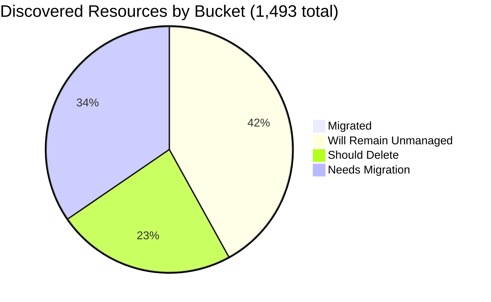

# Pulumi Migration Report — `pequod`

> **Generated:** November 13, 2026 (week ending Nov 13)  
> **Source:** Pulumi Insights (4 enrolled top-level accounts) + Pulumi Cloud API  
> **Scope:** All discovered cloud resources across enrolled Insights accounts (full exact scan, 1,493 resources) plus Pulumi stack/project growth data.  
> **Action taken:** None. This report only observes and recommends.

---

## 1. Executive Summary

**Org-wide migration coverage (Insights-discovered resources)**

```
░░░░░░░░░░░░░░░░░░░░ 0.4%  (6 of 1,493 discovered resources are Pulumi-managed)
```

`pequod` is the Pulumi Customer Engineering shared demo and workshop estate (not production). **16 active stacks manage 271 IaC resources**, but almost none of them are in the clouds/accounts Insights scans, so Insights sees only 6 as managed. The biggest takeaway: **349 resources (23%) are demo or test leftovers recommended for deletion**, almost half of the Azure subscription. Removing them first shrinks the real migration base from 869 to about 520.

| Bucket | Count | % of Discovered | % of Migratable Base |
|--------|------:|----------------:|---------------------:|
| Migrated (in a Pulumi stack) | 6 | 0.4% | 0.7% |
| Will remain unmanaged | 624 | 41.8% | n/a |
| Should be deleted (review) | 349 | 23.4% | 40.2% |
| Needs migration | 514 | 34.4% | 59.1% |
| **Total discovered** | **1,493** | 100% | n/a |

*Migratable base = 869 (1,493 total minus 624 will-remain-unmanaged). Buckets sum to account totals; accounts sum to 1,493.*

**Data-quality caveats:**
- The main CE account `aws-pulumi-ce-052848974346` (4,651 resources in the Jun 29 report) is **no longer returned by the Insights accounts API**. It was removed or is not visible to this task's credentials. Totals are not comparable with June (see "Change since last report").
- `aws-neo-eu-west-2-420942475186` and `aws-pulumi-ce-workshops-420942475186` are **the same AWS account (420942475186) registered twice**. 73 of the 109 workshops `global` resources (IAM, CloudFront, Route 53) duplicate the neo account. Budgets are listed once per region (10 records, 2 unique).
- Workshops account scans are 80 to 106 days old, and scheduled scans are disabled there.
- No formal Pulumi Teams are configured, so ownership is inferred (mapping in section 6).

### Change since last report (Jun 29, 2026)

| Metric | Jun 29 | Nov 13 | Note |
|--------|-------:|-------:|------|
| Discovered resources | 5,946 | 1,493 | Main CE AWS account (4,651) not visible; the four remaining accounts grew by 198 combined |
| Pulumi-managed (Insights view) | 53 | 6 | Same cause; Azure 5 to 3, GCP 3 to 3 |
| Stacks / IaC resources | 21 / ~297 | 20 / 271 | `demo-app`, `lotctl-k8s-aws`, `demo-aws-container-services-py-0629` no longer listed |
| New stacks in last 7 days | n/a | 6 | `aicr-*`, `software-factory-*`, one Azure Container App stack |

---

## 2. Migration Progress

### Org-wide four-bucket split (% of 1,493 discovered)

| Bucket | Bar | % |
|--------|-----|--:|
| Migrated | `░░░░░░░░░░░░░░░░░░░░` | 0.4% |
| Will remain unmanaged | `████████░░░░░░░░░░░░` | 41.8% |
| Should delete | `█████░░░░░░░░░░░░░░░` | 23.4% |
| Needs migration | `███████░░░░░░░░░░░░░` | 34.4% |



### % Migrated by Account (of that account's discovered resources)

| Account | Bar | Migrated / Total |
|---------|-----|-----------------:|
| aws-neo-eu-west-2-420942475186 | `░░░░░░░░░░░░░░░░░░░░` | 0 / 181 (0.0%) |
| aws-pulumi-ce-workshops-420942475186 (stale) | `░░░░░░░░░░░░░░░░░░░░` | 0 / 334 (0.0%) |
| azure-team-ce-subscription | `░░░░░░░░░░░░░░░░░░░░` | 3 / 356 (0.8%) |
| google-pulum-ce-team-438338752289 | `░░░░░░░░░░░░░░░░░░░░` | 3 / 622 (0.5%) |

*No account is above 1%. Every managed resource Insights sees belongs to the platform stacks (`shared-dev-aks`, `gcp-oidc-env-config`).*

### % Migrated by Responsible Team (migrated / (migrated + needs migration))

| Team | Needs Migration | Migrated | Bar |
|------|----------------:|---------:|-----|
| Mitch Gerdisch (mitch* names + account-owner fallback) | 320 | 0 | `░░░░░░░░░░░░░░░░░░░░` 0% |
| Individual CE demos (9 owners) | 49 | 0 | `░░░░░░░░░░░░░░░░░░░░` 0% |
| Menfin | 36 | 0 | `░░░░░░░░░░░░░░░░░░░░` 0% |
| Databricks / Wladi | 32 | 0 | `░░░░░░░░░░░░░░░░░░░░` 0% |
| Robert Smith (aws-neo account owner) | 17 | 0 | `░░░░░░░░░░░░░░░░░░░░` 0% |
| Piers Karsenbarg | 16 | 0 | `░░░░░░░░░░░░░░░░░░░░` 0% |
| Geoff (aptos DNS/backup) | 16 | 0 | `░░░░░░░░░░░░░░░░░░░░` 0% |
| Platform / workshops (tag or pequod stacks) | 16 | 6 | `█████░░░░░░░░░░░░░░░` 27% |
| Pulumi build-engineering (tag) | 12 | 0 | `░░░░░░░░░░░░░░░░░░░░` 0% |
| **Total** | **514** | **6** | |

*Only the platform team has any migrated resources. Ownership signals are listed in section 6.*

---

## 3. Momentum

**Active Pulumi footprint (`pequod` org):** 20 stacks, 20 projects, 271 IaC-managed resources, 16 stacks with resources (2 stacks have never been deployed, 2 are empty).

Stack creation is approximated by each stack's first successful update. New stacks per month for the last 12 months (bars scaled to the busiest month, Nov 2026):

```
Dec 2025 ░░░░░░░░░░░░ 0
Jan 2026 ░░░░░░░░░░░░ 0
Feb 2026 ░░░░░░░░░░░░ 0
Mar 2026 ░░░░░░░░░░░░ 0
Apr 2026 ░░░░░░░░░░░░ 0
May 2026 ░░░░░░░░░░░░ 0
Jun 2026 ░░░░░░░░░░░░ 0
Jul 2026 ░░░░░░░░░░░░ 0
Aug 2026 ░░░░░░░░░░░░ 0
Sep 2026 ████░░░░░░░░ 2
Oct 2026 ██░░░░░░░░░░ 1
Nov 2026 ████████████ 6   <- busiest month on record (to date)
```

- **Before Dec 2025:** 9 stacks created between Nov 2023 and Jul 2025 (3 in Jan 2024).
- **Last 12 months:** 9 of 18 dated stacks (50%), holding 71 of 271 resources (26% of the footprint).
- **Accelerating:** `aicr-*` (3 deployed stacks) and `software-factory-*` (2 stacks) were all created Nov 11 to 12; `k8s-hybrid-*` since late Sep.
- **Stalled (no update in 90+ days):** `rhum-monitor` (Jul 8), `insights-azure-creds` (Feb 2025), `azure-oidc-env-config` and `gcp-oidc-env-config` (May 2025). Two stacks (`aicr-chatbot-demo`, `aws-eks-h100-inference`) exist with no deployments.

**Largest stacks by IaC resources:**

| Project / Stack | IaC Resources | Last Updated |
|-----------------|--------------:|--------------|
| pequod-user-mgmt / prod | 83 | Oct 9, 2026 |
| shared-dev-eks / dev | 62 | Oct 20, 2026 |
| k8s-hybrid-app / dev | 21 | Oct 29, 2026 |
| shared-dev-aks / dev | 18 | Sep 28, 2026 |
| aicr-provider-delivery / main | 16 | Nov 12, 2026 |

---

## 4. Coverage by Enrolled Account

> **Caveat:** Insights coverage reflects only enrolled accounts, not the full estate. The 271 stack-managed resources mostly live in clusters, OIDC config and Kubernetes objects that Insights does not tag as managed, so only 6 show as managed in scans. The "date enrolled" is not exposed by the API.

| Account | Cloud | Pulumi-Managed | Total Discovered | Coverage | Last Scan | Scheduled Scans |
|---------|-------|---------------:|-----------------:|----------|-----------|-----------------|
| aws-neo-eu-west-2-420942475186 | AWS | 0 | 181 | `░░░░░░░░░░░░░░░░░░░░` 0.0% | Nov 12, 2026 | On |
| aws-pulumi-ce-workshops-420942475186 | AWS | 0 | 334 | `░░░░░░░░░░░░░░░░░░░░` 0.0% | Jul 30 to Aug 25, 2026 (stale) | **Off** |
| azure-team-ce-subscription | Azure | 3 | 356 | `░░░░░░░░░░░░░░░░░░░░` 0.8% | Nov 12, 2026 | On |
| google-pulum-ce-team-438338752289 | GCP | 3 | 622 | `░░░░░░░░░░░░░░░░░░░░` 0.5% | Nov 12, 2026 | On |
| **Org total** | n/a | **6** | **1,493** | `░░░░░░░░░░░░░░░░░░░░` 0.4% | n/a | n/a |

**Gaps:**
- Re-enable scheduled scans on the workshops account (or drop it, since it duplicates the neo account's AWS account ID).
- Confirm the status of `aws-pulumi-ce-052848974346`. Re-enrolling it would restore about 4,650 resources of visibility.
- Enrolling the AWS and Azure accounts behind `shared-dev-eks` (62 resources) and `shared-dev-aks` (18) would show most of the stack-managed footprint as managed.

---

## 5. Data Analysis

| Account | Cloud | Total | Migrated | Will Remain Unmanaged | Should Delete | Needs Migration | % Mig (All) | % Mig (Migratable) |
|---------|-------|------:|---------:|----------------------:|--------------:|----------------:|------------:|-------------------:|
| aws-neo-eu-west-2-420942475186 | AWS | 181 | 0 | 138 | 6 | 37 | 0.0% | 0.0% |
| aws-pulumi-ce-workshops-420942475186 | AWS | 334 | 0 | 217 | 33 | 84 | 0.0% | 0.0% |
| azure-team-ce-subscription | Azure | 356 | 3 | 85 | 170 | 98 | 0.8% | 1.1% |
| google-pulum-ce-team-438338752289 | GCP | 622 | 3 | 184 | 140 | 295 | 0.5% | 0.7% |
| **Org total** | n/a | **1,493** | **6** | **624** | **349** | **514** | **0.4%** | **0.7%** |

**Noteworthy specifics:**
- **Azure is 48% deletion candidates** (170 of 356). About 41 hex-suffixed demo resource groups (`resource_group<hex>`, `resourceGroup<hex>`) plus a leftover hub-spoke demo with VPN gateways and VMs, which has a running cost.
- **GCP holds 42% of all discovered resources** (622). 90 of its 295 migration candidates are custom-VPC subnets (`my-demo-network`, `mitchselfhosted-*`), so the real workload count is much lower. Another 69 resources are orphaned Composer/Airflow/Dataproc Metastore buckets.
- **AWS is mostly platform scaffolding** (355 of 515 are will-remain-unmanaged). The only sizeable application stack is the CloudFormation/CDK `PostgresLambdaStack` in workshops us-east-1 (34 resources).

**Classification methodology:**
- *Will remain unmanaged:* AWS Service Linked Roles and their attachments, IAM Identity Center roles, CloudFront `Managed-*` policies, default VPC pieces, default EventBridge/Athena/MemoryDB/ElastiCache/X-Ray objects, CDK bootstrap, IoT system domains, auto-created ENIs; GCP project service APIs, default network, GKE-created LB rules, GCF/App Engine/GCR buckets, default service accounts and log sinks; Azure `DefaultResourceGroup-*`, NetworkWatchers, `MC_*` AKS node RGs, Cloud Shell storage, Databricks and App Insights managed RGs.
- *Should delete:* naming heuristics (see section 6). Confidence is **medium**, so human review is required.
- *Needs migration:* everything else. Resources managed by CloudFormation or ARM/Bicep count here, because they are not Pulumi-managed.
- Child accounts that are CloudFormation/ARM stack views (2 under the AWS workshops account, 27 under the Azure subscription) re-list resources already counted in their parent, in some cases with finer-grained sub-resources (for example `rg-sentinel-pulumi-test` shows 30 there vs 7 in the parent). They were excluded to avoid double counting, so those stacks may be larger than counted.

---

## 6. Actions Needed

### Migration Queue by Team

**Ownership signals used (in order):** (1) resource tags `Owner` (on IAM roles and Lambda functions; policy attachments inherit from their role); (2) name-prefix mapping: `menfin*`/`m-demo|ent|ess|pro-*` to Menfin, `wladi*`/`rg-dbw-*`/`dbw-*`/`meggy*` to Databricks / Wladi, `pk-*`/`piers*` to Piers Karsenbarg, `aptos*`/`geoff*` to Geoff, `mitch*`/`workshop*` to Mitch Gerdisch; nine single-owner demos (`aureq*`, `shaht*`, `stoo*`, `megan`/`mtan`, `initech*`, `yte*`, `zendesk*`, `zbuchheit*`, `dwcore*`) are grouped as "Individual CE demos"; (4) account owner as fallback (237 of Mitch's 320 and all 17 of Robert Smith's). GitHub repo/CODEOWNERS search (signal 3) was **not** performed. Please validate the mapping.

**Mitch Gerdisch** (320 resources; account owner of the Azure, GCP and workshops AWS accounts)

| Priority | Resource(s) | Why |
|----------|-------------|-----|
| High | GCP custom networks `my-demo-network`, `main-vpc`, `mitchselfhosted-mitchsh-network-*` with routers, NAT, firewalls, peering (113 incl. subnets) | Core networking for demos; accidental deletion would break dependents |
| High | Self-hosted Pulumi backend `mitchselfhosted-mitchsh-{checkpoints,esc,policypacks}-*` buckets, `mitch-selfhosted`, KMS keyring | State/checkpoint storage; should be in IaC |
| High | AWS CDK `PostgresLambdaStack` (VPC, NAT, Aurora cluster, 5 Lambdas, SGs; 34 resources) | CloudFormation-managed app; migrate CDK to Pulumi |
| Medium | Azure `rg-shared-services-dev`, `rg-hub-network-dev`, `podinfo-webapp-rg` (ARM-managed) | Shared services and running web app |
| Medium | GCP demo load balancers (11 backend services, 5 NEGs, 2 URL maps, 2 proxies, 2 forwarding rules; 22 total) | Active LB demos with no IaC |
| +220 more | Route 53 zone `workshops.pulumi-ce.team`, budgets, Sentinel workspace, remaining subnets | Group by service domain |

**Individual CE demos** (49 resources)

| Priority | Resource(s) | Why |
|----------|-------------|-----|
| High | `aureq-pulumi-diy-state-storage` bucket | DIY backend state storage |
| Medium | `zendesk-domestic-vpc-*` network, firewalls and VM (6) | Active demo network |
| Medium | `dwcore_dev_dataset_1` BigQuery dataset and `dwcore-dev-bucket-1-*` | Data warehouse demo |
| Medium | OIDC pools, providers and service accounts for megan, mtan, shaht, stoo, initech (about 20) | Federated auth for each demo |
| Low | `zbuchheit-oidc` roles (2 AWS accounts), `yte-demo-secrets` | Per-person OIDC and secrets |

**Menfin** (36 resources)

| Priority | Resource(s) | Why |
|----------|-------------|-----|
| High | `m-{demo,ent,ess,pro}-diy-state-storage-bucket` | Pulumi DIY state buckets for four demo tiers |
| Medium | 4 workload identity pools, 4 providers, 4 service accounts (`menfin*`) | OIDC access for each tier |
| Low | Associated bucket ACLs and IAM policies (20) | Follow their buckets |

**Databricks / Wladi** (32 resources)

| Priority | Resource(s) | Why |
|----------|-------------|-----|
| High | 5 Databricks workspaces (`dbw-my-team-*`, `dbw-team-alpha-dev`, `meggy`) | Active workspaces; managed RGs already excluded as platform-owned |
| Medium | 6 VNets and 10 NSGs (`vnet-dbw-*`, `nsg-dbw-*`) | Networking for the workspaces |
| Low | `wladi-gcp-pool`, `wladi-gcp-oidc-sa`, `meggy2` App Configuration | GCP OIDC and config |

**Robert Smith, aws-neo account owner** (17 resources)

| Priority | Resource(s) | Why |
|----------|-------------|-----|
| High | `pulumi-esc-ediri`, `pulumi-esc-oidc-paul-umi-AdministratorAccess-role`, `ESCWksp` | ESC OIDC roles with AdministratorAccess |
| Medium | `oidc` OpenID Connect provider | Trust anchor for the roles above |
| Low | 2 account budgets, `VNOrient`/`MCOrient` roles | Purpose unclear (see Unattributed) |

**Piers Karsenbarg** (16 resources): `pk-vm-win-box` (VNet, 2 NSGs), key vaults `pk-demo-kv` and `pierskarsenbarg` (ARM-managed), `pk-gitlab-*` GCP pool and service account, `piers-service-account-insights`.

**Geoff (aptos)** (16 resources): `geoff` Cloud DNS zone with 11 record sets, `aptos-default-backup` bucket and service account.

**Platform / workshops and Pulumi build-engineering** (28 resources): `insights-account-scan` roles (both AWS accounts), `ContinuousDeliveryAdminRole`, `workshop-instructor-role`, and the `lambda-for-account-cleanup` functions, role and policy (tag `Owner=pulumi-build-engineering`, five regions). Prioritize `insights-account-scan`, since Insights depends on it.

---

### Deletion Candidates

*Recommend human review before deleting. Classification is based on naming heuristics and the scan only.*

| Pattern | Count | Account | Reason |
|---------|------:|---------|--------|
| Generic hex-suffix / placeholder resource groups (`resource_group<hex>`, `resourceGroup<hex>`, `rg<hex>`, `pkresourcegroup*`, `stoo*resourcegroup*`) and their contents | 105 (41 RGs) | azure-team-ce-subscription | Auto-generated names from demo runs; storage accounts, VNets and VMs with no owner or tags |
| Orphaned Composer/Airflow/Dataproc Metastore buckets (`europe-west1-my-composer-en-*`, `us-west2-airflow-*`, `gcs-bucket-metastore-srv-*`) incl. ACLs and IAM | 69 | google-pulum-ce-team | No Composer/Airflow/Metastore environment appears in the scan; verify no data needed |
| Test/scratch buckets (`piers-test-bucket`, `my-bucket-*`, `nelsons-bucket-for-issue-repro-*`, `phil-cosmic-test-oauth`, tutorial buckets) incl. ACLs and IAM | 42 | google-pulum-ce-team | Explicit test, repro or placeholder names |
| Hub-spoke demo leftovers (`hub-vnet-rg*`, `hub-nva-rg*`, `onprem-vnet-rg*`, `spoke1-vnet-rg*`) | 28 (4 RGs) | azure-team-ce-subscription | Pulumi-autonamed demo with 2 VPN gateways, 3 VMs and public IPs; **ongoing cost** |
| Pulumi-autonamed AWS leftovers (`webAppLambda-51d3904`, `apiGateway-35a85b2` and its stage/route, `app-bucket-e232f6b`, `my-bucket-*`, `lambdaRole-482bdf2`) | 26 | aws-pulumi-ce-workshops, aws-neo | Hex-suffixed demo objects; `my-bucket-*` tagged `workshop=aicamp` |
| Explicit test/scratch Azure RGs (`rs-test`, `neo-test-sqldb`, `elisabeth*`, `reuse-tf-module-test-workspace`, `rg-pulumi-test`) | 22 (13 RGs) | azure-team-ce-subscription | Test names; `neo-test-sqldb` includes Cosmos DB and Search |
| Placeholder secrets (`dev-secret-1/2`, `prod-secret-1/2`, `my-app-secret`) with versions and IAM | 18 | google-pulum-ce-team | Generic names; confirm no workload reads them |
| Pulumi-autonamed Azure RGs (`webapp-rg*`, `pulumi-aca-webapp-rg*`, `beacon-platform-v1*`, `rg-8264-stoo*`) | 15 (6 RGs) | azure-team-ce-subscription | Hex-suffixed demo RGs |
| `mitch-assumerole-test*` (S3 bucket, IAM role, policy, attachment) | 9 | both AWS accounts | Explicit test name |
| Test service accounts (`aureq-test-sa`, `demos-weekly-test`, `my-account`, `service-account-id-2`) | 8 | google-pulum-ce-team | Test or placeholder names |

*Smaller groups not shown: test KMS keyrings (3), orphan demo RDS MySQL `db-QKB…` and `db-sg-*` (3), personal key pair `elisabeth-key-pair` (1).*

---

### Unattributed Resources (ownership could not be resolved)

| Resource | Account | Why Unresolved |
|----------|---------|----------------|
| `MCOrient`, `VNOrient`, `AdminWorkshop` IAM roles | aws-neo, aws-workshops | No tag or owner prefix; purpose unclear |
| `snqawpscpmsharedacr` Container Registry (in `resourcegroup29b198b3`) | azure-team-ce-subscription | Hex-named RG hides a possibly shared registry; kept out of deletion list on purpose |
| `rg-sentinel-pulumi-test` (Sentinel workspace, DCRs, workbook) | azure-team-ce-subscription | Name says test, but it looks like live Pulumi audit-log ingestion |
| `identity-change-detection` and `user` Pub/Sub topics and subscriptions | google-pulum-ce-team | Monitoring pipeline with no owner |
| HMAC key `GOOG1E…` | google-pulum-ce-team | Credential with no owner; review first |
| `core-network-*` and `gke-network-*` networks | google-pulum-ce-team | Names not tied to a person or team |

---

*All counts are exact from a full enumeration of 1,493 discovered resources (no sampling). Percentages reconcile: buckets sum to account totals and accounts sum to the org total. Stack creation dates are approximated by each stack's first successful update.*
