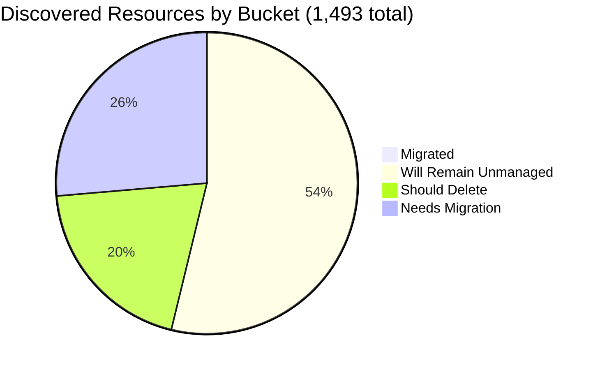

# Pulumi Migration Report — `pequod`

> **Generated:** November 20, 2026 (week of Nov 16)
> **Source:** Pulumi Insights (4 scanned account groups, 12 Insights account records) + Pulumi Cloud API
> **Scope:** Every resource discovered in enrolled Insights accounts (full paginated scan, exact counts, no sampling).
> **Action taken:** None. This report only observes and recommends.

---

## 1. Executive Summary

**Org-wide migration (Insights-discovered resources)**

```
░░░░░░░░░░░░░░░░░░░░ 0.4%   (6 of 1,493 discovered resources are Pulumi-managed)
░░░░░░░░░░░░░░░░░░░░ 0.9%   (6 of 693 in the migratable base)
```

`pequod` is the Pulumi CE shared demo and workshop org. The Pulumi footprint is real but lives mostly outside the cloud accounts Insights scans: **59 stacks, 34 projects, 521 IaC resources**. Only 138 of those 521 are cloud-provider resources. The rest are Pulumi, Delivery, command, GitHub and random resources.

| Bucket | Count | % of discovered | % of migratable base |
|---|--:|--:|--:|
| Migrated (Pulumi stack) | 6 | 0.4% | 0.9% |
| Will remain unmanaged | 800 | 53.6% | n/a |
| Should be deleted (review) | 295 | 19.8% | 42.6% |
| Needs migration | 392 | 26.3% | 56.6% |
| **Total discovered** | **1,493** | 100% | n/a |

*Migratable base = 1,493 - 800 = 693. Buckets sum to account totals and accounts sum to 1,493.*

**Biggest takeaway:** Cleanup comes before migration. 295 resources (43% of the migratable base) look like scratch or test leftovers. 166 of them are Azure resource groups, mostly auto-named. Setting them aside, the real migration queue is **392 resources**. 76 of those are already managed by CloudFormation (33) or ARM (43), which makes them the lowest-risk conversions.

**Data-quality caveats**
- Both AWS Insights accounts (`aws-neo-eu-west-2-420942475186` and `aws-pulumi-ce-workshops-420942475186`) scan the **same AWS account (420942475186)**. 109 `global` resources are double-counted. De-duplicated: 1,384 total, 6 migrated (0.4%, 0.9% of the 665 migratable resources), 719 unmanaged, 290 delete, 369 needs migration.
- The workshops AWS account has scheduled scans disabled. Its data is 87 to 113 days old.
- `team-ce` (Azure, owner Piers Karsenbarg) has never been scanned, so no data.
- 98% of the resources needing migration (386 of 392) have no ownership tag, so ownership is inferred (see section 6).

**Change since last report (Jun 29, 2026):** The org's Insights footprint was reshaped. The old `aws-pulumi-ce-052848974346` account (4,651 resources) is no longer enrolled, so totals fell from 5,946 to 1,493 and are not comparable one to one. Migrated resources went from 53 to 6 as a result. Stack count rose to 59 (21 in June).

---

## 2. Migration Progress

### Org-wide four-bucket split (% of 1,493 discovered)

| Bucket | Bar | % |
|---|---|--:|
| Migrated | `░░░░░░░░░░░░░░░░░░░░` | 0.4% |
| Will remain unmanaged | `███████████░░░░░░░░░` | 53.6% |
| Should delete | `████░░░░░░░░░░░░░░░░` | 19.8% |
| Needs migration | `█████░░░░░░░░░░░░░░░` | 26.3% |



### % migrated by account (of the account's discovered resources)

| Account | Bar | Migrated / Total |
|---|---|--:|
| aws-neo-eu-west-2-420942475186 | `░░░░░░░░░░░░░░░░░░░░` | 0 / 181 (0.0%) |
| aws-pulumi-ce-workshops-420942475186 | `░░░░░░░░░░░░░░░░░░░░` | 0 / 334 (0.0%) |
| azure-team-ce-subscription | `░░░░░░░░░░░░░░░░░░░░` | 3 / 356 (0.8%) |
| google-pulum-ce-team-438338752289 | `░░░░░░░░░░░░░░░░░░░░` | 3 / 622 (0.5%) |

*Every account is under 1%. Only the Azure AKS cluster and the GCP `pequod-gcp-access` identity are managed.*

### % migrated by responsible team (migrated / (migrated + needs migration))

| Team | Needs migration | Migrated | Bar |
|---|--:|--:|---|
| Mitch Gerdisch (account-owner fallback, self-hosted) | 165 | 0 | `░░░░░░░░░░░░░░░░░░░░` 0% |
| Individual CE members (OIDC / demo sets) | 68 | 0 | `░░░░░░░░░░░░░░░░░░░░` 0% |
| CE Platform and Workshops | 54 | 6 | `██░░░░░░░░░░░░░░░░░░` 10% |
| Azure platform demos | 39 | 0 | `░░░░░░░░░░░░░░░░░░░░` 0% |
| Menfin demos | 36 | 0 | `░░░░░░░░░░░░░░░░░░░░` 0% |
| Databricks data-platform demo | 24 | 0 | `░░░░░░░░░░░░░░░░░░░░` 0% |
| Robert Smith (account-owner fallback) | 6 | 0 | `░░░░░░░░░░░░░░░░░░░░` 0% |
| **Total** | **392** | **6** | |

*Only CE Platform has migrated anything: the `shared-dev-aks` AKS cluster (Azure) and the `pequod-gcp-access` identity (GCP). Both were attributed to CE Platform by name.*

---

## 3. Momentum

**Pulumi footprint (pequod org):** 59 stacks, 34 projects, 521 IaC resources. 51 stacks have been deployed and 8 never have (6 `pequod-delivery-targets` stacks, `aicr-chatbot-demo`, `aws-eks-h100-inference`).

*New stacks per month, from each stack's first update, for the last 12 months. Bars are scaled to the busiest month (Nov 2026).*

```
Dec 2025 ░░░░░░░░░░░░░░░░░░░░  0
Jan 2026 ░░░░░░░░░░░░░░░░░░░░  0
Feb 2026 ░░░░░░░░░░░░░░░░░░░░  0
Mar 2026 ░░░░░░░░░░░░░░░░░░░░  0
Apr 2026 ░░░░░░░░░░░░░░░░░░░░  0
May 2026 ░░░░░░░░░░░░░░░░░░░░  0
Jun 2026 ░░░░░░░░░░░░░░░░░░░░  0
Jul 2026 ░░░░░░░░░░░░░░░░░░░░  0
Aug 2026 ░░░░░░░░░░░░░░░░░░░░  0
Sep 2026 █░░░░░░░░░░░░░░░░░░░  2
Oct 2026 █░░░░░░░░░░░░░░░░░░░  1
Nov 2026 ████████████████████ 39   <- busiest month on record
```

- **This week:** 34 new stacks in the last 7 days. 39 in the last 30 days.
- **Footprint built in the last 12 months:** 42 of 51 deployed stacks (82%) and 321 of 521 resources (62%).
- **Accelerating:** Delivery and demo pipelines (`pequod-delivery-targets`, `mrg*-delivery-*`, `dogfood-shop-*`, `software-factory-*`, `aicr-*`, `reinvent-tasks`, `piers-delivery-*`). Almost all of November's growth is here.
- **Stalled (no update in 90+ days):** `azure-oidc-env-config/prod` (since 2025-05-01), `gcp-oidc-env-config/prod` (2025-05-01), `insights-azure-creds/prod` (2025-02-05), `rhum-monitor/prod` (2026-07-08). All four are tagged to the `pequod-platform` repo (credential, OIDC and monitoring stacks). 47 of 51 deployed stacks were updated in the last 90 days.
- **Caveat:** These counts cover only stacks that still exist. Org policy puts 24-hour TTLs on new stacks, so short-lived stacks do not appear in the history.

---

## 4. Coverage by Enrolled Account

> Insights coverage reflects only enrolled accounts. Of the 521 stack-managed resources, only 6 are visible as Pulumi-managed in Insights. The remaining 515 are mostly Pulumi, Delivery, GitHub and command resources, or live in accounts that are not enrolled.

| Account (scanned children) | Cloud | Pulumi-managed | Discovered | Coverage | Last scan | Scheduled scans |
|---|---|--:|--:|---|---|---|
| aws-neo-eu-west-2-420942475186 (eu-west-2, global) | AWS | 0 | 181 | `░░░░░░░░░░░░░░░░░░░░` 0.0% | 2026-11-19 | on |
| aws-pulumi-ce-workshops-420942475186 (global, us-east-1/2, us-west-1/2) | AWS | 0 | 334 | `░░░░░░░░░░░░░░░░░░░░` 0.0% | 2026-07-30 to 2026-08-25 (stale) | **off** |
| azure-team-ce-subscription | Azure | 3 | 356 | `░░░░░░░░░░░░░░░░░░░░` 0.8% | 2026-11-19 | on |
| google-pulum-ce-team-438338752289 | GCP | 3 | 622 | `░░░░░░░░░░░░░░░░░░░░` 0.5% | 2026-11-19 | on |
| team-ce | Azure | n/a | no scan data | n/a | never | off |
| **Total** | | **6** | **1,493** | `░░░░░░░░░░░░░░░░░░░░` 0.4% | | |

*Enrollment dates are not exposed by the Insights API.*

- **Stale scan:** the workshops AWS account was last scanned 87 to 113 days ago. Re-scan before acting on its data.
- **Duplicate scan:** the two AWS accounts cover the same AWS account ID. Consider consolidating them.
- **Visibility gain:** enrolling the accounts behind `shared-dev-eks` and `pequod-user-mgmt` (the two biggest IaC stacks) would show the platform team's real coverage. Scanning `team-ce` would show Piers Karsenbarg's Azure estate.

---

## 5. Data Analysis

| Account | Cloud | Total | Migrated | Will remain unmanaged | Should delete | Needs migration | % migrated (all) | % migrated (migratable) |
|---|---|--:|--:|--:|--:|--:|--:|--:|
| aws-neo-eu-west-2-420942475186 | AWS | 181 | 0 | 147 | 5 | 29 | 0.0% | 0.0% |
| aws-pulumi-ce-workshops-420942475186 | AWS | 334 | 0 | 228 | 32 | 74 | 0.0% | 0.0% |
| azure-team-ce-subscription | Azure | 356 | 3 | 85 | 166 | 102 | 0.8% | 1.1% |
| google-pulum-ce-team-438338752289 | GCP | 622 | 3 | 340 | 92 | 187 | 0.5% | 1.1% |
| **Org total** | | **1,493** | **6** | **800** | **295** | **392** | **0.4%** | **0.9%** |

**Classification rules used**
- *Will remain unmanaged:* AWS service-linked roles, CloudFront AWS-managed policies, IoT system domain configs, default VPC scaffolding, service-created ENIs, Identity Center and Organizations roles, CDK bootstrap, service defaults (EventBus, Athena, MemoryDB, ElastiCache, X-Ray, KMS, RDS), and the account-cleanup stack owned by `pulumi/aws-account-cleanup`. On Azure: NetworkWatchers, `DefaultResourceGroup-*`, `MC_*` AKS node RGs, Cloud Shell storage, Databricks and App Insights managed RGs. On GCP: project service APIs, default and auto-mode subnetworks, default network and firewalls, GCF, App Engine, Cloud Build, Composer and Dataproc buckets, default service accounts, `_Default` and `_Required` logging.
- *Should delete:* auto-named or test-named resources with no owner tag. Resource groups that contain ARM- or CloudFormation-managed resources are **not** marked for deletion.
- *Needs migration:* everything else. This includes all 76 CloudFormation- or ARM-managed resources.
- *Judgment calls to validate:* the Databricks managed RGs (`rg-dbw-managed-*`) are treated as platform-managed. The `lambda-for-account-cleanup` resources are treated as externally managed. GCP Composer and Dataproc buckets look like leftovers, but they are Google-managed.

**Notable specifics**
- **Azure holds 56% of deletion candidates (166 of 295).** 96 are generic auto-named resource groups, and some contain running VMs. Check cost before deleting.
- **AWS cleanup is small (37).** The big AWS item is the CDK `PostgresLambdaStack` (VPC, NAT, Aurora, 5 Lambdas, 33 CloudFormation-managed resources), which is a good CloudFormation-to-Pulumi candidate.
- **GCP is 55% platform scaffolding (340 of 622).** About three quarters of that is default or auto-mode subnetworks (128) and Google-managed buckets (129).

---

## 6. Actions Needed

### Ownership method

Signals, in order: (1) resource tags, (2) name-prefix mapping, (3) Insights account owner as fallback. GitHub code search was not run for this report.

| Signal used | Resources | Share |
|---|--:|--:|
| Tag (`Owner`, `Resource Owner`) | 6 | 1.5% |
| Name prefix | 244 | 62.2% |
| Account-owner fallback | 142 | 36.2% |

**Name-prefix mapping (please validate):** `pulumi-esc-*`, `pulumi-oidc-bbdf*`, `insights-account-scan`, `ContinuousDeliveryAdminRole`, `team-ce-*` map to CE Platform. `workshop*`, `AdminWorkshop`, `ESCWksp`, `MCOrient` and `VNOrient` map to Workshops. `mitch*` and `mitchselfhosted*` map to Mitch Gerdisch. `menfin-*` and `m-<tier>-diy-*` map to Menfin demos. `rg-dbw-*` and `*-dbw-*` map to Databricks. `pk-*` maps to PK. `aureq-*` and `zendesk-*` map to Aureq. `piers-*`, `wladi*`, `megan`, `mtan`, `shaht`, `stooj`, `initech`, `zbuchheit`, `elisabeth` and `codefresh` map to the named individual. Pulumi Teams in the org (`DevTeam`, `PlatformTeam`, and others) are access groups with no resource ownership, so they were not used.

### Migration queue by team

**Mitch Gerdisch: 165** (136 fallback, 29 `mitch*`)

| Item | Why |
|---|---|
| `PostgresLambdaStack` CDK app (us-east-1): VPC, NAT, Aurora cluster, 5 Lambdas, secret (33 CloudFormation-managed) | Live CDK stack. Best CloudFormation-to-Pulumi candidate. |
| Self-hosted Pulumi on GCP: `mitchselfhosted-mitchsh-network`, SA, KMS keyring, `-checkpoints`, `-esc` and `-policypacks` buckets, `mitch-selfhosted` and `mitch-selfmanaged` buckets | Names indicate Pulumi checkpoints, ESC and policy-pack storage for a self-hosted install. |
| GCP load-balancer demo estate: 11 backend services, 5 NEGs, 3 URL maps, 2 proxies, 2 forwarding rules | Large and uniform, so quick to import in bulk. |
| GCP custom VPCs: `main-vpc`, `core-network`, `gke-network`, `my-demo-network`, plus routers and NATs | Base networking. |
| Azure ARM-managed: `uptime-rg` App Insights, `meggy` workspace, `sqlTest-dev` SQL, `jamesneotest433` | Already template-managed, so these are ARM-to-Pulumi conversions. |

**Individual CE members: 68**

| Item | Why |
|---|---|
| `aureq-pulumi-diy-state-storage` bucket and the `zendesk-domestic` VPC, VM and firewalls (Aureq) | DIY Pulumi state storage. |
| `pk-gitlab` Workload Identity pool and SA, `pk-demo-keyvault`, `pk-vm-win-box` (PK) | Active demos. |
| `dwcore_dev_dataset_1` BigQuery dataset and `dwcore-dev-bucket-1` (data-warehouse demo) | Data assets. |
| Workload Identity pool, provider and SA sets for Wladi, Megan, M. Tan, Shaht, Stooj, Initech (4 each) | OIDC access. Import each set as a unit. |
| `zbuchheit-oidc` role in both AWS Insights accounts (Z. Buchheit) | ESC OIDC role. |

**CE Platform and Workshops: 54**

| Item | Why |
|---|---|
| `pulumi-esc-ediri`, `pulumi-esc-oidc-paul-umi-AdministratorAccess-role`, `ContinuousDeliveryAdminRole`, `insights-account-scan` (AWS) | Admin-level OIDC roles that ESC and Insights depend on. |
| `workshop-instructor-role`, `AdminWorkshop`, `ESCWksp`, `MCOrient`, `VNOrient` (AWS) | Workshop provisioning roles. |
| GCP `pulumi-cloud` Workload Identity pool, `demo` and `pulumi-bbdf1c46` providers, 4 service accounts | Core OIDC for the CE team. |
| `pulumi-team-ce-tf-state` bucket (GCP) | Terraform state. |
| `rg-esc-demo` and `kv-esc-demo-in` (Azure, tagged `owner=cloud-platform`) | ESC demo. |

**Azure platform demos: 39**

| Item | Why |
|---|---|
| `rg-shared-services-dev`: `kv-demo-plat-dev`, `log-demo-platform-dev`, `id-demo-platform-dev` (ARM) | Shared services. |
| `rg-hub-network-dev`: `vnet-hub-dev` | Hub network. |
| `rg-sentinel-pulumi-test`: Sentinel workspace, DCR and DCE (ARM) | Active monitoring. Name says "test" but contents are ARM-managed. |
| `podinfo-webapp-rg`: Cosmos DB, web app, plan, App Insights (ARM) | Running app. |
| `beacon-platform-v1c098aee5` ACR (tag `Resource Owner=Beacon Team`) | Only tag-attributed owner in Azure. |

**Menfin demos: 36**. Four tiers (demo, enterprise, essentials, pro). Each has a `m-<tier>-diy-state-storage-bucket`, a Workload Identity pool and provider, and a service account. Import as four identical sets.

**Databricks data-platform demo: 24**. Five RGs, 5 VNets, 10 NSGs and 4 Databricks workspaces: `dbw-my-team-1-dev`, `dbw-team-alpha-dev`, `dbw-my-team-wladi-dev`, `dbw-my-team-beta-dev`. They are tagged `managed-by: pulumi`, but none of the org's 34 projects looks like a Databricks program. Check for a Pulumi program elsewhere before importing.

**Robert Smith: 6**. `workshops.pulumi-ce.team` Route53 zone with NS and SOA records (live workshop DNS), 2 account budgets, `api.pulumi.com/oidc` provider.

### Deletion candidates (recommend human review before deleting)

| Pattern | Count | Reason |
|---|--:|---|
| Auto-named Azure RGs (`resource_group*`, `resourceGroup*`, `resource-group*`) and their contents | 96 | Random-suffix demo leftovers. Some hold running VMs. |
| GCP test and scratch buckets (`my-bucket-*`, `*-test*`, `*repro*`, `*tutorial*`) with ACLs and IAM | 41 | Generic or test names. |
| Azure hub/spoke and webapp demo RGs with random suffix | 36 | Hex-suffix names, no owner tag. |
| Azure explicit test RGs (`*test*`, `example-rg`, `piers-resourcegroup-*`, `elisabeth*`) | 24 | Test names. Excludes RGs with ARM-managed contents. |
| GCP placeholder secrets (`dev-secret-*`, `prod-secret-*`, `my-app-secret`) | 18 | Placeholder names. |
| AWS test artifacts (`mitch-assumerole-test*`, `zbuchheit-bucket-*`, key pair) | 13 | Explicit test names. |
| AWS auto-named placeholder buckets (`my-bucket-*`, `app-bucket-*`) | 12 | Tagged `workshop=aicamp` or generic. |
| GCP scratch DNS zone `geoff` and records | 12 | Aptos test records. |
| GCP placeholder service accounts (`my-account`, `service-account-id-2`, `*-test-sa`, `demos-weekly-test`, `vm-identity`) | 10 | Placeholder names. |
| AWS orphaned web-app Lambda stack (`lambdaRole-*`, `webAppLambda-*`, API Gateway `sbcdzzbuv4`) | 10 | Auto-named demo remnant. |
| Other (GCP generic VMs 6, Azure `6680-*` 4, Azure empty RGs 3, GCP test KMS 3, Azure `rg-oriented-chamois` 3, AWS demo RDS 2, GCP repro URL map 1, GCP HMAC key 1) | 23 | Scratch resources. |

*Total 295. 290 after de-duplicating the AWS double scan.*

### Unattributed (needs a human to assign an owner)

| Resource | Account | Why unresolved |
|---|---|---|
| Firestore database `constructconnect-db3` | GCP | No tag or owner-style name. |
| Pub/Sub `identity-change-detection` and `user` topics and subscriptions (tagged `vanta-*`) | GCP | Compliance-related. Owner unknown. |
| `YTE_API_KEY` secret and `gcp-oidc-vasu` service account | GCP | Individual owners unclear (`yte`, `vasu`). |
| `yteappmgmt` API Management and `ytestorageacct123` | Azure | Prefix `yte` not mapped to a person. |
| `PostgresLambdaStack` and 2 `420942475186-budget-*` budgets | AWS | No owner tag. Assigned to the account owner by fallback. |

---

*All counts come from a full paginated scan of the org's resource index (2,014 records: 1,493 discovered and 521 stack-managed). Classification of "will remain unmanaged" is rule-based. "Should delete" and ownership are heuristic and need human review. Nothing was deleted, modified or migrated.*
