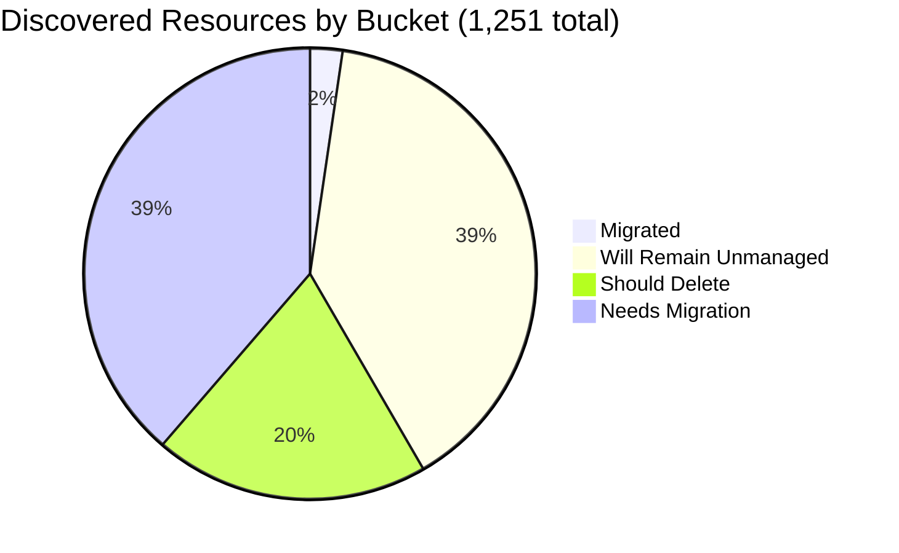

# Pulumi Migration Report — `pequod`

> **Generated:** November 27, 2026  
> **Source:** Pulumi Insights (5 registered accounts, 3 scannable cloud accounts) + Pulumi Cloud API  
> **Scope:** Every resource indexed from Insights scans — full paginated enumeration, exact counts, no sampling.  
> **Action taken:** None. This report only observes and recommends.

---

## 1. Executive Summary

**Org-wide migration:** 29 of 1,251 discovered resources are under Pulumi management.

```
% of all resources       ░░░░░░░░░░░░░░░░░░░░ 2.3%
% of migratable base     █░░░░░░░░░░░░░░░░░░░ 3.8%
```

`pequod` is the Pulumi Customer Engineering demo estate. Insights sees **1,251 unique resources** across one AWS account, one Azure subscription and one GCP project; **29** are in a Pulumi stack. The Pulumi footprint itself has grown sharply (**81 stacks, 46 projects**), but most of it deploys to places Insights does not scan (Kubernetes, un-enrolled accounts, or resources created this month).

| Bucket | Count | % of discovered | % of migratable base |
|---|---:|---:|---:|
| Migrated (in a Pulumi stack) | 29 | 2.3% | 3.8% |
| Will remain unmanaged | 492 | 39.3% | — |
| Should be deleted (review) | 246 | 19.7% | 32.4% |
| Needs migration | 484 | 38.7% | 63.8% |
| **Total discovered** | **1,251** | 100% | — |

*Migratable base = 1,251 − 492 = 759. Buckets sum to account totals; account totals sum to 1,251.*

**Biggest takeaway:** 246 resources (almost all Azure demo resource groups and GCP test buckets) are deletion candidates, nearly as many as the 484 that need migration. Reviewing them first shrinks the migration backlog by about a third.

**Change since the last report (June 29, 2026):** The main AWS CE account `aws-pulumi-ce-052848974346` (4,651 resources then) is **no longer registered in Insights**, so the discovered total dropped from 5,946 to 1,251. Figures are not like-for-like. Migrated resources fell from 53 to 29 for the same reason.

**Data-quality caveats:** (1) Two Insights registrations point at the same AWS account `420942475186`; they are de-duplicated here (327 raw index records → 225 unique). (2) The `aws-pulumi-ce-workshops` registration was last scanned 94–120 days ago and is not scheduled; the scheduled `aws-neo-eu-west-2` registration only covers `eu-west-2` and `global`, so `us-east-1/2` and `us-west-1/2` data is stale. (3) Insights account `team-ce` has never been scanned. (4) There are no Pulumi Teams for resource ownership; ownership is attributed by tag and naming convention (see §6).

---

## 2. Migration Progress

### Org-wide four-bucket split (1,251 resources)

| Bucket | Bar | % |
|---|---|---:|
| Migrated | `░░░░░░░░░░░░░░░░░░░░` | 2.3% |
| Will remain unmanaged | `████████░░░░░░░░░░░░` | 39.3% |
| Should be deleted | `████░░░░░░░░░░░░░░░░` | 19.7% |
| Needs migration | `████████░░░░░░░░░░░░` | 38.7% |



### % migrated by account

| Account | Bar | Migrated / Total |
|---|---|---:|
| AWS `420942475186` | `░░░░░░░░░░░░░░░░░░░░` | 0 / 225 — 0.0% |
| Azure `team-ce-subscription` | `░░░░░░░░░░░░░░░░░░░░` | 3 / 358 — 0.8% |
| GCP `pulumi-ce-team` | `█░░░░░░░░░░░░░░░░░░░` | 26 / 668 — 3.9% |

*GCP is the only account with meaningful IaC coverage, driven by the `todo-*` and `pie-pantry` demo stacks.*

### % migrated by responsible team (migrated ÷ (migrated + needs migration))

| Team | Bar | Migrated | Needs migration |
|---|---|---:|---:|
| Platform / ESC (stack-owned) | `███████████████░░░░░` 75% | 6 | 2 |
| Demo apps (todo / build-a-pie) | `██████████░░░░░░░░░░` 50% | 23 | 23 |
| Mitch Gerdisch | `░░░░░░░░░░░░░░░░░░░░` 0% | 0 | 322 |
| Individual CEs (wladi, aureq, menfin, …) | `░░░░░░░░░░░░░░░░░░░░` 0% | 0 | 72 |
| Databricks demo teams (tagged) | `░░░░░░░░░░░░░░░░░░░░` 0% | 0 | 24 |
| Robert Smith (AWS account owner) | `░░░░░░░░░░░░░░░░░░░░` 0% | 0 | 23 |
| Piers Karsenbarg | `░░░░░░░░░░░░░░░░░░░░` 0% | 0 | 16 |
| Zack Buchheit | `░░░░░░░░░░░░░░░░░░░░` 0% | 0 | 2 |

*Teams that deploy through Pulumi pipelines are migrated; hand-built networking, state buckets and identity resources are not.*

---

## 3. Momentum

**Active Pulumi footprint:** **81 stacks** · **46 projects** · **67 stacks with resources** · **625 unique managed resources indexed** (797 per the stack API, which also counts provider and stack resources).

*New stacks per month, using the date the stack was first indexed as a proxy for creation (the API does not expose a creation date). 54 of 81 stacks have an indexed Stack resource; 27 are empty or unindexed and are not dated. Bars scale to the busiest month; non-zero months show at least one block.*

```
Dec 2025 ░░░░░░░░░░░░░░░░░░░░  0
Jan 2026 ░░░░░░░░░░░░░░░░░░░░  0
Feb 2026 ░░░░░░░░░░░░░░░░░░░░  0
Mar 2026 ░░░░░░░░░░░░░░░░░░░░  0
Apr 2026 ░░░░░░░░░░░░░░░░░░░░  0
May 2026 ░░░░░░░░░░░░░░░░░░░░  0
Jun 2026 ░░░░░░░░░░░░░░░░░░░░  0
Jul 2026 ░░░░░░░░░░░░░░░░░░░░  0
Aug 2026 ░░░░░░░░░░░░░░░░░░░░  0
Sep 2026 █░░░░░░░░░░░░░░░░░░░  1
Oct 2026 █░░░░░░░░░░░░░░░░░░░  3
Nov 2026 ████████████████████ 44  ← busiest month on record
```

- **Share of footprint built in the last 12 months:** 89% of dated stacks (48 of 54) and 91% of managed resources (567 of 625).
- **Last 30 days:** 62 stacks updated; **last 90 days:** 65 of 69 stacks that have ever been updated.
- **Caveat:** the November spike reflects first-indexed dates. Some of it may be re-creation of existing demo stacks rather than brand-new work.
- **Accelerating (new stacks in the last 90 days):** the `cs-*` projects (fleet, gated, layered), `todo-*`, `pie-*`, `dogfood-shop-*`, `k8s-hybrid-*`, `aicr-*`, `ag-*`.
- **Stalled (no update in 90+ days):** `azure-oidc-env-config`, `gcp-oidc-env-config`, `insights-azure-creds`, `rhum-monitor`. Another 12 stacks (mostly `cs-fleet-tenant` ×5, `cs-gated-app` ×2, `cs-gated-infra` ×2) have never completed an update.

**Largest projects by indexed resources:** `pequod-user-mgmt` 79 · `reinvent-tasks` 62 · `shared-dev-eks` 62 · `cs-fleet-tenant` 32 · `todo-bootstrap` 25.

---

## 4. Coverage by Enrolled Account

> **Important:** Insights coverage reflects only enrolled accounts. 596 of the 625 indexed Pulumi-managed resources (95%) have no matching Insights-scanned counterpart, because they run in un-scanned accounts or are non-cloud types.

| Insights account | Cloud | Pulumi-managed | Discovered | Coverage | Last scan | Scheduled |
|---|---|---:|---:|---|---|---|
| `aws-neo-eu-west-2-420942475186` (`eu-west-2`, `global`) | AWS | 0 | 225 (shared*) | `░░░░░░░░░░░░░░░░░░░░` 0% | Nov 26, 2026 | Yes |
| `aws-pulumi-ce-workshops-420942475186` (`global`, `us-east-1/2`, `us-west-1/2`) | AWS | 0 | (shared*) | `░░░░░░░░░░░░░░░░░░░░` 0% | **Jul 30 – Aug 25, 2026** (94–120 days) | No |
| `azure-team-ce-subscription` | Azure | 3 | 358 | `░░░░░░░░░░░░░░░░░░░░` 0.8% | Nov 26, 2026 | Yes |
| `google-pulum-ce-team-438338752289` | GCP | 26 | 668 | `█░░░░░░░░░░░░░░░░░░░` 3.9% | Nov 26, 2026 | Yes |
| `team-ce` (Azure, owner Piers Karsenbarg) | Azure | — | not scanned | n/a | **Never** | No |
| **Org total** | — | **29** | **1,251** | `░░░░░░░░░░░░░░░░░░░░` 2.3% | — | — |

*\*Both AWS registrations scan the same account (`420942475186`); 225 is the de-duplicated total.*  
*Enrollment dates are not exposed by the API.*

**Visibility gain from fixing enrollment:** re-enabling scheduled scans on the workshops registration (or adding `us-*` regions to the `neo` registration) would refresh Mitch Gerdisch's AWS view. Completing `team-ce` would give Piers Karsenbarg's Azure resources visibility.

---

## 5. Data Analysis

| Account | Cloud | Total | Migrated | Will remain unmanaged | Should delete | Needs migration | % Mig (all) | % Mig (migratable) |
|---|---|---:|---:|---:|---:|---:|---:|---:|
| `420942475186` | AWS | 225 | 0 | 174 | 13 | 38 | 0.0% | 0.0% |
| `team-ce-subscription` | Azure | 358 | 3 | 84 | 162 | 109 | 0.8% | 1.1% |
| `pulumi-ce-team` | GCP | 668 | 26 | 234 | 71 | 337 | 3.9% | 6.0% |
| **Org total** | — | **1,251** | **29** | **492** | **246** | **484** | **2.3%** | **3.8%** |

**"Will remain unmanaged" patterns (counts):**

- **AWS 174:** default VPC scaffolding 46 · Service Linked Roles and their attachments 44 · CloudFront AWS-managed policies 28 · CDK bootstrap roles 11 · default EventBus/rules 7 · MemoryDB/ElastiCache defaults 7 · X-Ray defaults 7 · IoT domain configs 6 · other 18.
- **GCP 234:** GCF / App Engine / Composer / Metastore auto-created buckets with their ACLs and IAM 122 · project service APIs 49 · default-network subnetworks 43 · default and GKE `k8s-*` firewalls 9 · default service accounts 10 · default network 1.
- **Azure 84:** AKS node RGs `MC_*` 24 · Databricks managed RGs 24 · NetworkWatchers 16 · `DefaultResourceGroup-*` 11 · Cloud Shell storage 5 · App Insights managed RGs 4.

**Noteworthy:**

- **Azure is 45% deletion candidates** (162 of 358), almost entirely Pulumi quickstart leftovers with auto-generated names. 109 Azure resources need migration, and 43 of those are already managed by ARM/Bicep. Those 43 are treated as migration candidates and excluded from the deletion heuristics.
- **Two resources in the AWS account carry a `pulumi:stack-id` tag** (`pulumi/AWS_Account_Cleanup-IAMRoles/pulumi-ce-workshops`), so they are managed by a stack in a different Pulumi org. They are counted as needing migration here, but likely need no action in `pequod`.
- **Low-confidence classifications:** CloudFront policies are matched by type only (IDs, no names, assumed `Managed-*`). Composer and Metastore buckets are assumed to be platform-created. The five Bedrock AgentCore roles and policies are assumed to be console-created. Confidence is HIGH for "will remain unmanaged" patterns and MEDIUM for "should delete" (naming heuristics).

---

## 6. Actions Needed

### Ownership signals and mapping used

Signals, in priority order: (1) resource tags `Owner`/`team` **→ 32 resources**; (2) name prefix **→ 275 resources**; (3) Insights account owner as fallback **→ 177 resources**. GitHub CODEOWNERS and repo search were not used. No formal Pulumi Teams map to cloud ownership (existing teams are Delivery pipeline service principals, `DevTeam`, `PlatformTeam`, etc.).

| Name prefix / tag | Team |
|---|---|
| `mitch*`, `mitchselfhosted*`, `workshop*`, `nelson*`, `my-demo-network`, `zendesk*`, `core-network*`, `geoff`/`aptos*`, `dwcore*`, Composer/Airflow | Mitch Gerdisch *(weak for zendesk, core-network, geoff/aptos, dwcore)* |
| `wladi*`, `aureq*`, `menfin*`, `m-{demo,ent,ess,pro}-diy-*`, `elisabeth*`, `megan*`, `vasu*`, `shaht*`, `stoo*`, `initech*` | Individual CEs *(`m-*-diy-*` assumed menfin; confirm)* |
| `piers*`, `pk-*` | Piers Karsenbarg |
| `zbuchheit*` | Zack Buchheit |
| `todo*`, `build-a-pie*`, `pie-*` | Demo apps |
| tag `my-team*`, `team-alpha` | Databricks demo teams |
| tag `cloud-platform`, ESC demo | Platform / ESC |
| AWS tags `workshops`, `pequod`, `pulumi`, `pulumi-build-engineering`, and the `neo` account fallback | Robert Smith (AWS account owner) |
| everything else | account owner: Mitch Gerdisch for Azure, GCP and AWS workshops |

### Migration queue by team (largest first)

**Mitch Gerdisch: 322 resources** (162 by name prefix, 160 by account-owner fallback)

| Priority | Resource(s) | Why |
|---|---|---|
| High | GCP networks `my-demo-network` and `mitchselfhosted-mitchsh-network-afa8380` plus 85 regional subnetworks | Custom networks used by compute and self-hosted workloads; the largest single block of the queue |
| High | GCS buckets `mitch-selfhosted`, `mitch-selfmanaged`, `mitchselfhosted-mitchsh-{policypacks,checkpoints,esc}-*` | Self-hosted Pulumi state, checkpoint and policy-pack storage |
| Medium | 11 global backend services (`echo-backend-*`, `httpbin-*`, `backend-alpha…delta-*`, …) + 5 regional NEGs | Active load-balanced demo services with no IaC |
| Medium | Cloud DNS zone `geoff` and its 11 record sets | DNS; owner assumed from the name |
| Medium | AWS Budgets (2) and KMS keys (4), workshops registration | Account hygiene; data is stale (see §4) |
| +~240 more | Azure shared services/hub networking RGs, remaining GCP IAM, ACLs and service accounts | Group by service domain and migrate networking first |

**Individual CEs: 72 resources**

| Priority | Resource(s) | Why |
|---|---|---|
| High | `aureq-pulumi-diy-state-storage`, `m-{demo,ent,ess,pro}-diy-state-storage-bucket` plus ACLs and IAM | DIY Pulumi state buckets; losing them breaks stacks |
| High | 9 workload identity pools + 9 providers (`menfin*`, `wladi*`, `vasu`, `shaht`, `megan`, …) | OIDC trust for ESC and CI; security-sensitive |
| Medium | 10 service accounts + 10 IAM policies for the OIDC pools above | Pair with the pools |
| Low | `initech-access` service account and pool | Demo org; confirm still needed |

**Databricks demo teams: 24 resources**: five `rg-dbw-*` workspaces (`my-team`, `my-team-1`, `my-team-beta`, `my-team-wladi`, `team-alpha`), each with a VNet and NSGs. Tagged, so ownership is certain.

**Robert Smith (AWS account owner): 23 resources**

| Priority | Resource(s) | Why |
|---|---|---|
| High | `workshop-instructor-role` (tag `Owner=workshops`) | Provisions workshop participant accounts |
| High | `insights-account-scan` role + 2 attachments | The role Insights itself uses to scan; holds AdministratorAccess and ReadOnlyAccess |
| High | ESC/OIDC roles `pulumi-esc-ediri`, `pulumi-esc-oidc-paul-umi-AdministratorAccess-role`, `ESCWksp`, `ContinuousDeliveryAdminRole` | Admin-level trust relationships that should be code-reviewed |
| Medium | `lambda-for-account-cleanup` + role/policy | Possibly managed in another Pulumi org (see §5); confirm before importing |
| Medium | `MCOrient`, `VNOrient` roles + inline policies | Workshop roles; owner unclear |

**Demo apps: 23 resources**: `todo-*` and `build-a-pie-*` GCP IAM policies, secret IAM, bucket IAM and Cloud SQL users and databases. These follow stacks that are already partly migrated (23 migrated, 23 remaining); they are the fastest wins.

**Piers Karsenbarg: 16 resources**: `pk-vm-win-box` RG and VNet, `pk-demo-keyvault-rg` and `pk-keyvault-rg7376eb58` key vaults, `piers-resourcegroup-12345`, GCP SAs `pk-gitlab-*` and `piers-service-account-insights`.

**Zack Buchheit: 2 resources**: AWS role `zbuchheit-oidc` plus its AdministratorAccess attachment.

**Platform / ESC: 2 resources**: `rg-esc-demo` and `kv-esc-demo-in`. This team already has 6 migrated resources, so it is nearly done.

### Deletion candidates (246 total)

*Recommend human review before deleting anything. Classification is by naming heuristic; nothing was checked for usage or attachment.*

| Pattern | Count | Account | Reason |
|---|---:|---|---|
| Generic demo RG names (`resourceGroup5fb3a110`, `resource-groupd94c5d17`, `resource_group0ac51bd5`, `rg-secondary-location5329fbff`, `mitch-rg-020625`) + children | 78 | Azure | Pulumi quickstart default names. The Azure deletion set includes 8 VMs and 8 disks, so confirm nothing is running. |
| Auto-named hex-suffix demo RGs (`onprem-vnet-rg2a52eb0f`, `hub-nva-rg70ff95a5`, `hub-vnet-rg867281c0`, `spoke1-vnet-rgc46a32c5`, `grafana-rg05f569ae`) + children | 55 | Azure | Hub-and-spoke and demo leftovers with auto-generated suffixes |
| Empty resource groups (`hypervimages`, `synapse`, `visualstudioonline-*`, `defaultproviderrgf20c9f13`) | 24 | Azure | No child resources |
| Test/scratch names (`pk-keyvault-test894d8e7d`, `VnetConfigTestGroup`, `VnetConfigTestEnvironment`, `testNetwork`, `pk-purged6e177722`) | 5 | Azure | Explicit test names |
| Test/placeholder GCS buckets + ACLs + IAM (`piers-test-bucket`, `phil-cosmic-test-oauth`, `my-bucket-*`, `nelsons-bucket-for-issue-repro-*`, `pulumi-tutorial-storage-bucket-megan`) | 41 | GCP | Generic or test names; 10 buckets plus 31 child ACLs and IAM policies |
| Placeholder Secret Manager secrets (`my-app-secret`, `dev-secret-1/2`, `prod-secret-1/2`) + versions and IAM | 18 | GCP | Tutorial placeholder names |
| Test service accounts (`service-account-id-2`, `my-account`, `aureq-test-sa`, `demos-weekly-test`, `pulumi-oidc-mtan-sa`) + IAM, and `kms-test` key rings (`boog-kms-test`, `mitch-kms-test`) | 12 | GCP | Test/placeholder names. Key rings cannot be deleted in GCP, so they only need cleanup of keys. |
| `mitch-assumerole-test` S3 bucket, role, policy and attachments | 6 | AWS | Explicit test/experiment name |
| `webAppLambda-51d3904`, `lambdaRole-482bdf2` + attachment, API Gateway `sbcdzzbuv4` | 4 | AWS (us-east-1) | Pulumi auto-named demo leftovers |
| `zbuchheit-bucket-bbb152b` + ownership controls + public access block | 3 | AWS (us-west-2) | Auto-named demo bucket |

### Unattributed (needs a human to assign an owner)

| Resource | Account | Why unresolved |
|---|---|---|
| 5 unnamed KMS keys (`14a12191-…`, `08ff3de6-…`, `be144c85-…`, `084607fb-…`, `f22041b5-…`) | AWS | No tags or aliases in scan data |
| `rg-sentinel-pulumi-test`, `rg-shared-services-dev`, `rg-hub-network-dev`, `podinfo-webapp-rg`, `rg-apim` (+ ~13 more RGs) | Azure | Active-looking shared infrastructure, no tag or prefix; ARM-managed in several cases |
| `constructconnect-db3`, `lb-urlmap-b6485d1`, `lb-urlmap-fa9b713`, `repro-urlmap-bdeb6f8`, `nat-router-fc0d684` | GCP | Load balancer and database resources with no owner signal |
| `pulumi-team-ce-tf-state`, `gcs-bucket-default-2a658d1-…`, `appengine-static-content-ac017ac` | GCP | Terraform state and default-style buckets; ownership and criticality unknown |
| `zendesk-domestic-vpc-0398fb1`, `core-network-network-731606a`, `geoff` DNS zone, `dwcore_dev_dataset_1` | GCP | Assigned to Mitch Gerdisch only by weak name matching (39 resources); confirm |

---

*Method: full enumeration through the Pulumi resource-search API (1,255 raw unmanaged records collapsed to 1,153 unique, plus 69 ARM-managed, plus 29 Insights-discovered resources already in stacks). Insights scan metadata shows more resources than are indexed for the workshops registration (334 reported vs 146 indexed); this report uses the indexed set, so counts there are lower bounds.*
