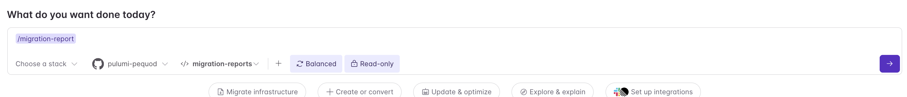

# migration-reports

Contains Migration Reports.

## To setup:

First copy the content of [Neo-Skill](./Neo-Skill.md) and go to Settings -> Neo Settings.

Scroll down and create a new slash command with:

Name: migration-report

Description: Generate an org-wide IaC migration report across all Pulumi Insights accounts — what's migrated, what still needs migrating, what stays unmanaged, and what should be deleted — with ownership attribution and roll-up metrics.

Instructions: the copied text. Edit to customize to your organization's standards for ownership and determining what should be deleted, migrated, or left alone.

## To use:

Go to Neo Tasks, and run the skill with the proper permissions, autonomy, and repo selected.

